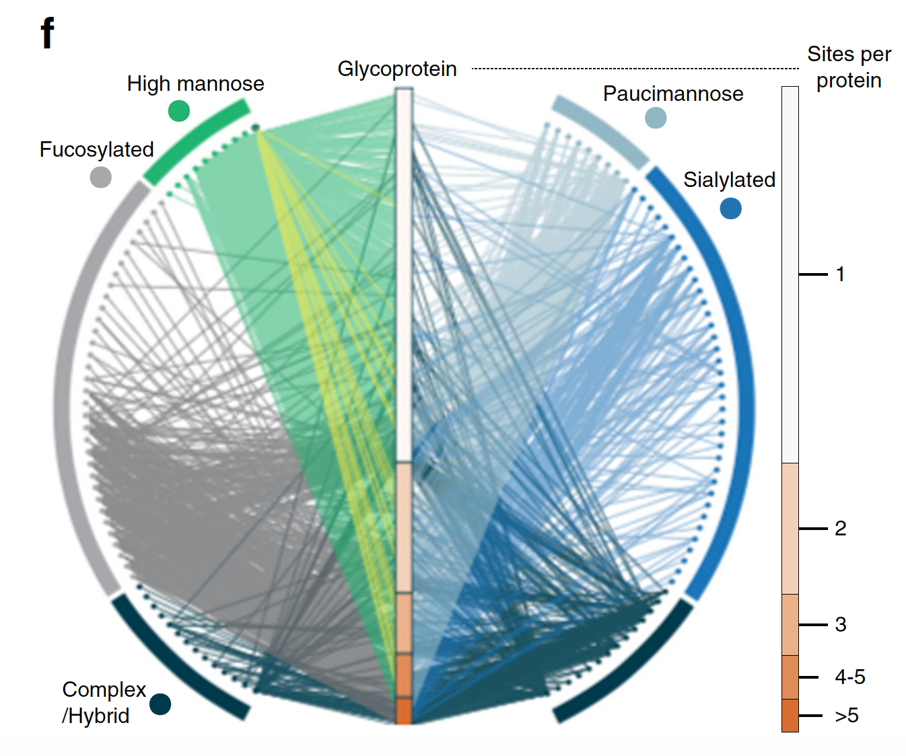

弧线图把两个层级的实体放到同心环上，用直线或曲线弦连接对应关系——参考文档复现的是 Nature Communications 的糖蛋白图：外环为**类别弧**（糖胺类别）、中环每个中间实体一个点（糖苷）、内环每个目标一个矩形（糖蛋白）、层级之间用按类别着色的连线 \[1\]。本仓库 lockfile 没有 `arcdiagram` 包；整套装版——按类别分组的角槽、径向连线排序、环半径——全部手工计算并用朴素 ggplot2 几何对象绘制，这也让版式可以随需求调整：

## 示例

{fig-alt="弧线图 DEMO" fig-align="center" width="70%"}

## 环境配置

-   系统要求：跨平台（Linux/MacOS/Windows）

-   编程语言：R

-   依赖包：`ggplot2`

```{r packages setup, message=FALSE, warning=FALSE, output=FALSE}
suppressPackageStartupMessages({
  library(ggplot2)
})
```

```{r}
sessioninfo::session_info("attached")
```

## 数据准备

三层对应表：6 个糖胺类别 → 60 个糖苷 → 约 35 个糖蛋白，每个糖蛋白携带 1-3 个糖苷。参考文档的输入是两张表（节点表 + 分组表）；模拟植入同样结构：

```{r load data}
set.seed(52352)
cats <- c("High-mannose", "Hybrid", "Complex tri-antennary",
          "Complex bi-antennary", "Sialylated", "Fucosylated")
n_mid <- 60
mid_cat <- factor(sample(cats, n_mid, TRUE, c(.18, .12, .2, .22, .16, .12)))
mids <- sprintf("G%02d", seq_len(n_mid))
tgts <- sprintf("P%02d", seq_len(40))
## 每个糖蛋白取 1-3 个糖苷（先到先得，糖苷会用尽）
edges <- data.frame()
used <- logical(n_mid)
for (t in seq_along(tgts)) {
  k <- sample(1:3, 1, TRUE, c(.4, .4, .2))
  cand <- which(!used)
  if (!length(cand)) break
  k <- min(k, length(cand))
  pick <- sample(cand, k)
  used[pick] <- TRUE
  edges <- rbind(edges, data.frame(mid = mids[pick], tgt = tgts[t]))
}
edges$cat <- mid_cat[match(edges$mid, mids)]
cat("glycosides:", n_mid, " glycoproteins with edges:", length(unique(edges$tgt)), "\n")
```

## 可视化

### 带类别弧的环形版式

三条版式规则造就参考图的可读性。(1) 中环的点**按类别分组**，每个类别占据一段连续角块——它的外弧就是这段弧的跨度。(2) 内环目标**按其糖苷的平均角度排序**，连线保持径向而不在圆心交叉。(3) 环半径区分编码：弧在 r = 1.02、点在 r = 1、矩形在 r = 0.6：

```{r}
#| label: fig-1.1ArcDiagram
#| fig-cap: "二部弧线图：外弧 = 跨越其成员的糖胺类别、中环点 = 糖苷、内环矩形 = 糖蛋白、连线按类别着色。目标按角度排序使连线呈径向。"
#| out.width: "85%"
#| fig-width: 9
#| fig-height: 6.2

n_used <- length(unique(edges$tgt))
## (1) 中环：按类别分组的角槽
o <- order(mid_cat)
pos_mid <- data.frame(mid = mids[o], cat = mid_cat[o],
                      th = seq(0, 2 * pi, length.out = n_mid + 1)[-(n_mid + 1)])
## (2) 目标环：按糖苷平均角排序后等距排布
tgt_mean <- tapply(pos_mid$th[match(edges$mid, pos_mid$mid)], edges$tgt, mean)
tgt_order <- names(sort(tgt_mean))
pos_tgt <- data.frame(tgt = tgt_order,
                      th = seq(0, 2 * pi, length.out = n_used + 1)[-(n_used + 1)])
## 外弧：每个类别角块的跨度（加 pad）
arcs <- do.call(rbind, lapply(cats, function(cc) {
  th <- pos_mid$th[pos_mid$cat == cc]
  if (!length(th)) return(NULL)
  pad <- 2 * pi / (n_mid + n_used) * 0.4
  data.frame(cat = cc, from = min(th) - pad, to = max(th) + pad)
}))
pal <- setNames(c("#E69F00", "#56B4E9", "#009E73", "#F0E442",
                  "#0072B2", "#CC79A7"), cats)

arc_df <- do.call(rbind, lapply(seq_len(nrow(arcs)), function(i) {
  th <- seq(arcs$from[i], arcs$to[i], length.out = 80)
  data.frame(x = 1.02 * cos(th), y = 1.02 * sin(th), grp = i, cat = arcs$cat[i])
}))
mid_xy <- data.frame(x = cos(pos_mid$th), y = sin(pos_mid$th),
                     mid = pos_mid$mid, cat = pos_mid$cat)
tgt_xy <- data.frame(x = 0.6 * cos(pos_tgt$th), y = 0.6 * sin(pos_tgt$th),
                     tgt = pos_tgt$tgt,
                     w = 2 * pi / n_used * 0.55)
tgt_xy$cat <- edges$cat[match(tgt_xy$tgt, edges$tgt)]
edges2 <- merge(edges, mid_xy[, c("mid", "x", "y")], by = "mid")
names(edges2)[names(edges2) %in% c("x", "y")] <- c("x_m", "y_m")
edges2 <- merge(edges2, tgt_xy[, c("tgt", "x", "y")], by = "tgt")
names(edges2)[names(edges2) %in% c("x", "y")] <- c("x_t", "y_t")

ggplot() +
  geom_path(data = arc_df, aes(x, y, group = grp, colour = cat),
            linewidth = 2.2, lineend = "round") +
  geom_point(data = mid_xy, aes(x, y, colour = cat), size = 1.6) +
  geom_tile(data = tgt_xy, aes(x, y, width = w * 0.62, height = 0.05, fill = cat),
            colour = "grey25", linewidth = 0.2) +
  geom_segment(data = edges2,
               aes(x = x_m, y = y_m, xend = x_t, yend = y_t, colour = cat),
               linewidth = 0.3, alpha = 0.6) +
  annotate("text", x = 1.2 * cos((arcs$from + arcs$to) / 2),
           y = 1.2 * sin((arcs$from + arcs$to) / 2),
           label = arcs$cat, size = 2.7) +
  scale_colour_manual(values = pal, name = NULL) +
  scale_fill_manual(values = pal, name = NULL) +
  coord_fixed(clip = "off") +
  xlim(-1.35, 1.35) + ylim(-1.35, 1.35) +
  theme_void(base_size = 10) +
  theme(legend.position = "right",
        legend.text = element_text(size = 8))
```

::: callout-tip
**实践要点**

-   两条排序规则就是整张图：中环按类别分组（弧变成连续块）、目标按平均角排序（连线保持径向）。破坏任何一条，图就退化成毛线球。
-   用**形状**而不只是位置区分层级：类别用弧、中间实体用点、目标用矩形——读者无需给 95 个实体逐一标注也能识别每个环。
-   `theme_void()` 连图例文字一并移除——要显式加回 `legend.text`，否则色块键没有名称。
-   参考文档的真实输入是节点表 + 分组表（`easy_input_node.txt`、`easy_input_group.txt`）；任何带共享类别列的二部对应都能套进同一版式——通路→基因→药物、模块→蛋白→复合体。
-   边数很多（>500）的多对多场景中直线段会饱和：先降低 alpha 或换 `geom_bezier` 类曲线，而不是加大线宽。
:::

## 应用场景

::: {#fig-ArcApplications1}
{fig-alt="弧线图" fig-align="center" width="70%"}

经糖苷把糖胺类别与糖蛋白相连的二部弧线图
:::

二部弧线图适用于一切"两个实体集合被共享分类桥接"的场景：糖胺类别→糖苷→糖蛋白、调控因子→靶基因→通路、药物→靶蛋白→疾病模块——外弧汇总分类，弦承载对应关系。

## 参考文献

\[1\] Xiaofan Lu, et al. FigureYa: A Standardized Visualization Framework for Enhancing Biomedical Data Interpretation and Research Efficiency. iMetaMed. 2025. doi:10.1002/imm3.70005. FigureYa 源码：[FigureYa145target](https://github.com/ying-ge/FigureYa/tree/main/FigureYa145target)。
