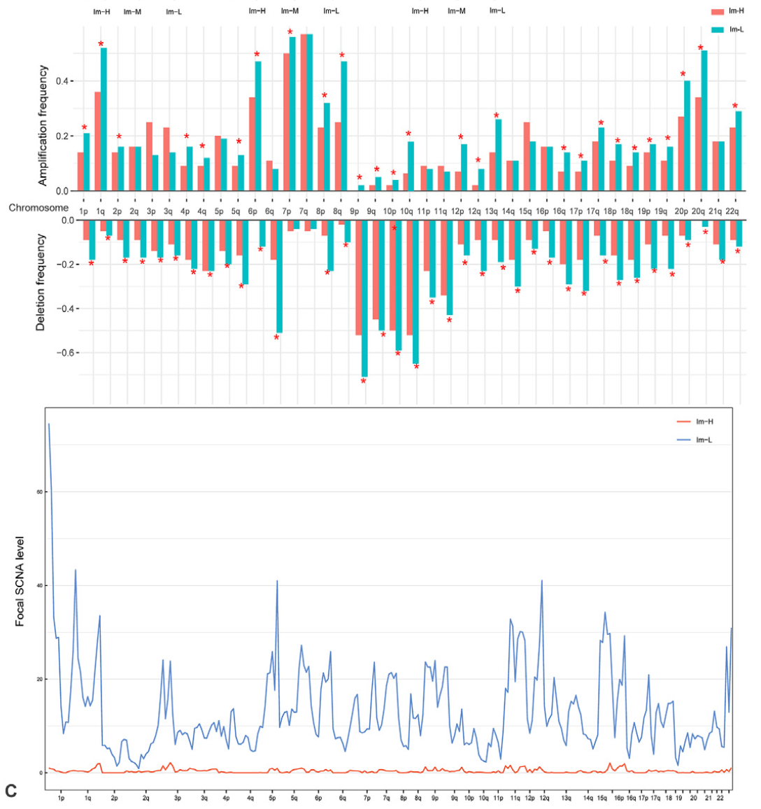

The reference compares two immune-score groups (Im-H vs Im-L melanomas) on copy-number burden: **arm-level amplification/deletion frequencies** (per chromosome arm, per group, Fisher-tested) and **focal-level amplification/deletion levels** (per-patient intensity scores, Wilcoxon-tested), drawn as paired bar panels plus boxplots \[1\]. Both summaries derive from GISTIC-style calls, simulated here at arm resolution; the grouped-ggplot rendering with in-bar group colours is the reference's:

## Example

{fig-alt="Arm-Level CNV Group Comparison DEMO" fig-align="center" width="80%"}

## Setup

-   System Requirements: Cross-platform (Linux/MacOS/Windows)

-   Programming language: R

-   Dependent packages: `ggplot2`; `patchwork`

```{r packages setup, message=FALSE, warning=FALSE, output=FALSE}
suppressPackageStartupMessages({
  library(ggplot2); library(patchwork)
})
```

```{r}
sessioninfo::session_info("attached")
```

## Data Preparation

24 chromosome arms × two groups of 60 patients each. Arm-level calls are simulated as per-patient arm states (amp/del/neutral) with planted excess amplification on 7q/8q/20q and excess deletion on 9p/13q in the Im-L group (high immune score melanomas carry fewer SCNAs, per the reference's logistic-model claim). Focal-level scores are per-patient totals with the same group direction:

```{r load data}
suppressPackageStartupMessages({library(ggplot2); library(patchwork)})
set.seed(43257)
arms <- c(paste0(1:22, "p"), paste0(1:22, "q"))
groups <- c("Im-H", "Im-L")
n_per <- 60
grp <- rep(groups, each = n_per)
hot_arms_amp <- c("7q", "8q", "20q"); hot_arms_del <- c("9p", "13q")
arm_states <- do.call(rbind, lapply(arms, function(a) {
  do.call(rbind, lapply(groups, function(g) {
    p_amp <- 0.12 + if (a %in% hot_arms_amp && g == "Im-L") 0.28 else 0
    p_del <- 0.10 + if (a %in% hot_arms_del && g == "Im-L") 0.25 else 0
    st <- sample(c("amp", "del", "neutral"), n_per, TRUE,
                 prob = c(p_amp, p_del, 1 - p_amp - p_del))
    data.frame(arm = a, group = g, state = st)
  }))
}))
arm_freq <- aggregate(state ~ arm + group, arm_states,
                      function(x) mean(x == "amp") * 100)
names(arm_freq)[3] <- "amp_pct"
arm_freq$del_pct <- as.vector(aggregate(state ~ arm + group, arm_states,
                                        function(x) mean(x == "del") * 100)$state)

## focal-level scores per patient (total focal amp + del events)
focal <- data.frame(
  group = grp,
  patient = sprintf("P%03d", seq_len(2 * n_per)),
  amp_level = ifelse(grp == "Im-L", rnorm(2 * n_per, 9, 2.5), rnorm(2 * n_per, 6, 2)),
  del_level = ifelse(grp == "Im-L", rnorm(2 * n_per, 7, 2.2), rnorm(2 * n_per, 5, 1.8)))
```

## Visualization

### 1. Arm-Level Amplification and Deletion Frequencies

Grouped bars per arm (one pair per chromosome arm, Im-H/Im-L side by side) for amplification and deletion separately, with Fisher tests annotated for the arms that pass — the reference's two bar panels:

```{r}
#| label: fig-1.1ArmFreq
#| fig-cap: "Arm-level CNV frequencies by immune-score group: amplification (left) and deletion (right) percentages per chromosome arm, Im-H vs Im-L; Fisher-tested arms (planted 7q/8q/20q amplification and 9p/13q deletion excess in Im-L) are marked with their p values."
#| out.width: "95%"
#| fig-width: 12
#| fig-height: 5.6

fish <- do.call(rbind, lapply(arms, function(a) {
  d <- arm_states[arm_states$arm == a, ]
  tb <- table(d$group, d$state == "amp")
  pd <- table(d$group, d$state == "del")
  data.frame(arm = a,
             p_amp = fisher.test(tb)$p.value,
             p_del = fisher.test(pd)$p.value)
}))
plot_bars <- function(value_col, title, sig_col) {
  ggplot(arm_freq, aes(arm, .data[[value_col]], fill = group)) +
    geom_col(position = position_dodge(), width = 0.75) +
    scale_fill_manual(values = c("Im-H" = "#4472C4", "Im-L" = "#ED7D31")) +
    geom_text(data = fish[fish[[sig_col]] < 0.05, ],
              aes(x = arm, y = 72, label = format.pval(.data[[sig_col]], digits = 1)),
              inherit.aes = FALSE, size = 2.2, angle = 90, hjust = 0,
              colour = "grey25") +
    labs(x = NULL, y = "% of patients", title = title, fill = NULL) +
    theme_bw(base_size = 10) +
    theme(axis.text.x = element_text(angle = 90, size = 6.5, vjust = 0.5),
          panel.grid.minor = element_blank(),
          legend.position = "top")
}
p1 <- plot_bars("amp_pct", "Arm-level amplification frequency", "p_amp")
p2 <- plot_bars("del_pct", "Arm-level deletion frequency", "p_del")
p1 + p2 + plot_layout(ncol = 2)
```

### 2. Focal-Level Amplification and Deletion Levels

Per-patient focal scores as paired boxplots with Wilcoxon p — the quantified burden behind the frequency panels:

```{r}
#| label: fig-2.1ArmFocal
#| fig-cap: "Focal-level amplification (left) and deletion (right) levels per patient by group: Im-L melanomas carry significantly higher focal burden (Wilcoxon p annotated), consistent with the arm-level excess."
#| out.width: "85%"
#| fig-width: 8
#| fig-height: 5

focal_long <- do.call(rbind, lapply(c("amp_level", "del_level"), function(v) {
  data.frame(group = focal$group, level = focal[[v]],
             type = sub("_level", "", v))
}))
pw <- do.call(rbind, lapply(c("amp_level", "del_level"), function(v) {
  data.frame(type = sub("_level", "", v),
             p = wilcox.test(focal[[v]] ~ focal$group)$p.value)
}))
pw$lab <- sprintf("%s\nWilcoxon p = %s", pw$type, format.pval(pw$p, digits = 2))
focal_long$type <- factor(focal_long$type, levels = c("amp", "del"))
ggplot(focal_long, aes(group, level, fill = group)) +
  geom_boxplot(outlier.shape = NA, alpha = 0.55) +
  geom_point(shape = 21, size = 1.6,
             position = position_jitterdodge(jitter.width = 0.14),
             aes(colour = group), alpha = 0.6) +
  facet_wrap(~ type, ncol = 2,
             labeller = labeller(type = setNames(pw$lab, pw$type))) +
  scale_fill_manual(values = c("Im-H" = "#4472C4", "Im-L" = "#ED7D31")) +
  scale_color_manual(values = c("Im-H" = "#4472C4", "Im-L" = "#ED7D31")) +
  labs(x = NULL, y = "focal CNV level (events per sample)") +
  theme_bw(base_size = 11) +
  theme(axis.text.x = element_text(size = 11),
        legend.position = "top",
        legend.title = element_blank(),
        strip.background = element_blank(),
        panel.grid.minor = element_blank())
```

::: callout-tip
**Practice tips**

-   Frequencies come from **per-patient arm states** (GISTIC's broad events), focal levels from per-patient event counts — the two panels test different granularities and can disagree; report both.
-   Test arm frequencies with Fisher (2×2 group × event) per arm and correct across 39 arms if you screen all of them; annotate only the corrected-significant arms.
-   Keep the y axis in "% of patients" (0-100) for both panels — rescaling the deletion panel independently makes arms look equally loaded.
-   Group colours must be identical across all four panels of the figure; the reference's Im-H/Im-L palette is reused in bars, points and boxplots.
-   An immune-score-stratified comparison is not causal: SCNAs shape the microenvironment *and* the microenvironment selects for SCNAs — state the direction carefully.
:::

## Application

::: {#fig-ArmCnvApplications1}
{fig-alt="Arm-Level CNV Group Comparison" fig-align="center" width="80%"}

Arm-level CNV group comparison
:::

The grouped frequency + burden panels apply to any binary-vs-continuous CNV contrast: treatment responders vs non-responders, subtype pairs, or tumour vs metastasis — wherever copy-number burden is compared across cohorts.

## Reference

\[1\] Xiaofan Lu, et al. FigureYa: A Standardized Visualization Framework for Enhancing Biomedical Data Interpretation and Research Efficiency. iMetaMed. 2025. doi:10.1002/imm3.70005
