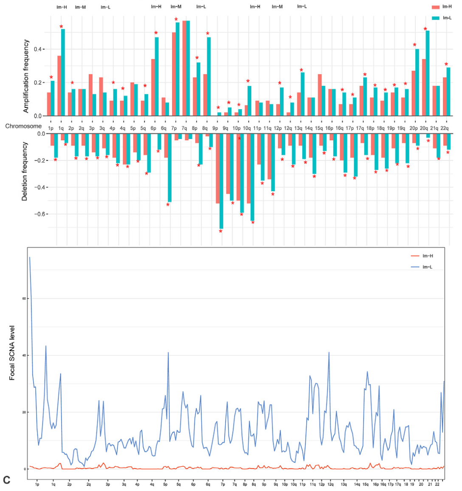

参考文档在两个免疫评分组（Im-H vs Im-L 黑色素瘤）上比较拷贝数负荷：**臂级扩增/缺失频率**（逐染色体臂、逐组、Fisher 检验）与**焦点级扩增/缺失水平**（逐患者强度评分、Wilcoxon 检验），画成成对条形面板加箱线图 \[1\]。两份汇总都源自 GISTIC 式离散调用，此处按臂分辨率模拟；分组 ggplot 渲染与条内组配色是参考的：

## Example

{fig-alt="臂级 CNV 组间比较 DEMO" fig-align="center" width="60%"}

## Setup

-   系统要求：跨平台（Linux/MacOS/Windows）

-   编程语言：R

-   依赖包：`ggplot2`; `patchwork`

```{r packages setup, message=FALSE, warning=FALSE, output=FALSE}
suppressPackageStartupMessages({
  library(ggplot2); library(patchwork)
})
```

```{r}
sessioninfo::session_info("attached")
```

## 数据准备

24 条染色体臂 × 两组各 60 患者。臂级调用模拟为逐患者臂状态（扩增/缺失/中性），在 Im-L 组的 7q/8q/20q 植入多余扩增、9p/13q 植入多余缺失（依参考的 logistic 模型主张，高免疫评分黑色素瘤携带更少 SCNA）。焦点级评分为逐患者总数、方向一致：

```{r load data}
suppressPackageStartupMessages({library(ggplot2); library(patchwork)})
set.seed(43257)
arms <- c(paste0(1:22, "p"), paste0(1:22, "q"))
groups <- c("Im-H", "Im-L")
n_per <- 60
grp <- rep(groups, each = n_per)
hot_arms_amp <- c("7q", "8q", "20q"); hot_arms_del <- c("9p", "13q")
arm_states <- do.call(rbind, lapply(arms, function(a) {
  do.call(rbind, lapply(groups, function(g) {
    p_amp <- 0.12 + if (a %in% hot_arms_amp && g == "Im-L") 0.28 else 0
    p_del <- 0.10 + if (a %in% hot_arms_del && g == "Im-L") 0.25 else 0
    st <- sample(c("amp", "del", "neutral"), n_per, TRUE,
                 prob = c(p_amp, p_del, 1 - p_amp - p_del))
    data.frame(arm = a, group = g, state = st)
  }))
}))
arm_freq <- aggregate(state ~ arm + group, arm_states,
                      function(x) mean(x == "amp") * 100)
names(arm_freq)[3] <- "amp_pct"
arm_freq$del_pct <- as.vector(aggregate(state ~ arm + group, arm_states,
                                        function(x) mean(x == "del") * 100)$state)

## focal-level scores per patient (total focal amp + del events)
focal <- data.frame(
  group = grp,
  patient = sprintf("P%03d", seq_len(2 * n_per)),
  amp_level = ifelse(grp == "Im-L", rnorm(2 * n_per, 9, 2.5), rnorm(2 * n_per, 6, 2)),
  del_level = ifelse(grp == "Im-L", rnorm(2 * n_per, 7, 2.2), rnorm(2 * n_per, 5, 1.8)))
```

## Visualization

### 臂级扩增与缺失频率

逐臂分组条形（每臂一对 Im-H/Im-L）分扩增与缺失两面板、通过检验的臂标注 Fisher p——即参考的两张条形面板：

```{r}
#| label: fig-1.1ArmFreq
#| fig-cap: "按免疫评分组的臂级 CNV 频率：扩增（左）与缺失（右）在每条染色体臂上的百分比、Im-H vs Im-L；Fisher 检验显著的臂（植入的 7q/8q/20q 扩增与 9p/13q 缺失在 Im-L 过量）标注 p 值。"
#| out.width: "95%"
#| fig-width: 12
#| fig-height: 5.6

fish <- do.call(rbind, lapply(arms, function(a) {
  d <- arm_states[arm_states$arm == a, ]
  tb <- table(d$group, d$state == "amp")
  pd <- table(d$group, d$state == "del")
  data.frame(arm = a,
             p_amp = fisher.test(tb)$p.value,
             p_del = fisher.test(pd)$p.value)
}))
plot_bars <- function(value_col, title, sig_col) {
  ggplot(arm_freq, aes(arm, .data[[value_col]], fill = group)) +
    geom_col(position = position_dodge(), width = 0.75) +
    scale_fill_manual(values = c("Im-H" = "#4472C4", "Im-L" = "#ED7D31")) +
    geom_text(data = fish[fish[[sig_col]] < 0.05, ],
              aes(x = arm, y = 72, label = format.pval(.data[[sig_col]], digits = 1)),
              inherit.aes = FALSE, size = 2.2, angle = 90, hjust = 0,
              colour = "grey25") +
    labs(x = NULL, y = "% of patients", title = title, fill = NULL) +
    theme_bw(base_size = 10) +
    theme(axis.text.x = element_text(angle = 90, size = 6.5, vjust = 0.5),
          panel.grid.minor = element_blank(),
          legend.position = "top")
}
p1 <- plot_bars("amp_pct", "Arm-level amplification frequency", "p_amp")
p2 <- plot_bars("del_pct", "Arm-level deletion frequency", "p_del")
p1 + p2 + plot_layout(ncol = 2)
```

### 焦点级扩增与缺失水平

逐患者焦点评分的成对箱线图加 Wilcoxon p——频率面板背后的量化负荷：

```{r}
#| label: fig-2.1ArmFocal
#| fig-cap: "逐患者焦点级扩增（左）与缺失（右）水平按组分面：Im-L 黑色素瘤的焦点负荷显著更高（标注 Wilcoxon p），与臂级过量一致。"
#| out.width: "85%"
#| fig-width: 8
#| fig-height: 5

focal_long <- do.call(rbind, lapply(c("amp_level", "del_level"), function(v) {
  data.frame(group = focal$group, level = focal[[v]],
             type = sub("_level", "", v))
}))
pw <- do.call(rbind, lapply(c("amp_level", "del_level"), function(v) {
  data.frame(type = sub("_level", "", v),
             p = wilcox.test(focal[[v]] ~ focal$group)$p.value)
}))
pw$lab <- sprintf("%s\nWilcoxon p = %s", pw$type, format.pval(pw$p, digits = 2))
focal_long$type <- factor(focal_long$type, levels = c("amp", "del"))
ggplot(focal_long, aes(group, level, fill = group)) +
  geom_boxplot(outlier.shape = NA, alpha = 0.55) +
  geom_point(shape = 21, size = 1.6,
             position = position_jitterdodge(jitter.width = 0.14),
             aes(colour = group), alpha = 0.6) +
  facet_wrap(~ type, ncol = 2,
             labeller = labeller(type = setNames(pw$lab, pw$type))) +
  scale_fill_manual(values = c("Im-H" = "#4472C4", "Im-L" = "#ED7D31")) +
  scale_color_manual(values = c("Im-H" = "#4472C4", "Im-L" = "#ED7D31")) +
  labs(x = NULL, y = "focal CNV level (events per sample)") +
  theme_bw(base_size = 11) +
  theme(axis.text.x = element_text(size = 11),
        legend.position = "top",
        legend.title = element_blank(),
        strip.background = element_blank(),
        panel.grid.minor = element_blank())
```


## 应用场景

::: {{#fig-ArmCnvApplications1}}
{fig-alt="臂级 CNV 组间比较" fig-align="center" width="60%"}

臂级 CNV 组间比较
:::

分组频率 + 负荷面板适用于任何二值-vs-连续的 CNV 对比：治疗应答者 vs 非应答者、亚型对、或原发 vs 转移——凡拷贝数负荷跨队列比较处。

## 参考文献

\[1\] Xiaofan Lu, et al. FigureYa: A Standardized Visualization Framework for Enhancing Biomedical Data Interpretation and Research Efficiency. iMetaMed. 2025. doi:10.1002/imm3.70005
