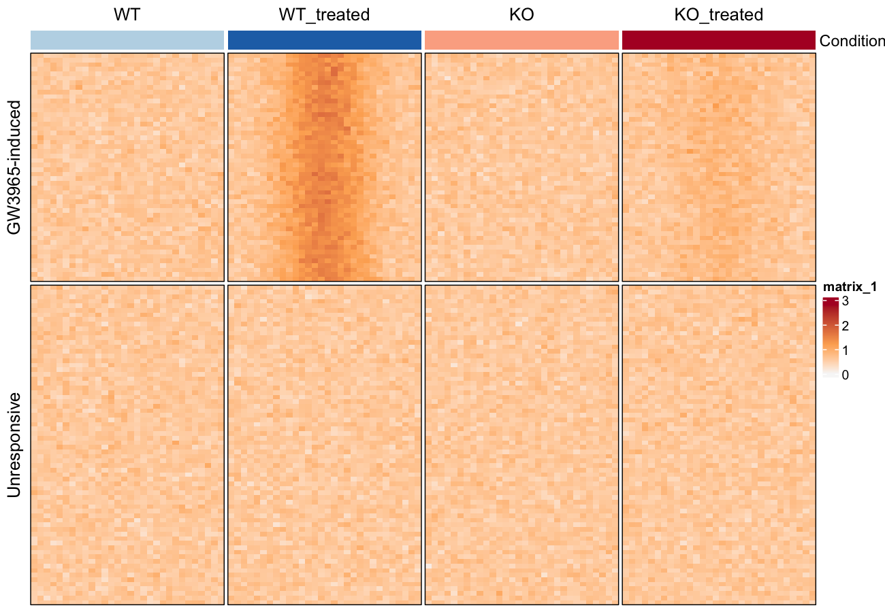

Chromatin-accessibility experiments (ATAC-seq, DNase-seq) are reported as **aggregate heatmaps over genomic regions**: rows are peaks, columns are binned signal per condition, sorted so induced and unresponsive regions separate \[1\]. This tutorial draws that layout on simulated bigWig-style binned matrices — the plotting half of the deeptools workflow (align → MACS2 → `multiBigwigSummary` → this figure), with the locus-level difference view the reference paper highlights.

## Example

{fig-alt="AtacSeqPlot DEMO" fig-align="center" width="60%"}

## Setup

-   System Requirements: Cross-platform (Linux/MacOS/Windows)

-   Programming Language: R

-   Dependent packages: `ComplexHeatmap`; `ggplot2`; `dplyr`; `tidyr`; `circlize`

```{r packages setup, message=FALSE, warning=FALSE, output=FALSE}
# Installing necessary packages
if (!requireNamespace("ComplexHeatmap", quietly = TRUE)) {
  BiocManager::install("ComplexHeatmap")
}
if (!requireNamespace("ggplot2", quietly = TRUE)) {
  install.packages("ggplot2")
}
if (!requireNamespace("dplyr", quietly = TRUE)) {
  install.packages("dplyr")
}
if (!requireNamespace("tidyr", quietly = TRUE)) {
  install.packages("tidyr")
}
if (!requireNamespace("circlize", quietly = TRUE)) {
  install.packages("circlize")
}

# Load packages
library(ComplexHeatmap)
library(ggplot2)
library(dplyr)
library(tidyr)
library(circlize)
```

```{r}
sessioninfo::session_info("attached")
```

## Data Preparation

In practice the input is the matrix `multiBigwigSummary BED-file` writes (one column per bigWig, one row per peak). We simulate 120 peaks measured in four conditions — WT and KO macrophages, each with and without LXR agonist treatment — with a treatment-responsive block and an unresponsive block.

```{r load data, message=FALSE, warning=FALSE}
set.seed(701)
n_induced <- 50; n_flat <- 70
n_bin <- 30
conditions <- c("WT", "WT_treated", "KO", "KO_treated")

## binned ChIP/ATAC signal: rows = peaks, columns = 30 bins x 4 conditions
shape_vals <- dnorm(seq(-3, 3, length.out = n_bin))              # peaked profile
mk_profile <- function(peak_effect, n) {
  do.call(cbind, lapply(conditions, function(cn) {
    eff <- peak_effect *
      ifelse(cn == "WT_treated", 1, ifelse(cn == "KO_treated", 0.25, 0))
    do.call(cbind, lapply(seq_len(n_bin), function(b)
      0.6 + eff * shape_vals[b] + rnorm(n, sd = 0.12)))          # n peaks x 1 bin
  }))
}
peaks_induced <- mk_profile(2.2, n_induced)
peaks_flat    <- mk_profile(0.0, n_flat)
colnames(peaks_induced) <- colnames(peaks_flat) <-
  paste0(rep(conditions, each = n_bin), "_b", rep(seq_len(n_bin), times = 4))

peak_mat <- rbind(peaks_induced, peaks_flat)
rownames(peak_mat) <- c(paste0("Induced_peak_", seq_len(n_induced)),
                        paste0("Flat_peak_", seq_len(n_flat)))
peak_group <- factor(c(rep("GW3965-induced", n_induced), rep("Unresponsive", n_flat)),
                     levels = c("GW3965-induced", "Unresponsive"))
dim(peak_mat)
```

## Visualization

### 1. Group-Mean Accessibility Profiles

```{r}
#| label: fig-1.1GroupProfiles
#| fig-cap: "Mean binned accessibility per condition for the induced region set: treatment raises WT strongly, KO only weakly."
#| out.width: "80%"
#| warning: false
#| message: false
#| fig-width: 7
#| fig-height: 4.5

prof <- as.data.frame(peak_mat) |>
  mutate(group = peak_group) |>
  group_by(group) |>
  summarise(across(where(is.numeric), mean), .groups = "drop") |>
  pivot_longer(-group, names_to = "key", values_to = "signal") |>
  mutate(condition = sub("_b[0-9]+$", "", key),
         bin = as.integer(sub(".*_b", "", key)))

ggplot(prof, aes(bin, signal, colour = condition, fill = condition)) +
  stat_summary(geom = "line", linewidth = 0.9) +
  facet_wrap(~group, nrow = 1) +
  scale_colour_manual(values = c(WT = "#2874C5", WT_treated = "#2874C5",
                                 KO = "#B2182B", KO_treated = "#B2182B"),
                      labels = c(WT = "WT", WT_treated = "WT + GW3965",
                                 KO = "KO", KO_treated = "KO + GW3965"),
                      name = NULL) +
  scale_fill_manual(values = c(WT = "#2874C5", WT_treated = "#2874C5",
                               KO = "#B2182B", KO_treated = "#B2182B")) +
  labs(x = "Position over peak (binned)", y = "Mean accessibility") +
  guides(fill = "none") +
  theme_classic(base_size = 11) +
  theme(legend.position = "top", legend.key.size = unit(3, "mm"))
```

The WT + GW3965 curve separates from KO + GW3965 in the induced set but not in the unresponsive set — the treatment effect the reference figure reports.

### 2. Accessibility-Difference Heatmap

```{r}
#| label: fig-1.2DifferenceHeatmap
#| fig-cap: "Log2 accessibility heatmap (rows = peaks sorted within each group, columns = 30 bins x 4 conditions), split by region group."
#| out.width: "95%"
#| warning: false
#| message: false
#| fig-width: 9
#| fig-height: 7

col_fun <- circlize::colorRamp2(c(0, 1.2, 2.8), c("#F7F7F7", "#FDAE61", "#B2182B"))
row_ord <- order(peak_group,                                  # group first
                 rowMeans(peak_mat[, grep("KO_treated_b", colnames(peak_mat))] -
                            peak_mat[, grep("KO_b", colnames(peak_mat))]),
                 decreasing = TRUE)
mat_sorted <- peak_mat[row_ord, ]
grp_sorted <- peak_group[row_ord]

col_names <- rep(seq_len(n_bin), times = 4)
ha_top <- HeatmapAnnotation(
  Condition = rep(conditions, each = n_bin),
  col = list(Condition = c(WT = "#BDD7E7", WT_treated = "#2171B5",
                           KO = "#FCAE91", KO_treated = "#B2182B")),
  show_legend = FALSE)

Heatmap(mat_sorted, name = "Accessibility",
        top_annotation = ha_top,
        col = col_fun,
        cluster_rows = FALSE, cluster_columns = FALSE,
        row_split = grp_sorted, column_split = factor(rep(conditions, each = n_bin), conditions),
        column_gap = unit(1, "mm"),
        show_column_names = FALSE, show_row_names = FALSE,
        border = TRUE)
```

::: callout-tip
**Practice tips**

-   Sort rows by the **biological contrast** (here KO-treated minus KO) inside each group — clustering would scramble the induced/unresponsive split the figure exists to show.
-   `column_split` + `column_gap` keeps the four condition blocks visually separate; the top annotation maps each block to its condition colour.
-   Upstream, the real matrices come from `multiBigwigSummary BED-file`; normalise samples first (deeptools `bigwigCompare` or RPGC), or the condition colours will reflect depth, not accessibility.
:::

## Application

Aggregate accessibility heatmaps are the standard figure for reporting condition-specific chromatin opening (drug treatment, knockout, lineage transitions). The same layout serves ChIP-seq signal over peak sets.

## Reference

\[1\] Ramírez F, Dündar F, Diehl S, Grüning BA, Manke T. deepTools: a flexible web platform for exploring high-throughput sequencing data. Nucleic Acids Res. 2014;42(W1):W187-191. doi:10.1093/nar/gku365

\[2\] Xiaofan Lu, et al. FigureYa: A Standardized Visualization Framework for Enhancing Biomedical Data Interpretation and Research Efficiency. iMetaMed. 2025. doi:10.1002/imm3.70005
