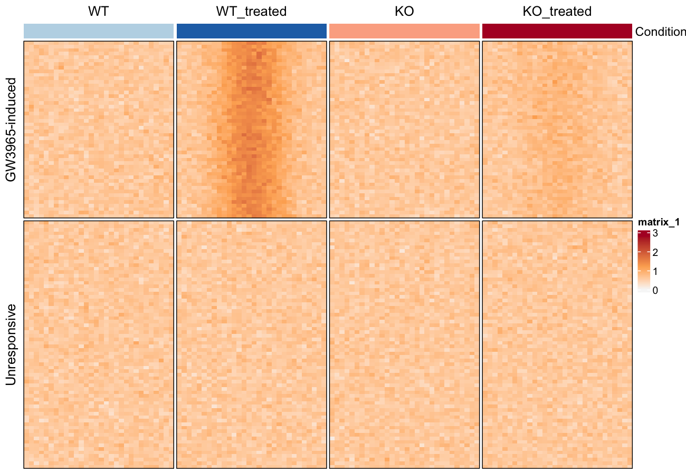

染色质可及性实验（ATAC-seq、DNase-seq）以**基因组区域上的聚合热图**报告：行是 peak，列是各条件的分箱信号，排序后使受诱导与不响应的 region 分开 \[1\]。本教程在模拟的 bigWig 式分箱矩阵上绘制该版式——deeptools 工作流（比对 → MACS2 → `multiBigwigSummary` → 本图）的绘图半程，并给出参考论文强调的位点级差异视图。

## Example

{fig-alt="AtacSeqPlot DEMO" fig-align="center" width="60%"}

## Setup

-   系统要求：跨平台（Linux/MacOS/Windows）

-   编程语言：R

-   依赖包： `ComplexHeatmap`; `ggplot2`; `dplyr`; `tidyr`; `circlize`

```{r packages setup, message=FALSE, warning=FALSE, output=FALSE}
# 安装必要的包
if (!requireNamespace("ComplexHeatmap", quietly = TRUE)) {
  BiocManager::install("ComplexHeatmap")
}
if (!requireNamespace("ggplot2", quietly = TRUE)) {
  install.packages("ggplot2")
}
if (!requireNamespace("dplyr", quietly = TRUE)) {
  install.packages("dplyr")
}
if (!requireNamespace("tidyr", quietly = TRUE)) {
  install.packages("tidyr")
}
if (!requireNamespace("circlize", quietly = TRUE)) {
  install.packages("circlize")
}

# 加载包
library(ComplexHeatmap)
library(ggplot2)
library(dplyr)
library(tidyr)
library(circlize)
```

```{r}
sessioninfo::session_info("attached")
```

## Data Preparation

实际输入是 `multiBigwigSummary BED-file` 输出的矩阵（每个 bigWig 一列、每个 peak 一行）。我们模拟 120 个 peak 在四个条件下的测量——WT 与 KO 巨噬细胞、各分是否用 LXR 激动剂处理——含一个处理响应区块和一个不响应区块。

```{r load data, message=FALSE, warning=FALSE}
set.seed(701)
n_induced <- 50; n_flat <- 70
n_bin <- 30
conditions <- c("WT", "WT_treated", "KO", "KO_treated")

## binned ChIP/ATAC signal: rows = peaks, columns = 30 bins x 4 conditions
shape_vals <- dnorm(seq(-3, 3, length.out = n_bin))              # peaked profile
mk_profile <- function(peak_effect, n) {
  do.call(cbind, lapply(conditions, function(cn) {
    eff <- peak_effect *
      ifelse(cn == "WT_treated", 1, ifelse(cn == "KO_treated", 0.25, 0))
    do.call(cbind, lapply(seq_len(n_bin), function(b)
      0.6 + eff * shape_vals[b] + rnorm(n, sd = 0.12)))          # n peaks x 1 bin
  }))
}
peaks_induced <- mk_profile(2.2, n_induced)
peaks_flat    <- mk_profile(0.0, n_flat)
colnames(peaks_induced) <- colnames(peaks_flat) <-
  paste0(rep(conditions, each = n_bin), "_b", rep(seq_len(n_bin), times = 4))

peak_mat <- rbind(peaks_induced, peaks_flat)
rownames(peak_mat) <- c(paste0("Induced_peak_", seq_len(n_induced)),
                        paste0("Flat_peak_", seq_len(n_flat)))
peak_group <- factor(c(rep("GW3965-induced", n_induced), rep("Unresponsive", n_flat)),
                     levels = c("GW3965-induced", "Unresponsive"))
dim(peak_mat)
```

## Visualization

### 1. 各组平均可及性曲线

```{r}
#| label: fig-1.1GroupProfiles
#| fig-cap: "受诱导 region 集内各条件的平均分箱可及性：处理显著抬高 WT，KO 仅微弱。"
#| out.width: "80%"
#| warning: false
#| message: false
#| fig-width: 7
#| fig-height: 4.5

prof <- as.data.frame(peak_mat) |>
  mutate(group = peak_group) |>
  group_by(group) |>
  summarise(across(where(is.numeric), mean), .groups = "drop") |>
  pivot_longer(-group, names_to = "key", values_to = "signal") |>
  mutate(condition = sub("_b[0-9]+$", "", key),
         bin = as.integer(sub(".*_b", "", key)))

ggplot(prof, aes(bin, signal, colour = condition, fill = condition)) +
  stat_summary(geom = "line", linewidth = 0.9) +
  facet_wrap(~group, nrow = 1) +
  scale_colour_manual(values = c(WT = "#2874C5", WT_treated = "#2874C5",
                                 KO = "#B2182B", KO_treated = "#B2182B"),
                      labels = c(WT = "WT", WT_treated = "WT + GW3965",
                                 KO = "KO", KO_treated = "KO + GW3965"),
                      name = NULL) +
  scale_fill_manual(values = c(WT = "#2874C5", WT_treated = "#2874C5",
                               KO = "#B2182B", KO_treated = "#B2182B")) +
  labs(x = "Position over peak (binned)", y = "Mean accessibility") +
  guides(fill = "none") +
  theme_classic(base_size = 11) +
  theme(legend.position = "top", legend.key.size = unit(3, "mm"))
```

受诱导集中 WT + GW3965 曲线与 KO + GW3965 分离，而不响应集中不分离——正是参考图报告的处理效应。

### 2. 可及性差异热图

```{r}
#| label: fig-1.2DifferenceHeatmap
#| fig-cap: "可及性热图（行 = 各组内排序的 peak，列 = 30 分箱 × 4 条件），按 region 组分块。"
#| out.width: "95%"
#| warning: false
#| message: false
#| fig-width: 9
#| fig-height: 7

col_fun <- circlize::colorRamp2(c(0, 1.2, 2.8), c("#F7F7F7", "#FDAE61", "#B2182B"))
row_ord <- order(peak_group,                                  # group first
                 rowMeans(peak_mat[, grep("KO_treated_b", colnames(peak_mat))] -
                            peak_mat[, grep("KO_b", colnames(peak_mat))]),
                 decreasing = TRUE)
mat_sorted <- peak_mat[row_ord, ]
grp_sorted <- peak_group[row_ord]

col_names <- rep(seq_len(n_bin), times = 4)
ha_top <- HeatmapAnnotation(
  Condition = rep(conditions, each = n_bin),
  col = list(Condition = c(WT = "#BDD7E7", WT_treated = "#2171B5",
                           KO = "#FCAE91", KO_treated = "#B2182B")),
  show_legend = FALSE)

Heatmap(mat_sorted, name = "Accessibility",
        top_annotation = ha_top,
        col = col_fun,
        cluster_rows = FALSE, cluster_columns = FALSE,
        row_split = grp_sorted, column_split = factor(rep(conditions, each = n_bin), conditions),
        column_gap = unit(1, "mm"),
        show_column_names = FALSE, show_row_names = FALSE,
        border = TRUE)
```

::: callout-tip
**Practice tips**

-   每组内按**生物学对比**（此处为 KO 处理减 KO）排序行——聚类会打乱本图要展示的受诱导/不响应划分。
-   `column_split` + `column_gap` 让四个条件块视觉分离；顶部注释把每块映射到其条件颜色。
-   上游真实矩阵来自 `multiBigwigSummary BED-file`；先做样本归一化（deeptools `bigwigCompare` 或 RPGC），否则条件颜色反映的是测序深度而非可及性。
:::

## Application

聚合可及性热图是报告条件特异染色质开放（药物处理、敲除、谱系转换）的标准配图；同一版式也适用于 peak 集合上的 ChIP-seq 信号。

## Reference

\[1\] Ramírez F, Dündar F, Diehl S, Grüning BA, Manke T. deepTools: a flexible web platform for exploring high-throughput sequencing data. Nucleic Acids Res. 2014;42(W1):W187-191. doi:10.1093/nar/gku365

\[2\] Xiaofan Lu, et al. FigureYa: A Standardized Visualization Framework for Enhancing Biomedical Data Interpretation and Research Efficiency. iMetaMed. 2025. doi:10.1002/imm3.70005
