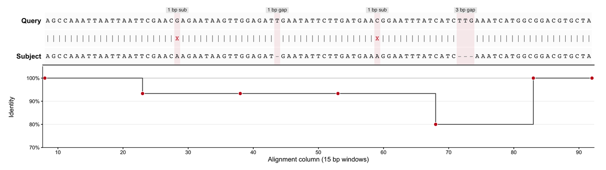

An alignment is only convincing when the evidence is drawn, not described. Two complementary layouts dominate the literature: the **pairwise alignment view** (query against subject, base by base, with match / mismatch / gap characters — the text layout of `BLAST -outfmt 0` or `sam2pairwise`) and the **read pileup view** (reads stacked against a reference genome with a coverage track — the BAM snapshot family). This tutorial rebuilds both in pure R from transparent inputs, so every glyph maps to a column a real aligner would emit.

## Example

{fig-alt="Blast Alignment Plot DEMO" fig-align="center" width="85%"}

A BLAST+ style pairwise alignment between a query and a subject sequence, showing the two aligned rows, the match/mismatch/gap identity string between them, and the sliding-window identity profile underneath. The 3 bp insertion in the query and the 1 bp deletion in the subject are visible as columns with no partner, which is exactly what a text alignment has to make obvious.

## Setup

-   System Requirements: Cross-platform (Linux/MacOS/Windows)

-   Programming language: R

-   Dependent packages: `ggplot2`; `dplyr`; `tidyr`; `patchwork`; `scales`

```{r packages setup, message=FALSE, warning=FALSE, output=FALSE}
if (!requireNamespace("ggplot2", quietly = TRUE)) install.packages("ggplot2")
if (!requireNamespace("dplyr", quietly = TRUE)) install.packages("dplyr")
if (!requireNamespace("tidyr", quietly = TRUE)) install.packages("tidyr")
if (!requireNamespace("patchwork", quietly = TRUE)) install.packages("patchwork")
if (!requireNamespace("scales", quietly = TRUE)) install.packages("scales")
library(ggplot2)
library(dplyr)
library(tidyr)
library(patchwork)
library(scales)
```

```{r}
sessioninfo::session_info("attached")
```

## Data Preparation

The pairwise panel uses a 90 bp window with two single-base mismatches, a 1 bp deletion in the subject and a 3 bp insertion in the query. The pileup panel simulates eight short reads over a 420 bp GRCh38 reference carrying two SNPs, a 5 bp deletion junction and a 3 bp insertion. Both are built from plain character vectors, exactly the fields a BLAST text report or a SAM record would provide.

```{r load data, message=FALSE, warning=FALSE}
set.seed(4352)
bases <- c("A", "C", "G", "T")
base_colours <- c(A = "#1B9E77", C = "#377EB8", G = "#E6AB02", T = "#D95F02")
## ---- (1) pairwise alignment window -------------------------------------
ref_seq <- paste(sample(bases, 90, replace = TRUE, prob = c(.3, .2, .22, .28)),
                 collapse = "")
q_seq <- ref_seq
substr(q_seq, 23, 23) <- ifelse(substr(ref_seq, 23, 23) == "A", "G", "A")
substr(q_seq, 57, 57) <- ifelse(substr(ref_seq, 57, 57) == "C", "T", "C")
## Aligned rows: query has a 3 bp insertion after column 70, subject a 1 bp
## deletion at column 40; both strings are 93 columns wide.
q_aln <- paste0(substr(q_seq, 1, 70), "TTG", substr(q_seq, 71, 90))
s_aln <- paste0(substr(ref_seq, 1, 39), "-", substr(ref_seq, 41, 70),
                "---", substr(ref_seq, 71, 90))
q_chars <- strsplit(q_aln, "")[[1]]
s_chars <- strsplit(s_aln, "")[[1]]
stopifnot(length(q_chars) == length(s_chars))
## The middle row is the BLAST identity string: | match, X mismatch, space gap.
pair <- tibble(col = seq_along(q_chars), q_char = q_chars, s_char = s_chars) |>
  mutate(state = case_when(q_char == "-" | s_char == "-" ~ "gap",
                           q_char == s_char ~ "match", TRUE ~ "mismatch"),
         glyph = case_when(state == "match" ~ "|",
                           state == "mismatch" ~ "X", TRUE ~ " "))
## ---- (2) simulated pileup over a 420 bp locus --------------------------
ref_len <- 420
reference <- sample(bases, ref_len, replace = TRUE, prob = c(.3, .2, .22, .28))
reference[95] <- "C"; reference[211] <- "T"
deletion <- 300:304; insertion_at <- 350
n_reads <- 8
read_start <- sample(60:90, n_reads, replace = TRUE)
read_len <- sample(300:330, n_reads, replace = TRUE)
has_del <- c(FALSE, TRUE, TRUE, FALSE, TRUE, FALSE, FALSE, FALSE)
has_ins <- c(FALSE, FALSE, TRUE, FALSE, FALSE, TRUE, FALSE, FALSE)
pileup <- bind_rows(lapply(seq_len(n_reads), function(i) {
  span <- read_start[i]:(read_start[i] + read_len[i] - 1)
  span <- span[span <= ref_len]
  span <- setdiff(span, deletion[has_del[i]])
  tibble(read_index = i, ref_pos = span, base = reference[span])
})) |>
  mutate(
    ## Sequencer errors plus sample alleles at ~50% allele fraction.
    base = if_else(runif(n()) < 0.012, sample(bases, n(), replace = TRUE), base),
    base = if_else(ref_pos == 95 & read_index %in% 1:4, "G", base),
    base = if_else(ref_pos == 211 & read_index %in% 2:4, "C", base),
    base = factor(base, levels = bases)
  )
## Coverage = reads spanning a base (samtools depth semantics).
coverage <- tibble(ref_pos = seq_len(ref_len)) |>
  left_join(count(pileup, ref_pos), by = "ref_pos") |>
  mutate(n = replace_na(n, 0L))
insertion_rows <- bind_rows(lapply(which(has_ins), function(i) {
  tibble(read_index = i, ref_pos = insertion_at)
}))
junctions <- tibble(ref_pos = c(min(deletion) - 1, max(deletion) + 1))
pair |> group_by(state) |> summarise(n = n(), .groups = "drop")
```

## Visualization

### 1. Pairwise Alignment with Identity String and Conservation Track

The BLAST text layout is the most information-dense alignment figure: query and subject rows, the `|` / `X` / space string in the middle, and running coordinates. A monospaced face keeps the glyph order exact, a pale band ties every non-match column to the gap or substitution it encodes, and the window identity track below quantifies what the reader is meant to infer by eye.

```{r}
#| label: fig-1.1PairwiseAlignment
#| fig-cap: "BLAST+ style pairwise alignment: query (top), subject (bottom), match/mismatch/gap string, and per-window identity."
#| warning: false
#| message: false
#| fig-width: 11
#| fig-height: 3.1
#| fig-dpi: 300
aln_rows <- bind_rows(
  pair |> transmute(col, row = 3, label = q_char),
  pair |> transmute(col, row = 2, label = glyph),
  pair |> transmute(col, row = 1, label = s_char)
) |>
  mutate(state = if_else(label %in% c("-", " "), "gap",
                         if_else(label == "X", "mismatch",
                                 if_else(label == "|", "match", "base"))))
win <- cut(pair$col, breaks = seq(0, nrow(pair), by = 15), labels = FALSE)
identity <- pair |>
  group_by(window = win) |>
  summarise(mid = mean(col), ident = mean(state == "match"), .groups = "drop")
gap_labels <- pair |>
  filter(state != "match") |>
  group_by(run = cumsum(c(TRUE, diff(col) > 1))) |>
  summarise(x = mean(col), n = n(), kind = first(state), .groups = "drop") |>
  mutate(label = if_else(n >= 2,
                         paste0(n, " bp ", if_else(kind == "gap", "gap", "sub")),
                         paste0("1 bp ", if_else(kind == "gap", "gap", "sub"))))
p_pair <- ggplot(aln_rows, aes(col, row)) +
  geom_tile(fill = "#FCFCFC", colour = NA, height = 0.92, width = 1) +
  geom_tile(data = pair |> filter(state != "match"), aes(x = col, y = 2),
            inherit.aes = FALSE, width = 1, height = 3, fill = "#C51B1F",
            alpha = 0.08) +
  geom_text(aes(label = label, colour = state), family = "mono", size = 3) +
  geom_label(data = gap_labels, aes(x, 3.42, label = label), inherit.aes = FALSE,
             size = 2.3, label.size = 0, label.padding = unit(0.8, "mm"),
             fill = "grey92", colour = "grey15", vjust = 0,
             family = "sans") +
  scale_colour_manual(values = c(match = "#4D4D4D", mismatch = "#C51B1F",
                                 gap = "#9E9E9E", base = "#222222"),
                      guide = "none") +
  scale_y_continuous(breaks = c(1, 3), labels = c("Subject", "Query"),
                     limits = c(0.5, 3.75), expand = c(0, 0)) +
  scale_x_continuous(expand = c(0.004, 0.004), breaks = seq(0, 90, 10)) +
  labs(x = NULL, y = NULL) +
  theme_classic(base_size = 9) +
  theme(axis.text.y = element_text(face = "bold", size = 9),
        axis.ticks.y = element_blank(), axis.line.y = element_blank(),
        axis.text.x = element_blank(), axis.ticks.x = element_blank(),
        plot.margin = margin(4, 10, 0, 6))
p_ident <- ggplot(identity, aes(mid, ident)) +
  geom_hline(yintercept = 1, colour = "#BDBDBD", linewidth = 0.3) +
  geom_step(colour = "#4D4D4D", linewidth = 0.45, direction = "hv") +
  geom_point(shape = 21, size = 2, fill = "#C51B1F", colour = "white",
             stroke = 0.5) +
  scale_y_continuous(labels = percent_format(accuracy = 1),
                     limits = c(0.7, 1.05), expand = c(0, 0)) +
  scale_x_continuous(expand = c(0.004, 0.004), breaks = seq(0, 90, 10)) +
  labs(x = "Alignment column (15 bp windows)", y = "Identity") +
  theme_classic(base_size = 8.5) +
  theme(axis.line = element_line(linewidth = 0.3),
        panel.grid.major.y = element_line(colour = "grey92", linewidth = 0.25),
        plot.margin = margin(2, 10, 4, 6))
p_pair / p_ident + plot_layout(heights = c(1, 1.4))
```

### 2. Read Pileup, Base Colours and Coverage Track

This is the BAM snapshot layout used by **BAMSnap**, **Bamsnap-LRS**, **alignoth**, **pyBamView**, **bamscope**, **JVarKit BamToSVG**, **plotReads**, **VizAln** and **DrukBam**: rows are reads, columns are reference positions, colour is the observed base, and a coverage track shares the x axis. The pale band marks the deletion junction, so the event is visible without opening IGV.

```{r}
#| label: fig-1.2ReadPileup
#| fig-cap: "Read pileup over 420 bp (GRCh38 chr1:12,000-12,419): base colours, SNP markers, a 5 bp deletion junction, a 3 bp insertion, and read-depth coverage."
#| warning: false
#| message: false
#| fig-width: 11
#| fig-height: 5.4
#| fig-dpi: 300
ymax_read <- max(pileup$read_index)
p_pile <- ggplot(pileup, aes(ref_pos, read_index)) +
  geom_tile(aes(fill = base), height = 0.86, width = 1.05) +
  geom_rect(data = junctions, inherit.aes = FALSE,
            aes(xmin = ref_pos - 1.6, xmax = ref_pos + 1.6,
                ymin = -Inf, ymax = Inf), fill = "#8E44AD", alpha = 0.08) +
  geom_point(data = insertion_rows, shape = 25, size = 2.1,
             fill = "#8E44AD", colour = "#4A1486") +
  geom_tile(data = pileup |> filter(ref_pos %in% c(95, 211)),
            aes(ref_pos, read_index), fill = NA, colour = "#111111",
            linewidth = 0.45, width = 1.05, height = 0.86) +
  annotate("text", x = c(95, 211), y = ymax_read + 0.75, label = "SNP",
           size = 2.6, colour = "#222222") +
  annotate("text", x = mean(deletion), y = ymax_read + 0.75,
           label = "5 bp deletion", size = 2.6, colour = "#4A1486") +
  annotate("text", x = insertion_at, y = ymax_read + 0.75,
           label = "3 bp insertion", size = 2.6, colour = "#4A1486") +
  scale_fill_manual(values = base_colours, na.value = "white", name = "Base",
                    breaks = bases) +
  scale_x_continuous(limits = c(55, 410), expand = c(0, 0)) +
  scale_y_continuous(breaks = seq_len(ymax_read),
                     labels = paste0("read_0", seq_len(ymax_read)),
                     expand = c(0.02, 0.13)) +
  labs(x = NULL, y = "Read") +
  theme_classic(base_size = 9.5) +
  theme(axis.text.x = element_blank(), axis.ticks.x = element_blank(),
        axis.line = element_line(linewidth = 0.3),
        legend.position = "right", legend.key.size = unit(3.6, "mm"),
        legend.title = element_text(size = 9),
        plot.margin = margin(4, 6, 0, 6))
p_cov <- ggplot(coverage, aes(ref_pos, n)) +
  geom_area(data = coverage |> filter(ref_pos >= 55, ref_pos <= 410),
            fill = "#3C5488", alpha = 0.8) +
  geom_vline(xintercept = c(min(deletion), max(deletion)), colour = "#8E44AD",
             linetype = "dashed", linewidth = 0.3) +
  scale_x_continuous(limits = c(55, 410), expand = c(0, 0)) +
  scale_y_continuous(expand = c(0.02, 0), breaks = pretty_breaks(3)) +
  labs(x = "Reference position (bp)", y = "Read depth") +
  theme_classic(base_size = 9) +
  theme(axis.line = element_line(linewidth = 0.3),
        plot.margin = margin(3, 6, 4, 6))
p_pile / p_cov + plot_layout(heights = c(3.5, 1))
```

### 3. Zoomed Deletion Junction with Base Letters

At publication scale the whole-locus pileup cannot show individual bases, so the junction is redrawn as a zoom. Letters inside the tiles make the deletion auditable base by base; a bracket instead of a shifted row keeps every read on its own lane, which is what lets the reader count the missing bases.

```{r}
#| label: fig-1.3DeletionZoom
#| fig-cap: "Zoom on the 5 bp deletion: reference row, base letters per read, and open brackets on the three deletion-carrying reads."
#| warning: false
#| message: false
#| fig-width: 9.6
#| fig-height: 4.4
#| fig-dpi: 300
zoom <- pileup |> filter(ref_pos >= 286, ref_pos <= 320)
ref_row <- tibble(ref_pos = 286:320,
                  base = factor(reference[286:320], levels = bases))
carriers <- tibble(read_index = which(has_del))
ggplot(zoom, aes(ref_pos, read_index)) +
  geom_tile(aes(fill = base), height = 0.9, width = 1) +
  geom_text(aes(label = base), colour = "white", fontface = "bold", size = 2.5) +
  geom_segment(data = carriers,
               aes(x = min(deletion) - 0.5, xend = max(deletion) + 0.5,
                   y = read_index, yend = read_index),
               inherit.aes = FALSE, colour = "#4A1486", linewidth = 0.5) +
  geom_text(data = carriers, aes(x = mean(deletion), y = read_index,
                                 label = "del 5"),
            inherit.aes = FALSE, colour = "#4A1486", size = 2.2, vjust = -0.6) +
  geom_tile(data = ref_row, aes(ref_pos, 9.2, fill = base), height = 0.9,
            width = 1, colour = "white", linewidth = 0.2) +
  geom_text(data = ref_row, aes(ref_pos, 9.2, label = base),
            colour = "#444444", size = 2.4, family = "mono") +
  scale_fill_manual(values = base_colours, name = "Base", breaks = bases) +
  scale_x_continuous(expand = c(0, 0), breaks = seq(286, 320, 5)) +
  scale_y_continuous(breaks = c(9.2, 1:8), labels = c("Ref", paste0("read_0", 1:8)),
                     expand = c(0.02, 0.02)) +
  labs(x = "Reference position (bp)", y = NULL) +
  theme_classic(base_size = 9.5) +
  theme(axis.text.y = element_text(size = 7.6),
        axis.line = element_line(linewidth = 0.3),
        legend.position = "right", legend.key.size = unit(3.6, "mm"),
        plot.margin = margin(4, 6, 4, 6))
```

::: callout-tip
**Practice tips**

-   Print the identity string (`|`, `X`, space) with a **monospaced** family and never re-kern it: any spacing change silently moves a mismatch into the wrong column.
-   `sam2pairwise` and `samtools mpileup` regenerate the same query-vs-reference rows from a BAM; `BLAST+ -outfmt 0` / `-outfmt 6` give the text and tabular variants of the pairwise panel.
-   Keep pileup and coverage on **one shared x scale**: a junction and its depth drop are only legible when vertically aligned.
-   Use four colour-blind-safe base colours (Okabe–Ito style) and add glyph redundancy — a pale band for the junction, a purple caret for the insertion — so the figure survives greyscale printing.
-   Never left-shift a read row after a deletion: draw a bracket or leave a white gap, but keep `read_index` fixed, otherwise the number of missing bases is unreadable.
-   Long-read tools (`Bamsnap-LRS`, `DrukBam`) usually pair the pileup with a per-read minimap track; place it below the coverage panel to preserve the depth-first reading order.
:::

## Implementations deliberately not used here

This page draws its figures from base graphics on purpose. Of the tools that the issue-435 inventory maps onto Omics/BlastAlignmentPlot, 4 were marked **skipped** and are used only as layout references, not as dependencies: 4 that have gone more than five years without an operational commit (cutoff 2021-11-07) and 0 whose dependency closure is too heavy to justify for one static figure. The figure conventions were read off those tools, then re-implemented here so each panel can be inspected line by line.

| Tool | Last commit | Status | Why it is skipped |
| --- | --- | --- | --- |
| GSSPlayground | 2020-07-12 | archived | repository archived, no further maintenance |
| Hapviz | 2014-03-12 | stale | >5 years without maintenance |
| Sam2pairwise | 2015-01-29 | stale | >5 years without maintenance |
| shabam | 2017-05-08 | stale | >5 years without maintenance |

## Application

Pileup and pairwise panels answer different questions. The pairwise view is the verdict panel: it shows exactly where an aligner or a variant caller departs from the reference, which is the reviewer's evidence when `samtools` QC, a call set and a raw read disagree. The pileup is the triage panel: collapsed repeats, soft clips, chimeric reads and strand artefacts are visible there but cannot be stored in a per-position VCF record. Practical tooling spans the range — **Sam2pairwise** and **SequenceServer** for text and web alignment reports, **BAMSnap**, **Bamsnap-LRS**, **bamscope** and **DrukBam** for publication snapshots, **alignoth** for coverage-aware layouts, **pyBamView** and **plotReads** for interactive QC, **JVarKit BamToSVG**, **VizAln** and **GSSPlayground** for vector output, and **Hapviz**, **shabam**, **svv** and **samplot** for structural-variant and haplotype-aware layouts.

## Reference

\[1\] Altschul SF, Gish W, Miller W, Myers EW, Lipman DJ. Basic local alignment search tool. J Mol Biol. 1990;215(3):403-410. doi:10.1016/S0022-2836(05)80360-2

\[2\] Robinson JT, Thorvaldsdóttir H, Winckler W, Guttman M, Lander ES, Getz G, Mesirov JP. Integrative genomics viewer. Nat Biotechnol. 2011;29(1):24-26. doi:10.1038/nbt.1754

\[3\] Thorvaldsdottir H, Robinson JT, Mesirov JP. Integrative Genomics Viewer (IGV): high-performance genomics data visualization and exploration. Brief Bioinform. 2013;14(2):178-192. doi:10.1093/bib/bbs017
