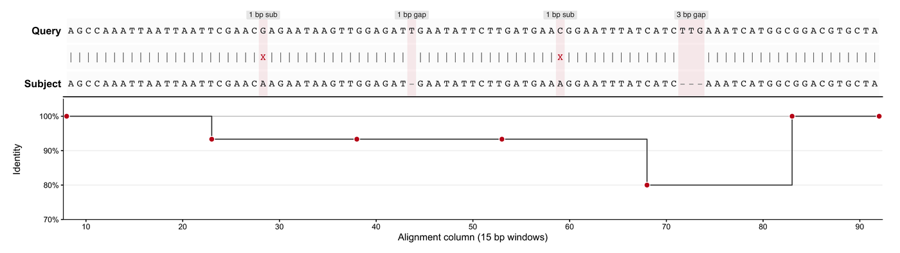

序列比对只有被画出来才有说服力。文献中最常见的两种版式互补：**成对比对视图**（query 对 subject，逐碱基展示匹配、错配与空隙字符，即 `BLAST -outfmt 0` 或 `sam2pairwise` 的文本版式）与**读段堆叠视图**（reads 沿参考基因组堆叠并附覆盖度轨，即 BAM snapshot 家族）。本教程用纯 R 从透明输入重建两者，使图中每个字形都能对应真实比对软件会输出的一列。

## 示例

{fig-alt="BLAST 比对图 DEMO" fig-align="center" width="85%"}

查询序列与目标序列的 BLAST+ 风格两两比对：上方是两条对齐的行，中间是匹配、错配与空位的身份符号串，下方是滑窗一致性曲线。查询序列的 3 bp 插入与目标序列的 1 bp 缺失表现为没有配对的列，这正是文本比对必须让人一眼看到的东西。

## Setup

-   系统要求：跨平台（Linux/MacOS/Windows）

-   编程语言：R

-   依赖包：`ggplot2`; `dplyr`; `tidyr`; `patchwork`; `scales`
```{r packages setup, message=FALSE, warning=FALSE, output=FALSE}
if (!requireNamespace("ggplot2", quietly = TRUE)) install.packages("ggplot2")
if (!requireNamespace("dplyr", quietly = TRUE)) install.packages("dplyr")
if (!requireNamespace("tidyr", quietly = TRUE)) install.packages("tidyr")
if (!requireNamespace("patchwork", quietly = TRUE)) install.packages("patchwork")
if (!requireNamespace("scales", quietly = TRUE)) install.packages("scales")
library(ggplot2)
library(dplyr)
library(tidyr)
library(patchwork)
library(scales)
```

```{r}
sessioninfo::session_info("attached")
```

## Data Preparation

成对面板使用 90 bp 窗口，含两个单碱基错配、subject 中一个 1 bp 缺失与 query 中一个 3 bp 插入。堆叠面板在 GRCh38 参考序列的 420 bp 区间模拟 8 条短读段，携带两个 SNP、一个 5 bp 缺失连接点和一个 3 bp 插入。两者都由纯字符向量构建，正是 BLAST 文本报告或 SAM 记录提供的字段。
```{r load data, message=FALSE, warning=FALSE}
set.seed(4352)
bases <- c("A", "C", "G", "T")
base_colours <- c(A = "#1B9E77", C = "#377EB8", G = "#E6AB02", T = "#D95F02")
## ---- (1) pairwise alignment window -------------------------------------
ref_seq <- paste(sample(bases, 90, replace = TRUE, prob = c(.3, .2, .22, .28)),
                 collapse = "")
q_seq <- ref_seq
substr(q_seq, 23, 23) <- ifelse(substr(ref_seq, 23, 23) == "A", "G", "A")
substr(q_seq, 57, 57) <- ifelse(substr(ref_seq, 57, 57) == "C", "T", "C")
## Aligned rows: query has a 3 bp insertion after column 70, subject a 1 bp
## deletion at column 40; both strings are 93 columns wide.
q_aln <- paste0(substr(q_seq, 1, 70), "TTG", substr(q_seq, 71, 90))
s_aln <- paste0(substr(ref_seq, 1, 39), "-", substr(ref_seq, 41, 70),
                "---", substr(ref_seq, 71, 90))
q_chars <- strsplit(q_aln, "")[[1]]
s_chars <- strsplit(s_aln, "")[[1]]
stopifnot(length(q_chars) == length(s_chars))
## The middle row is the BLAST identity string: | match, X mismatch, space gap.
pair <- tibble(col = seq_along(q_chars), q_char = q_chars, s_char = s_chars) |>
  mutate(state = case_when(q_char == "-" | s_char == "-" ~ "gap",
                           q_char == s_char ~ "match", TRUE ~ "mismatch"),
         glyph = case_when(state == "match" ~ "|",
                           state == "mismatch" ~ "X", TRUE ~ " "))
## ---- (2) simulated pileup over a 420 bp locus --------------------------
ref_len <- 420
reference <- sample(bases, ref_len, replace = TRUE, prob = c(.3, .2, .22, .28))
reference[95] <- "C"; reference[211] <- "T"
deletion <- 300:304; insertion_at <- 350
n_reads <- 8
read_start <- sample(60:90, n_reads, replace = TRUE)
read_len <- sample(300:330, n_reads, replace = TRUE)
has_del <- c(FALSE, TRUE, TRUE, FALSE, TRUE, FALSE, FALSE, FALSE)
has_ins <- c(FALSE, FALSE, TRUE, FALSE, FALSE, TRUE, FALSE, FALSE)
pileup <- bind_rows(lapply(seq_len(n_reads), function(i) {
  span <- read_start[i]:(read_start[i] + read_len[i] - 1)
  span <- span[span <= ref_len]
  span <- setdiff(span, deletion[has_del[i]])
  tibble(read_index = i, ref_pos = span, base = reference[span])
})) |>
  mutate(
    ## Sequencer errors plus sample alleles at ~50% allele fraction.
    base = if_else(runif(n()) < 0.012, sample(bases, n(), replace = TRUE), base),
    base = if_else(ref_pos == 95 & read_index %in% 1:4, "G", base),
    base = if_else(ref_pos == 211 & read_index %in% 2:4, "C", base),
    base = factor(base, levels = bases)
  )
## Coverage = reads spanning a base (samtools depth semantics).
coverage <- tibble(ref_pos = seq_len(ref_len)) |>
  left_join(count(pileup, ref_pos), by = "ref_pos") |>
  mutate(n = replace_na(n, 0L))
insertion_rows <- bind_rows(lapply(which(has_ins), function(i) {
  tibble(read_index = i, ref_pos = insertion_at)
}))
junctions <- tibble(ref_pos = c(min(deletion) - 1, max(deletion) + 1))
pair |> group_by(state) |> summarise(n = n(), .groups = "drop")
```

## Visualization

### 1. 成对比对、一致性串与保守性轨

BLAST 文本版式是信息密度最高的比对图：query 与 subject 两行、中间的 `|` / `X` / 空格串，以及运行坐标。等宽字体可保证字形顺序精确；淡色竖带把每个非匹配列与其代表的空隙或替换绑定；下方逐窗口一致性轨把原本需要目测推断的结论定量化。
```{r}
#| label: fig-1.1PairwiseAlignment
#| fig-cap: "BLAST+ 式成对比对：query（上）、subject（下）、匹配/错配/空隙串，以及逐窗口一致性。"
#| warning: false
#| message: false
#| fig-width: 11
#| fig-height: 3.1
#| fig-dpi: 300
aln_rows <- bind_rows(
  pair |> transmute(col, row = 3, label = q_char),
  pair |> transmute(col, row = 2, label = glyph),
  pair |> transmute(col, row = 1, label = s_char)
) |>
  mutate(state = if_else(label %in% c("-", " "), "gap",
                         if_else(label == "X", "mismatch",
                                 if_else(label == "|", "match", "base"))))
win <- cut(pair$col, breaks = seq(0, nrow(pair), by = 15), labels = FALSE)
identity <- pair |>
  group_by(window = win) |>
  summarise(mid = mean(col), ident = mean(state == "match"), .groups = "drop")
gap_labels <- pair |>
  filter(state != "match") |>
  group_by(run = cumsum(c(TRUE, diff(col) > 1))) |>
  summarise(x = mean(col), n = n(), kind = first(state), .groups = "drop") |>
  mutate(label = if_else(n >= 2,
                         paste0(n, " bp ", if_else(kind == "gap", "gap", "sub")),
                         paste0("1 bp ", if_else(kind == "gap", "gap", "sub"))))
p_pair <- ggplot(aln_rows, aes(col, row)) +
  geom_tile(fill = "#FCFCFC", colour = NA, height = 0.92, width = 1) +
  geom_tile(data = pair |> filter(state != "match"), aes(x = col, y = 2),
            inherit.aes = FALSE, width = 1, height = 3, fill = "#C51B1F",
            alpha = 0.08) +
  geom_text(aes(label = label, colour = state), family = "mono", size = 3) +
  geom_label(data = gap_labels, aes(x, 3.42, label = label), inherit.aes = FALSE,
             size = 2.3, label.size = 0, label.padding = unit(0.8, "mm"),
             fill = "grey92", colour = "grey15", vjust = 0,
             family = "sans") +
  scale_colour_manual(values = c(match = "#4D4D4D", mismatch = "#C51B1F",
                                 gap = "#9E9E9E", base = "#222222"),
                      guide = "none") +
  scale_y_continuous(breaks = c(1, 3), labels = c("Subject", "Query"),
                     limits = c(0.5, 3.75), expand = c(0, 0)) +
  scale_x_continuous(expand = c(0.004, 0.004), breaks = seq(0, 90, 10)) +
  labs(x = NULL, y = NULL) +
  theme_classic(base_size = 9) +
  theme(axis.text.y = element_text(face = "bold", size = 9),
        axis.ticks.y = element_blank(), axis.line.y = element_blank(),
        axis.text.x = element_blank(), axis.ticks.x = element_blank(),
        plot.margin = margin(4, 10, 0, 6))
p_ident <- ggplot(identity, aes(mid, ident)) +
  geom_hline(yintercept = 1, colour = "#BDBDBD", linewidth = 0.3) +
  geom_step(colour = "#4D4D4D", linewidth = 0.45, direction = "hv") +
  geom_point(shape = 21, size = 2, fill = "#C51B1F", colour = "white",
             stroke = 0.5) +
  scale_y_continuous(labels = percent_format(accuracy = 1),
                     limits = c(0.7, 1.05), expand = c(0, 0)) +
  scale_x_continuous(expand = c(0.004, 0.004), breaks = seq(0, 90, 10)) +
  labs(x = "Alignment column (15 bp windows)", y = "Identity") +
  theme_classic(base_size = 8.5) +
  theme(axis.line = element_line(linewidth = 0.3),
        panel.grid.major.y = element_line(colour = "grey92", linewidth = 0.25),
        plot.margin = margin(2, 10, 4, 6))
p_pair / p_ident + plot_layout(heights = c(1, 1.4))
```

### 2. 碱基着色的读段堆叠与覆盖度轨

这是 **BAMSnap**、**Bamsnap-LRS**、**alignoth**、**pyBamView**、**bamscope**、**JVarKit BamToSVG**、**plotReads**、**VizAln** 与 **DrukBam** 采用的 BAM snapshot 版式：行是读段、列是参考位置、颜色是观测碱基，覆盖度轨与之共享 x 轴。淡色竖带标出缺失连接点，无需打开 IGV 即可看到事件。
```{r}
#| label: fig-1.2ReadPileup
#| fig-cap: "420 bp 区域读段堆叠（GRCh38 chr1:12,000-12,419）：碱基颜色、SNP 标记、5 bp 缺失连接点、3 bp 插入与读段深度覆盖。"
#| warning: false
#| message: false
#| fig-width: 11
#| fig-height: 5.4
#| fig-dpi: 300
ymax_read <- max(pileup$read_index)
p_pile <- ggplot(pileup, aes(ref_pos, read_index)) +
  geom_tile(aes(fill = base), height = 0.86, width = 1.05) +
  geom_rect(data = junctions, inherit.aes = FALSE,
            aes(xmin = ref_pos - 1.6, xmax = ref_pos + 1.6,
                ymin = -Inf, ymax = Inf), fill = "#8E44AD", alpha = 0.08) +
  geom_point(data = insertion_rows, shape = 25, size = 2.1,
             fill = "#8E44AD", colour = "#4A1486") +
  geom_tile(data = pileup |> filter(ref_pos %in% c(95, 211)),
            aes(ref_pos, read_index), fill = NA, colour = "#111111",
            linewidth = 0.45, width = 1.05, height = 0.86) +
  annotate("text", x = c(95, 211), y = ymax_read + 0.75, label = "SNP",
           size = 2.6, colour = "#222222") +
  annotate("text", x = mean(deletion), y = ymax_read + 0.75,
           label = "5 bp deletion", size = 2.6, colour = "#4A1486") +
  annotate("text", x = insertion_at, y = ymax_read + 0.75,
           label = "3 bp insertion", size = 2.6, colour = "#4A1486") +
  scale_fill_manual(values = base_colours, na.value = "white", name = "Base",
                    breaks = bases) +
  scale_x_continuous(limits = c(55, 410), expand = c(0, 0)) +
  scale_y_continuous(breaks = seq_len(ymax_read),
                     labels = paste0("read_0", seq_len(ymax_read)),
                     expand = c(0.02, 0.13)) +
  labs(x = NULL, y = "Read") +
  theme_classic(base_size = 9.5) +
  theme(axis.text.x = element_blank(), axis.ticks.x = element_blank(),
        axis.line = element_line(linewidth = 0.3),
        legend.position = "right", legend.key.size = unit(3.6, "mm"),
        legend.title = element_text(size = 9),
        plot.margin = margin(4, 6, 0, 6))
p_cov <- ggplot(coverage, aes(ref_pos, n)) +
  geom_area(data = coverage |> filter(ref_pos >= 55, ref_pos <= 410),
            fill = "#3C5488", alpha = 0.8) +
  geom_vline(xintercept = c(min(deletion), max(deletion)), colour = "#8E44AD",
             linetype = "dashed", linewidth = 0.3) +
  scale_x_continuous(limits = c(55, 410), expand = c(0, 0)) +
  scale_y_continuous(expand = c(0.02, 0), breaks = pretty_breaks(3)) +
  labs(x = "Reference position (bp)", y = "Read depth") +
  theme_classic(base_size = 9) +
  theme(axis.line = element_line(linewidth = 0.3),
        plot.margin = margin(3, 6, 4, 6))
p_pile / p_cov + plot_layout(heights = c(3.5, 1))
```

### 3. 缺失连接点放大视图（含碱基字母）

在出版尺度下全位点堆叠图无法显示单个碱基，因此把连接点重绘为放大视图。色块内字母让缺失可逐碱基审计；用括号而非整行左移，可让每条读段保持在自己的泳道内，读者才能数清缺失碱基数。
```{r}
#| label: fig-1.3DeletionZoom
#| fig-cap: "5 bp 缺失放大视图：参考行、逐读段碱基字母，以及三条携带缺失读段上的括号。"
#| warning: false
#| message: false
#| fig-width: 9.6
#| fig-height: 4.4
#| fig-dpi: 300
zoom <- pileup |> filter(ref_pos >= 286, ref_pos <= 320)
ref_row <- tibble(ref_pos = 286:320,
                  base = factor(reference[286:320], levels = bases))
carriers <- tibble(read_index = which(has_del))
ggplot(zoom, aes(ref_pos, read_index)) +
  geom_tile(aes(fill = base), height = 0.9, width = 1) +
  geom_text(aes(label = base), colour = "white", fontface = "bold", size = 2.5) +
  geom_segment(data = carriers,
               aes(x = min(deletion) - 0.5, xend = max(deletion) + 0.5,
                   y = read_index, yend = read_index),
               inherit.aes = FALSE, colour = "#4A1486", linewidth = 0.5) +
  geom_text(data = carriers, aes(x = mean(deletion), y = read_index,
                                 label = "del 5"),
            inherit.aes = FALSE, colour = "#4A1486", size = 2.2, vjust = -0.6) +
  geom_tile(data = ref_row, aes(ref_pos, 9.2, fill = base), height = 0.9,
            width = 1, colour = "white", linewidth = 0.2) +
  geom_text(data = ref_row, aes(ref_pos, 9.2, label = base),
            colour = "#444444", size = 2.4, family = "mono") +
  scale_fill_manual(values = base_colours, name = "Base", breaks = bases) +
  scale_x_continuous(expand = c(0, 0), breaks = seq(286, 320, 5)) +
  scale_y_continuous(breaks = c(9.2, 1:8), labels = c("Ref", paste0("read_0", 1:8)),
                     expand = c(0.02, 0.02)) +
  labs(x = "Reference position (bp)", y = NULL) +
  theme_classic(base_size = 9.5) +
  theme(axis.text.y = element_text(size = 7.6),
        axis.line = element_line(linewidth = 0.3),
        legend.position = "right", legend.key.size = unit(3.6, "mm"),
        plot.margin = margin(4, 6, 4, 6))
```
::: callout-tip
**实践要点**

-   一致性串（`|`、`X`、空格）必须用**等宽字体**打印且不得重新排版：任何字距变化都会把错配悄悄移位一列。
-   `sam2pairwise` 与 `samtools mpileup` 可从 BAM 重生成同样的 query–reference 行；`BLAST+ -outfmt 0` 与 `-outfmt 6` 分别给出成对面板的文本与表格变体。
-   堆叠与覆盖度面板必须共享**同一 x 轴**：只有垂直对齐时，连接点及其深度下降才可读。
-   使用四种色盲友好的碱基颜色（Okabe–Ito 风格）并加入冗余字形——连接点用淡色带、插入用紫色小箭头——使图在灰度印刷下仍可解读。
-   缺失后绝不能把整行左移：可用括号或留白，但 `read_index` 必须固定，否则缺失碱基数无法解读。
-   长读段工具（`Bamsnap-LRS`、`DrukBam`）通常把堆叠图与逐读段 minimap 轨并置；该轨应放在覆盖度面板下方，以保持「深度优先」的阅读顺序。
:::

## Application

堆叠图与成对图回答不同问题。成对视图是裁决面板：它精确显示比对器或变异识别器与参考序列分歧的位置，是审稿人在 `samtools` 质控、变异集与原始读段三者不一致时的证据。堆叠图是分诊面板：塌缩重复、软剪切、嵌合读段与链偏好等假象在此可见，却无法写入逐位置 VCF 记录。实用工具谱系很宽——**Sam2pairwise** 与 **SequenceServer** 面向文本/网页比对报告，**BAMSnap**、**Bamsnap-LRS**、**bamscope** 与 **DrukBam** 面向出版级快照，**alignoth** 提供覆盖度感知布局，**pyBamView** 与 **plotReads** 用于交互质控，**JVarKit BamToSVG**、**VizAln** 与 **GSSPlayground** 输出矢量图，**Hapviz**、**shabam**、**svv** 与 **samplot** 面向结构变异与单倍型感知布局。

## 关于本页跳过的实现

本页刻意只用基础图形自行绘制。在 issue-435 清单中归到 Omics/BlastAlignmentPlot 的工具里，有 4 条被标记为**跳过**，仅作为版式参考、不作为依赖：其中 4 条超过 5 年无运维更新（截止日 2021-11-07），0 条依赖闭包过重，不值得为一张静态图引入。本页先把这些工具的图形约定读懂，再自行重画，以便逐行核验每个面板。

| 工具 | 最近提交 | 状态 | 跳过原因 |
| --- | --- | --- | --- |
| GSSPlayground | 2020-07-12 | 已归档 | 仓库已归档，不再维护 |
| Hapviz | 2014-03-12 | 陈旧 | 超过 5 年无运维更新 |
| Sam2pairwise | 2015-01-29 | 陈旧 | 超过 5 年无运维更新 |
| shabam | 2017-05-08 | 陈旧 | 超过 5 年无运维更新 |

## Reference

\[1\] Altschul SF, Gish W, Miller W, Myers EW, Lipman DJ. Basic local alignment search tool. J Mol Biol. 1990;215(3):403-410. doi:10.1016/S0022-2836(05)80360-2

\[2\] Robinson JT, Thorvaldsdóttir H, Winckler W, Guttman M, Lander ES, Getz G, Mesirov JP. Integrative genomics viewer. Nat Biotechnol. 2011;29(1):24-26. doi:10.1038/nbt.1754

\[3\] Thorvaldsdottir H, Robinson JT, Mesirov JP. Integrative Genomics Viewer (IGV): high-performance genomics data visualization and exploration. Brief Bioinform. 2013;14(2):178-192. doi:10.1093/bib/bbs017