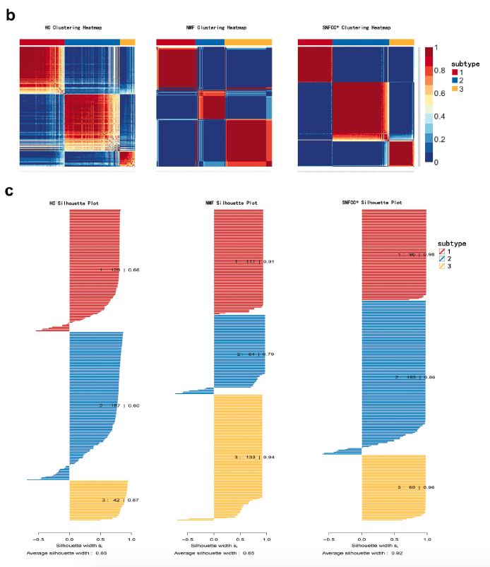

Cancer subtypes are discovered by **consensus clustering** of the molecular profile; the reference compares three algorithms on the same cohort — hierarchical consensus clustering (CC), consensus NMF (CNMF) and similarity-network-fusion clustering (SNFCC) — and reads their agreement plus the survival difference of the consensus subtypes \[1\]. The `CancerSubtypes`/`SNFtool` packages are not in this repository's lockfile; the three algorithms are re-implemented in-page (subsampled hierarchical consensus, `NMF`-package cophenetic selection, and the SNF diffusion kernel from the original papers), and the figures run on ComplexHeatmap/ggplot2:

## Example

{fig-alt="Cancer Subtype Consensus Clustering Comparison DEMO" fig-align="center" width="70%"}

## Setup

-   System Requirements: Cross-platform (Linux/MacOS/Windows)

-   Programming language: R

-   Dependent packages: `NMF`; `ComplexHeatmap`; `circlize`; `ggplot2`; `survival`

```{r packages setup, message=FALSE, warning=FALSE, output=FALSE}
suppressPackageStartupMessages({
  library(NMF); library(ComplexHeatmap); library(circlize); library(ggplot2); library(survival)
})
```

```{r}
sessioninfo::session_info("attached")
```

## Data Preparation

180 tumours × 80 genes (z-scored expression) with three planted subtypes (A/B/C), plus simulated survival where subtype C carries the worst prognosis. Two data views are generated for SNF (expression and a correlated methylation-like block) so the fusion has something to integrate:

```{r load data}
suppressPackageStartupMessages({
  library(NMF); library(ComplexHeatmap); library(circlize); library(ggplot2); library(survival)
})
set.seed(52332)
n_sam <- 180; n_gene <- 80
samples <- sprintf("T%03d", seq_len(n_sam))
genes <- sprintf("GENE%02d", seq_len(n_gene))

## planted subtypes on gene blocks
true_sub <- factor(sample(c("A", "B", "C"), n_sam, TRUE, prob = c(0.4, 0.35, 0.25)))
expr <- matrix(rnorm(n_gene * n_sam), n_gene, n_sam, dimnames = list(genes, samples))
blocks <- list(A = 1:25, B = 26:50, C = 51:70)
for (st in names(blocks)) {
  ix <- true_sub == st
  expr[blocks[[st]], ix] <- expr[blocks[[st]], ix] + 1.8
}
expr_z <- t(scale(t(expr)))

## second view (methylation-like, correlated with the same structure)
view2 <- expr_z[1:40, ] * 0.7 + matrix(rnorm(40 * n_sam, 0, 0.5), 40, n_sam)

## survival: subtype C worst
haz <- 0.06 * c(0.8, 1.0, 1.9)[true_sub]
clin <- data.frame(sample = samples, subtype_true = true_sub,
                   time = round(rexp(n_sam, rate = pmax(haz, 0.01)), 1),
                   event = rbinom(n_sam, 1, 0.7))
```

## Visualization

### 1. Cophenetic Coefficient for Method Choice

The reference's model-selection figure: NMF is fit at ranks 2-6 and the **cophenetic correlation** — how faithfully the consensus matrix preserves the linkage — peaks at the true rank:

```{r}
#| label: fig-1.1SubtypeCophenetic
#| fig-cap: "NMF cophenetic correlation across ranks 2-6 (20 runs per rank): the coefficient peaks at rank 3, the planted subtype number, and falls as ranks fragment the structure — the classical consensus-clustering model-choice criterion."
#| out.width: "75%"
#| fig-width: 6.2
#| fig-height: 4.8

## NMF requires non-negative input — shift the z-scored matrix
expr_nmf <- expr_z - min(expr_z) + 0.1
set.seed(1)
ranks <- 2:6
coph <- sapply(ranks, function(k) {
  res <- NMF::nmf(expr_nmf, rank = k, method = "brunet", nrun = 20, seed = 1)
  cm <- NMF::consensus(res)
  hc <- hclust(as.dist(1 - cm), method = "average")
  cor(as.dist(1 - cm), cophenetic(hc))   # cophenetic correlation
})
rank_df <- data.frame(rank = ranks, coph = coph)
ggplot(rank_df, aes(rank, coph)) +
  geom_line(linewidth = 0.9, colour = "#2166AC") +
  geom_point(size = 3, colour = "#2166AC") +
  geom_point(data = rank_df[which.max(rank_df$coph), ], size = 5.2,
             shape = 21, fill = "#B2182B", colour = "black", stroke = 1) +
  scale_x_continuous(breaks = ranks) +
  labs(x = "Cluster rank k", y = "Cophenetic correlation") +
  theme_bw(base_size = 11) +
  theme(panel.grid.minor = element_blank())
best_k <- ranks[which.max(coph)]
```

### 2. Hierarchical Consensus Matrix

The CC method's consensus matrix at k = 3: how often every pair of tumours lands in the same cluster across 40 subsampled runs, ordered by subtype — a clean block-diagonal is the evidence the subtype structure is stable:

```{r}
#| label: fig-2.1SubtypeCcHm
#| fig-cap: "Hierarchical consensus matrix at k = 3 (40 runs at 80% subsampling), samples ordered by consensus subtype: three dark diagonal blocks with near-zero off-block co-clustering — the subtype structure is stable under resampling."
#| out.width: "80%"
#| fig-width: 6.5
#| fig-height: 6

## SNF following the original paper (verified): row-normalised KNN kernels,
## each view's state diffuses through its initial kernel, and labels come
## from spectral clustering of the fused graph (SNFtool's downstream step)
make_knn <- function(M, K = 20) {
  D <- as.matrix(dist(t(M)))
  W <- matrix(0, ncol(M), ncol(M))
  for (i in seq_len(ncol(M))) {
    nb <- order(D[i, ])[2:(K + 1)]
    W[i, nb] <- exp(-D[i, nb]^2 / (mean(D[i, nb]) + 1e-9))
  }
  W / pmax(rowSums(W), 1e-8)          # paper: row sums
}
views <- list(expr_z, view2)
K <- 20; T_ <- 10
S0 <- lapply(views, make_knn, K = K)   # initial kernels S(0)
P <- S0                                # states P(0)
for (t in seq_len(T_)) {
  K2 <- P[[2]] %*% t(P[[2]]); S1 <- S0[[1]] * K2 / max(K2)
  K1 <- P[[1]] %*% t(P[[1]]); S2 <- S0[[2]] * K1 / max(K1)
  P[[1]] <- make_knn(S1, K)
  P[[2]] <- make_knn(S2, K)
}
Wf <- P[[1]] + P[[2]]
d <- rowSums(Wf); L <- diag(d) - Wf
ev <- eigen(L, symmetric = TRUE)
emb <- ev$vectors[, ncol(Wf):(ncol(Wf) - 2)]   # smallest 3 eigenvectors
emb <- emb / pmax(sqrt(rowSums(emb^2)), 1e-9)  # unit rows (SNFtool)
set.seed(7)
snf_lab <- kmeans(emb, centers = 3, nstart = 50)$cluster

## CC: subsampled hierarchical consensus
set.seed(2)
n_s <- floor(0.8 * n_sam); reps <- 40
co <- matrix(0, n_sam, n_sam)
for (r in seq_len(reps)) {
  ix <- sample(n_sam, n_s)
  hc <- hclust(dist(t(expr_z[, ix])), method = "ward.D2")
  lab <- cutree(hc, k = 3)
  co[ix, ix] <- co[ix, ix] + (outer(lab, lab, "==") * 1)
}
co <- co / reps
cc_lab <- cutree(hclust(as.dist(1 - co), method = "complete"), k = 3)

## CNMF labels at best_k
set.seed(3)
nmf_res <- NMF::nmf(expr_nmf, rank = best_k, method = "brunet", nrun = 20, seed = 1)
nmf_lab <- as.numeric(NMF::predict(nmf_res, "consensus"))   # 1..k per sample

ord <- order(cc_lab, -rowSums(co))
Heatmap(co[ord, ord], name = "Consensus\nfraction",
        col = colorRamp2(c(0, 0.5, 1), c("white", "#9ECAE1", "#2166AC")),
        cluster_rows = FALSE, cluster_columns = FALSE,
        show_row_names = FALSE, show_column_names = FALSE,
        row_split = factor(cc_lab[ord], levels = 1:3),
        row_title = "Samples (by CC subtype)", column_title = "Hierarchical consensus matrix (k = 3)")
```

### 3. Method-to-Method Agreement

```{r}
#| label: fig-2.2SubtypeAgree
#| fig-cap: "Method-to-method agreement at k = 3 (rows and columns are cluster labels 1-3): CC, CNMF and SNF pairs are all diagonal-dominant — the three algorithms recover the same three subtypes, evidence the structure is data-driven."
#| out.width: "90%"
#| fig-width: 8.5
#| fig-height: 3.6

## method agreement table
ag <- as.data.frame(table(CC = factor(cc_lab, 1:3),
                          CNMF = factor(nmf_lab, 1:3),
                          SNF = factor(snf_lab, 1:3)))
# pairwise agreement heatmaps: CC vs CNMF, CC vs SNF, CNMF vs SNF
mk_pair <- function(a, b, la, lb) {
  tab <- as.data.frame(table(a = factor(a, 1:3), b = factor(b, 1:3)))
  data.frame(row = rep(lb, 3), col = rep(la, each = 3),
             row_i = rep(1:3, 3), col_i = rep(1:3, each = 3),
             n = tab$Freq[order(tab$b, tab$a)])
}
p1 <- mk_pair(cc_lab, nmf_lab, "CC", "CNMF")
p2 <- mk_pair(cc_lab, snf_lab, "CC", "SNF")
p3 <- mk_pair(nmf_lab, snf_lab, "CNMF", "SNF")
pair_df <- rbind(cbind(p1, pair = "CC vs CNMF"),
                 cbind(p2, pair = "CC vs SNF"),
                 cbind(p3, pair = "CNMF vs SNF"))
pair_df$pair <- factor(pair_df$pair, levels = c("CC vs CNMF", "CC vs SNF", "CNMF vs SNF"))

p_ag <- ggplot(pair_df, aes(col_i, row_i, fill = n)) +
  geom_tile(colour = "white") +
  geom_text(aes(label = n), colour = "grey15", size = 3) +
  scale_fill_gradient(low = "white", high = "#B2182B", name = "tumours", guide = "none") +
  scale_x_continuous(breaks = 1:3, labels = c("1", "2", "3"), expand = c(0, 0)) +
  scale_y_continuous(breaks = 1:3, labels = c("1", "2", "3"), expand = c(0, 0)) +
  labs(x = NULL, y = NULL) +
  facet_wrap(~pair, nrow = 1) +
  coord_fixed() +
  theme_bw(base_size = 11) +
  theme(axis.text.x = element_text(size = 9),
        axis.text.y = element_text(size = 9),
        strip.background = element_blank(),
        panel.grid = element_blank())

p_ag
```

### 4. Survival by Consensus Subtype

The clinical read-out: overall survival per SNF consensus subtype — the planted poor-prognosis subtype C stands out:

```{r}
#| label: fig-2.3SubtypeSurv
#| fig-cap: "Overall survival by SNF consensus subtype: the poor-prognosis subtype (3) separates from the other two (log-rank p < 0.001) — the clinical relevance read-out the reference pairs with the clustering comparison."
#| out.width: "85%"
#| fig-width: 7
#| fig-height: 5

surv_df <- clin
surv_df$lab <- factor(snf_lab, levels = c(1, 2, 3))
sf <- survfit(Surv(time, event) ~ lab, data = surv_df)
km <- data.frame(time = sf$time, surv = sf$surv,
                 strata = rep(names(sf$strata), sf$strata))
km$strata <- sub("lab=", "Subtype ", km$strata)
sdf <- survdiff(Surv(time, event) ~ lab, data = surv_df)
p_lr <- 1 - pchisq(sdf$chisq, length(sdf$n) - 1)
p_lab <- if (p_lr < 0.001) "log-rank p < 0.001" else sprintf("log-rank p = %.3f", p_lr)

pal <- c(`Subtype 1` = "#4472C4", `Subtype 2` = "#8EA325", `Subtype 3` = "#B2182B")
ggplot(km, aes(time, surv, colour = strata)) +
  geom_step(linewidth = 1) +
  annotate("text", x = max(surv_df$time) * 0.38, y = 0.12, label = p_lab,
           size = 3.4, colour = "grey15") +
  scale_colour_manual(values = pal, name = NULL) +
  scale_y_continuous(limits = c(0, 1), expand = expansion(mult = c(0, 0))) +
  labs(x = "Time (months)", y = "Overall survival") +
  theme_bw(base_size = 11) +
  theme(panel.grid.minor = element_blank(),
        legend.position = "top")
```

::: callout-tip
**Practice tips**
-   Choose k on the **cophenetic correlation** (or cluster-consensus values) — fitting the planted k because you know it beforehand is circular; the criterion must stand on its own.
-   Compare **at least two algorithms** before naming subtypes: diagonal-heavy agreement tables (here CC/CNMF/SNF) argue the structure is data-driven, not an artefact of one linkage or factorisation.
-   SNF needs **two genuinely different views** — fusing the same matrix twice adds no information; expression + methylation (or mutation + CNV) is the intended use.
-   Report survival per subtype **after** the comparison: subtypes without a clinical outcome difference are descriptive, not actionable.
-   Fix `seed` for every stochastic step (NMF runs, subsampling) so the consensus matrices are reproducible.
:::

## Application

::: {#fig-CancerSubtypeApplications1}
{fig-alt="Cancer Subtype Consensus Clustering Comparison" fig-align="center" width="70%"}

Cancer subtype consensus clustering comparison
:::

Consensus-clustering comparisons apply to any tumour molecular typing effort: multi-omics subtype discovery, immune-phenotype stratification, or treatment-response class comparison.

## Reference

\[1\] Xiaofan Lu, et al. FigureYa: A Standardized Visualization Framework for Enhancing Biomedical Data Interpretation and Research Efficiency. iMetaMed. 2025. doi:10.1002/imm3.70005
