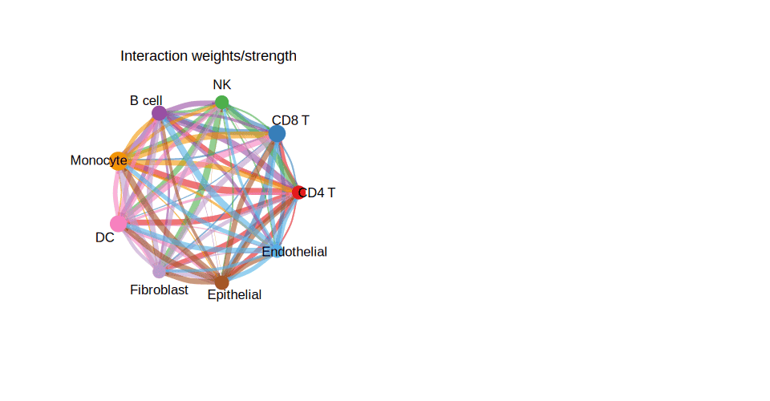

The Cell-Cell Communication Circle Plot (细胞-细胞通讯网络圈图) is a specialized visualization for depicting intercellular signaling interactions inferred from single-cell RNA sequencing (scRNA-seq) data. Using the **CellChat** R package, this plot presents a circular network where nodes represent cell populations (cell types or clusters) and directed edges indicate the strength and direction of ligand-receptor communication signals between them.

The arc width of each edge encodes communication probability, and the self-loops on each node represent autocrine signaling. Color coding maps each cell type to a distinct hue, and arrow directionality shows the sender-receiver relationship. This visualization is particularly powerful for discovering cross-talk between immune cells and tumor cells, identifying key signaling hubs in tissue microenvironments, and comparing communication networks across biological conditions.

## Example

{fig-alt="Cell-Cell Communication Circle Plot DEMO" fig-align="center" width="60%"}

## Setup

-   System Requirements: Cross-platform (Linux/MacOS/Windows)

-   Programming Language: R

-   Dependencies: `CellChat`, `ggplot2`, `circlize`

```{r packages setup, message=FALSE, warning=FALSE, output=FALSE}
# Install Bioconductor manager if needed
if (!requireNamespace("BiocManager", quietly = TRUE)) {
  install.packages("BiocManager")
}

# Install CRAN dependencies
if (!requireNamespace("ggplot2", quietly = TRUE)) install.packages("ggplot2")
if (!requireNamespace("circlize", quietly = TRUE)) install.packages("circlize")
if (!requireNamespace("igraph", quietly = TRUE)) install.packages("igraph")
if (!requireNamespace("ggraph", quietly = TRUE)) install.packages("ggraph")
if (!requireNamespace("tidygraph", quietly = TRUE)) install.packages("tidygraph")
if (!requireNamespace("ggrepel", quietly = TRUE)) install.packages("ggrepel")

# Install CellChat from GitHub (jinworks/CellChat is the current maintained fork)
if (!requireNamespace("CellChat", quietly = TRUE)) {
  if (!requireNamespace("remotes", quietly = TRUE)) install.packages("remotes")
  remotes::install_github("jinworks/CellChat")
}

# Load packages
library(CellChat)
library(ggplot2)
library(circlize)
library(ggraph)
library(tidygraph)
library(ggrepel)
```

```{r session info}
sessioninfo::session_info("attached")
```

## Data Preparation

For this tutorial, we build a simulated CellChat-compatible communication matrix so the
example is fully self-contained and runs without requiring an external dataset or model
inference. The same visualizations work identically with a real `CellChat` object produced
from your own scRNA-seq data.

```{r simulate data, message=FALSE, warning=FALSE}
# Simulate a communication count/weight matrix
# In real use, these come from cellchat@net$count and cellchat@net$weight

set.seed(42)
cell_types <- c("CD4 T", "CD8 T", "NK", "B cell", "Monocyte",
                "DC", "Fibroblast", "Epithelial", "Endothelial")
n <- length(cell_types)

net_count  <- matrix(sample(0:50, n * n, replace = TRUE), n, n,
                     dimnames = list(cell_types, cell_types))
net_weight <- matrix(runif(n * n, 0, 1), n, n,
                     dimnames = list(cell_types, cell_types))
diag(net_count)  <- 0  # remove self-communication
diag(net_weight) <- 0

# Group size (proportional to number of cells per type, simulated)
group_size <- sample(50:500, n, replace = TRUE)
names(group_size) <- cell_types

cat("Simulated", n, "cell types with", sum(net_count), "total interactions\n")
print(net_count)
```

### Build a CellChat Object from Your Own Data (Reference)

The following code is for reference only (`eval: false`). It shows how to build a CellChat
object from a Seurat scRNA-seq object before running the visualizations below.

```{r upstream workflow, eval=FALSE, echo=TRUE}
library(Seurat)
library(CellChat)

# 1. Extract normalised count matrix and metadata from a Seurat object
seurat_obj  <- readRDS("your_seurat_object.rds")
data_input  <- GetAssayData(seurat_obj, assay = "RNA", slot = "data")
meta        <- seurat_obj@meta.data

# 2. Create CellChat object
cellchat <- createCellChat(object = data_input, meta = meta, group.by = "cell_type")

# 3. Set ligand-receptor database
cellchat@DB <- CellChatDB.human  # or CellChatDB.mouse

# 4. Pre-process & infer communication
cellchat <- subsetData(cellchat)
cellchat <- identifyOverExpressedGenes(cellchat)
cellchat <- identifyOverExpressedInteractions(cellchat)
cellchat <- computeCommunProb(cellchat, type = "triMean")
cellchat <- filterCommunication(cellchat, min.cells = 10)
cellchat <- computeCommunProbPathway(cellchat)
cellchat <- aggregateNet(cellchat)
# Now cellchat@net$count and cellchat@net$weight are available for plotting
```

## Visualization

### 1. Circle Plot of Overall Cell-Cell Communication Network

The overall circle plot summarizes all inferred communication interactions. Each node
represents a cell type; node size is proportional to the number of interactions it
participates in. Arc width encodes communication strength.

```{r, fig.height=5, warning=FALSE}
#| label: fig-1-overall-circle
#| fig-cap: "Overall Cell-Cell Communication Circle Plot"
#| out.width: "95%"

par(mfrow = c(1, 2), xpd = TRUE)

# Panel A: Number of interactions
netVisual_circle(
  net_count,
  vertex.weight = group_size,
  weight.scale  = TRUE,
  label.edge    = FALSE,
  title.name    = "Number of interactions"
)

# Panel B: Interaction strength (weights)
netVisual_circle(
  net_weight,
  vertex.weight = group_size,
  weight.scale  = TRUE,
  label.edge    = FALSE,
  title.name    = "Interaction weights/strength"
)

par(mfrow = c(1, 1))
```

### 2. Circle Plot for Individual Cell Groups

To highlight the outgoing signals from each cell type separately, we subset the weight
matrix row by row and produce one circle per cell type.

```{r, fig.height=10, warning=FALSE}
#| label: fig-2-individual-circle
#| fig-cap: "Per-Cell-Type Outgoing Communication Circle Plot"
#| out.width: "95%"

n_types <- nrow(net_weight)
n_cols  <- ceiling(sqrt(n_types))
n_rows  <- ceiling(n_types / n_cols)

par(mfrow = c(n_rows, n_cols), xpd = TRUE, mar = c(1, 1, 2, 1))

for (i in seq_len(n_types)) {
  mat_i          <- matrix(0, nrow = n_types, ncol = n_types,
                           dimnames = dimnames(net_weight))
  mat_i[i, ]    <- net_weight[i, ]   # outgoing signals from cell type i

  netVisual_circle(
    mat_i,
    vertex.weight   = group_size,
    weight.scale    = TRUE,
    edge.weight.max = max(net_weight),
    title.name      = rownames(net_weight)[i]
  )
}

par(mfrow = c(1, 1))
```

### 3. Chord Diagram

The chord diagram provides an alternative circular view using `circlize`, clearly showing
bidirectional communication volumes between cell type pairs.

```{r, fig.height=7, warning=FALSE}
#| label: fig-3-chord
#| fig-cap: "Cell-Cell Communication Chord Diagram"
#| out.width: "80%"

# Use circlize for a chord diagram of communication weights
chordDiagram(
  net_weight,
  transparency      = 0.4,
  annotationTrack   = "grid",
  preAllocateTracks = 1
)

circos.trackPlotRegion(
  track.index = 1,
  panel.fun   = function(x, y) {
    circos.text(
      CELL_META$xcenter,
      CELL_META$ylim[1] + 0.1,
      CELL_META$sector.index,
      facing     = "clockwise",
      niceFacing = TRUE,
      adj        = c(0, 0.5),
      cex        = 0.7
    )
  },
  bg.border = NA
)

title("Cell-Cell Communication (Chord Diagram)")
circos.clear()
```

### 4. Communication Heatmap

A heatmap view allows rapid identification of dominant sender-receiver pairs and
asymmetric communication patterns.

```{r, fig.height=6, warning=FALSE}
#| label: fig-4-heatmap
#| fig-cap: "Cell-Cell Communication Heatmap"
#| out.width: "80%"

df_heat <- as.data.frame(as.table(net_weight))
colnames(df_heat) <- c("Sender", "Receiver", "Weight")

ggplot(df_heat, aes(x = Receiver, y = Sender, fill = Weight)) +
  geom_tile(color = "white", linewidth = 0.4) +
  scale_fill_gradient(low = "white", high = "#b74147", name = "Weight") +
  theme_minimal(base_size = 11) +
  theme(
    axis.text.x = element_text(angle = 45, hjust = 1),
    panel.grid  = element_blank(),
    plot.title  = element_text(size = 13, face = "bold", hjust = 0.5)
  ) +
  labs(
    title = "Cell-Cell Communication Heatmap",
    x = "Receiver", y = "Sender"
  )
```


### 5. CellPhoneDB-Style Ligand-Receptor Dot Plot

The CellPhoneDB output is conventionally shown as a **dot heatmap**: rows = ligand-receptor pairs, columns = cell-type pairs, point size = permutation P value, colour = scaled mean expression of both partners \[4\]. This recipe reproduces that layout from a simulated interaction table.

```{r}
#| label: fig-5.1CellPhoneDB
#| fig-cap: "CellPhoneDB-style dot plot: rows = ligand-receptor pairs, columns = cell-type pairs; point size = permutation P, colour = scaled mean expression."
#| out.width: "95%"
#| warning: false
#| message: false
#| fig-width: 9
#| fig-height: 5

set.seed(2401)
lr_pairs <- c("FGFR1_FGF2", "MET_HGF", "EGFR_EGFR", "VEGFB_FLT1",
              "NOTCH1_DLL1", "WNT5A_FZD5", "CXCL12_CXCR4", "PDGFB_PDGFRB")
cell_pairs <- c("EC1|EC2", "EC1|Fibro", "EC2|SMC", "Fibro|EC1",
                "EC2|EC2", "SMC|EC1", "Fibro|EC2", "EC1|SMC")

lr_df <- expand.grid(pair = lr_pairs, cell_pair = cell_pairs,
                     stringsAsFactors = FALSE)
lr_df$pval  <- runif(nrow(lr_df), 0, 1)
lr_df$mean  <- rnorm(nrow(lr_df), 0.5, 0.4)
lr_df$mean  <- pmax(pmin(lr_df$mean, 1.5), 0)

ggplot(lr_df, aes(cell_pair, pair, size = pval, colour = mean)) +
  geom_point(alpha = 0.85) +
  scale_size_continuous(range = c(0.5, 6), trans = "reverse",
                        name = "Permutation P") +
  scale_colour_gradient(low = "#445EAD", high = "#B2182B",
                        name = "Scaled mean\nexpression") +
  labs(x = "Cell-type pair", y = "Ligand-receptor pair") +
  theme_classic(base_size = 10) +
  theme(axis.text.x = element_text(angle = 45, hjust = 1),
        legend.box = "vertical")
```

::: callout-tip
**Practice tips**

-   CellPhoneDB permutation P values are one-sided (larger = more random); `scale_size_continuous(trans = "reverse")` flips the axis so larger points = more significant.
-   The colour scale represents the **mean of the two partners' normalised expression**, which is what CellPhoneDB reports as `scale_factor`.
-   `expand.grid()` creates all pair combinations; subset to significant interactions (e.g. P < 0.05) before plotting for cleaner figures.
-   For the network-scale view of the same table, section 7 renders the FigureYa310 edge-bundled chord (two-level dendrogram + `geom_conn_bundle`).
:::


### 6. Differential Communication Between Two Conditions

Stimulation-vs-control is the recurring comparison: which sender|receiver channels **change**. CellChat ships `compareInteractions()` for exactly this, and the difference matrices behind it (`stim$count - ctrl$count`) support two honest views \[5\]: a butterfly bar of the top changed pairs, and the interaction circle **pulled open** to only the changed links.

```{r cellchat-compare-ref, eval=FALSE}
# With real CellChat objects (reference route):
cellchat <- mergeCellChat(list(CTRL = ctrl.cellchat, STIM = stim.cellchat),
                          add.names = names(list(CTRL = 1, STIM = 2)))
gg1 <- compareInteractions(cellchat, show.legend = FALSE, group = c(1, 2))
gg2 <- compareInteractions(cellchat, show.legend = FALSE, group = c(1, 2),
                           measure = "weight")
```

```{r}
#| label: fig-6.1DiffBars
#| fig-cap: "STIM-vs-CTRL differential communication: the top sender|receiver pairs ranked by the count difference; red = up in STIM, blue = up in CTRL, labels print the signed delta."
#| out.width: "95%"
#| warning: false
#| message: false
#| fig-width: 9
#| fig-height: 5.2

set.seed(1619)
cts <- c("CD14 Mono", "T CD4", "T CD8", "NK", "B", "Fibro")
base_c <- matrix(c(0, 18, 12, 6, 8, 5,
                   9, 0, 6, 10, 4, 3,
                   7, 5, 0, 8, 3, 2,
                   4, 3, 3, 0, 2, 2,
                   14, 6, 2, 2, 0, 4,
                   3, 2, 1, 1, 2, 0), 6, 6, byrow = TRUE,
                 dimnames = list(cts, cts))
## two conditions: three CD14-mono-driven links up in STIM, two links up in CTRL
stim <- ctrl <- base_c
stim["CD14 Mono", "T CD4"] <- stim["CD14 Mono", "T CD4"] + 46
stim["CD14 Mono", "Fibro"] <- stim["CD14 Mono", "Fibro"] + 38
stim["Fibro", "CD14 Mono"] <- stim["Fibro", "CD14 Mono"] + 31
ctrl["B", "T CD4"]         <- ctrl["B", "T CD4"]         + 27
ctrl["NK", "T CD8"]        <- ctrl["NK", "T CD8"]        + 22
diff <- stim - ctrl                       # = STIM-count - CTRL-count matrix

pairs <- expand.grid(sender = cts, receiver = cts, stringsAsFactors = FALSE)
pairs$d <- as.numeric(diff[cbind(pairs$sender, pairs$receiver)])
pairs <- subset(pairs, sender != receiver)
pairs$pair <- paste0(pairs$sender, " \u2192 ", pairs$receiver)
top <- pairs[order(-abs(pairs$d)), ]
top <- top[!duplicated(top$pair), ][seq_len(12), ]

p_bfly <- ggplot(top, aes(x = reorder(pair, d), fill = d > 0)) +
  geom_col(aes(y = d), width = 0.72, colour = "grey25", linewidth = 0.2) +
  geom_text(aes(y = d + sign(d) * 3.5, label = sprintf("%+d", as.integer(d))),
            size = 2.6, hjust = 0.5) +
  scale_fill_manual(values = c("FALSE" = "#1F5FA6", "TRUE" = "#C0272D"),
                     guide = "none") +
  coord_flip() +
  labs(x = NULL, y = "STIM - CTRL interactions") +
  theme_minimal(base_size = 11) +
  theme(axis.text.y = element_text(size = 8),
        panel.grid.major.y = element_blank())
print(p_bfly)
```

```{r}
#| label: fig-6.2DiffCircle
#| fig-cap: "The same difference as a circular network: node ring width scales with total communication, curved links show only the changed pairs, red thickening up in STIM, blue up in CTRL."
#| out.width: "80%"
#| warning: false
#| message: false
#| fig-width: 6.5
#| fig-height: 6

par(mar = rep(1.2, 4))
plot(c(-1.35, 1.35), c(-1.35, 1.35), type = "n", ax = FALSE, ann = FALSE)
ang <- seq(pi / 2, pi / 2 + 2 * pi, length.out = length(cts) + 1)[seq_along(cts)]
pos <- cbind(cos(ang), sin(ang)); rownames(pos) <- cts

circle <- function(x0, y0, r, col, lwd = 1) {
  th <- seq(0, 2 * pi, length.out = 100)
  lines(x0 + r * cos(th), y0 + r * sin(th), col = col, lwd = lwd)
}
tot <- rowSums(stim) + rowSums(ctrl)
for (i in seq_along(cts))
  circle(pos[i, 1], pos[i, 2], 0.09, col = "#24364A",
         lwd = 1 + tot[i] / max(tot) * 2.2)

for (s in cts) for (r in cts) if (s != r) {
  d <- diff[s, r]
  if (abs(d) >= 15) {
    col <- if (d > 0) adjustcolor("#C0272D", alpha = 0.68)
           else adjustcolor("#1F5FA6", alpha = 0.68)
    mx <- (pos[s, 1] + pos[r, 1]) / 2 * 0.22
    my <- (pos[s, 2] + pos[r, 2]) / 2 * 0.22
    lines(c(pos[s, 1], mx, pos[r, 1]), c(pos[s, 2], my, pos[r, 2]),
          col = col, lwd = 0.6 + abs(d) / 12)
  }
}
text(pos[, 1] * 1.22, pos[, 2] * 1.22, cts, cex = 0.8, col = "#24364A")
title("STIM vs CTRL differential circle", line = 0.2, cex.main = 1, font.main = 2)
legend("bottomleft", legend = c("up in STIM", "up in CTRL"),
       col = c("#C0272D", "#1F5FA6"), lwd = 3, bty = "n", cex = 0.75)
```

::: callout-tip
**Practice tips**

-   Threshold the links (`abs(d) >= 15`): drawing every non-zero difference turns the circle into a hairball; the changed pairs are the figure's argument.
-   Keep red/blue **one convention across both panels** (here: red = up in STIM) - bar and circle are two readings of the same `diff` matrix and must never disagree.
-   The count difference is Poisson-like noise at low counts; for a publication claim, back the visual with a Poisson/binomial test on the drawn interaction counts.
:::


### 7. Two-Group Differential Communication as an Edge-Bundled Chord

The FigureYa310 layout \[6\] reads like a chord diagram but is a **hierarchical edge bundle**: radial tree arms root → cell type → gene, and the ligand–receptor interactions are drawn as bundles connecting a source-cell ligand leaf to a target-cell receptor leaf. Colour carries the ligand's log2 fold change between the two conditions (red = up in STIM), node size the expressing fraction, and the open-vs-filled shape separates ligands from receptors. The input is the same differential table as the §5 dot plot (CellPhoneDB `means`/`pvalues` files plus per-cell-type DE, or the simulated stand-in below); the bundle view adds the *hierarchy* — you see at a glance which cell-type pair a gene belongs to.

```{r}
#| label: fig-7.1CPDBBundle
#| fig-cap: "Differential ligand-receptor communication as an edge-bundled chord (ggraph): radial tree arms per cell type, bundles coloured by ligand log2 fold change (red = up in STIM), leaf size = expressing fraction, open = ligand, filled = receptor."
#| out.width: "85%"
#| warning: false
#| message: false
#| fig-width: 9
#| fig-height: 9

set.seed(3101)
cells <- c("Cancer", "T CD4", "T CD8", "Macro", "Fibro")
lrs <- expand.grid(ligand = c("EGFR", "ERBB2", "MET", "TGFB1", "CXCL12", "CCL5",
                              "VEGFA", "FGF2", "WNT5A", "DLL4"),
                   receptor = c("EGFR", "ERBB3", "MET", "TGFBR1", "CXCR4", "CCR5",
                                "KDR", "FGFR1", "FZD4", "NOTCH1"), stringsAsFactors = FALSE)
lrs <- lrs[sample(nrow(lrs), 22), ]
lrs$source <- sample(cells, 22, replace = TRUE, prob = c(0.4, 0.15, 0.15, 0.15, 0.15))
lrs$target <- sample(cells, 22, replace = TRUE, prob = c(0.1, 0.2, 0.2, 0.3, 0.2))
lrs$logFC <- rnorm(22, 0, 1)
lrs$logFC[lrs$source == "Cancer"] <- lrs$logFC[lrs$source == "Cancer"] + 0.8
lrs$logFC <- pmin(pmax(lrs$logFC, -2), 2)
lrs$frac <- runif(22, 0.1, 0.9)
lrs$from <- paste0(lrs$ligand, "_", lrs$source, "_ligand")
lrs$to <- paste0(lrs$receptor, "_", lrs$target, "_receptor")
celltypes <- unique(c(lrs$source, lrs$target))

vert <- rbind(
  data.frame(name = unique(lrs$from), celltype = gsub(".*_(.+)_ligand", "\\1", unique(lrs$from)),
             type = "ligand", frac = lrs$frac[match(unique(lrs$from), lrs$from)],
             label = gsub("_.*", "", unique(lrs$from))),
  data.frame(name = unique(lrs$to), celltype = gsub(".*_(.+)_receptor", "\\1", unique(lrs$to)),
             type = "receptor", frac = NA,
             label = gsub("_.*", "", unique(lrs$to))))
vert <- vert[!duplicated(vert$name), ]
vert$frac[is.na(vert$frac)] <- runif(sum(is.na(vert$frac)), 0.1, 0.9)
head_df <- data.frame(
  name = c("root", paste0(celltypes, "_ligand"), paste0(celltypes, "_receptor")),
  celltype = c("root", celltypes, celltypes),
  type = c("root", rep("ligand", length(celltypes)), rep("receptor", length(celltypes))),
  frac = 0.5, label = c("root", celltypes, celltypes))
vert_all <- rbind(head_df, vert)

## tree edges only (root -> cell-type arms -> gene nodes); the ligand-receptor
## interactions are NOT tree edges, they go into get_con() as node index pairs
## (parallel edges would break the dendrogram layout)
edges <- unique(rbind(
  data.frame(from = "root", to = paste0(celltypes, "_ligand")),
  data.frame(from = "root", to = paste0(celltypes, "_receptor")),
  data.frame(from = paste0(lrs$source, "_ligand"), to = lrs$from),
  data.frame(from = paste0(lrs$target, "_receptor"), to = lrs$to)))
g <- graph_from_data_frame(edges, directed = TRUE, vertices = vert_all)
from_m <- match(lrs$from, vert_all$name)
to_m <- match(lrs$to, vert_all$name)

## precompute the bundle data on the CIRCULAR layout (matching the ggraph call)
## and attach per-connection logFC via con.id - ggraph does not propagate edge
## attributes into geom_conn_bundle
bundle <- get_con(from = from_m, to = to_m)(
  create_layout(g, layout = "dendrogram", circular = TRUE))
bundle$logFC <- lrs$logFC[bundle$con.id]

cell.col <- setNames(c("#8DD3C7", "#BEBADA", "#FB8072", "#80B1D3", "#FDB462")[1:length(celltypes)], celltypes)
ggraph(g, layout = "dendrogram", circular = TRUE) +
  geom_conn_bundle(data = bundle, aes(colour = logFC),
                   width = 1.1, tension = 0.6, alpha = 0.85) +
  geom_node_point(aes(size = frac, filter = leaf, colour = celltype, shape = type)) +
  geom_node_text(aes(x = x * 1.08, y = y * 1.08, label = label, filter = leaf),
                 size = 2.6, repel = TRUE, segment.size = 0.2, max.overlaps = 20) +
  scale_edge_colour_gradientn(colours = c("#3E52C5", "#FFFFFF", "#B91129"),
                              limits = c(-2, 2), name = "ligand log2FC") +
  scale_shape_manual(values = c("ligand" = 1, "receptor" = 19), name = NULL) +
  scale_colour_manual(values = cell.col, name = NULL) +
  theme_void()
```

::: callout-tip
**Practice tips**

-   The graph must stay a **tree**: only root → cell-type arm → gene edges belong in it, and `unique()` them — a gene that appears in several interactions has one parent per arm, and parallel edges make the dendrogram layout collapse into a line.
-   Compute the bundle with `get_con(from, to)(create_layout(g, layout = "dendrogram", circular = TRUE))` — the layout must carry the same `circular` flag as the `ggraph()` call, or the two layers silently land in different coordinate systems.
-   Colour bundles by the ligand's condition effect (the sender's biology); colouring by the receptor side mixes two stories in one plot.
:::

## References

\[1\] Jin S, Guerrero-Juarez CF, Zhang L, et al. Inference and analysis of cell-cell communication using CellChat. *Nature Communications*. 2021;12(1):1088. <https://doi.org/10.1038/s41467-021-21246-9>

\[2\] Jin S, et al. CellChat for systematic analysis of cell-cell communication from single-cell transcriptomics. *Nature Protocols*. 2024. <https://doi.org/10.1038/s41596-024-01045-4>

\[3\] CellChat GitHub: <https://github.com/jinworks/CellChat>

\[4\] Efremova M, Gong C. CellPhoneDB: inferring intercellular communication network from single-cell transcriptomics data. *Nat Methods*. 2018;15(6):431-432.

\[5\] Xiaofan Lu, et al. FigureYa267scCellChat reference figure: differential interaction comparison between conditions. FigureYapy/FigureYa documentation. <https://ying-ge.github.io/FigureYa/>

\[6\] Xiaofan Lu, et al. FigureYa310CPDBChordGramV2 reference figure: CellPhoneDB differential communication as a circular edge-bundled chord. FigureYa documentation. <https://ying-ge.github.io/FigureYa/>
