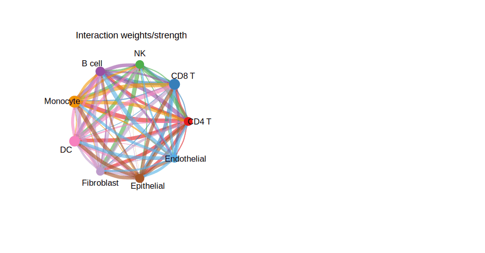

细胞-细胞通讯网络圈图是一种专用于描绘来自单细胞 RNA 测序（scRNA-seq）数据推断的细胞间信号交互的可视化方法。使用 **CellChat** R 包，该图以圆形网络的形式展示，其中节点代表细胞群（细胞类型或细胞簇），有向边表示细胞类型之间配体-受体通讯信号的强度和方向。

每条边的弧宽编码通讯概率，每个节点上的自环代表自分泌信号。颜色编码将每种细胞类型映射到不同颜色，箭头方向显示发送者-接收者关系。该可视化方法特别适用于发现免疫细胞与肿瘤细胞之间的交叉信号，识别组织微环境中的关键信号中枢，以及比较不同生物学条件下的通讯网络。

## 示例

{fig-alt="Cell-Cell Communication Circle Plot DEMO" fig-align="center" width="60%"}

## 环境配置

-   系统要求：跨平台（Linux/MacOS/Windows）

-   编程语言：R

-   依赖包：`CellChat`、`ggplot2`、`circlize`

```{r packages setup, message=FALSE, warning=FALSE, output=FALSE}
# 如有需要，安装 Bioconductor 管理器
if (!requireNamespace("BiocManager", quietly = TRUE)) {
  install.packages("BiocManager")
}

# 安装 CRAN 依赖
if (!requireNamespace("ggplot2", quietly = TRUE)) install.packages("ggplot2")
if (!requireNamespace("circlize", quietly = TRUE)) install.packages("circlize")
if (!requireNamespace("igraph", quietly = TRUE)) install.packages("igraph")

# 从 GitHub 安装 CellChat（jinworks/CellChat 为当前维护版本）
if (!requireNamespace("CellChat", quietly = TRUE)) {
  if (!requireNamespace("remotes", quietly = TRUE)) install.packages("remotes")
  remotes::install_github("jinworks/CellChat")
}

# 加载包
library(CellChat)
library(ggplot2)
library(circlize)
```

```{r session info}
sessioninfo::session_info("attached")
```

## 数据准备

本教程使用模拟的 CellChat 兼容通讯矩阵，使示例完全自包含，无需外部数据集或模型推断即可运行。对于使用真实 `CellChat` 对象（由您自己的 scRNA-seq 数据生成）的用户，相同的可视化代码同样适用。

```{r simulate data, message=FALSE, warning=FALSE}
# 模拟通讯计数/权重矩阵
# 在实际使用中，这些数据来自 cellchat@net$count 和 cellchat@net$weight

set.seed(42)
cell_types <- c("CD4 T", "CD8 T", "NK", "B cell", "Monocyte",
                "DC", "Fibroblast", "Epithelial", "Endothelial")
n <- length(cell_types)

net_count  <- matrix(sample(0:50, n * n, replace = TRUE), n, n,
                     dimnames = list(cell_types, cell_types))
net_weight <- matrix(runif(n * n, 0, 1), n, n,
                     dimnames = list(cell_types, cell_types))
diag(net_count)  <- 0  # 移除自分泌通讯
diag(net_weight) <- 0

# 每种细胞类型的细胞数量（模拟）
group_size <- sample(50:500, n, replace = TRUE)
names(group_size) <- cell_types

cat("模拟了", n, "种细胞类型，共", sum(net_count), "次交互\n")
print(net_count)
```

### 使用自有数据构建 CellChat 对象（参考代码）

以下代码仅供参考（`eval: false`），展示如何从 Seurat scRNA-seq 对象构建 CellChat 对象，然后进行下方的可视化。

```{r upstream workflow, eval=FALSE, echo=TRUE}
library(Seurat)
library(CellChat)

# 1. 从 Seurat 对象提取标准化计数矩阵和元数据
seurat_obj  <- readRDS("your_seurat_object.rds")
data_input  <- GetAssayData(seurat_obj, assay = "RNA", slot = "data")
meta        <- seurat_obj@meta.data

# 2. 创建 CellChat 对象
cellchat <- createCellChat(object = data_input, meta = meta, group.by = "cell_type")

# 3. 设置配体-受体数据库
cellchat@DB <- CellChatDB.human  # 小鼠数据使用 CellChatDB.mouse

# 4. 预处理与推断通讯
cellchat <- subsetData(cellchat)
cellchat <- identifyOverExpressedGenes(cellchat)
cellchat <- identifyOverExpressedInteractions(cellchat)
cellchat <- computeCommunProb(cellchat, type = "triMean")
cellchat <- filterCommunication(cellchat, min.cells = 10)
cellchat <- computeCommunProbPathway(cellchat)
cellchat <- aggregateNet(cellchat)
# 此后 cellchat@net$count 和 cellchat@net$weight 即可用于绘图
```

## 可视化

### 1. 整体细胞-细胞通讯圈图

整体圈图汇总所有推断的通讯交互。每个节点代表一种细胞类型；节点大小与该细胞类型参与的交互数量成正比。弧宽编码通讯强度。

```{r}
#| label: fig-1-overall-circle
#| fig-width: 9
#| fig-height: 5
#| warning: false
#| fig-cap: "整体细胞-细胞通讯圈图"
#| out.width: "95%"

par(mfrow = c(1, 2), xpd = TRUE)

# 面板 A：交互数量
netVisual_circle(
  net_count,
  vertex.weight = group_size,
  weight.scale  = TRUE,
  label.edge    = FALSE,
  title.name    = "交互数量"
)

# 面板 B：交互强度（权重）
netVisual_circle(
  net_weight,
  vertex.weight = group_size,
  weight.scale  = TRUE,
  label.edge    = FALSE,
  title.name    = "交互权重/强度"
)

par(mfrow = c(1, 1))
```

### 2. 单细胞类型通讯圈图

逐行对权重矩阵进行子集化，分别展示每种细胞类型的输出信号。

```{r}
#| label: fig-2-individual-circle
#| fig-width: 10
#| fig-height: 10
#| warning: false
#| fig-cap: "各细胞类型输出通讯圈图"
#| out.width: "95%"

n_types <- nrow(net_weight)
n_cols  <- ceiling(sqrt(n_types))
n_rows  <- ceiling(n_types / n_cols)

par(mfrow = c(n_rows, n_cols), xpd = TRUE, mar = c(1, 1, 2, 1))

for (i in seq_len(n_types)) {
  mat_i          <- matrix(0, nrow = n_types, ncol = n_types,
                           dimnames = dimnames(net_weight))
  mat_i[i, ]    <- net_weight[i, ]   # 第 i 种细胞类型的输出信号

  netVisual_circle(
    mat_i,
    vertex.weight   = group_size,
    weight.scale    = TRUE,
    edge.weight.max = max(net_weight),
    title.name      = rownames(net_weight)[i]
  )
}

par(mfrow = c(1, 1))
```

### 3. 弦图

弦图使用 `circlize` 提供了另一种圆形视图，清晰展示细胞类型对之间的双向通讯量。

```{r}
#| label: fig-3-chord
#| fig-width: 7
#| fig-height: 7
#| warning: false
#| fig-cap: "细胞-细胞通讯弦图"
#| out.width: "80%"

chordDiagram(
  net_weight,
  transparency      = 0.4,
  annotationTrack   = "grid",
  preAllocateTracks = 1
)

circos.trackPlotRegion(
  track.index = 1,
  panel.fun   = function(x, y) {
    circos.text(
      CELL_META$xcenter,
      CELL_META$ylim[1] + 0.1,
      CELL_META$sector.index,
      facing     = "clockwise",
      niceFacing = TRUE,
      adj        = c(0, 0.5),
      cex        = 0.7
    )
  },
  bg.border = NA
)

title("细胞-细胞通讯（弦图）")
circos.clear()
```

### 4. 通讯热图

热图视图可快速识别主要的发送者-接收者细胞对及不对称通讯模式。

```{r}
#| label: fig-4-heatmap
#| fig-width: 7
#| fig-height: 6
#| warning: false
#| fig-cap: "细胞-细胞通讯热图"
#| out.width: "80%"

df_heat <- as.data.frame(as.table(net_weight))
colnames(df_heat) <- c("发送者", "接收者", "权重")

ggplot(df_heat, aes(x = 接收者, y = 发送者, fill = 权重)) +
  geom_tile(color = "white", linewidth = 0.4) +
  scale_fill_gradient(low = "white", high = "#b74147", name = "权重") +
  theme_minimal(base_size = 11) +
  theme(
    axis.text.x = element_text(angle = 45, hjust = 1),
    panel.grid  = element_blank(),
    plot.title  = element_text(size = 13, face = "bold", hjust = 0.5)
  ) +
  labs(
    title = "细胞-细胞通讯热图",
    x = "接收者", y = "发送者"
  )
```

### 5. CellPhoneDB 风格配体-受体点图

CellPhoneDB 输出通常以**点热图**展示：行 = 配体-受体对，列 = 细胞类型对，点大小 = 置换 P 值，颜色 = 两配体/受体的平均表达量 \[4\]。以下配方从模拟互作表复现该版式。

```{r}
#| label: fig-5.1CellPhoneDB
#| fig-cap: "CellPhoneDB 风格点图：行 = 配体-受体对，列 = 细胞类型对；点大小 = 置换 P，颜色 = 缩放平均表达。"
#| out.width: "95%"
#| warning: false
#| message: false
#| fig-width: 9
#| fig-height: 5

set.seed(2401)
lr_pairs <- c("FGFR1_FGF2", "MET_HGF", "EGFR_EGFR", "VEGFB_FLT1",
              "NOTCH1_DLL1", "WNT5A_FZD5", "CXCL12_CXCR4", "PDGFB_PDGFRB")
cell_pairs <- c("EC1|EC2", "EC1|Fibro", "EC2|SMC", "Fibro|EC1",
                "EC2|EC2", "SMC|EC1", "Fibro|EC2", "EC1|SMC")

lr_df <- expand.grid(pair = lr_pairs, cell_pair = cell_pairs,
                     stringsAsFactors = FALSE)
lr_df$pval  <- runif(nrow(lr_df), 0, 1)
lr_df$mean  <- rnorm(nrow(lr_df), 0.5, 0.4)
lr_df$mean  <- pmax(pmin(lr_df$mean, 1.5), 0)

ggplot(lr_df, aes(cell_pair, pair, size = pval, colour = mean)) +
  geom_point(alpha = 0.85) +
  scale_size_continuous(range = c(0.5, 6), trans = "reverse",
                        name = "Permutation P") +
  scale_colour_gradient(low = "#445EAD", high = "#B2182B",
                        name = "Scaled mean\nexpression") +
  labs(x = "Cell-type pair", y = "Ligand-receptor pair") +
  theme_classic(base_size = 10) +
  theme(axis.text.x = element_text(angle = 45, hjust = 1),
        legend.box = "vertical")
```

::: callout-tip
**实践要点**

-   CellPhoneDB 置换 P 值是单侧的（越大越随机）；`scale_size_continuous(trans = "reverse")` 反转轴使大点 = 更显著。
-   颜色标度表示**两个配体/受体归一化表达的均值**，即 CellPhoneDB 报告的 `scale_factor`。
-   `expand.grid()` 创建所有配对组合；绘图前筛除不显著互作（如 P ≥ 0.05）以获得更干净的图。
:::

## References


### 6. 两条件间差异通讯

刺激 vs 对照是高频比较：哪些发送|接收通道**发生了变化**。CellChat 自带 `compareInteractions()` 正为此而设，其背后的差值矩阵（`stim$count - ctrl$count`）支撑两种诚实视图 \[5\]：变化最大配对的蝴蝶条图，以及只留变化连线、把圆图"拉开"的差值网络。

```{r cellchat-compare-ref, eval=FALSE}
# 真实 CellChat 对象（参考路线）：
cellchat <- mergeCellChat(list(CTRL = ctrl.cellchat, STIM = stim.cellchat),
                          add.names = names(list(CTRL = 1, STIM = 2)))
gg1 <- compareInteractions(cellchat, show.legend = FALSE, group = c(1, 2))
gg2 <- compareInteractions(cellchat, show.legend = FALSE, group = c(1, 2),
                           measure = "weight")
```

```{r}
#| label: fig-6.1DiffBars
#| fig-cap: "STIM-vs-CTRL differential communication: the top sender|receiver pairs ranked by the count difference; red = up in STIM, blue = up in CTRL, labels print the signed delta."
#| out.width: "95%"
#| warning: false
#| message: false
#| fig-width: 9
#| fig-height: 5.2

set.seed(1619)
cts <- c("CD14 Mono", "T CD4", "T CD8", "NK", "B", "Fibro")
base_c <- matrix(c(0, 18, 12, 6, 8, 5,
                   9, 0, 6, 10, 4, 3,
                   7, 5, 0, 8, 3, 2,
                   4, 3, 3, 0, 2, 2,
                   14, 6, 2, 2, 0, 4,
                   3, 2, 1, 1, 2, 0), 6, 6, byrow = TRUE,
                 dimnames = list(cts, cts))
## two conditions: three CD14-mono-driven links up in STIM, two links up in CTRL
stim <- ctrl <- base_c
stim["CD14 Mono", "T CD4"] <- stim["CD14 Mono", "T CD4"] + 46
stim["CD14 Mono", "Fibro"] <- stim["CD14 Mono", "Fibro"] + 38
stim["Fibro", "CD14 Mono"] <- stim["Fibro", "CD14 Mono"] + 31
ctrl["B", "T CD4"]         <- ctrl["B", "T CD4"]         + 27
ctrl["NK", "T CD8"]        <- ctrl["NK", "T CD8"]        + 22
diff <- stim - ctrl                       # = STIM-count - CTRL-count matrix

pairs <- expand.grid(sender = cts, receiver = cts, stringsAsFactors = FALSE)
pairs$d <- as.numeric(diff[cbind(pairs$sender, pairs$receiver)])
pairs <- subset(pairs, sender != receiver)
pairs$pair <- paste0(pairs$sender, " \u2192 ", pairs$receiver)
top <- pairs[order(-abs(pairs$d)), ]
top <- top[!duplicated(top$pair), ][seq_len(12), ]

p_bfly <- ggplot(top, aes(x = reorder(pair, d), fill = d > 0)) +
  geom_col(aes(y = d), width = 0.72, colour = "grey25", linewidth = 0.2) +
  geom_text(aes(y = d + sign(d) * 3.5, label = sprintf("%+d", as.integer(d))),
            size = 2.6, hjust = 0.5) +
  scale_fill_manual(values = c("FALSE" = "#1F5FA6", "TRUE" = "#C0272D"),
                     guide = "none") +
  coord_flip() +
  labs(x = NULL, y = "STIM - CTRL interactions") +
  theme_minimal(base_size = 11) +
  theme(axis.text.y = element_text(size = 8),
        panel.grid.major.y = element_blank())
print(p_bfly)
```

```{r}
#| label: fig-6.2DiffCircle
#| fig-cap: "The same difference as a circular network: node ring width scales with total communication, curved links show only the changed pairs, red thickening up in STIM, blue up in CTRL."
#| out.width: "80%"
#| warning: false
#| message: false
#| fig-width: 6.5
#| fig-height: 6

par(mar = rep(1.2, 4))
plot(c(-1.35, 1.35), c(-1.35, 1.35), type = "n", ax = FALSE, ann = FALSE)
ang <- seq(pi / 2, pi / 2 + 2 * pi, length.out = length(cts) + 1)[seq_along(cts)]
pos <- cbind(cos(ang), sin(ang)); rownames(pos) <- cts

circle <- function(x0, y0, r, col, lwd = 1) {
  th <- seq(0, 2 * pi, length.out = 100)
  lines(x0 + r * cos(th), y0 + r * sin(th), col = col, lwd = lwd)
}
tot <- rowSums(stim) + rowSums(ctrl)
for (i in seq_along(cts))
  circle(pos[i, 1], pos[i, 2], 0.09, col = "#24364A",
         lwd = 1 + tot[i] / max(tot) * 2.2)

for (s in cts) for (r in cts) if (s != r) {
  d <- diff[s, r]
  if (abs(d) >= 15) {
    col <- if (d > 0) adjustcolor("#C0272D", alpha = 0.68)
           else adjustcolor("#1F5FA6", alpha = 0.68)
    mx <- (pos[s, 1] + pos[r, 1]) / 2 * 0.22
    my <- (pos[s, 2] + pos[r, 2]) / 2 * 0.22
    lines(c(pos[s, 1], mx, pos[r, 1]), c(pos[s, 2], my, pos[r, 2]),
          col = col, lwd = 0.6 + abs(d) / 12)
  }
}
text(rep(0, length(cts)), pos[, 2] * 1.22, cts, cex = 0.8, col = "#24364A")
title("STIM vs CTRL differential circle", line = 0.2, cex.main = 1, font.main = 2)
legend("bottomleft", legend = c("up in STIM", "up in CTRL"),
       col = c("#C0272D", "#1F5FA6"), lwd = 3, bty = "n", cex = 0.75)
```

::: callout-tip
**实践要点**

-   给连线设阈值（`abs(d) >= 15`）：把所有非零差异都画上，圆图就成了一团乱麻——发生变化的配对才是图的论点。
-   红/蓝**在两个面板保持同一约定**（此处红 = STIM 上调）——条图与圆图是同一 `diff` 矩阵的两种读法，绝不能互相矛盾。
-   低计数时次数差异是泊松噪声；发文章前对抽样互作次数做泊松/二项检验，给视觉结论补统计证据。
:::


## 参考文献

\[1\] Jin S, Guerrero-Juarez CF, Zhang L 等. 使用 CellChat 推断和分析细胞-细胞通讯. *Nature Communications*. 2021;12(1):1088. <https://doi.org/10.1038/s41467-021-21246-9>

\[2\] Jin S 等. 基于单细胞转录组系统分析细胞-细胞通讯的 CellChat. *Nature Protocols*. 2024. <https://doi.org/10.1038/s41596-024-01045-4>

\[3\] CellChat GitHub: <https://github.com/jinworks/CellChat>

\[4\] Efremova M, Gong C. CellPhoneDB: inferring intercellular communication network from single-cell transcriptomics data. *Nat Methods*. 2018;15(6):431-432.

\[5\] Xiaofan Lu, et al. FigureYa267scCellChat 参考图：两条件间差异互作比较。FigureYa 文档。<https://ying-ge.github.io/FigureYa/>
