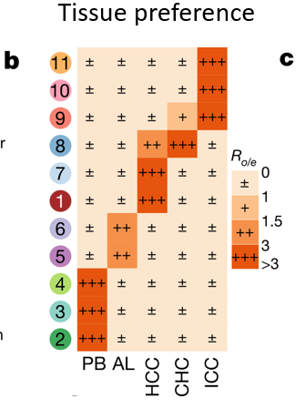

**Ro/e** (ratio of observed to expected cell numbers) is the standard single-cell tissue-enrichment statistic: from a cluster × tissue contingency table, the expected count under independence is `row_total × col_total / grand_total`, and Ro/e = observed / expected — above 1 means the cluster prefers that tissue, below 1 means it avoids it \[1\]. The reference renders it as a dot heatmap. Everything runs in-page from the contingency table:

## Example

{fig-alt="Cell-Type Tissue Preference (Ro/e) DEMO" fig-align="center" width="70%"}

## Setup

-   System Requirements: Cross-platform (Linux/MacOS/Windows)

-   Programming language: R

-   Dependent packages: `ggplot2`

```{r packages setup, message=FALSE, warning=FALSE, output=FALSE}
suppressPackageStartupMessages({
  library(ggplot2)
})
```

```{r}
sessioninfo::session_info("attached")
```

## Data Preparation

8 immune clusters × 5 tissues (atherosclerotic core, adjacent tissue, blood, spleen, lymph node), 12,000 simulated cells. Planted preferences: mast cells and myeloid clusters concentrate in the plaque core, lymphocytes in lymph node and adjacent tissue — the reference's biological finding:

```{r load data}
suppressPackageStartupMessages({library(ggplot2)})
set.seed(51312)
clusters <- c("Mast", "Myeloid_1", "Myeloid_2", "SMC", "Endothelial",
              "T_cell", "B_cell", "NK")
tissues <- c("Core", "Adjacent", "Blood", "Spleen", "LymphNode")
n <- c(500, 1400, 1600, 900, 1200, 3400, 1800, 1200)

## preference matrix: which tissue each cluster favours
pref <- list(Mast = "Core", Myeloid_1 = "Core", Myeloid_2 = "Core",
             SMC = "Core", Endothelial = "Core",
             T_cell = "LymphNode", B_cell = "LymphNode", NK = "Adjacent")
obs <- do.call(rbind, lapply(seq_along(clusters), function(i) {
  base <- rep(1 / length(tissues), length(tissues))
  base[tissues == pref[[clusters[i]]]] <- 3.2
  p <- base / sum(base)
  as.vector(rmultinom(1, n[i], p))
}))
dimnames(obs) <- list(clusters, tissues)

## Ro/e = observed / expected under independence
expected <- outer(rowSums(obs), colSums(obs)) / sum(obs)
roe <- obs / expected
roe_df <- as.data.frame(as.table(roe))
names(roe_df) <- c("cluster", "tissue", "roe")
oe_df <- as.data.frame(as.table(obs))
names(oe_df) <- c("cluster", "tissue", "n_cells")
roe_df$n_cells <- oe_df$n_cells
```

## Visualization

### 1. Ro/e Dot Heatmap

The reference's Fig. 3c style: clusters as rows, tissues as columns, tile colour = Ro/e (**red > 1 enriched, blue < 1 depleted**), dot size = cell count, and the value printed in each tile:

```{r}
#| label: fig-1.1RoeDot
#| fig-cap: "Tissue preference by Ro/e: clusters (rows) x tissues (columns), tile colour shows enrichment (red, Ro/e > 1) or depletion (blue, Ro/e < 1) with the Ro/e value printed and the dot size proportional to cell number; mast and myeloid clusters prefer the plaque core, lymphocytes the lymph node."
#| out.width: "90%"
#| fig-width: 8
#| fig-height: 5.6

ggplot(roe_df, aes(tissue, cluster)) +
  geom_tile(aes(fill = roe), colour = "white", linewidth = 0.8) +
  geom_point(aes(size = n_cells), shape = 21, fill = NA, colour = "grey25",
             stroke = 0.4) +
  geom_text(aes(label = sprintf("%.2f", roe)),
            size = 2.9, colour = ifelse(abs(log2(roe_df$roe)) > 1.2, "white", "grey15")) +
  scale_fill_gradient2(low = "#2166AC", mid = "white", high = "#B2182B",
                       midpoint = 1, name = "Ro/e") +
  scale_size_continuous(range = c(0.5, 5), guide = "none") +
  labs(x = NULL, y = NULL,
       caption = "dot size = number of cells; Ro/e > 1 = enriched, < 1 = depleted") +
  theme_bw(base_size = 10.5) +
  theme(panel.grid = element_blank(),
        axis.text.x = element_text(angle = 30, hjust = 1))
```

### 2. The Chi-Square Residual Check

Ro/e is an effect size; whether the preference is statistically supported needs the test behind the table. Pearson residuals from `chisq.test()` on the same contingency table show which cells deviate more than expected:

```{r}
#| label: fig-2.1RoeResidual
#| fig-cap: "Pearson residuals of the same cluster x tissue table (chi-square test): the planted core-preferring and lymph-node-preferring blocks show large positive residuals, confirming the Ro/e pattern is statistically supported rather than driven by small counts."
#| out.width: "90%"
#| fig-width: 8
#| fig-height: 5.6

ct <- chisq.test(obs)
res_df <- data.frame(cluster = rep(rownames(obs), ncol(obs)),
                     tissue = rep(colnames(obs), each = nrow(obs)),
                     resid = as.numeric(t(ct$residuals)))
ggplot(res_df, aes(tissue, cluster, fill = resid)) +
  geom_tile(colour = "white", linewidth = 0.8) +
  geom_text(aes(label = sprintf("%.1f", resid)), size = 2.7,
            colour = ifelse(abs(res_df$resid) > 8, "white", "grey15")) +
  scale_fill_gradient2(low = "#2166AC", mid = "white", high = "#B2182B",
                       name = "Pearson\nresidual") +
  labs(x = NULL, y = NULL,
       title = sprintf("chi-square p = %s",
                       format.pval(ct$p.value, digits = 2))) +
  theme_bw(base_size = 10.5) +
  theme(panel.grid = element_blank(),
        axis.text.x = element_text(angle = 30, hjust = 1))
```

::: callout-tip
**Practice tips**

-   Compute Ro/e from the **contingency table**, not from per-sample fractions: pooled counts make the expected value `row × col / total`, which is the definition the reference uses.
-   Colour around **1**, not around 0 — the null for a ratio is 1, so `scale_fill_gradient2(midpoint = 1)` is what makes enrichment and depletion symmetric.
-   Print the Ro/e value in each tile and add a size channel for cell counts: a 3.0 Ro/e from 4 cells is not the same claim as from 400.
-   Report the chi-square p, or per-cell standardised residuals, alongside — Ro/e is descriptive and will happily dramatise rare clusters.
-   Keep a fixed cluster and tissue order in every panel; readers compare patterns across figures by position.
:::

## Application

::: {#fig-CellPreferenceApplications1}
{fig-alt="Cell-Type Tissue Preference (Ro/e)" fig-align="center" width="70%"}

Cell-type tissue preference (Ro/e)
:::

Ro/e preference maps apply to any multi-tissue single-cell atlas: immune infiltration per organ, tumour vs adjacent preference, or cluster distribution across spatial regions.

## Reference

\[1\] Xiaofan Lu, et al. FigureYa: A Standardized Visualization Framework for Enhancing Biomedical Data Interpretation and Research Efficiency. iMetaMed. 2025. doi:10.1002/imm3.70005
