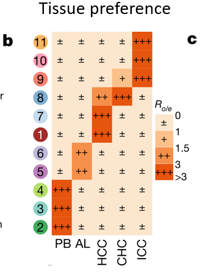

**Ro/e**（观测细胞数与期望细胞数之比）是单细胞组织富集的标准统计量：从 簇 × 组织 列联表出发，独立假设下的期望计数为 `行合计 × 列合计 / 总数`，Ro/e = 观测 / 期望——大于 1 表示该簇偏好该组织、小于 1 表示回避 \[\1\]。参考将其呈现为点热图。全部计算在页内从列联表出发：

## Example

{fig-alt="细胞类型的组织偏好（Ro/e） DEMO" fig-align="center" width="60%"}

## Setup

-   系统要求：跨平台（Linux/MacOS/Windows）

-   编程语言：R

-   依赖包：`ggplot2`

```{r packages setup, message=FALSE, warning=FALSE, output=FALSE}
suppressPackageStartupMessages({
  library(ggplot2)
})
```

```{r}
sessioninfo::session_info("attached")
```

## 数据准备

8 个免疫簇 × 5 个组织（动脉粥样硬化核心、邻近组织、外周血、脾、淋巴结）、12,000 个模拟细胞。植入偏好：肥大细胞与髓系簇集中于斑块核心、淋巴细胞集中于淋巴结与邻近组织——即参考的生物学发现：

```{r load data}
suppressPackageStartupMessages({library(ggplot2)})
set.seed(51312)
clusters <- c("Mast", "Myeloid_1", "Myeloid_2", "SMC", "Endothelial",
              "T_cell", "B_cell", "NK")
tissues <- c("Core", "Adjacent", "Blood", "Spleen", "LymphNode")
n <- c(500, 1400, 1600, 900, 1200, 3400, 1800, 1200)

## preference matrix: which tissue each cluster favours
pref <- list(Mast = "Core", Myeloid_1 = "Core", Myeloid_2 = "Core",
             SMC = "Core", Endothelial = "Core",
             T_cell = "LymphNode", B_cell = "LymphNode", NK = "Adjacent")
obs <- do.call(rbind, lapply(seq_along(clusters), function(i) {
  base <- rep(1 / length(tissues), length(tissues))
  base[tissues == pref[[clusters[i]]]] <- 3.2
  p <- base / sum(base)
  as.vector(rmultinom(1, n[i], p))
}))
dimnames(obs) <- list(clusters, tissues)

## Ro/e = observed / expected under independence
expected <- outer(rowSums(obs), colSums(obs)) / sum(obs)
roe <- obs / expected
roe_df <- as.data.frame(as.table(roe))
names(roe_df) <- c("cluster", "tissue", "roe")
oe_df <- as.data.frame(as.table(obs))
names(oe_df) <- c("cluster", "tissue", "n_cells")
roe_df$n_cells <- oe_df$n_cells
```

## Visualization

### Ro/e 点热图

参考的 Fig. 3c 风格：簇为行、组织为列、格子颜色 = Ro/e（**红 > 1 富集、蓝 < 1 缺失**）、点大小 = 细胞数、数值印刷在格内：

```{r}
#| label: fig-1.1RoeDot
#| fig-cap: "按 Ro/e 的组织偏好：簇（行）× 组织（列）、格子颜色显示富集（红、Ro/e > 1）或缺失（蓝、Ro/e < 1）、数值印刷、点大小与细胞数成比例；肥大与髓系簇偏好斑块核心、淋巴细胞偏好淋巴结。"
#| out.width: "90%"
#| fig-width: 8
#| fig-height: 5.6

ggplot(roe_df, aes(tissue, cluster)) +
  geom_tile(aes(fill = roe), colour = "white", linewidth = 0.8) +
  geom_point(aes(size = n_cells), shape = 21, fill = NA, colour = "grey25",
             stroke = 0.4) +
  geom_text(aes(label = sprintf("%.2f", roe)),
            size = 2.9, colour = ifelse(abs(log2(roe_df$roe)) > 1.2, "white", "grey15")) +
  scale_fill_gradient2(low = "#2166AC", mid = "white", high = "#B2182B",
                       midpoint = 1, name = "Ro/e") +
  scale_size_continuous(range = c(0.5, 5), guide = "none") +
  labs(x = NULL, y = NULL,
       caption = "dot size = number of cells; Ro/e > 1 = enriched, < 1 = depleted") +
  theme_bw(base_size = 10.5) +
  theme(panel.grid = element_blank(),
        axis.text.x = element_text(angle = 30, hjust = 1))
```

### 卡方残差核查

Ro/e 是效应量；偏好是否被统计支持需要检验。同一列联表的 `chisq.test()` Pearson 残差显示哪些细胞偏离超出预期：

```{r}
#| label: fig-2.1RoeResidual
#| fig-cap: "同一 簇 × 组织 表的卡方 Pearson 残差：植入的核心偏好块与淋巴结偏好块呈大正残差，确认 Ro/e 模式有统计支持而非由小计数驱动。"
#| out.width: "90%"
#| fig-width: 8
#| fig-height: 5.6

ct <- chisq.test(obs)
res_df <- data.frame(cluster = rep(rownames(obs), ncol(obs)),
                     tissue = rep(colnames(obs), each = nrow(obs)),
                     resid = as.numeric(t(ct$residuals)))
ggplot(res_df, aes(tissue, cluster, fill = resid)) +
  geom_tile(colour = "white", linewidth = 0.8) +
  geom_text(aes(label = sprintf("%.1f", resid)), size = 2.7,
            colour = ifelse(abs(res_df$resid) > 8, "white", "grey15")) +
  scale_fill_gradient2(low = "#2166AC", mid = "white", high = "#B2182B",
                       name = "Pearson\nresidual") +
  labs(x = NULL, y = NULL,
       title = sprintf("chi-square p = %s",
                       format.pval(ct$p.value, digits = 2))) +
  theme_bw(base_size = 10.5) +
  theme(panel.grid = element_blank(),
        axis.text.x = element_text(angle = 30, hjust = 1))
```


## 应用场景

::: {{#fig-CellPreferenceApplications1}}
{fig-alt="细胞类型的组织偏好（Ro/e）" fig-align="center" width="60%"}

细胞类型的组织偏好（Ro/e）
:::

Ro/e 偏好图适用于任何多组织单细胞图谱：逐器官免疫浸润、肿瘤 vs 邻近偏好、或空间区域间的簇分布。

## 参考文献

\[1\] Xiaofan Lu, et al. FigureYa: A Standardized Visualization Framework for Enhancing Biomedical Data Interpretation and Research Efficiency. iMetaMed. 2025. doi:10.1002/imm3.70005
