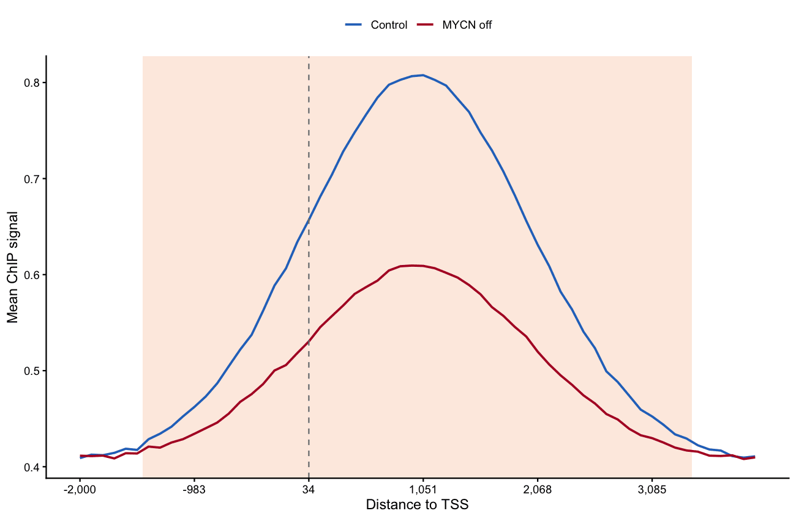

A quantitative (spike-in-corrected) ChIP-seq comparison is summarised by a **meta-gene profile**: signal averaged over all active genes across the TSS and gene body, with a Welch t test per bin marking where two conditions differ globally \[1\]. The companion travel-ratio (TR) boxplots condense the same comparison to one number per gene. This tutorial draws both from simulated bigWig-style matrices — the plotting half of the `bigWigSummary` workflow.

## Example

{fig-alt="ChipPvaluePlot DEMO" fig-align="center" width="60%"}

## Setup

-   System Requirements: Cross-platform (Linux/MacOS/Windows)

-   Programming Language: R

-   Dependent packages: `ggplot2`; `dplyr`; `tidyr`; `ggpubr`

```{r packages setup, message=FALSE, warning=FALSE, output=FALSE}
# Installing necessary packages
if (!requireNamespace("ggplot2", quietly = TRUE)) {
  install.packages("ggplot2")
}
if (!requireNamespace("dplyr", quietly = TRUE)) {
  install.packages("dplyr")
}
if (!requireNamespace("tidyr", quietly = TRUE)) {
  install.packages("tidyr")
}
if (!requireNamespace("ggpubr", quietly = TRUE)) {
  install.packages("ggpubr")
}

# Load packages
library(ggplot2)
library(dplyr)
library(tidyr)
library(ggpubr)
```

```{r}
sessioninfo::session_info("attached")
```

## Data Preparation

In practice you extract per-gene binned signal with the UCSC `bigWigSummary` utility (one row per gene, one column per bin, per condition) and read the tables into R. We simulate 1,000 active genes over 60 bins spanning −2 kb … +4 kb around the TSS, in a control and an MYCN-shutdown condition with a genome-wide loss of promoter signal.

```{r load data, message=FALSE, warning=FALSE}
set.seed(801)
n_gene <- 1000
n_bin <- 60
genes <- paste0("GENE", sprintf("%04d", 1:n_gene))

shape <- dnorm(seq(-3, 3, length.out = n_bin))          # promoter-peaked profile
ctrl <- t(sapply(1.6 ^ rnorm(n_gene, 0, 0.35), function(depth)     # genes as rows
  depth * (0.4 + shape) + rnorm(n_bin, sd = 0.05)))
knockdown <- t(sapply(1.6 ^ rnorm(n_gene, 0, 0.35), function(depth)
  depth * (0.4 + 0.5 * shape) + rnorm(n_bin, sd = 0.05)))

colnames(ctrl) <- paste0("ctrl_b", sprintf("%02d", 1:n_bin))
colnames(knockdown) <- paste0("kd_b", sprintf("%02d", 1:n_bin))

## travel ratio: promoter signal (first 10 bins) / total signal over the window
tr <- function(m) rowSums(m[, 1:10]) / rowSums(m)
tr_df <- data.frame(gene = rep(genes, times = 2),
                    Condition = rep(factor(c("Control", "MYCN off"),
                                           levels = c("Control", "MYCN off")),
                                    each = n_gene),
                    TR = c(tr(ctrl), tr(knockdown)))
head(tr_df, 3)
```

## Visualization

### 1. Meta-Gene Profile with Per-Bin Significance

```{r}
#| label: fig-1.1MetaGene
#| fig-cap: "Meta-gene profile over the TSS (dashed line): mean ± SE per bin for both conditions; the band marks bins with Welch p < 0.05."
#| out.width: "85%"
#| warning: false
#| message: false
#| fig-width: 8
#| fig-height: 4.5

bin_pos <- seq(-2000, 4000, length.out = n_bin)
meta <- data.frame(
  bin = seq_len(n_bin),
  ctrl_mean = colMeans(ctrl),
  ctrl_se = apply(ctrl, 2, function(x) sd(x) / sqrt(n_gene)),
  kd_mean = colMeans(knockdown),
  kd_se = apply(knockdown, 2, function(x) sd(x) / sqrt(n_gene)),
  p = sapply(seq_len(n_bin), function(b)
    t.test(ctrl[, b], knockdown[, b], var.equal = FALSE)$p.value))

meta_df <- meta |>
  pivot_longer(cols = c(ctrl_mean, kd_mean), names_to = "condition", values_to = "mean") |>
  mutate(se = ifelse(condition == "ctrl_mean", meta$ctrl_se, meta$kd_se),
         condition = ifelse(condition == "ctrl_mean", "Control", "MYCN off"))
sig_band <- subset(meta, p < 0.05)

ggplot() +
  geom_rect(data = sig_band, inherit.aes = FALSE,
            aes(xmin = bin - 0.5, xmax = bin + 0.5, ymin = -Inf, ymax = Inf),
            fill = "#FDE7DA", alpha = 0.8) +
  geom_ribbon(data = meta_df, aes(bin, ymin = mean - se, ymax = mean + se, fill = condition),
              alpha = 0.25, colour = NA) +
  geom_line(data = meta_df, aes(bin, mean, colour = condition), linewidth = 0.9) +
  geom_vline(xintercept = which.min(abs(bin_pos)), linetype = "dashed", colour = "grey50") +
  annotate("text", x = which.min(abs(bin_pos)) + 1.5,
           y = max(meta_df$mean) * 1.02, label = "TSS", hjust = 0, size = 3) +
  scale_x_continuous(breaks = seq(1, n_bin, 10),
                     labels = scales::comma(bin_pos[seq(1, n_bin, 10)])) +
  scale_colour_manual(values = c(Control = "#2874C5", `MYCN off` = "#B2182B")) +
  scale_fill_manual(values = c(Control = "#2874C5", `MYCN off` = "#B2182B")) +
  labs(x = "Distance to TSS", y = "Mean ChIP signal",
       title = "Meta-gene profile, all active genes",
       subtitle = "Shaded bins: Welch p < 0.05", colour = NULL, fill = NULL) +
  theme_classic(base_size = 11) +
  theme(legend.position = "top", legend.key.size = unit(3, "mm"))
```

### 2. Travel-Ratio Distributions with Significance Stars

```{r}
#| label: fig-1.2TravelRatio
#| fig-cap: "Travel-ratio distributions for all active genes; the Welch test p value is annotated with stars."
#| out.width: "60%"
#| warning: false
#| message: false
#| fig-width: 5.5
#| fig-height: 4.5

p_tr <- t.test(TR ~ Condition, data = tr_df, var.equal = FALSE)$p.value
star_lab <- as.character(cut(p_tr, c(0, 1e-9, 1e-6, 1e-3, 1),
                             labels = c("****", "***", "**", "*"),
                             include.lowest = TRUE))  # an underflowed p = 0 must map to "****"

ggplot(tr_df, aes(Condition, TR, fill = Condition)) +
  geom_boxplot(outlier.shape = NA, width = 0.55) +
  geom_jitter(width = 0.08, size = 0.4, alpha = 0.25, show.legend = FALSE) +
  scale_fill_manual(values = c(Control = "#BDD7E7", `MYCN off` = "#FCAE91")) +
  geom_text(data = data.frame(Condition = factor("MYCN off",
                                                   levels = levels(tr_df$Condition)),
                              y = max(tr_df$TR) + 0.08 * diff(range(tr_df$TR)),
                              lab = star_lab),
            aes(Condition, y, label = lab), inherit.aes = FALSE,
            size = 5.5, colour = "grey10") +
  labs(y = "RNA Pol II travelling ratio", title = sprintf("Welch p %s",
       ifelse(p_tr < 0.001, "< 0.001", sprintf("= %.3f", p_tr)))) +
  scale_y_continuous(expand = expansion(mult = c(0.05, 0.17))) +
  theme_classic(base_size = 11) +
  theme(legend.position = "none")
```

::: callout-tip
**Practice tips**

-   The meta-gene test is only meaningful on **normalised** (spike-in-corrected) data — global uncorrected losses are exactly the artefact the reference paper guards against.
-   A Welch (unequal-variance) t test per bin is the reference statistic; display the p band as a background ribbon rather than stars per bin, which becomes unreadable at 60 bins.
-   The TR (travelling ratio, promoter / total) needs a fixed gene set — use "all active genes" consistently across conditions or the comparison is confounded.
:::

## Application

Meta-gene profiles with per-bin significance are the standard first figure for global ChIP-seq comparisons (transcription-factor shutdown, drug treatment). The same code accepts any two conditions' binned matrices.

## Reference

\[1\] Deregulated MYCN binds active chromatin and amplifies transcription in neuroblastoma. Nat Genet. 2018. https://www.nature.com/articles/s41588-018-0044-9 (reference figure context)

\[2\] Xiaofan Lu, et al. FigureYa: A Standardized Visualization Framework for Enhancing Biomedical Data Interpretation and Research Efficiency. iMetaMed. 2025. doi:10.1002/imm3.70005
