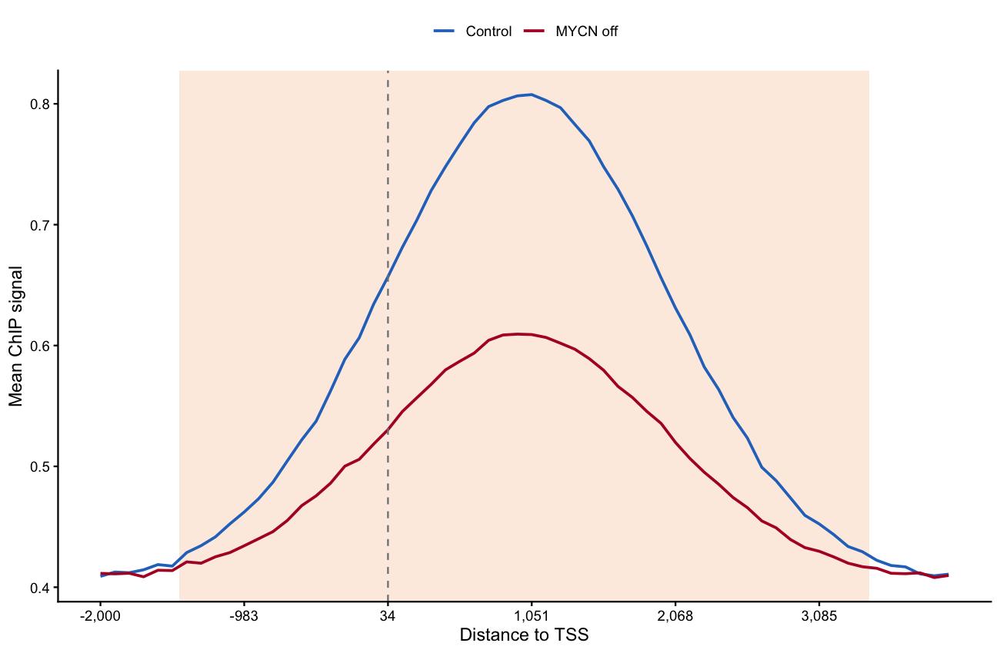

定量（spike-in 校正）ChIP-seq 对比以 **meta-gene 曲线**总结：信号在所有活性基因的 TSS 与基因体上取平均，并按 bin 做 Welch t 检验标记两个条件在全基因组范围的全局差异 \[1\]。配套的 travel-ratio（TR）箱线图把同一对比压缩为每基因一个数。本教程从模拟的 bigWig 式矩阵绘制两者——`bigWigSummary` 工作流的绘图半程。

## Example

{fig-alt="ChipPvaluePlot DEMO" fig-align="center" width="60%"}

## Setup

-   系统要求：跨平台（Linux/MacOS/Windows）

-   编程语言：R

-   依赖包： `ggplot2`; `dplyr`; `tidyr`; `ggpubr`

```{r packages setup, message=FALSE, warning=FALSE, output=FALSE}
# 安装必要的包
if (!requireNamespace("ggplot2", quietly = TRUE)) {
  install.packages("ggplot2")
}
if (!requireNamespace("dplyr", quietly = TRUE)) {
  install.packages("dplyr")
}
if (!requireNamespace("tidyr", quietly = TRUE)) {
  install.packages("tidyr")
}
if (!requireNamespace("ggpubr", quietly = TRUE)) {
  install.packages("ggpubr")
}

# 加载包
library(ggplot2)
library(dplyr)
library(tidyr)
library(ggpubr)
```

```{r}
sessioninfo::session_info("attached")
```

## Data Preparation

实际操作中用 UCSC `bigWigSummary` 工具按基因提取分箱信号（每条件一行一基因、一列一 bin）并读入 R。我们模拟 1,000 个活性基因在 TSS ±2 kb…+4 kb 共 60 个 bin 的信号，分对照与 MYCN 关闭两组，后者有全基因组范围的启动子信号丢失。

```{r load data, message=FALSE, warning=FALSE}
set.seed(801)
n_gene <- 1000
n_bin <- 60
genes <- paste0("GENE", sprintf("%04d", 1:n_gene))

shape <- dnorm(seq(-3, 3, length.out = n_bin))          # promoter-peaked profile
ctrl <- t(sapply(1.6 ^ rnorm(n_gene, 0, 0.35), function(depth)     # genes as rows
  depth * (0.4 + shape) + rnorm(n_bin, sd = 0.05)))
knockdown <- t(sapply(1.6 ^ rnorm(n_gene, 0, 0.35), function(depth)
  depth * (0.4 + 0.5 * shape) + rnorm(n_bin, sd = 0.05)))

colnames(ctrl) <- paste0("ctrl_b", sprintf("%02d", 1:n_bin))
colnames(knockdown) <- paste0("kd_b", sprintf("%02d", 1:n_bin))

## travel ratio: promoter signal (first 10 bins) / total signal over the window
tr <- function(m) rowSums(m[, 1:10]) / rowSums(m)
tr_df <- data.frame(gene = rep(genes, times = 2),
                    Condition = rep(factor(c("Control", "MYCN off"),
                                           levels = c("Control", "MYCN off")),
                                    each = n_gene),
                    TR = c(tr(ctrl), tr(knockdown)))
head(tr_df, 3)
```

## Visualization

### 1. 带 per-bin 显著性的 meta-gene 曲线

```{r}
#| label: fig-1.1MetaGene
#| fig-cap: "TSS 上的 meta-gene 曲线（虚线）：两组的逐 bin 均值 ± SE；色带标出 Welch p < 0.05 的 bin。"
#| out.width: "85%"
#| warning: false
#| message: false
#| fig-width: 8
#| fig-height: 4.5

bin_pos <- seq(-2000, 4000, length.out = n_bin)
meta <- data.frame(
  bin = seq_len(n_bin),
  ctrl_mean = colMeans(ctrl),
  ctrl_se = apply(ctrl, 2, function(x) sd(x) / sqrt(n_gene)),
  kd_mean = colMeans(knockdown),
  kd_se = apply(knockdown, 2, function(x) sd(x) / sqrt(n_gene)),
  p = sapply(seq_len(n_bin), function(b)
    t.test(ctrl[, b], knockdown[, b], var.equal = FALSE)$p.value))

meta_df <- meta |>
  pivot_longer(cols = c(ctrl_mean, kd_mean), names_to = "condition", values_to = "mean") |>
  mutate(se = ifelse(condition == "ctrl_mean", meta$ctrl_se, meta$kd_se),
         condition = ifelse(condition == "ctrl_mean", "Control", "MYCN off"))
sig_band <- subset(meta, p < 0.05)

ggplot() +
  geom_rect(data = sig_band, inherit.aes = FALSE,
            aes(xmin = bin - 0.5, xmax = bin + 0.5, ymin = -Inf, ymax = Inf),
            fill = "#FDE7DA", alpha = 0.8) +
  geom_ribbon(data = meta_df, aes(bin, ymin = mean - se, ymax = mean + se, fill = condition),
              alpha = 0.25, colour = NA) +
  geom_line(data = meta_df, aes(bin, mean, colour = condition), linewidth = 0.9) +
  geom_vline(xintercept = which.min(abs(bin_pos)), linetype = "dashed", colour = "grey50") +
  annotate("text", x = which.min(abs(bin_pos)) + 1.5,
           y = max(meta_df$mean) * 1.02, label = "TSS", hjust = 0, size = 3) +
  scale_x_continuous(breaks = seq(1, n_bin, 10),
                     labels = scales::comma(bin_pos[seq(1, n_bin, 10)])) +
  scale_colour_manual(values = c(Control = "#2874C5", `MYCN off` = "#B2182B")) +
  scale_fill_manual(values = c(Control = "#2874C5", `MYCN off` = "#B2182B")) +
  labs(x = "Distance to TSS", y = "Mean ChIP signal",
       title = "Meta-gene profile, all active genes",
       subtitle = "Shaded bins: Welch p < 0.05", colour = NULL, fill = NULL) +
  theme_classic(base_size = 11) +
  theme(legend.position = "top", legend.key.size = unit(3, "mm"))
```

### 2. 带显著性星号的 travel-ratio 分布

```{r}
#| label: fig-1.2TravelRatio
#| fig-cap: "全部活性基因的 travel-ratio 分布；标注 Welch 检验 p 值。"
#| out.width: "60%"
#| warning: false
#| message: false
#| fig-width: 5.5
#| fig-height: 4.5

p_tr <- t.test(TR ~ Condition, data = tr_df, var.equal = FALSE)$p.value
star <- cut(p_tr, c(0, 1e-9, 1e-6, 1e-3, 1),
            labels = c("****", "***", "**", "*"))

ggplot(tr_df, aes(Condition, TR, fill = Condition)) +
  geom_boxplot(outlier.shape = NA, width = 0.55) +
  geom_jitter(width = 0.08, size = 0.4, alpha = 0.25, show.legend = FALSE) +
  scale_fill_manual(values = c(Control = "#BDD7E7", `MYCN off` = "#FCAE91")) +
  labs(y = "RNA Pol II travelling ratio", title = sprintf("Welch p %s",
       ifelse(p_tr < 0.001, "< 0.001", sprintf("= %.3f", p_tr)))) +
  theme_classic(base_size = 11) +
  theme(legend.position = "none")
```

::: callout-tip
**Practice tips**

-   meta-gene 检验只在**归一化**（spike-in 校正）数据上有意义——未校正的全局丢失正是参考论文防范的假象。
-   逐 bin 的 Welch（异方差）t 检验即参考统计量；p 值带以背景色带展示而非逐 bin 星号——60 个 bin 时星号不可读。
-   TR（travel ratio，启动子/全窗）需要固定的基因集——两组都一致使用"全部活性基因"，否则对比被混杂。
:::

## Application

带 per-bin 显著性的 meta-gene 曲线是全局 ChIP-seq 对比（转录因子关闭、药物处理）的标准首图；同一代码接受任意两组的分箱矩阵。

## Reference

\[1\] Deregulated MYCN binds active chromatin and amplifies transcription in neuroblastoma. Nat Genet. 2018. https://www.nature.com/articles/s41588-018-0044-9（参考图出处）

\[2\] Xiaofan Lu, et al. FigureYa: A Standardized Visualization Framework for Enhancing Biomedical Data Interpretation and Research Efficiency. iMetaMed. 2025. doi:10.1002/imm3.70005
