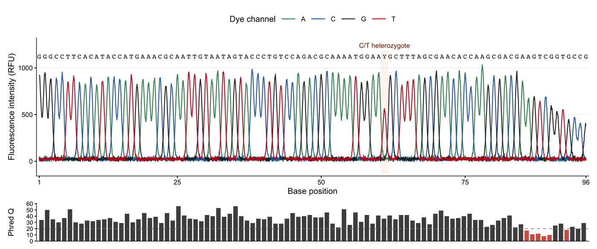

Sanger 测序峰图是毛细管测序的原始证据轨迹：四个荧光通道随洗脱时间记录信号，碱基识别器在每个峰上给出一个核苷酸。它仍是检查杂合位点、 indel 边界与低质量尾段的标准图形。本教程从原始 trace 式数据重建出版版式：四条按染料着色的通道、识别碱基序列，以及与主图共享 x 轴的质量轨。

## 示例

{fig-alt="测序峰图 DEMO" fig-align="center" width="85%"}

Sanger 测序峰图：四个荧光通道以彩色峰形叠加，顶部标出判读出的碱基，阴影列标出第 61 位的 C/T 杂合——那里两个半高峰重叠。下方的质量值面板在末尾几个碱基跌破 Phred 20 线，也正是在那里判读开始不可信。

## Setup

-   系统要求：跨平台（Linux/MacOS/Windows）

-   编程语言：R

-   依赖包：`ggplot2`; `dplyr`; `tidyr`; `patchwork`; `scales`

```{r packages setup, message=FALSE, warning=FALSE, output=FALSE}
if (!requireNamespace("ggplot2", quietly = TRUE)) install.packages("ggplot2")
if (!requireNamespace("dplyr", quietly = TRUE)) install.packages("dplyr")
if (!requireNamespace("tidyr", quietly = TRUE)) install.packages("tidyr")
if (!requireNamespace("patchwork", quietly = TRUE)) install.packages("patchwork")
if (!requireNamespace("scales", quietly = TRUE)) install.packages("scales")

library(ggplot2)
library(dplyr)
library(tidyr)
library(patchwork)
library(scales)
```

```{r}
sessioninfo::session_info("attached")
```

## Data Preparation

`.ab1` 读取器输出的是荧光强度矩阵（scan 行 × 四个染料列），外加识别序列与逐碱基质量值。我们模拟 96 个碱基：高斯峰叠加局部基线噪声，在第 61 位放一个 C/T 杂合峰，并在 3′ 端制造低质量尾段。模拟是透明的——图中每个视觉特征都对应真实 trace reader 会提供的一列数据。

```{r load data, message=FALSE, warning=FALSE}
set.seed(4351)

bases <- c("A", "C", "G", "T")
dye_colours <- c(A = "#2E8B57", C = "#2166AC", G = "#222222", T = "#C51B1F")
n_base <- 96

called <- sample(bases, n_base, replace = TRUE, prob = c(.3, .2, .22, .28))
called[61] <- "Y"                       # C/T heterozygote
called[88:96] <- sample(bases, 9, replace = TRUE)

position <- seq_len(n_base)
base_amp <- rnorm(n_base, 860, 55)
base_amp[61] <- 900
scan <- seq(1, n_base, length.out = n_base * 24)
peak <- function(centre, sigma = 0.30) {
  dnorm(scan, centre, sigma) / dnorm(centre, centre, sigma)
}

## Each channel carries a peak only where that base was called. The C/T site
## receives two half-height peaks, which is the evidence a heterozygote call needs.
make_channel <- function(ch) {
  y <- numeric(length(scan))
  for (i in seq_along(called)) {
    if (called[i] == ch) y <- y + base_amp[i] * peak(i)
    if (called[i] == "Y" && ch %in% c("C", "T")) {
      y <- y + 0.58 * base_amp[i] * peak(i)
    }
  }
  y
}

trace <- tibble(scan = scan) |>
  mutate(A = make_channel("A"), C = make_channel("C"),
         G = make_channel("G"), T = make_channel("T")) |>
  pivot_longer(-scan, names_to = "channel", values_to = "signal") |>
  mutate(
    base_index = scan,
    taper = ifelse(base_index >= 84, pmax(0.38, 1 - (base_index - 83) / 22), 1),
    signal = pmax(0, signal * taper + 24 + rnorm(n(), 0, 12))
  )

quality <- tibble(
  base_index = position,
  quality = pmin(60, pmax(9, round(rnorm(n_base, 37, 8)))),
  called = called
) |>
  mutate(quality = ifelse(base_index >= 84, quality - 18, quality),
         quality = pmax(5, quality))

head(trace)
```

## Visualization

### 1. 四通道峰图与识别碱基

经典视图把四条染料通道叠画在同一时间轴上，并在峰上方标出识别碱基。颜色只留给通道；识别序列保持黑色，以保证黑白打印时仍可读。

```{r}
#| label: fig-1.1FourChannelTrace
#| fig-cap: "Sanger 峰图：四条荧光通道、识别碱基，以及第 61 位的 C/T 杂合峰。"
#| out.width: "100%"
#| warning: false
#| message: false
#| fig-width: 11
#| fig-height: 4.6
#| fig-dpi: 300

base_labels <- quality |>
  mutate(y = 1120, label = called)

p_trace <- ggplot(trace, aes(scan, signal, colour = channel)) +
  geom_line(linewidth = 0.55, alpha = 0.95) +
  geom_text(data = base_labels, aes(base_index, y, label = label),
            inherit.aes = FALSE, size = 3.1, family = "mono") +
  annotate("rect", xmin = 60.35, xmax = 61.65, ymin = -130, ymax = 1180,
           fill = "#F4A582", alpha = 0.12, colour = NA) +
  annotate("text", x = 61, y = 1240, label = "C/T heterozygote",
           size = 3.1, colour = "#8C2D04") +
  scale_colour_manual(values = dye_colours, name = "Dye channel") +
  scale_x_continuous(breaks = c(1, 25, 50, 75, 96),
                     expand = c(0.005, 0)) +
  scale_y_continuous(expand = expansion(mult = c(0.02, 0.06))) +
  labs(x = "Base position", y = "Fluorescence intensity (RFU)") +
  theme_classic(base_size = 11) +
  theme(
    legend.position = "top",
    legend.key.width = unit(8, "mm"),
    axis.line = element_line(linewidth = 0.35),
    panel.grid.major.y = element_line(colour = "#EBEBEB", linewidth = 0.25)
  )

p_quality <- ggplot(quality, aes(base_index, quality, fill = quality < 20)) +
  geom_col(width = 0.78) +
  geom_hline(yintercept = 20, linetype = "dashed", linewidth = 0.35,
             colour = "#7F7F7F") +
  scale_fill_manual(values = c(`FALSE` = "#4D4D4D", `TRUE` = "#D6604D"),
                    guide = "none") +
  scale_x_continuous(expand = c(0.005, 0)) +
  scale_y_continuous(expand = expansion(mult = c(0, 0.08))) +
  labs(x = NULL, y = "Phred Q") +
  theme_classic(base_size = 10) +
  theme(
    axis.text.x = element_blank(),
    axis.ticks.x = element_blank(),
    axis.line = element_line(linewidth = 0.35)
  )

p_trace / p_quality + plot_layout(heights = c(4.4, 1.2))
```

### 2. 杂合峰分解

杂合识别不是装饰性注释：两个通道必须在同一位置同时升起，且高度约为纯合峰的一半。放大局部窗口可以把这一证据变成可审计的画面，并区分真实变异、染料团块与相邻碱基肩峰。

```{r}
#| label: fig-1.2Heterozygote
#| fig-cap: "C/T 位点的局部分解：C 与 T 通道出现半高重叠峰，周边纯合峰提供高度参照。"
#| out.width: "78%"
#| warning: false
#| message: false
#| fig-width: 7.2
#| fig-height: 4.2
#| fig-dpi: 300

local <- trace |>
  filter(scan > 56.4, scan < 65.6) |>
  mutate(channel = factor(channel, levels = bases))

local_labels <- quality |>
  filter(base_index %in% 57:65) |>
  mutate(y = 1080)

ggplot(local, aes(base_index, signal, colour = channel)) +
  geom_line(linewidth = 0.8) +
  geom_point(data = local |> filter(base_index == 61,
                                    channel %in% c("C", "T")),
             size = 2.1, show.legend = FALSE) +
  geom_text(data = local_labels, aes(base_index, y, label = called),
            inherit.aes = FALSE, size = 3.4, family = "mono") +
  scale_colour_manual(values = dye_colours, name = "Dye channel") +
  scale_x_continuous(breaks = 57:65, expand = c(0.03, 0.03)) +
  labs(
    x = "Base position",
    y = "Fluorescence intensity (RFU)",
    title = "C/T heterozygote at position 61",
    subtitle = "Two channels peak together at ~58% of the homozygous signal"
  ) +
  theme_classic(base_size = 11) +
  theme(
    legend.position = "right",
    plot.title = element_text(face = "bold", size = 11),
    plot.subtitle = element_text(colour = "#555555", size = 9.5)
  )
```

::: callout-tip
**实践要点**

-   在**识别碱基坐标系**中读图，而不是原始 scan 索引：不同染料的迁移率不同，`.ab1` 读取器会先对齐通道再绘图。
-   杂合位点要求两个通道在同一位置、高度可比。相邻碱基的肩峰通常不对称且更窄。
-   质量轨要紧贴主图并共享 x 轴，这样低质量尾段表现为明确的视觉断点，而不是序列中无解释的空缺。
-   出版时优先导出矢量 trace；若只能用位图，单栏图至少 300 dpi。
:::

## Application

Sanger 峰图仍是 CRISPR 编辑、质粒构建与临床变异确认的验证层。同一四通道版式可推广到任何毛细管电泳信号（SSR 分型、甲基化敏感 Sanger 与亚硫酸氢盐测序）。在多读段拼装视图中，逐碱基质量轨进一步成为决定不一致位点是否真实的共识模型。

## Reference

\[1\] Staden R, Beal KF, Bonfield JK. The Staden package, 1998. Methods Mol Biol. 2000;132:115-130. doi:10.1385/1-59259-192-2:115

\[2\] Gordon D, Abajian C, Green P. Consed: a graphical tool for sequence finishing. Genome Res. 1998;8(3):195-202. doi:10.1101/gr.8.3.195

\[3\] Cock PJA, Fields CJ, Goto N, Heuer ML, Rice PM. The Sanger FASTQ file format for sequences with quality scores, and the Solexa/Illumina FASTQ variants. Nucleic Acids Res. 2010;38(6):1767-1771. doi:10.1093/nar/gkp1137
