An chromosome plot (ideogram) is a graphical tool used to visualize chromosome structure and various genomic features on chromosomes. It typically represents each chromosome individually, drawing the length and structures such as the centromere to scale. Additionally, it can annotate multiple types of information on the chromosomes, including gene density, genetic variations, expression levels, repetitive sequences, and functional markers.

Chromosome plot can take linear or circular forms (such as Circos plots). Among these, linear ideograms are more suitable for displaying the linear structure of chromosomes and local data variations, making them particularly useful for studies such as genome-wide scans, population comparisons, and genetic mapping. Their visual representation not only facilitates an intuitive understanding of data distribution along chromosomes but also allows for the overlay of multiple layers of information, such as heatmaps, markers, lines, and color blocks.

## Example

{fig-alt="Chromosome Plot DEMO" fig-align="center" width="60%"}

The image shows a chromosome ideogram with dual-line labels, plotted using the built-in Liriodendron data from the RIdeogram package. Each chromosome is drawn to scale, with the color in the center representing genomic heatmap data (here, Fst values reflecting the degree of population differentiation). The upper and lower lines on both sides represent the Pi values (nucleotide diversity) of two populations (CE and CW) across different chromosomal regions.

## Setup

-   System Requirements: Cross-platform (Linux/MacOS/Windows)

-   Programming language: R

-   Dependent packages: `RIdeogram`

-   Maintenance status: `RIdeogram` had its last upstream commit on 2020-09-22, so it is more than five years without an operational update. It is used here because this page's figures are built on it, not because it is actively maintained; check that it still installs against your R version before relying on it.

```{r packages setup, message=FALSE, warning=FALSE, output=FALSE}
# Install packages
if (!requireNamespace("RIdeogram", quietly = TRUE)) {
  install.packages("RIdeogram")
}

# Load packages
library(RIdeogram)
```

```{r}
sessioninfo::session_info("attached")
```

## Data Preparation

Use the built-in data from the `RIDeogram` package.

```{r load data}
data(human_karyotype, package="RIdeogram")
data(gene_density, package="RIdeogram")
data(Random_RNAs_500, package="RIdeogram")
```

You can use the `head()` function to view the basic format of each data:

```{r}
head(human_karyotype)
```

`human_karyotype` karyotype data contains five columns: the first column is the chromosome ID, the second and third columns are the chromosome start and end positions, and the fourth and fifth columns are the centromere start and end positions. Note: If there is no centromere information, only the first three columns can be retained.

```{r}
head(gene_density)
```

`gene_density` data is used to draw heat maps. It contains chromosome ID, start and end positions. The fourth column is a numerical value (such as the number of genes, SNP density, etc.) used for heat mapping on chromosomes.

```{r}
head(Random_RNAs_500)
```

`Random_RNAs_500` data is label information (track), with six columns including: label type (such as tRNA, rRNA, miRNA, etc.), shape (optional: circle, box or triangle), chromosome, start and end positions, and label color.

## Visualization

### 1. Basic Chromosome Plot

After running, you can find an SVG file and a PNG file in the working directory.

```{r}
#| label: fig-1BasicChromosomePlot
#| fig-cap: "Basic Chromosome Plot"
#| out.width: "95%"
#| warning: false
#| eval: false

# Basic Chromosome Plot
ideogram(karyotype = human_karyotype)
convertSVG("chromosome.svg", device = "png")
```

::: {#fig-1BasicChromosomePlot}
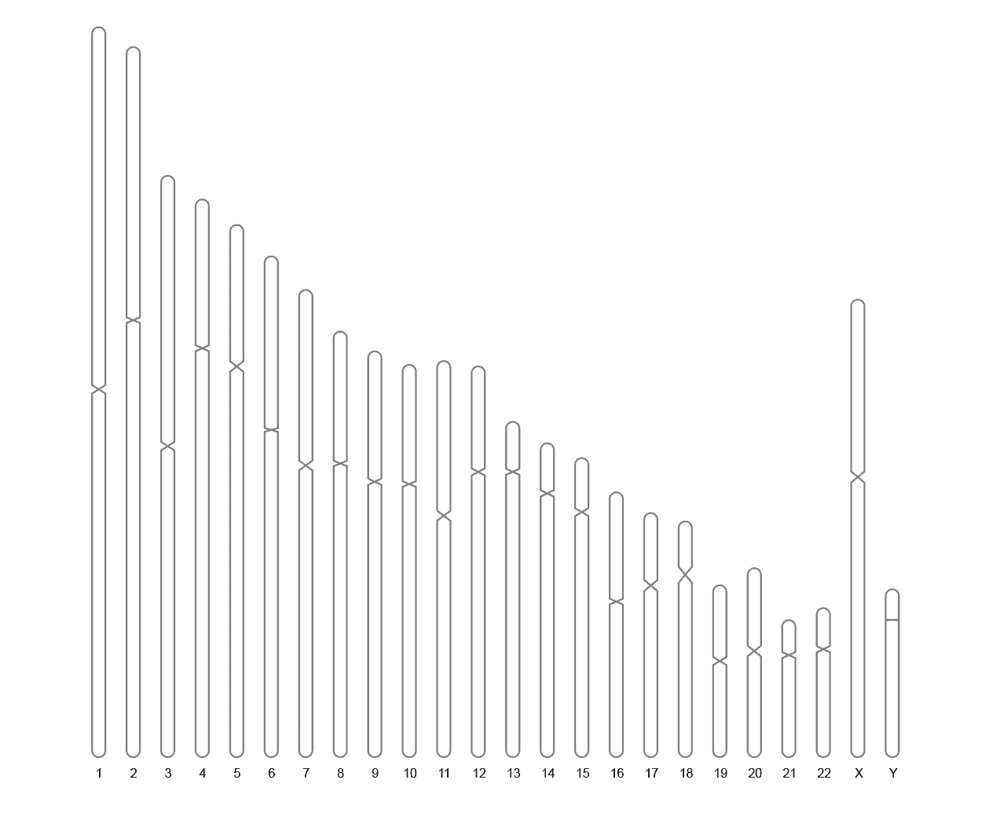{fig-alt="Basic Chromosome Plot" fig-align="center" width="95%"}

Basic Chromosome Plot
:::

### 2. Chromosome plot with heatmap

Use the `overlaid` parameter to map the whole genome data onto the chromosome map, visualizing the gene density of the entire human genome.

```{r}
#| label: fig-1HeatmapChromosomePlot
#| fig-cap: "Chromosome plot with heatmap"
#| out.width: "95%"
#| warning: false
#| eval: false

# Chromosome plot with heatmap
ideogram(karyotype = human_karyotype, overlaid = gene_density)
convertSVG("chromosome.svg", device = "png")
```

::: {#fig-1HeatmapChromosomePlot}
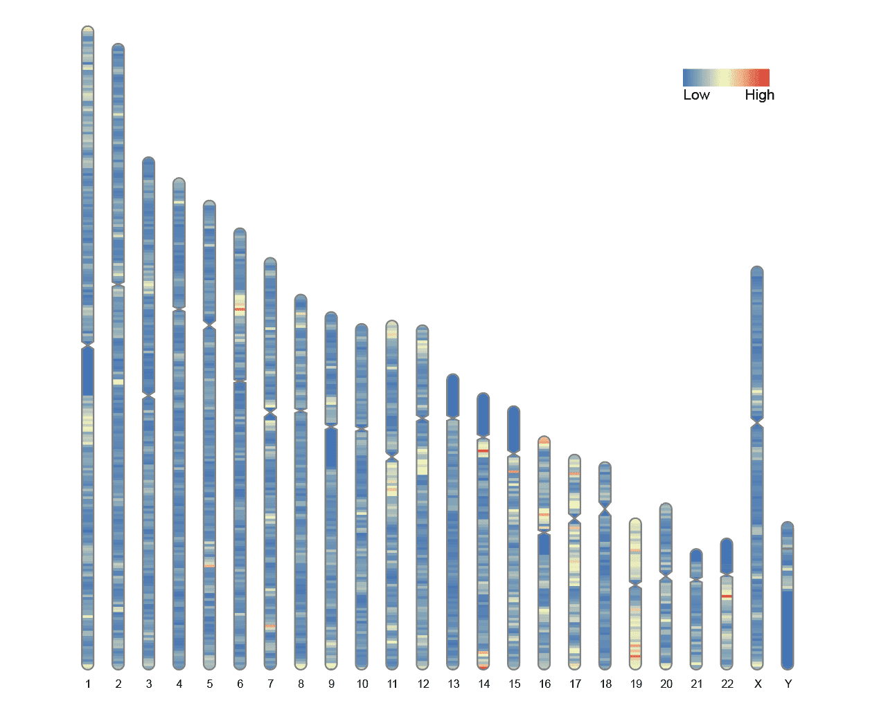{fig-alt="Chromosome plot with heatmap" fig-align="center" width="95%"}

Chromosome plot with heatmap
:::

### 3. Track Label

Map some genome-wide data as tracks on the side of the chromosome map.

```{r}
#| label: fig-1LabelChromosomePlot
#| fig-cap: "Track Label"
#| out.width: "95%"
#| warning: false
#| eval: false

# Track Label
ideogram(karyotype = human_karyotype, label = Random_RNAs_500, label_type = "marker")
convertSVG("chromosome.svg", device = "png")
```

::: {#fig-1LabelChromosomePlot}
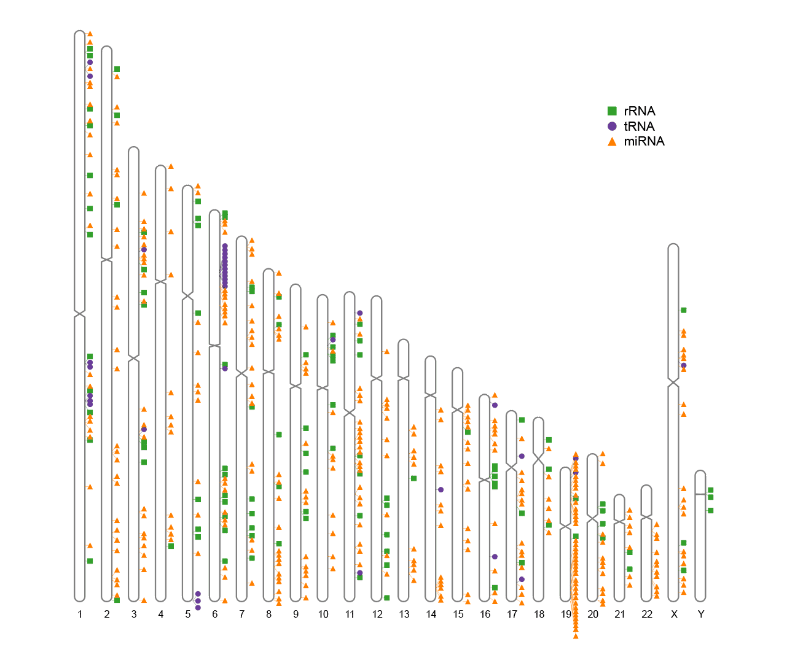{fig-alt="Track Label" fig-align="center" width="95%"}

Track Label
:::

### 4. Plot heatmap and trajectory labels simultaneously

Simultaneously map the overlaid heatmap and track labels on chromosome representations.

```{r}
#| label: fig-1Both
#| fig-cap: "Plot heatmap and trajectory labels simultaneously"
#| out.width: "95%"
#| warning: false
#| eval: false

# Plot heatmap and trajectory labels simultaneously
ideogram(karyotype = human_karyotype, overlaid = gene_density, label = Random_RNAs_500, label_type = "marker")
convertSVG("chromosome.svg", device = "png")
```

::: {#fig-1Both}
{fig-alt="Plot heatmap and trajectory labels simultaneously" fig-align="center" width="95%"}

Plot heatmap and trajectory labels simultaneously
:::

### 5. Custom heatmap colors

To change the colors of the heatmap, modify the `colorset1` parameter (default is `colorset1 = c("#4575b4", "#ffffbf", "#d73027")`). You can use built-in color names, `colors()`, or hexadecimal color codes in the format `"#rrggbb"` or `"#rrggbbaa"`.

```{r}
#| label: fig-1Color
#| fig-cap: "Custom heatmap colors"
#| out.width: "95%"
#| warning: false
#| eval: false

# Custom heatmap colors
ideogram(karyotype = human_karyotype, overlaid = gene_density, label = Random_RNAs_500, label_type = "marker", colorset1 = c("#fc8d59", "#ffffbf", "#91bfdb"))
convertSVG("chromosome.svg", device = "png")
```

::: {#fig-1Both}
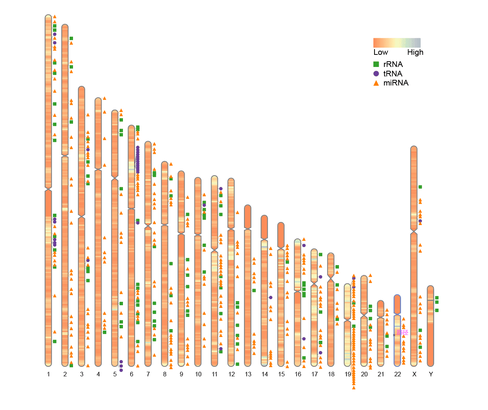{fig-alt="Custom heatmap colors" fig-align="center" width="95%"}

Custom heatmap colors
:::

### 6. Chromosome plot without centromere information

If the species under study lacks clear centromere location information, a chromosome map can still be drawn. In this case, the karyotype file only needs to contain three columns: chromosome number, start position, and end position. The fourth and fifth columns containing the centromere start and end coordinates are unnecessary.

To simulate this situation, the last two columns of the `human_karyotype` data frame included with RIdeogram can be deleted:

```{r}
#| label: fig-6
#| fig-cap: "Chromosome plot without centromere information"
#| out.width: "95%"
#| warning: false
#| eval: false

# Chromosome plot without centromere information
human_karyotype <- human_karyotype[,1:3]
ideogram(karyotype = human_karyotype, overlaid = gene_density, label = Random_RNAs_500, label_type = "marker")
convertSVG("chromosome.svg", device = "png")
```

::: {#fig-6}
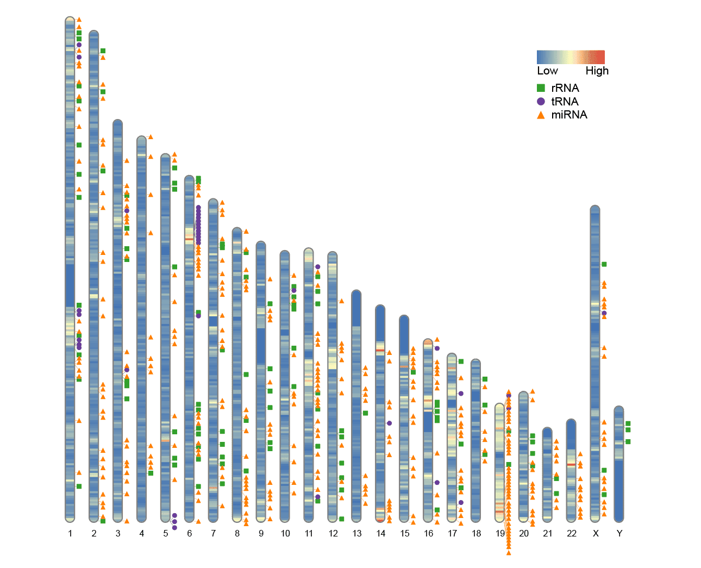{fig-alt="不含着丝粒信息的染色体图" fig-align="center" width="95%"}

Chromosome plot without centromere information
:::

Even if centromere information is missing, RIdeogram can still be plotted, but the centromere region will not be marked in the plot.

### 7. Width setting when only part of the chromosome is used

In some cases, such as analyzing only a subset of chromosomes (e.g., the first 10 chromosomes), the default plot width may appear too scattered or leave too much white space. In this case, it is recommended to optimize the plot layout by adjusting the `width` parameter.

To simulate this situation, you can retain the first 10 chromosomes from the `human_karyotype` data and compare the results of plotting with the default width and the adjusted width:

Before modification:

```{r}
#| label: fig-1Fig7-1
#| fig-cap: "Width setting when only part of the chromosome is used"
#| out.width: "95%"
#| warning: false
#| eval: false

# Before modification:
human_karyotype <- human_karyotype[1:10,]
ideogram(karyotype = human_karyotype, overlaid = gene_density, label = Random_RNAs_500, label_type = "marker")
convertSVG("chromosome.svg", device = "png")
```

::: {#fig-7-1}
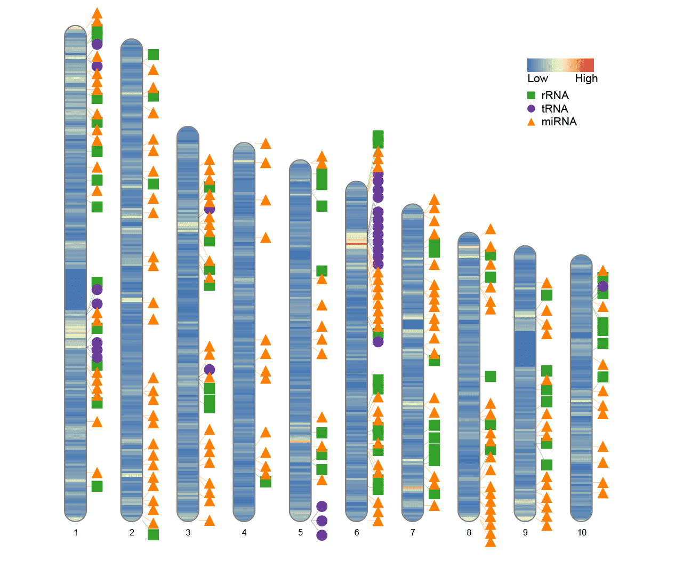{fig-alt="Width setting when only part of the chromosome is used" fig-align="center" width="95%"}

Before modification:
:::

After modification:

```{r}
#| label: fig-1Fig7-2
#| fig-cap: "Width setting when only part of the chromosome is used"
#| out.width: "95%"
#| warning: false
#| eval: false

# After modification
human_karyotype <- human_karyotype[1:10,]
ideogram(karyotype = human_karyotype, overlaid = gene_density, label = Random_RNAs_500, label_type = "marker", width = 100)
convertSVG("chromosome.svg", device = "png")
```

::: {#fig-7-2}
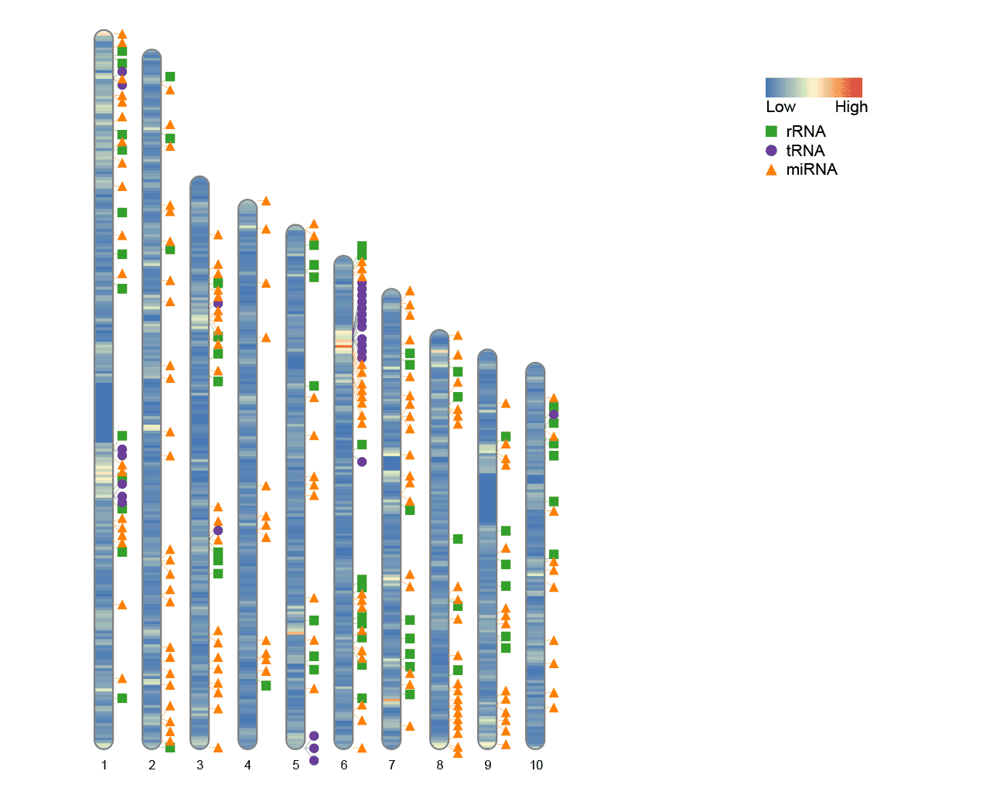{fig-alt="Width setting when only part of the chromosome is used" fig-align="center" width="95%"}

After modification
:::

### 8. Adjust the legend position

If you wish to reposition the legend, you can do so by modifying the `Lx` and `Ly` parameters. These parameters control the position of the legend's top-left corner relative to the image edge. The default values are `Lx = 160` and `Ly = 35`, respectively.

- `Lx`: The distance from the top-left corner of the legend to the left edge of the image.
- `Ly`: The distance from the top-left corner of the legend to the top edge of the image.

By adjusting these parameters, you can prevent the legend from overlapping the main image or position it more appropriately for your layout.

```{r}
#| label: fig-8
#| fig-cap: "Adjust the legend position"
#| out.width: "95%"
#| warning: false
#| eval: false

# Adjust the legend position
ideogram(karyotype = human_karyotype, overlaid = gene_density, label = Random_RNAs_500, label_type = "marker", width = 100, Lx = 80, Ly = 25)
convertSVG("chromosome.svg", device = "png")
```

::: {#fig-8}
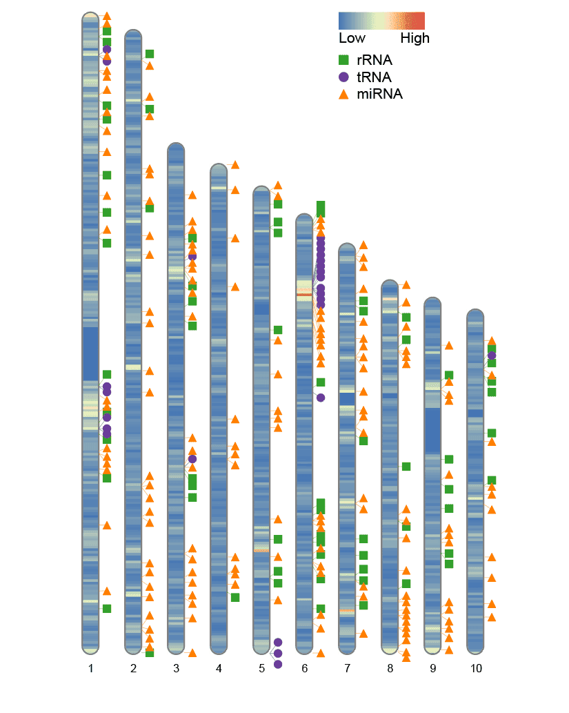{fig-alt="Adjust the legend position" fig-align="center" width="95%"}

Adjust the legend position
:::

### 9. Different label types

RIdeogram supports multiple label types, and you can choose different ways to display data according to your visualization needs. Currently supported label types include:

- `"marker"` (marker point)
- `"heatmap"` (heat map)
- `"line"` (polyline)
- `"polygon"` (polygon)

#### 9.1 Heatmap Label

```{r}
#| label: fig-9-1
#| fig-cap: "Heatmap Label"
#| out.width: "95%"
#| warning: false
#| eval: false

# Heatmap Label
data(human_karyotype, package="RIdeogram")
ideogram(karyotype = human_karyotype, overlaid = gene_density, label = LTR_density, label_type = "heatmap", colorset1 = c("#f7f7f7", "#e34a33"), colorset2 = c("#f7f7f7", "#2c7fb8"))
convertSVG("chromosome.svg", device = "png")
```

::: {#fig-9-1}
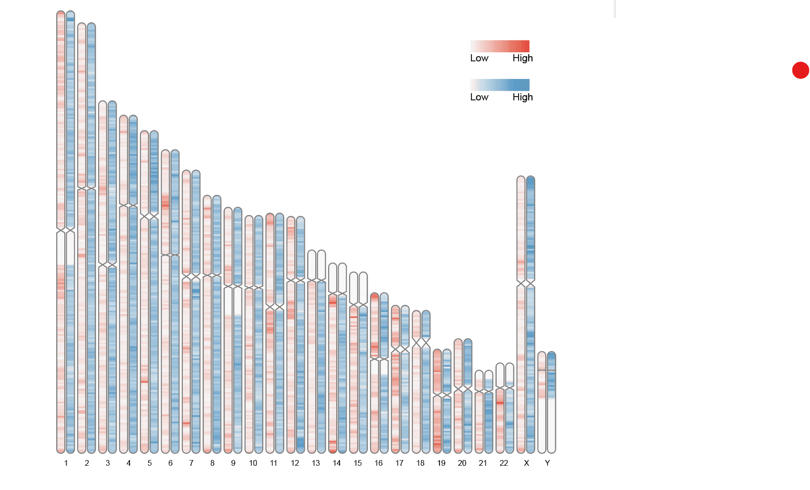{fig-alt="Heatmap Label" fig-align="center" width="95%"}

Heatmap Label
:::

This graph uses human chromosome data built into RIdeogram to show the distribution of two features (gene density and LTR element density) across chromosomes. Different color shades represent different ranges of values, helping to visualize density differences across regions of the genome.

#### 9.2 Single line label

```{r}
#| label: fig-9-2
#| fig-cap: "Single line label"
#| out.width: "95%"
#| warning: false
#| eval: false

# Single line label
data(liriodendron_karyotype, package="RIdeogram")
data(Fst_between_CE_and_CW, package="RIdeogram")
data(Pi_for_CE, package="RIdeogram")
ideogram(karyotype = liriodendron_karyotype, overlaid = Fst_between_CE_and_CW, label = Pi_for_CE, label_type = "line", colorset1 = c("#e5f5f9", "#99d8c9", "#2ca25f"))
convertSVG("chromosome.svg", device = "png")
```

::: {#fig-9-2}
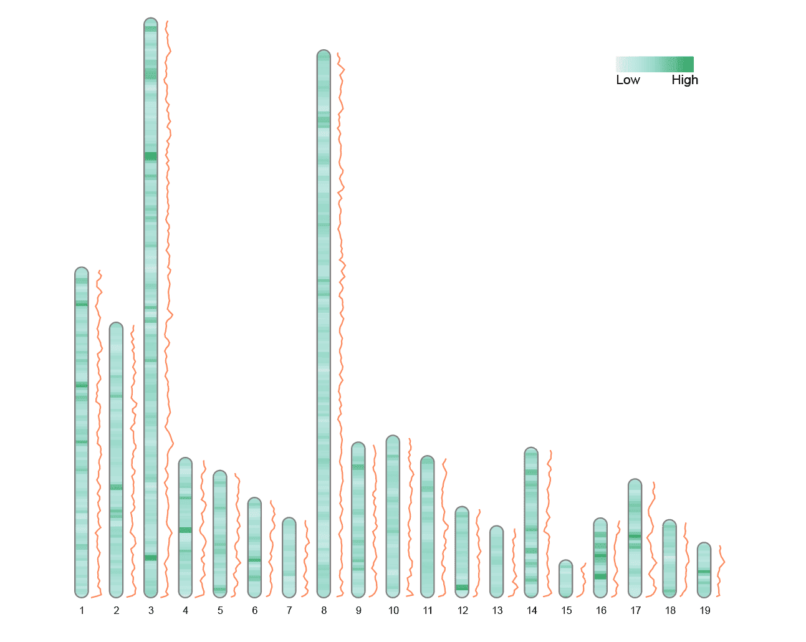{fig-alt="Single line label" fig-align="center" width="95%"}

Single line label
:::

This figure shows the continuous change trend of a single indicator (Pi value) on the chromosome. The fluctuation of the broken line can intuitively reflect the distribution pattern of genetic diversity in different segments.

#### 9.3 Double line label

```{r}
#| label: fig-9-3
#| fig-cap: "Double line label"
#| out.width: "95%"
#| warning: false
#| eval: false

# Double line label
data(liriodendron_karyotype, package="RIdeogram")
data(Fst_between_CE_and_CW, package="RIdeogram")
data(Pi_for_CE_and_CW, package="RIdeogram")
ideogram(karyotype = liriodendron_karyotype, overlaid = Fst_between_CE_and_CW, label = Pi_for_CE_and_CW, label_type = "line", colorset1 = c("#e5f5f9", "#99d8c9", "#2ca25f"))
convertSVG("chromosome.svg", device = "png")
```

::: {#fig-9-3}
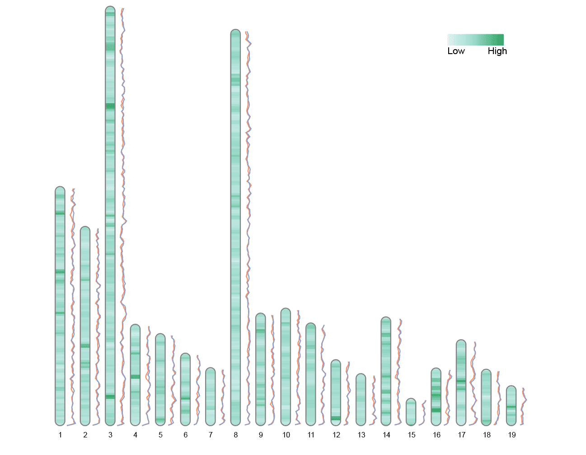{fig-alt="Double line label" fig-align="center" width="95%"}

Double line label
:::

This figure shows the comparison of Pi values of two populations (CE and CW) on chromosomes. The double-line parallel depiction helps to discover the differences in diversity between the two groups in certain chromosome segments.

#### 9.4 Single polygon label

```{r}
#| label: fig-9-4
#| fig-cap: "Single polygon label"
#| out.width: "95%"
#| warning: false
#| eval: false

# Single polygon label
data(liriodendron_karyotype, package="RIdeogram")
data(Fst_between_CE_and_CW, package="RIdeogram")
data(Pi_for_CE, package="RIdeogram")
ideogram(karyotype = liriodendron_karyotype, overlaid = Fst_between_CE_and_CW, label = Pi_for_CE, label_type = "polygon", colorset1 = c("#e5f5f9", "#99d8c9", "#2ca25f"))
convertSVG("chromosome.svg", device = "png")
```

::: {#fig-9-4}
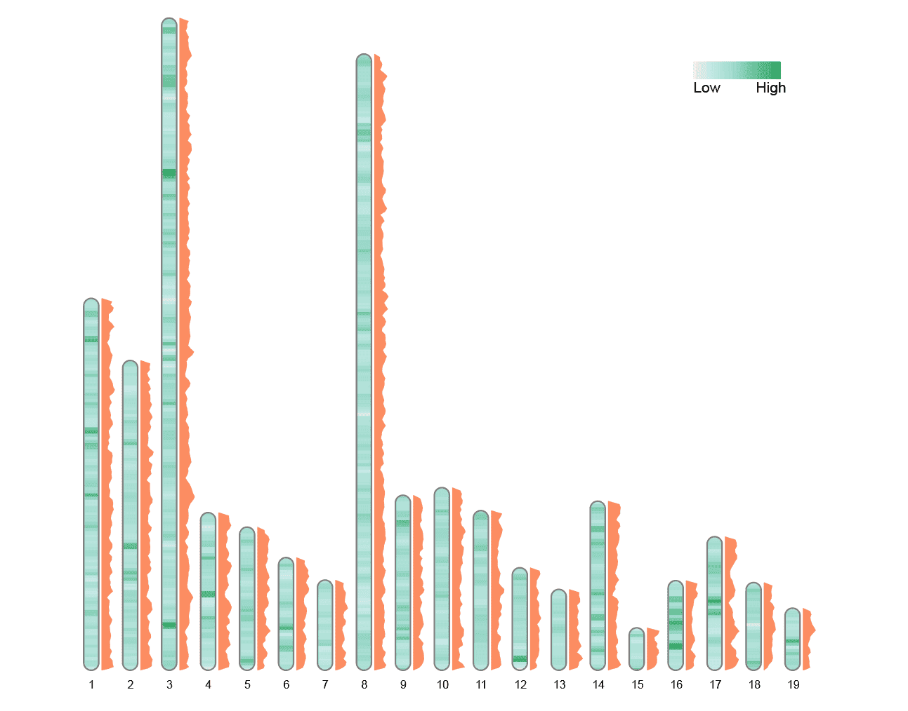{fig-alt="Single polygon label" fig-align="center" width="95%"}

Single polygon label
:::

This graph displays the variation of a single indicator in polygonal form. The change in area more significantly reflects the size of the value, making it suitable for emphasizing local significant areas.

#### 9.5 Double polygon label

```{r}
#| label: fig-9-5
#| fig-cap: "Double polygon label"
#| out.width: "95%"
#| warning: false
#| eval: false

# Double polygon label
data(liriodendron_karyotype, package="RIdeogram") 
data(Fst_between_CE_and_CW, package="RIdeogram") 
data(Pi_for_CE_and_CW, package="RIdeogram") 
ideogram(karyotype = liriodendron_karyotype, overlaid = Fst_between_CE_and_CW, label = Pi_for_CE_and_CW, label_type = "polygon", colorset1 = c("#e5f5f9", "#99d8c9", "#2ca25f"))
convertSVG("chromosome.svg", device = "png")
```

::: {#fig-9-5}
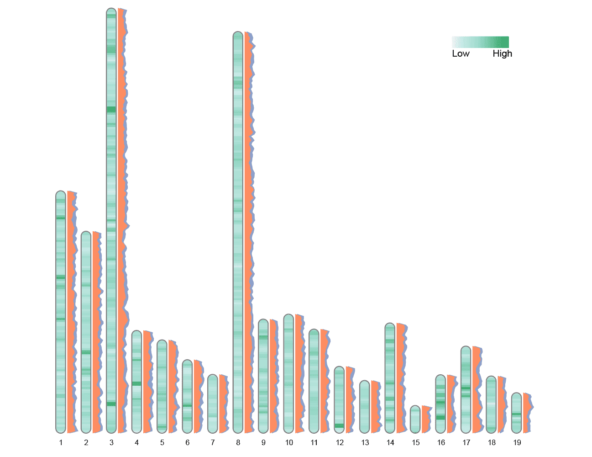{fig-alt="Double polygon label" fig-align="center" width="95%"}

Double polygon label
:::

The second polygon label is automatically offset horizontally by 0.2 chromosome widths to improve readability. This graph uses two sets of polygons to simultaneously display the differences in metrics between the two populations on the chromosome. The overlapping areas or spacing allow for intuitive comparison of the numerical distribution and trends of each segment.

### 10. Output image files in different formats

In addition to the png format, other formats can also be generated using the `device` parameter:

```{r}
#| label: fig-10-1
#| fig-cap: "Output image files in different formats"
#| out.width: "95%"
#| warning: false
#| eval: false

convertSVG("chromosome.svg", device = "tiff", dpi = 600)
```

Without `device`, there are some quick functions to convert SVG images to other formats:

```{r}
#| label: fig-10-2
#| fig-cap: "Output image files in different formats"
#| out.width: "95%"
#| warning: false
#| eval: false

svg2png("chromosome.svg")
svg2pdf("chromosome.svg")
svg2jpg("chromosome.svg")
svg2tiff("chromosome.svg")
```

### 11. Building the karyotype from your own annotation (GTF)

`RIdeogram` ships karyotype data for a few species, but real projects usually work with a custom genome build or assembly. In that case, construct the karyotype table from your annotation file (GTF/GFF): chromosome name, start, end and — when available — centromere coordinates \[3\]. The table can then be passed straight to `ideogram(karyotype = ...)` as in the sections above.

Two implementations are shown: `rtracklayer` for complex annotations, and a `dplyr` fallback that derives chromosome lengths from the longest feature per chromosome (many GTF files have no `chromosome`/`centromere` records).

```{r}
#| label: fig-11-1
#| fig-cap: "Building a karyotype table from a GTF file with rtracklayer."
#| out.width: "95%"
#| warning: false
#| eval: false

# Method 1: rtracklayer — works when the GTF contains chromosome/centromere records
library(rtracklayer)
library(dplyr)

gtf <- import("your_annotation.gtf")

karyotype <- gtf %>%
  as.data.frame() %>%
  filter(type == "chromosome") %>%
  select(seqnames, start, end) %>%
  rename(Chromosome = seqnames, Start = start, End = end) %>%
  mutate(Centromere_Start = NA, Centromere_End = NA)

centromere <- gtf %>%
  as.data.frame() %>%
  filter(type == "centromere") %>%
  select(seqnames, start, end) %>%
  rename(Chromosome = seqnames, Centromere_Start = start, Centromere_End = end)

karyotype <- left_join(karyotype, centromere, by = "Chromosome")
write.csv(karyotype, "karyotype.csv", row.names = FALSE)
```

```{r}
#| label: fig-11-2
#| fig-cap: "dplyr fallback: derive chromosome lengths from the longest feature per chromosome."
#| out.width: "95%"
#| warning: false
#| eval: false

# Method 2: dplyr fallback — no chromosome/centromere records needed
karyotype <- gtf %>%
  as.data.frame() %>%
  group_by(Chromosome = seqnames) %>%
  summarise(Start = min(start), End = max(end), .groups = "drop") %>%
  mutate(Centromere_Start = NA, Centromere_End = NA)

write.csv(karyotype, "karyotype.csv", row.names = FALSE)
```

::: callout-tip
**Coordinate systems:** GTF/GFF files are 1-based; BED files are 0-based (half-open). `RIdeogram` input should be kept internally consistent — if your feature tables (heatmap, marker tracks) come from BED-derived data, convert them to the same convention as the karyotype before plotting.
:::

### 12. Anchored Ideogram, Signal Track and Marker Rug

`RIdeogram` fixes the track layout: the heatmap sits inside the chromosome and the two label tracks sit above and below it. When you need a different stack — an ideogram, an arbitrary value track, and a marker rug — the reliable approach is to build the layout yourself and to share **one** x axis between the panels. The version below lays the chromosomes end to end on a cumulative coordinate (the "UCSC Genome Graphs" convention \[9\]) and anchors a per-window Fst track and a marker set to exactly the same scale \[6,9\].

```{r}
#| label: fig-12-1AnchoredIdeogram
#| fig-cap: "Anchored ideogram with cumulative coordinates for a simulated five-chromosome genome laid end to end (4 Mb gaps): band shading with chromosome outlines and the centromere drawn as a dark tick on top, per-window Fst below with two planted selective-sweep peaks (chr2:62 Mb, chr4:20 Mb) and the 0.25 outlier threshold, and a marker rug (tRNA/rRNA/miRNA/QTL) on the top axis."
#| out.width: "100%"
#| warning: false
#| message: false
#| fig-width: 10
#| fig-height: 4.6

suppressPackageStartupMessages({
  library(ggplot2)
  library(dplyr)
  library(patchwork)
})

## A chromosome table in the shape RIdeogram expects: name, start, end,
## centromere. Lengths are a five-chromosome toy genome in Mb.
karyo <- data.frame(
  chr = c("chr1", "chr2", "chr3", "chr4", "chr5"),
  len = c(120, 95, 80, 60, 45),
  cen = c(48, 34, 31, 21, 17)
)
set.seed(43501)

## Cytobands: alternating stain with a density value, as G-band tables carry.
banding <- do.call(rbind, lapply(seq_len(nrow(karyo)), function(i) {
  k <- karyo[i, ]
  starts <- seq(0, k$len, by = 6)
  data.frame(chr = k$chr, start = starts, end = pmin(starts + 6, k$len),
             density = round(runif(length(starts), 0, 100)))
}))

## Per-window Fst with two planted peaks, so the reading order is verifiable.
win <- do.call(rbind, lapply(seq_len(nrow(karyo)), function(i) {
  k <- karyo[i, ]
  mid <- seq(1, k$len - 1, by = 2)
  fst <- 0.08 + 0.05 * abs(sin(mid / 9))
  if (k$chr == "chr2") fst <- fst + 0.55 * exp(-((mid - 62)^2) / 40)
  if (k$chr == "chr4") fst <- fst + 0.42 * exp(-((mid - 20)^2) / 50)
  data.frame(chr = k$chr, mid = mid,
             fst = pmin(0.95, fst + rnorm(length(mid), 0, 0.02)))
}))

markers <- data.frame(
  chr = c("chr1", "chr1", "chr2", "chr2", "chr3", "chr3", "chr4", "chr5", "chr5"),
  pos = c(12, 88, 62, 30, 41, 70, 20, 15, 38),
  type = c("tRNA", "rRNA", "miRNA", "tRNA", "rRNA", "miRNA",
           "QTL", "QTL", "miRNA")
)

## Cumulative coordinates: chromosomes end to end with a 4 Mb gap, so every
## panel can share a single x axis instead of relying on facet widths.
gap <- 4
offs <- data.frame(chr = karyo$chr,
                   offset = c(0, cumsum(karyo$len + gap)[-nrow(karyo)]))
banding <- left_join(banding, offs, by = "chr") |>
  mutate(x0 = offset + start, x1 = offset + end)
win <- left_join(win, offs, by = "chr") |> mutate(x = offset + mid)
markers <- left_join(markers, offs, by = "chr") |> mutate(x = offset + pos)
chr_lab <- data.frame(chr = karyo$chr, x = offs$offset + karyo$len / 2)
xmax <- max(win$x) + 3

p_ideo <- ggplot() +
  geom_rect(data = banding,
            aes(xmin = x0, xmax = x1, ymin = 0.84, ymax = 1.16, fill = density),
            colour = "#3d3d3d", linewidth = 0.12) +
  ## Centromere: a dark tick, not a white line -- white on a near-white band
  ## is invisible, which is exactly how the pinch disappears from the figure.
  geom_segment(data = left_join(karyo, offs, by = "chr"),
               aes(x = offset + cen, xend = offset + cen, y = 0.80, yend = 1.20),
               linewidth = 0.9, colour = "#111111", lineend = "butt") +
  geom_point(data = markers, aes(x, y = 1.34, colour = type, shape = type),
             size = 2.1) +
  scale_fill_gradientn("band\ndensity",
                       colours = c("#ffffff", "#c6c6c6", "#5a5a5a"),
                       limits = c(0, 100), guide = "none") +
  scale_colour_manual(values = c(tRNA = "#1b7837", rRNA = "#d95f02",
                                 miRNA = "#2166ac", QTL = "#b2182b"),
                      name = NULL) +
  scale_shape_manual(values = c(tRNA = 17, rRNA = 15, miRNA = 16, QTL = 18),
                     name = NULL) +
  scale_x_continuous(limits = c(-2, xmax), expand = c(0, 0)) +
  scale_y_continuous(limits = c(0.78, 1.46), expand = c(0, 0)) +
  labs(x = NULL, y = NULL) +
  theme_minimal(base_size = 9) +
  theme(panel.grid = element_blank(), axis.text = element_blank(),
        axis.ticks = element_blank(), legend.position = "bottom",
        legend.key.size = unit(0.32, "cm"),
        legend.text = element_text(size = 7.2),
        plot.margin = margin(2, 5, 0, 5))

p_track <- ggplot(win, aes(x, fst, group = chr)) +
  geom_area(fill = "#4292c6", alpha = 0.5, colour = NA) +
  geom_line(colour = "#08519c", linewidth = 0.32) +
  geom_hline(yintercept = 0.25, linetype = "dashed", linewidth = 0.3,
             colour = "#b2182b") +
  geom_vline(xintercept = offs$offset[-1] - gap / 2, linewidth = 0.25,
             colour = "#dedede") +
  ## chromosome names on the track's own panel, not borrowed from above
  annotate("text", x = chr_lab$x, y = 0.93, label = chr_lab$chr,
           size = 2.6, colour = "#333333") +
  scale_x_continuous(limits = c(-2, xmax), expand = c(0, 0)) +
  scale_y_continuous(limits = c(0, 0.96), breaks = c(0, 0.25, 0.5, 0.75),
                     expand = c(0, 0)) +
  labs(x = "cumulative position (Mb; chromosomes laid end to end)",
       y = "Fst") +
  theme_minimal(base_size = 9) +
  theme(panel.grid.major.x = element_blank(),
        panel.grid.minor = element_blank(),
        axis.text.x = element_text(size = 6.5),
        axis.text.y = element_text(size = 7),
        plot.margin = margin(0, 5, 2, 5))

p_ideo / p_track + plot_layout(heights = c(0.75, 1))
```

::: callout-tip
**Practice tips**

-   Choose one coordinate convention per panel stack: independent axes (RIdeogram's fixed tracks) or a cumulative axis with gaps. Do not mix them inside one figure — the reader will compare x positions across panels whether you intend it or not.
-   Insert a visible gap (here 4 Mb) between chromosomes: without it the last band of one chromosome and the first band of the next read as a single feature.
-   `left_join()` the chromosome offset table once and keep the offset in the data frame; recomputing `offset + start` inside `aes()` breaks as soon as a layer needs a different summary row.
-   Draw the centromere as a white pinch over the band fill rather than as a separate track: it is part of the chromosome, not a value along it.
-   Declare the outlier threshold (0.25 here) as an explicit rule; a dashed line with no stated statistic invites the reader to invent one.
:::
## Implementations deliberately not used here

This page draws its figures with RIdeogram and ggplot2 rather than installing the skipped tools. Of the tools that the issue-435 inventory maps onto Omics/ChromosomePlot.qmd, 3 are marked **skipped** here and used only as layout references, not as dependencies: 2 that have gone more than five years without an operational commit (cutoff 2021-11-07), and 1 whose dependency closure is too heavy for one static figure. Reproducing whatever still works would mean pinning abandoned code; installing the rest would mean pulling a whole analysis framework into a documentation build. The figure conventions were read off those tools, then re-implemented here so each panel can be inspected line by line.

| Tool | Last commit | Status | Why it is skipped |
| --- | --- | --- | --- |
| ggbio | — | heavy dependency | framework-scale dependency closure is too heavy for one static figure |
| Ideoplot | 2015-09-21 | stale | >5 years without maintenance |
| KaryotypeSVG | 2017-07-17 | stale | >5 years without maintenance |

## Application

::: {#fig-ChromosomePlotApplications1}
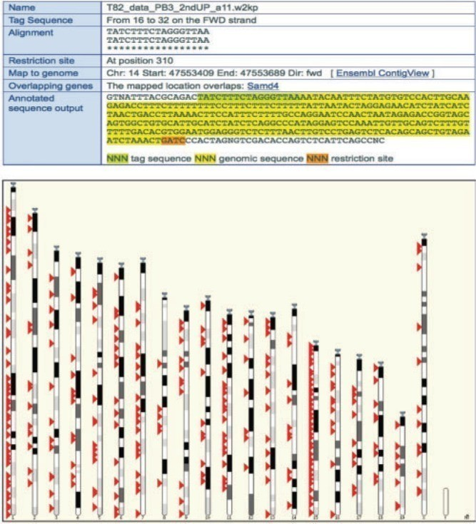{fig-alt="ChromosomePlotApp1" fig-align="center" width="60%"}

iMapper maps and analyzes insertion site sequence data
:::

::: {#fig-ChromosomePlotApplications2}
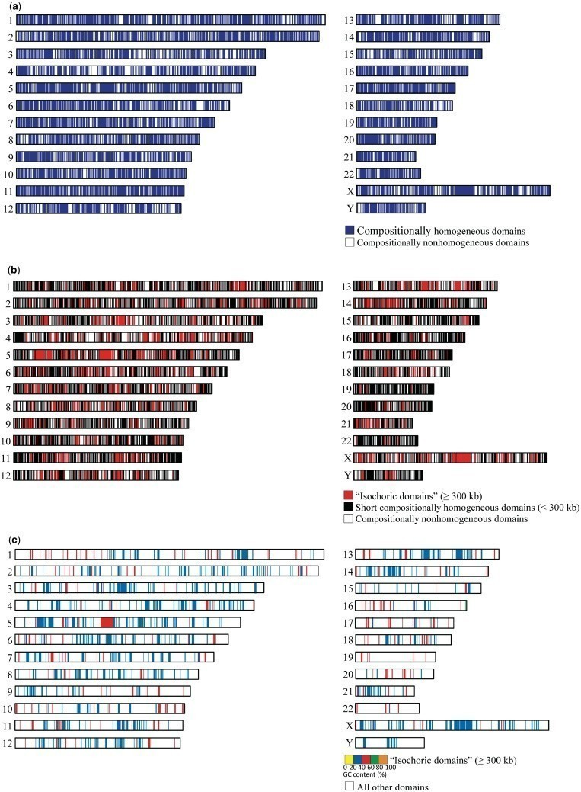{fig-alt="ChromosomePlotApp2" fig-align="center" width="60%"}

Schematic diagram of the combined domains inferred by IsoPlotter and mapped onto chromosomes
:::

## Reference

\[1\] RIdeogram: drawing SVG graphics to visualize and map genome-wide data on idiograms https://cran.r-project.org/web/packages/RIdeogram/vignettes/RIdeogram.html
\[2\] Hao Z, Lv D, Ge Y, Shi J, Weijers D, Yu G, Chen J. 2020. RIdeogram: drawing SVG graphics to visualize and map genome-wide data on the idiograms. PeerJ Comput. Sci. 6:e251 http://doi.org/10.7717/peerj-cs.251
\[3\] Lu X, Li K, Li Z, et al. FigureYa: a standardized visualization framework for enhancing biomedical data interpretation and research efficiency. iMetaMed. 2025;1(1). doi:10.1002/imm3.70005
\[4\] Hao Z, Lv D, Ge Y, et al. RIdeogram: drawing SVG graphics to visualize and map genome-wide data on the idiograms. PeerJ Comput Sci. 2020;6:e251. doi:10.7717/peerj-cs.251
\[5\] Anand L, Rodriguez Lopez CM. ChromoMap: an R package for interactive visualization of multi-omics data and annotation of chromosomes. BMC Bioinformatics. 2022;23:7. doi:10.1186/s12859-021-04556-z
\[6\] Gel B, Serra E. karyoploteR: an R/Bioconductor package to plot customizable genomes displaying arbitrary data. Bioinformatics. 2017;33(19):3088-3090. doi:10.1093/bioinformatics/btx346
\[7\] Yin T, Cook D, Lawrence M. ggbio: an R package for extending the grammar of graphics for genomic data. Genome Biol. 2012;13(8):R77. doi:10.1186/gb-2012-13-8-r77
\[8\] Yu Y, Yao W, Wang Y, Huang F. shinyChromosome: an R/Shiny application for interactive creation of non-circular plots of whole genomes. Genomics Proteomics Bioinformatics. 2019;17(5):535-539. doi:10.1016/j.gpb.2019.07.003
\[9\] Karolchik D, Baertsch R, Diekhans M, et al. The UCSC Genome Browser Database. Nucleic Acids Res. 2003;31(1):51-54. doi:10.1093/nar/gkg129


