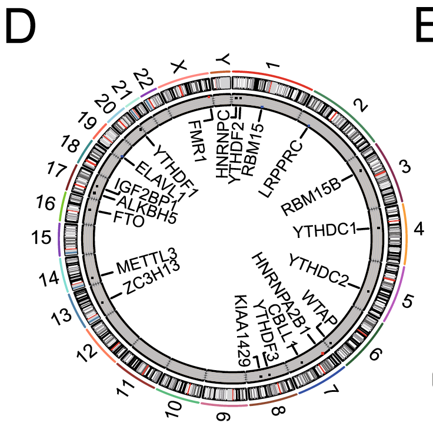

The reference places m6A regulators at their genomic positions on a **circular chromosome layout** (RCircos), with outer chromosome ideograms and inner tracks marking each gene's location and CNV class \[1\]. `RCircos` is not in this repository's lockfile; `circlize` is, and its genomic circos functions (`circos.genomicTrackPlotRegion`) reproduce the layout — chromosome ideogram ring, labelled gene markers, and a CNV-class track — over a simulated hg19-style cytoband table:

## Example

{fig-alt="Circos Gene-Location Track DEMO" fig-align="center" width="65%"}

## Setup

-   System Requirements: Cross-platform (Linux/MacOS/Windows)

-   Programming language: R

-   Dependent packages: `circlize`

```{r packages setup, message=FALSE, warning=FALSE, output=FALSE}
suppressPackageStartupMessages({
  library(circlize)
})
```

```{r}
sessioninfo::session_info("attached")
```

## Data Preparation

An hg19-style cytoband table (chromosome, start, end, stain) built at 10-Mb resolution — the `RCircos` `CytoIdeo` input shape — plus 14 "m6A regulator"-style genes spread over the chromosomes with planted positions and a CNV class (amplified/deleted/neutral) drawn as the inner track colour:

```{r load data}
suppressPackageStartupMessages({library(circlize)})
set.seed(43261)
## cytoband: 23 chromosomes, arms in 10-Mb bins, alternating stains
chrom_lens <- c(249, 243, 198, 190, 182, 171, 159, 145, 138, 134,
                135, 133, 114, 107, 102, 90, 83, 80, 59, 64, 47, 46, 17)
cytoband <- do.call(rbind, lapply(seq_along(chrom_lens), function(i) {
  st <- seq(0, chrom_lens[i], by = 10)
  data.frame(chr = paste0("chr", i), start = st,
             end = c(st[-1], chrom_lens[i]),
             name = paste0(i, "q", seq_along(st)),
             stain = rep(c("gpos", "gneg"), length.out = length(st)))
}))
## candidate genes with planted positions and CNV class
gene_anno <- data.frame(
  gene = c("METTL3", "METTL14", "WTAP", "RBM15", "VIRMA", "ZC3H13",
           "CBLL2", "KIAA1429", "FTO", "ALKBH5", "YTHDF1", "YTHDF2",
           "YTHDC1", "IGF2BP1"),
  ## one gene per chromosome so labels never collide on the ring
  chr = paste0("chr", c(1, 2, 3, 4, 5, 6, 7, 8, 10, 11, 13, 14, 17, 15)),
  start = c(154.0, 48.5, 69.5, 12.0, 8.3, 40.6, 22.0, 6.3, 49.0, 44.0,
            100.0, 22.3, 7.5, 65.0) * 1e6,
  end = NA,
  class = rep(c("amplified", "neutral", "deleted"), c(5, 6, 3)))
gene_anno$end <- gene_anno$start + 50000
## express positions in Mb to match the cytoband table (which is 10-Mb binned)
gene_anno$start <- gene_anno$start / 1e6
gene_anno$end <- gene_anno$end / 1e6
## circlize genomic functions require the chromosome column FIRST
gene_anno <- gene_anno[, c("chr", "start", "end", "gene", "class")]
```

## Visualization

### 1. Chromosome Ideogram with Gene Labels

The reference's outer layout: chromosome ideogram ring (stain-shaded), chromosome names outside, and each gene marked at its position with a labelled link to the inner ring — `circlize`'s genomic circos replaces `RCircos.initializeWithIdeogram`:

```{r}
#| label: fig-1.1CircosGene
#| fig-cap: "Circular gene-location layout: 23 chromosomes drawn as a shaded ideogram ring (10-Mb bins), the 14 candidate genes marked at their positions with labelled markers, ordered by chromosome; the CNV-class colour ring appears in the next figure."
#| out.width: "80%"
#| fig-width: 7.5
#| fig-height: 7.5

circos.clear()
circos.initializeWithIdeogram(cytoband, chromosome.index = paste0("chr", 1:23),
                              plotType = c("ideogram", "labels"))
circos.genomicTrackPlotRegion(gene_anno, stack = FALSE, ylim = c(0, 1.35),
                              panel.fun = function(region, value, ...) {
                                for (k in seq_len(nrow(region))) {
                                  mid <- (region[k, 1] + region[k, 2]) / 2
                                  circos.points(mid, 0.6, pch = 18,
                                                cex = 1.4, col = "#B2182B")
                                  circos.text(mid, 1.1 + 0.18 * ((k - 1) %% 2),
                                              value$gene[k],
                                              cex = 0.72, facing = "clockwise",
                                              adj = c(0, 0.5), niceFacing = TRUE)
                                }
                              }, track.height = 0.12)
circos.clear()
```

### 2. CNV-Class Track Under the Ideogram

The reference adds the alteration class as an inner track: each gene's CNV class drawn as a coloured point/sector on a second genomic track, colour-coded amplified/deleted/neutral with the legend outside:

```{r}
#| label: fig-2.1CircosGeneCNV
#| fig-cap: "Gene locations with CNV-class track: ideogram ring + gene markers as before, plus an inner ring where each gene's CNV class is colour-coded (red = amplified, grey = neutral, blue = deleted)."
#| out.width: "80%"
#| fig-width: 7.5
#| fig-height: 7.5

class_col <- c(amplified = "#B2182B", neutral = "grey55", deleted = "#2166AC")
circos.clear()
circos.initializeWithIdeogram(cytoband, chromosome.index = paste0("chr", 1:23),
                              plotType = c("ideogram", "labels"))
circos.genomicTrackPlotRegion(gene_anno, stack = FALSE, ylim = c(0, 1.35),
                              panel.fun = function(region, value, ...) {
                                for (k in seq_len(nrow(region))) {
                                  mid <- (region[k, 1] + region[k, 2]) / 2
                                  circos.points(mid, 0.6, pch = 18,
                                                cex = 1.4, col = "#B2182B")
                                  circos.text(mid, 1.1 + 0.18 * ((k - 1) %% 2),
                                              value$gene[k],
                                              cex = 0.72, facing = "clockwise",
                                              adj = c(0, 0.5), niceFacing = TRUE)
                                }
                              }, track.height = 0.12)
circos.genomicTrackPlotRegion(gene_anno, stack = FALSE, ylim = c(0, 1.2),
                              panel.fun = function(region, value, ...) {
                                for (k in seq_len(nrow(region))) {
                                  mid <- (region[k, 1] + region[k, 2]) / 2
                                  circos.points(mid, 0.6, pch = 15,
                                                cex = 1.8,
                                                col = class_col[value$class[k]])
                                }
                              }, track.height = 0.1)
par(xpd = TRUE)
legend("bottomleft", inset = c(-0.02, -0.02), legend = names(class_col), pch = 15,
       col = class_col, bty = "n", cex = 0.9, title = "CNV class")
par(xpd = FALSE)
circos.clear()
```

::: callout-tip
**Practice tips**

-   A genomic circos needs a **cytoband-shaped data frame** (chr, start, end, stain) — build one from the UCSC or Ensembl table rather than inventing chromosome lengths, so sector widths are proportional.
-   `chromosome.index` limits the ring to listed chromosomes and preserves their order; without it, circlize sorts lexically (chr1, chr10, chr11 before chr2).
-   Label genes with `facing = "clockwise", niceFacing = TRUE` — fixed-angle labels invert on half the ring and become unreadable.
-   Keep the two tracks on separate `circos.genomicTrackPlotRegion` calls with explicit heights; stacking everything in one track collapses markers onto shared positions.
-   `circos.clear()` after every genomic circos — leftover sector state corrupts the next circos figure in the same session.
:::

## Application

::: {#fig-CircosGeneApplications1}
{fig-alt="Circos Gene-Location Track" fig-align="center" width="65%"}

Circos gene-location track
:::

Any gene list with genomic coordinates reads this way: m6A/m5C/AC regulators, pathway members with reported focal CNVs, or eQTL genes across the genome — wherever "where do these genes sit and what has happened to them" is the opening question.

## Reference

\[1\] Xiaofan Lu, et al. FigureYa: A Standardized Visualization Framework for Enhancing Biomedical Data Interpretation and Research Efficiency. iMetaMed. 2025. doi:10.1002/imm3.70005
