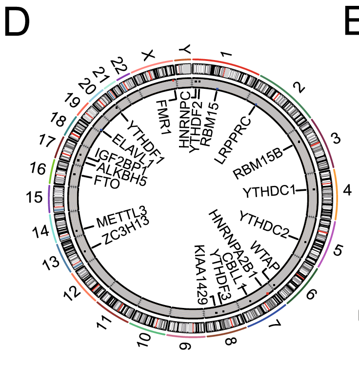

参考文档把 m6A 调控子放到**环形染色体版式**（RCircos）的基因组位置上：外圈染色体 ideogram、内圈轨道标注每个基因的位置与 CNV 类别 \[1\]。`RCircos` 不在本仓库 lockfile；`circlize` 在——其基因组 circos 函数（`circos.genomicTrackPlotRegion`）在 hg19 式细胞带表上复现该版式——染色体 ideogram 环、带标签的基因标记、CNV 类别轨道：

## Example

{fig-alt="Circos 基因位置轨道 DEMO" fig-align="center" width="60%"}

## Setup

-   系统要求：跨平台（Linux/MacOS/Windows）

-   编程语言：R

-   依赖包：`circlize`

```{r packages setup, message=FALSE, warning=FALSE, output=FALSE}
suppressPackageStartupMessages({
  library(circlize)
})
```

```{r}
sessioninfo::session_info("attached")
```

## 数据准备

hg19 式细胞带表（染色体、起点、终点、染色，10-Mb 分箱）——即 `RCircos` `CytoIdeo` 输入形状——加 14 个"m6A 调控子"式基因分布在染色体上（每染色体一个、避免环形标签碰撞），并带植入位置与 CNV 类别（扩增/中性/缺失）画成内轨颜色：

```{r load data}
suppressPackageStartupMessages({library(circlize)})
set.seed(43261)
## cytoband: 23 chromosomes, arms in 10-Mb bins, alternating stains
chrom_lens <- c(249, 243, 198, 190, 182, 171, 159, 145, 138, 134,
                135, 133, 114, 107, 102, 90, 83, 80, 59, 64, 47, 46, 17)
cytoband <- do.call(rbind, lapply(seq_along(chrom_lens), function(i) {
  st <- seq(0, chrom_lens[i], by = 10)
  data.frame(chr = paste0("chr", i), start = st,
             end = c(st[-1], chrom_lens[i]),
             name = paste0(i, "q", seq_along(st)),
             stain = rep(c("gpos", "gneg"), length.out = length(st)))
}))
## candidate genes with planted positions and CNV class
gene_anno <- data.frame(
  gene = c("METTL3", "METTL14", "WTAP", "RBM15", "VIRMA", "ZC3H13",
           "CBLL2", "KIAA1429", "FTO", "ALKBH5", "YTHDF1", "YTHDF2",
           "YTHDC1", "IGF2BP1"),
  ## one gene per chromosome so labels never collide on the ring
  chr = paste0("chr", c(1, 2, 3, 4, 5, 6, 7, 8, 10, 11, 13, 14, 17, 15)),
  start = c(154.0, 48.5, 69.5, 12.0, 8.3, 40.6, 22.0, 6.3, 49.0, 44.0,
            100.0, 22.3, 7.5, 65.0) * 1e6,
  end = NA,
  class = rep(c("amplified", "neutral", "deleted"), c(5, 6, 3)))
gene_anno$end <- gene_anno$start + 50000
## express positions in Mb to match the cytoband table (which is 10-Mb binned)
gene_anno$start <- gene_anno$start / 1e6
gene_anno$end <- gene_anno$end / 1e6
## circlize genomic functions require the chromosome column FIRST
gene_anno <- gene_anno[, c("chr", "start", "end", "gene", "class")]
```

## Visualization

### 染色体 ideogram 与基因标签

参考的外层版式：染色体 ideogram 环（染色分箱）、环外染色体名、每个基因在其位置以带标签的标记画出——`circlize` 的基因组 circos 替代 `RCircos.initializeWithIdeogram`：

```{r}
#| label: fig-1.1CircosGene
#| fig-cap: "环形基因位置版式：23 条染色体画成染色 ideogram 环（10-Mb 分箱）、14 个候选基因在各自位置以带标签的标记画出。"
#| out.width: "80%"
#| fig-width: 7.5
#| fig-height: 7.5

circos.clear()
circos.initializeWithIdeogram(cytoband, chromosome.index = paste0("chr", 1:23),
                              plotType = c("ideogram", "labels"))
circos.genomicTrackPlotRegion(gene_anno, stack = FALSE, ylim = c(0, 1.35),
                              panel.fun = function(region, value, ...) {
                                for (k in seq_len(nrow(region))) {
                                  mid <- (region[k, 1] + region[k, 2]) / 2
                                  circos.points(mid, 0.6, pch = 18,
                                                cex = 1.4, col = "#B2182B")
                                  circos.text(mid, 1.1 + 0.18 * ((k - 1) %% 2),
                                              value$gene[k],
                                              cex = 0.72, facing = "clockwise",
                                              adj = c(0, 0.5), niceFacing = TRUE)
                                }
                              }, track.height = 0.12)
circos.clear()
```

### ideogram 下的 CNV 类别轨道

参考把改变类别画成内轨：每个基因的 CNV 类别画成第二个基因组轨道上的彩色方块（扩增/缺失/中性配色）、图例在外：

```{r}
#| label: fig-2.1CircosGeneCNV
#| fig-cap: "基因位置加 CNV 类别轨道：ideogram 环 + 基因标记照旧，加一圈内轨把每个基因的 CNV 类别按颜色编码（红 = 扩增、灰 = 中性、蓝 = 缺失）。"
#| out.width: "80%"
#| fig-width: 7.5
#| fig-height: 7.5

class_col <- c(amplified = "#B2182B", neutral = "grey55", deleted = "#2166AC")
circos.clear()
circos.initializeWithIdeogram(cytoband, chromosome.index = paste0("chr", 1:23),
                              plotType = c("ideogram", "labels"))
circos.genomicTrackPlotRegion(gene_anno, stack = FALSE, ylim = c(0, 1.35),
                              panel.fun = function(region, value, ...) {
                                for (k in seq_len(nrow(region))) {
                                  mid <- (region[k, 1] + region[k, 2]) / 2
                                  circos.points(mid, 0.6, pch = 18,
                                                cex = 1.4, col = "#B2182B")
                                  circos.text(mid, 1.1 + 0.18 * ((k - 1) %% 2),
                                              value$gene[k],
                                              cex = 0.72, facing = "clockwise",
                                              adj = c(0, 0.5), niceFacing = TRUE)
                                }
                              }, track.height = 0.12)
circos.genomicTrackPlotRegion(gene_anno, stack = FALSE, ylim = c(0, 1.2),
                              panel.fun = function(region, value, ...) {
                                for (k in seq_len(nrow(region))) {
                                  mid <- (region[k, 1] + region[k, 2]) / 2
                                  circos.points(mid, 0.6, pch = 15,
                                                cex = 1.8,
                                                col = class_col[value$class[k]])
                                }
                              }, track.height = 0.1)
par(xpd = TRUE)
legend("bottomleft", inset = c(-0.02, -0.02), legend = names(class_col), pch = 15,
       col = class_col, bty = "n", cex = 0.9, title = "CNV class")
par(xpd = FALSE)
circos.clear()
```


## 应用场景

::: {{#fig-CircosGeneApplications1}}
{fig-alt="Circos 基因位置轨道" fig-align="center" width="60%"}

Circos 基因位置轨道
:::

任何带基因组坐标的基因清单都这样读：m6A/m5C/AC 调控子、带焦点 CNV 报道的通路成员、或跨基因组的 eQTL 基因——凡"这些基因在哪、发生了什么"是开场问题处。

## 参考文献

\[1\] Xiaofan Lu, et al. FigureYa: A Standardized Visualization Framework for Enhancing Biomedical Data Interpretation and Research Efficiency. iMetaMed. 2025. doi:10.1002/imm3.70005
