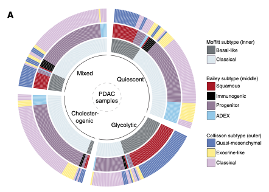

When one tumour cohort carries **several competing subtype classifications**, the reference aligns them on one circular layout: each sample is a sector, and each ring is one classification's label, drawn with `circlize::circos.heatmap()` and split so samples sharing a label sit inside the same arc — agreement between classifications is visible as colour blocks that persist around the circle \[1\]. Four rings for the PDAC metabolic/expression subtypes of the reference; `gridBase` viewport plumbing keeps the legends outside the circle:

## Example

{fig-alt="Circos Subtype Alignment Rings DEMO" fig-align="center" width="75%"}

## Setup

-   System Requirements: Cross-platform (Linux/MacOS/Windows)

-   Programming language: R

-   Dependent packages: `circlize`; `ComplexHeatmap`

```{r packages setup, message=FALSE, warning=FALSE, output=FALSE}
suppressPackageStartupMessages({
  library(circlize); library(ComplexHeatmap)
})
```

```{r}
sessioninfo::session_info("attached")
```

## Data Preparation

150 simulated PDAC samples with four subtype columns (metabolic TCGA-style, Moffitt-style, Bailey-style, Collisson-style) planted with realistic agreement structure: the metabolic subtypes align strongly with Moffitt's Basal-like/Classical split and only weakly with Collisson's — the "does my subtype recapitulate theirs" readout the figure exists for. Rows are sorted by the columns in order, as the reference requires, so each ring's arcs are contiguous:

```{r load data}
suppressPackageStartupMessages({library(circlize); library(ComplexHeatmap)})
set.seed(40236)
n <- 150
make_sub <- function(levels, probs) sample(levels, n, replace = TRUE, prob = probs)
subt <- data.frame(
  TCGA_subtype = make_sub(c("Cholesterogenic", "Glycolytic", "Quiescent", "Mixed"),
                          c(0.35, 0.35, 0.2, 0.1)))
## planted agreements: metabolic -> Moffitt strong, -> Bailey moderate, -> Collisson weak
moffitt_of <- c(Cholesterogenic = "Basal-like", Glycolytic = "Basal-like",
                Quiescent = "Classical", Mixed = "Classical")
bailey_of <- c(Cholesterogenic = "Squamous", Glycolytic = "Squamous",
               Quiescent = "Progenitor", Mixed = "Classical")
collisson_of <- c(Cholesterogenic = "Quasi-mesenchymal", Glycolytic = "Classical",
                  Quiescent = "Exocrine-like", Mixed = "Classical")
subt$Moffitt_subtype <- moffitt_of[subt$TCGA_subtype]
subt$Bailey_subtype <- bailey_of[subt$TCGA_subtype]
subt$Collisson_subtype <- collisson_of[subt$TCGA_subtype]
## per-sample noise: a fraction of samples disagree with the planted mapping
flip <- function(v, levels) {
  k <- round(0.18 * length(v))
  idx <- sample(length(v), k)
  v[idx] <- sample(levels, k, replace = TRUE)
  v
}
subt$Moffitt_subtype <- flip(subt$Moffitt_subtype, c("Basal-like", "Classical"))
subt$Bailey_subtype <- flip(subt$Bailey_subtype,
                            c("Squamous", "Immunogenic", "Progenitor", "ADEX"))
subt$Collisson_subtype <- flip(subt$Collisson_subtype,
                               c("Quasi-mesenchymal", "Exocrine-like", "Classical"))
rownames(subt) <- paste0("P", seq_len(n))
subt <- subt[order(subt$TCGA_subtype, subt$Moffitt_subtype,
                   subt$Bailey_subtype, subt$Collisson_subtype), ]
head(subt, 3)
```

## Visualization

### 1. Four Alignment Rings with Split Arcs

Each ring is one classification drawn with `circos.heatmap()`, `split` by its own factor levels so every label occupies a contiguous arc; the first ring shows sector labels. The planted agreement reads directly: the TCGA ring's arcs persist as coherent (if noisy) colour blocks through Moffitt, weaken through Bailey, and dissolve in Collisson:

```{r}
#| label: fig-1.1CircosGroup
#| fig-cap: "Circos alignment of four PDAC subtype classifications over 150 samples (sectors = samples, sorted): each ring is one classification split by its own labels; colour blocks persisting across rings mark agreement, fragmented blocks mark disagreement."
#| out.width: "70%"
#| fig-width: 7.5
#| fig-height: 7.5

col_subt1 <- c("Cholesterogenic" = "#9AAF57", "Glycolytic" = "#6AA1AB",
               "Quiescent" = "#E1B52E", "Mixed" = "#81552E")
col_subt2 <- c("Basal-like" = "#717579", "Classical" = "#DFE8EE")
col_subt3 <- c("Squamous" = "#9B1C1F", "Immunogenic" = "#8F7999",
               "Progenitor" = "black", "ADEX" = "#9FC6EC")
col_subt4 <- c("Quasi-mesenchymal" = "#6978BC", "Exocrine-like" = "#F7F07C",
               "Classical" = "#D3BDDC")

circos.clear()
circos.par(gap.degree = 3)
circos.heatmap(subt$TCGA_subtype,
               split = factor(subt$TCGA_subtype,
                              levels = c("Cholesterogenic", "Glycolytic",
                                         "Quiescent", "Mixed")),
               col = col_subt1, track.height = 0.14,
               show.sector.labels = TRUE)
circos.heatmap(subt$Moffitt_subtype,
               split = factor(subt$Moffitt_subtype, levels = c("Basal-like", "Classical")),
               col = col_subt2, track.height = 0.14)
circos.heatmap(subt$Bailey_subtype,
               split = factor(subt$Bailey_subtype,
                              levels = c("Squamous", "Immunogenic", "Progenitor", "ADEX")),
               col = col_subt3, track.height = 0.14)
circos.heatmap(subt$Collisson_subtype,
               split = factor(subt$Collisson_subtype,
                              levels = c("Quasi-mesenchymal", "Exocrine-like", "Classical")),
               col = col_subt4, track.height = 0.14)
text(0, 0, "PDAC\nsamples", cex = 0.9)
circos.clear()
```

### 2. With Packed Legends

The reference's final layout: the circle occupies a square viewport on the left and the four `Legend()` objects — one per classification, packed with `packLegend()` — sit to its right, so every ring's palette is decodable without guessing:

```{r}
#| label: fig-2.1CircosGroupLegend
#| fig-cap: "Circos alignment with packed legends on the right: one legend per ring (TCGA metabolic, Moffitt, Bailey, Collisson), drawn with ComplexHeatmap::packLegend outside the circle viewport."
#| out.width: "100%"
#| fig-width: 10
#| fig-height: 7.5

plot.new()
par(mar = c(1, 1, 1, 22))
circos.clear()
circos.par(gap.degree = 3)
circos.heatmap(subt$TCGA_subtype,
               split = factor(subt$TCGA_subtype,
                              levels = c("Cholesterogenic", "Glycolytic",
                                         "Quiescent", "Mixed")),
               col = col_subt1, track.height = 0.14,
               show.sector.labels = TRUE)
circos.heatmap(subt$Moffitt_subtype,
               split = factor(subt$Moffitt_subtype, levels = c("Basal-like", "Classical")),
               col = col_subt2, track.height = 0.14)
circos.heatmap(subt$Bailey_subtype,
               split = factor(subt$Bailey_subtype,
                              levels = c("Squamous", "Immunogenic", "Progenitor", "ADEX")),
               col = col_subt3, track.height = 0.14)
circos.heatmap(subt$Collisson_subtype,
               split = factor(subt$Collisson_subtype,
                              levels = c("Quasi-mesenchymal", "Exocrine-like", "Classical")),
               col = col_subt4, track.height = 0.14)
text(0, 0, "PDAC\nsamples", cex = 0.9)
circos.clear()
## auto-sized base legend on the widened right margin; NA fill entries act as
## group separators carrying the classification names
par(xpd = TRUE)
legend("right", inset = c(-0.42, 0), bty = "n", cex = 0.75,
       legend = c("TCGA metabolic:", names(col_subt1), "",
                  "Moffitt:", names(col_subt2), "",
                  "Bailey:", names(col_subt3), "",
                  "Collisson:", names(col_subt4)),
       fill = c(NA, col_subt1, NA, NA, col_subt2, NA,
                NA, col_subt3, NA, NA, col_subt4),
       border = c(NA, rep("#333333", 4), NA, NA, rep("#333333", 2), NA,
                  NA, rep("#333333", 4), NA, NA, rep("#333333", 3)))
par(xpd = FALSE)
```

::: callout-tip
**Practice tips**

-   Sort the sample table by **all** subtype columns in order before plotting — an unsorted table shreds every ring's arcs into noise and the agreement readout is gone.
-   Give each ring its own `split` factor: splitting every ring by the first classification makes later rings' arc boundaries meaningless.
-   Grey/near-white labels (Classical in Moffitt here) need a visible border or they vanish against the page; check the lightest palette entry last.
-   The reference's legend panel uses the `gridBase` package (not in this lockfile); drawing the legend block with base `rect`/`text` calls in a widened right margin is the portable equivalent.
-   `circos.clear()` after every circos render — a leftover circos state silently corrupts the next circos figure in the same session.
-   For agreement beyond eyeballing, quantify per-pair with an adjusted Rand index or a simple cross-tab heatmap; the circos figure is the *presentation*, not the test.
:::

## Application

::: {#fig-CircosGroupApplications1}
{fig-alt="Circos Subtype Alignment Rings" fig-align="center" width="75%"}

Circos subtype alignment rings
:::

Any "one sample, several categorical labels" table reads this way: consensus-clustering assignments vs published subtypes, histology vs molecular class, or batch vs batch-corrected clusters — wherever agreement between classifications is the message.

## Reference

\[1\] Xiaofan Lu, et al. FigureYa: A Standardized Visualization Framework for Enhancing Biomedical Data Interpretation and Research Efficiency. iMetaMed. 2025. doi:10.1002/imm3.70005
