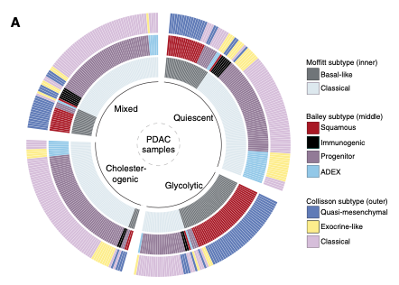

当一个队列同时携带**多套亚型分类**时，参考把它们对齐到同一环形版式：每个样本一个扇区、每条环是一套分类的标签，用 `circlize::circos.heatmap()` 绘制并按标签 split——同一标签的样本落进同一段弧，分类间的一致性表现为色块在环上是否延续 \[1\]。对应参考 PDAC 代谢/表达亚型的四条环；`gridBase` 视口管线把图例放在圆外：

## Example

{fig-alt="Circos 亚型对齐环图 DEMO" fig-align="center" width="60%"}

## Setup

-   系统要求：跨平台（Linux/MacOS/Windows）

-   编程语言：R

-   依赖包：`circlize`; `ComplexHeatmap`

```{r packages setup, message=FALSE, warning=FALSE, output=FALSE}
suppressPackageStartupMessages({
  library(circlize); library(ComplexHeatmap)
})
```

```{r}
sessioninfo::session_info("attached")
```

## 数据准备

150 个模拟 PDAC 样本、四列亚型（代谢 TCGA 式、Moffitt 式、Bailey 式、Collisson 式），植入真实的 agreement 结构：代谢亚型与 Moffitt 的 Basal-like/Classical 强一致、与 Collisson 弱一致——这正是这张图要回答的"我的亚型能否复现他们的"。行按列依次排序（参考要求），每条环的弧因此连续：

```{r load data}
suppressPackageStartupMessages({library(circlize); library(ComplexHeatmap)})
set.seed(40236)
n <- 150
make_sub <- function(levels, probs) sample(levels, n, replace = TRUE, prob = probs)
subt <- data.frame(
  TCGA_subtype = make_sub(c("Cholesterogenic", "Glycolytic", "Quiescent", "Mixed"),
                          c(0.35, 0.35, 0.2, 0.1)))
## planted agreements: metabolic -> Moffitt strong, -> Bailey moderate, -> Collisson weak
moffitt_of <- c(Cholesterogenic = "Basal-like", Glycolytic = "Basal-like",
                Quiescent = "Classical", Mixed = "Classical")
bailey_of <- c(Cholesterogenic = "Squamous", Glycolytic = "Squamous",
               Quiescent = "Progenitor", Mixed = "Classical")
collisson_of <- c(Cholesterogenic = "Quasi-mesenchymal", Glycolytic = "Classical",
                  Quiescent = "Exocrine-like", Mixed = "Classical")
subt$Moffitt_subtype <- moffitt_of[subt$TCGA_subtype]
subt$Bailey_subtype <- bailey_of[subt$TCGA_subtype]
subt$Collisson_subtype <- collisson_of[subt$TCGA_subtype]
## per-sample noise: a fraction of samples disagree with the planted mapping
flip <- function(v, levels) {
  k <- round(0.18 * length(v))
  idx <- sample(length(v), k)
  v[idx] <- sample(levels, k, replace = TRUE)
  v
}
subt$Moffitt_subtype <- flip(subt$Moffitt_subtype, c("Basal-like", "Classical"))
subt$Bailey_subtype <- flip(subt$Bailey_subtype,
                            c("Squamous", "Immunogenic", "Progenitor", "ADEX"))
subt$Collisson_subtype <- flip(subt$Collisson_subtype,
                               c("Quasi-mesenchymal", "Exocrine-like", "Classical"))
rownames(subt) <- paste0("P", seq_len(n))
subt <- subt[order(subt$TCGA_subtype, subt$Moffitt_subtype,
                   subt$Bailey_subtype, subt$Collisson_subtype), ]
head(subt, 3)
```

## Visualization

### 四条对齐环 + 分段弧

每条环是一个分类、`circos.heatmap()` 绘制、按各自的因子 levels `split`，使每个标签占据连续弧；第一条环显示扇区标签。植入的 agreement 直接可读：TCGA 环的弧在 Moffitt 上延续为连贯（含噪声）色块、到 Bailey 减弱、在 Collisson 上散开：

```{r}
#| label: fig-1.1CircosGroup
#| fig-cap: "150 个样本（扇区 = 样本、已排序）的四套 PDAC 亚型分类 circos 对齐：每环一套分类并按自身标签分段；跨环延续的色块 = 一致、碎裂的色块 = 分歧。"
#| out.width: "70%"
#| fig-width: 7.5
#| fig-height: 7.5

col_subt1 <- c("Cholesterogenic" = "#9AAF57", "Glycolytic" = "#6AA1AB",
               "Quiescent" = "#E1B52E", "Mixed" = "#81552E")
col_subt2 <- c("Basal-like" = "#717579", "Classical" = "#DFE8EE")
col_subt3 <- c("Squamous" = "#9B1C1F", "Immunogenic" = "#8F7999",
               "Progenitor" = "black", "ADEX" = "#9FC6EC")
col_subt4 <- c("Quasi-mesenchymal" = "#6978BC", "Exocrine-like" = "#F7F07C",
               "Classical" = "#D3BDDC")

circos.clear()
circos.par(gap.degree = 3)
circos.heatmap(subt$TCGA_subtype,
               split = factor(subt$TCGA_subtype,
                              levels = c("Cholesterogenic", "Glycolytic",
                                         "Quiescent", "Mixed")),
               col = col_subt1, track.height = 0.14,
               show.sector.labels = TRUE)
circos.heatmap(subt$Moffitt_subtype,
               split = factor(subt$Moffitt_subtype, levels = c("Basal-like", "Classical")),
               col = col_subt2, track.height = 0.14)
circos.heatmap(subt$Bailey_subtype,
               split = factor(subt$Bailey_subtype,
                              levels = c("Squamous", "Immunogenic", "Progenitor", "ADEX")),
               col = col_subt3, track.height = 0.14)
circos.heatmap(subt$Collisson_subtype,
               split = factor(subt$Collisson_subtype,
                              levels = c("Quasi-mesenchymal", "Exocrine-like", "Classical")),
               col = col_subt4, track.height = 0.14)
text(0, 0, "PDAC\nsamples", cex = 0.9)
circos.clear()
```

### 带打包图例

参考的最终版式：圆占据左侧方形区域，四个 `Legend()` 对象——每套分类一个、`packLegend()` 打包——放在右侧，每条环的调色板无需猜测即可解码：

```{r}
#| label: fig-2.1CircosGroupLegend
#| fig-cap: "右侧带打包图例的 circos 对齐：TCGA 代谢、Moffitt、Bailey、Collisson 各一条图例，在圆视口外绘制。"
#| out.width: "100%"
#| fig-width: 10
#| fig-height: 7.5

plot.new()
par(mar = c(1, 1, 1, 22))
circos.clear()
circos.par(gap.degree = 3)
circos.heatmap(subt$TCGA_subtype,
               split = factor(subt$TCGA_subtype,
                              levels = c("Cholesterogenic", "Glycolytic",
                                         "Quiescent", "Mixed")),
               col = col_subt1, track.height = 0.14,
               show.sector.labels = TRUE)
circos.heatmap(subt$Moffitt_subtype,
               split = factor(subt$Moffitt_subtype, levels = c("Basal-like", "Classical")),
               col = col_subt2, track.height = 0.14)
circos.heatmap(subt$Bailey_subtype,
               split = factor(subt$Bailey_subtype,
                              levels = c("Squamous", "Immunogenic", "Progenitor", "ADEX")),
               col = col_subt3, track.height = 0.14)
circos.heatmap(subt$Collisson_subtype,
               split = factor(subt$Collisson_subtype,
                              levels = c("Quasi-mesenchymal", "Exocrine-like", "Classical")),
               col = col_subt4, track.height = 0.14)
text(0, 0, "PDAC\nsamples", cex = 0.9)
circos.clear()
## auto-sized base legend on the widened right margin; NA fill entries act as
## group separators carrying the classification names
par(xpd = TRUE)
legend("right", inset = c(-0.42, 0), bty = "n", cex = 0.75,
       legend = c("TCGA metabolic:", names(col_subt1), "",
                  "Moffitt:", names(col_subt2), "",
                  "Bailey:", names(col_subt3), "",
                  "Collisson:", names(col_subt4)),
       fill = c(NA, col_subt1, NA, NA, col_subt2, NA,
                NA, col_subt3, NA, NA, col_subt4),
       border = c(NA, rep("#333333", 4), NA, NA, rep("#333333", 2), NA,
                  NA, rep("#333333", 4), NA, NA, rep("#333333", 3)))
par(xpd = FALSE)
```


## 应用场景

::: {{#fig-CircosGroupApplications1}}
{fig-alt="Circos 亚型对齐环图" fig-align="center" width="60%"}

Circos 亚型对齐环图
:::

任何"一样本多标签"表都能这样读：共识聚类 vs 已发表亚型、组织学 vs 分子分类、批次 vs 去批次后簇——凡分类间一致性是信息的地方。

## 参考文献

\[1\] Xiaofan Lu, et al. FigureYa: A Standardized Visualization Framework for Enhancing Biomedical Data Interpretation and Research Efficiency. iMetaMed. 2025. doi:10.1002/imm3.70005
