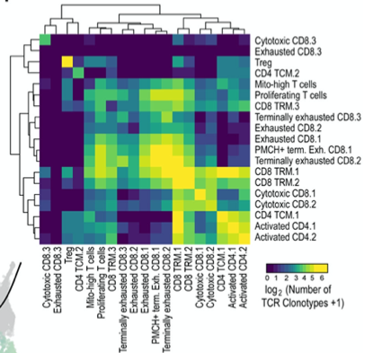

The reference's Fig. 4F: a heatmap showing the **log10 number of shared TCR clonotypes** between pairs of T-cell phenotypic clusters, revealing whether clonotypes are "homogeneous" (confined to one cluster) or "heterogeneous" (spread across multiple clusters) — evidence of clonal migration or state transitions \[1\]. Here a clonotype-to-cluster assignment table is simulated with planted homogeneous and heterogeneous clonotype sets, and the pairwise shared-clonotype matrix runs on ComplexHeatmap:

## Example

{fig-alt="Shared Clonotype Heatmap DEMO" fig-align="center" width="70%"}

## Setup

-   System Requirements: Cross-platform (Linux/MacOS/Windows)

-   Programming language: R

-   Dependent packages: `ComplexHeatmap`; `circlize`; `ggplot2`

```{r packages setup, message=FALSE, warning=FALSE, output=FALSE}
suppressPackageStartupMessages({
  library(ComplexHeatmap); library(circlize); library(ggplot2)
})
```

```{r}
sessioninfo::session_info("attached")
```

## Data Preparation

200 clonotypes distributed across 6 T-cell phenotypic clusters (Naive, Effector memory, Tissue-resident, Terminally exhausted, Proliferating, Regulatory). Planted structure: Terminally exhausted and Effector memory share a large clone pool (heterogeneous), Naive clonotypes are mostly homogeneous, and Regulatory shares with Effector memory:

```{r load data}
suppressPackageStartupMessages({library(ComplexHeatmap); library(circlize)})
set.seed(52320)
clusters <- c("Naive", "Eff_memory", "Tissue_resident", "Terminal_exhausted",
              "Proliferating", "Regulatory")
n_cl <- 200

## clonotype → cluster membership: some clones span multiple clusters
clone_membership <- lapply(seq_len(n_cl), function(k) {
  if (k <= 60) return("Naive")
  if (k > 60 & k <= 110) return("Terminal_exhausted")
  if (k > 110 & k <= 135) return("Eff_memory")
  if (k > 135 & k <= 150) return("Regulatory")
  if (k > 150 & k <= 165) return("Eff_memory")
  if (k > 165 & k <= 190) return("Tissue_resident")
  return("Proliferating")
})
## heterogeneous: exhaust + effector share a pool of 30
shared_pool <- sprintf("SH_%02d", 1:30)
for (k in 61:90) clone_membership[[k]] <- c("Terminal_exhausted", "Eff_memory")
for (k in 111:135) clone_membership[[k]] <- c("Eff_memory", "Terminal_exhausted")
## regulatory shares with effector memory for 10 clones
for (k in 136:145) clone_membership[[k]] <- c("Regulatory", "Eff_memory")
## naive mostly homogeneous (single cluster)
for (k in 1:60) clone_membership[[k]] <- "Naive"
## rest: single-cluster
for (k in 146:150) clone_membership[[k]] <- "Regulatory"
for (k in 166:190) clone_membership[[k]] <- "Tissue_resident"
for (k in 191:200) clone_membership[[k]] <- "Proliferating"
## rename shared pool clones
clone_membership <- lapply(seq_len(n_cl), function(k) {
  if (k >= 61 && k <= 110) c(paste0("SH_", sprintf("%02d", k - 60)), "Terminal_exhausted", "Eff_memory")
  else clone_membership[[k]]
})

## count shared clonotypes between each cluster pair
shared <- matrix(0, length(clusters), length(clusters),
                 dimnames = list(clusters, clusters))
for (i in seq_along(clusters)) for (j in seq_along(clusters)) {
  if (i == j) next
  ct_i <- sum(sapply(clone_membership, function(ms) clusters[i] %in% ms))
  ct_j <- sum(sapply(clone_membership, function(ms) clusters[j] %in% ms))
  shared[i, j] <- sum(sapply(clone_membership, function(ms)
    clusters[i] %in% ms && clusters[j] %in% ms))
}
shared_log <- log10(shared + 1)
shared_log <- log10(shared + 1)
```

## Visualization

### 1. Shared Clonotype Heatmap

The reference's Fig. 4F: cluster × cluster heatmap where colour = log10(shared clonotypes), revealing the heterogeneous Exhausted↔Effector-memory axis:

```{r}
#| label: fig-1.1ClontypeHeatmap
#| fig-cap: "Shared clonotype heatmap between 6 T-cell phenotypic clusters: colour = log10(number of shared clonotypes) on a white-to-red scale; the Terminal-exhausted/Effector-memory pair carries the largest overlap (heterogeneous clonotypes), while Naive clonotypes are mostly homogeneous."
#| out.width: "85%"
#| fig-width: 7
#| fig-height: 6

Heatmap(shared_log, name = "log10\nshared",
        col = colorRampPalette(c("white", "#B2182B"))(64),
        cluster_rows = TRUE, cluster_columns = TRUE,
        rect_gp = grid::gpar(col = "grey88", lwd = 1),
        row_names_side = "left",
        row_names_gp = grid::gpar(fontsize = 8),
        column_names_gp = grid::gpar(fontsize = 8),
        cell_fun = function(i, j, x, y, w, h, fill) {
          grid::grid.text(shared[i, j], x, y, gp = grid::gpar(fontsize = 7.5))
        })
```

### 2. Homogeneous vs Heterogeneous Clonotype Classification

The reference's classification: each clonotype is tagged "homogeneous" (found predominantly in 1 cluster) or "heterogeneous" (spread across multiple clusters), and their relative numbers per cluster are shown as a barplot:

```{r}
#| label: fig-2.1ClontypeClass
#| fig-cap: "Relative numbers of homogeneous (grey) vs heterogeneous (coloured) clonotypes per cluster: Naive carries mostly homogeneous clonotypes, while Terminally exhausted and Effector memory carry a larger heterogeneous share."
#| out.width: "85%"
#| fig-width: 8
#| fig-height: 5

hetero_count <- sapply(clusters, function(cl)
  sum(sapply(clone_membership, function(ms) cl %in% ms && length(ms) > 1)))
homo_count <- sapply(clusters, function(cl)
  sum(sapply(clone_membership, function(ms) identical(ms, cl))))
clonotype_df <- data.frame(
  cluster = factor(rep(clusters, 2), levels = clusters),
  type = rep(c("Heterogeneous", "Homogeneous"), each = length(clusters)),
  count = c(hetero_count, homo_count)
)
ggplot(clonotype_df, aes(cluster, count, fill = type)) +
  geom_col(position = "stack", width = 0.7) +
  scale_fill_manual(values = c(Heterogeneous = "#B2182B", Homogeneous = "grey70")) +
  labs(x = NULL, y = "Number of clonotypes") +
  theme_bw(base_size = 11) +
  theme(axis.text.x = element_text(angle = 30, hjust = 1),
        panel.grid.minor = element_blank(),
        legend.position = "top")
```

::: callout-tip
**Practice tips**
-   Define "shared clonotype" as present in ≥2 clusters before counting; a clonotype in only one cluster is homogeneous by definition.
-   Log10-transform the shared count so rare overlaps do not disappear against the dominant Exhausted↔Effector pair.
-   Use `ComplexHeatmap::Heatmap` with `cell_fun` to print raw counts on the heatmap — the log10 colour plus the raw number together is far more informative than either alone.
-   The "homogeneous vs heterogeneous" classification needs a dominance rule (e.g. ≥80% of a clonotype's cells in one cluster); state the rule explicitly.
-   Pair with TCR diversity metrics (Shannon entropy, clonality) per cluster to link heterogeneity to antigen-driven expansion.
:::

## Application

::: {#fig-ClontypeHeatmapApplications1}
{fig-alt="Shared Clonotype Heatmap" fig-align="center" width="70%"}

Shared clonotype heatmap
:::

Shared clonotype heatmaps apply to any TCR/BCR single-cell study: tumour-infiltrating lymphocyte tracking, vaccination response clonal tracking, or CAR-T persistence monitoring.

## Reference

\[1\] Xiaofan Lu, et al. FigureYa: A Standardized Visualization Framework for Enhancing Biomedical Data Interpretation and Research Efficiency. iMetaMed. 2025. doi:10.1002/imm3.70005
