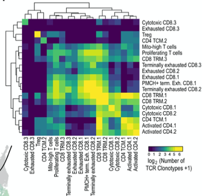

参考图 Fig. 4F：一张展示 **T 细胞表型聚类两两之间共享 TCR 克隆型 log10 数目**的热图，揭示克隆型是"同质"（局限于单一聚类）还是"异质"（跨越多个聚类）——克隆迁移或状态转换的证据 \[1\]。这里模拟一张克隆型-聚类归属表并植入同质/异质克隆型集，两两共享克隆型矩阵在 ComplexHeatmap 上运行：

## Example

{fig-alt="跨细胞类型共享克隆型热图 DEMO" fig-align="center" width="70%"}

## Setup

-   系统要求：跨平台（Linux/MacOS/Windows）

-   编程语言：R

-   依赖包：`ComplexHeatmap`; `circlize`; `ggplot2`

```{r packages setup, message=FALSE, warning=FALSE, output=FALSE}
suppressPackageStartupMessages({
  library(ComplexHeatmap); library(circlize); library(ggplot2)
})
```

```{r}
sessioninfo::session_info("attached")
```

## 数据准备

200 个克隆型分布在 6 个 T 细胞表型聚类（Naive、Effector memory、Tissue-resident、Terminally exhausted、Proliferating、Regulatory）。植入结构：Terminally exhausted 与 Effector memory 共享一个大克隆池（异质），Naive 克隆型多为同质，Regulatory 与 Effector memory 共享：

```{r load data}
suppressPackageStartupMessages({library(ComplexHeatmap); library(circlize)})
set.seed(52320)
clusters <- c("Naive", "Eff_memory", "Tissue_resident", "Terminal_exhausted",
              "Proliferating", "Regulatory")
n_cl <- 200

## clonotype → cluster membership: some clones span multiple clusters
clone_membership <- lapply(seq_len(n_cl), function(k) {
  if (k <= 60) return("Naive")
  if (k > 60 & k <= 110) return("Terminal_exhausted")
  if (k > 110 & k <= 135) return("Eff_memory")
  if (k > 135 & k <= 150) return("Regulatory")
  if (k > 150 & k <= 165) return("Eff_memory")
  if (k > 165 & k <= 190) return("Tissue_resident")
  return("Proliferating")
})
## heterogeneous: exhaust + effector share a pool of 30
shared_pool <- sprintf("SH_%02d", 1:30)
for (k in 61:90) clone_membership[[k]] <- c("Terminal_exhausted", "Eff_memory")
for (k in 111:135) clone_membership[[k]] <- c("Eff_memory", "Terminal_exhausted")
## regulatory shares with effector memory for 10 clones
for (k in 136:145) clone_membership[[k]] <- c("Regulatory", "Eff_memory")
## naive mostly homogeneous (single cluster)
for (k in 1:60) clone_membership[[k]] <- "Naive"
## rest: single-cluster
for (k in 146:150) clone_membership[[k]] <- "Regulatory"
for (k in 166:190) clone_membership[[k]] <- "Tissue_resident"
for (k in 191:200) clone_membership[[k]] <- "Proliferating"
## rename shared pool clones
clone_membership <- lapply(seq_len(n_cl), function(k) {
  if (k >= 61 && k <= 110) c(paste0("SH_", sprintf("%02d", k - 60)), "Terminal_exhausted", "Eff_memory")
  else clone_membership[[k]]
})

## count shared clonotypes between each cluster pair
shared <- matrix(0, length(clusters), length(clusters),
                 dimnames = list(clusters, clusters))
for (i in seq_along(clusters)) for (j in seq_along(clusters)) {
  if (i == j) next
  ct_i <- sum(sapply(clone_membership, function(ms) clusters[i] %in% ms))
  ct_j <- sum(sapply(clone_membership, function(ms) clusters[j] %in% ms))
  shared[i, j] <- sum(sapply(clone_membership, function(ms)
    clusters[i] %in% ms && clusters[j] %in% ms))
}
shared_log <- log10(shared + 1)
```

## Visualization

### 1. 共享克隆型热图

参考图 Fig. 4F：聚类 × 聚类热图，颜色 = log10(共享克隆型数)，揭示异质的 Exhausted↔Effector-memory 轴：

```{r}
#| label: fig-1.1ClontypeHeatmap
#| fig-cap: "6 个 T 细胞表型聚类之间的共享克隆型热图：颜色 = log10(共享克隆型数)，白到红标度；Terminal-exhausted/Effector-memory 对携带最大重叠（异质克隆型），而 Naive 克隆型多为同质。"
#| out.width: "85%"
#| fig-width: 7
#| fig-height: 6

Heatmap(shared_log, name = "log10\nshared",
        col = colorRampPalette(c("white", "#B2182B"))(64),
        cluster_rows = TRUE, cluster_columns = TRUE,
        rect_gp = grid::gpar(col = "grey88", lwd = 1),
        row_names_side = "left",
        row_names_gp = grid::gpar(fontsize = 8),
        column_names_gp = grid::gpar(fontsize = 8),
        cell_fun = function(i, j, x, y, w, h, fill) {
          grid::grid.text(shared[i, j], x, y, gp = grid::gpar(fontsize = 7.5))
        })
```

### 2. 同质 vs 异质克隆型分类

参考图的分类：每个克隆型被标记为"同质"（主要见于 1 个聚类）或"异质"（跨越多个聚类），并以条形图展示各聚类的相对数目：

```{r}
#| label: fig-2.1ClontypeClass
#| fig-cap: "各聚类中同质（灰）与异质（红）克隆型的数目：Naive 以同质克隆型为主，而 Terminally exhausted 与 Effector memory 的异质占比更大。"
#| out.width: "85%"
#| fig-width: 8
#| fig-height: 5

hetero_count <- sapply(clusters, function(cl)
  sum(sapply(clone_membership, function(ms) cl %in% ms && length(ms) > 1)))
homo_count <- sapply(clusters, function(cl)
  sum(sapply(clone_membership, function(ms) identical(ms, cl))))
clonotype_df <- data.frame(
  cluster = factor(rep(clusters, 2), levels = clusters),
  type = rep(c("Heterogeneous", "Homogeneous"), each = length(clusters)),
  count = c(hetero_count, homo_count)
)
ggplot(clonotype_df, aes(cluster, count, fill = type)) +
  geom_col(position = "stack", width = 0.7) +
  scale_fill_manual(values = c(Heterogeneous = "#B2182B", Homogeneous = "grey70")) +
  labs(x = NULL, y = "Number of clonotypes") +
  theme_bw(base_size = 11) +
  theme(axis.text.x = element_text(angle = 30, hjust = 1),
        panel.grid.minor = element_blank(),
        legend.position = "top")
```

::: callout-tip
**实践要点**
-   在计数之前先把"共享克隆型"定义为存在于 ≥2 个聚类的克隆型；只出现在一个聚类的克隆型按定义即为同质。
-   对共享计数做 log10 变换，避免稀有重叠被主导性的 Exhausted↔Effector 对淹没。
-   用 `ComplexHeatmap::Heatmap` 的 `cell_fun` 在热图上打印原始计数——log10 颜色加原始数字，比单独任何一种都信息量大得多。
-   "同质 vs 异质"分类需要一个优势规则（如某克隆型 ≥80% 的细胞在一个聚类）；务必显式说明该规则。
-   搭配每个聚类的 TCR 多样性指标（Shannon 熵、clonality），把异质性与抗原驱动的扩增联系起来。
:::

## 应用场景

::: {#fig-ClontypeHeatmapApplications1}
{fig-alt="跨细胞类型共享克隆型热图" fig-align="center" width="70%"}

跨细胞类型共享克隆型热图
:::

共享克隆型热图适用于任何 TCR/BCR 单细胞研究：肿瘤浸润淋巴细胞追踪、疫苗应答克隆追踪、或 CAR-T 持续性监测。

## 参考文献

\[1\] Xiaofan Lu, et al. FigureYa: A Standardized Visualization Framework for Enhancing Biomedical Data Interpretation and Research Efficiency. iMetaMed. 2025. doi:10.1002/imm3.70005
