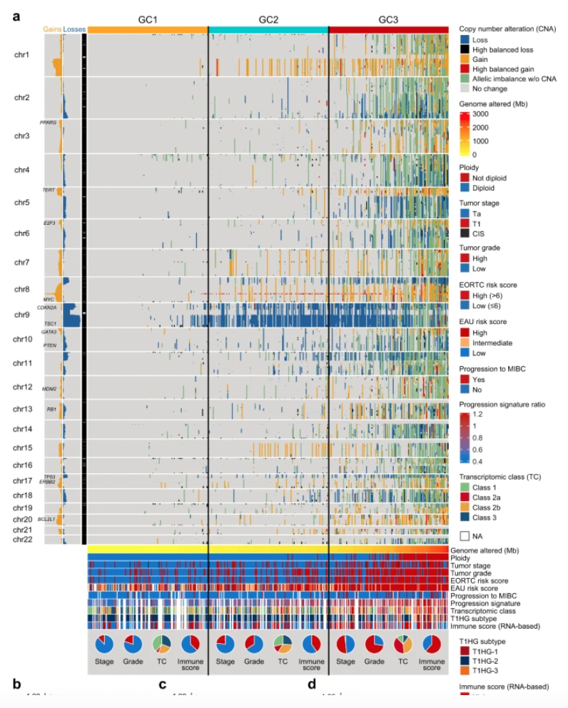

The reference's Fig. 2a: every tumour is one column of a genome-wide CNV heatmap, genes are rows **ordered by chromosome position**, and gains (red) and losses (blue) stack into coherent bands — so arm-level events appear as blocky stripes and focal events as narrow streaks \[1\]. GISTIC `thresholded.by_genes` output is simulated here at gene resolution with planted arm-level and focal events; the chromosome-ordered matrix plus a per-chromosome annotation bar reproduces the reference's layout:

## Example

{fig-alt="Genome-Wide CNV Heatmap DEMO" fig-align="center" width="70%"}

## Setup

-   System Requirements: Cross-platform (Linux/MacOS/Windows)

-   Programming language: R

-   Dependent packages: `ComplexHeatmap`; `circlize`; `ggplot2`

```{r packages setup, message=FALSE, warning=FALSE, output=FALSE}
suppressPackageStartupMessages({
  library(ComplexHeatmap); library(circlize); library(ggplot2)
})
```

```{r}
sessioninfo::session_info("attached")
```

## Data Preparation

1200 genes spread over 22 chromosomes (gene positions recorded so the matrix can be ordered), 120 tumours grouped into three genomic classes. Planted events: a broad **gain** of chr3 in class GC1, a broad **loss** of chr9 in GC2, a focal amplification of a 5-gene cluster on chr8 in all classes, and sparse background noise everywhere:

```{r load data}
suppressPackageStartupMessages({
  library(ComplexHeatmap); library(circlize); library(ggplot2)})
set.seed(51307)
n_gene <- 1200; n_sam <- 120
## assign genes to chromosomes proportional to real lengths
chr_len <- c(249, 243, 198, 190, 182, 171, 159, 145, 138, 134, 135, 133,
             114, 107, 102, 90, 83, 80, 59, 64, 47, 46)
chr_of <- sample(rep(paste0("chr", 1:22), round(n_gene * chr_len / sum(chr_len))),
                 n_gene)
## position within each chromosome (0-1), so genes can be ordered along the genome
pos_of <- numeric(n_gene)
for (ch in unique(chr_of)) {
  idx <- which(chr_of == ch)
  pos_of[idx] <- seq_along(idx) / length(idx)
}
genes <- sprintf("G%04d", 1:n_gene)
samples <- sprintf("T%03d", 1:n_sam)
cls <- rep(c("GC1", "GC2", "GC3"), length.out = n_sam)

## GISTIC-style discrete calls: -2 loss, -1 shallow loss, 0 neutral, 1 gain, 2 amp
cnv <- matrix(0L, n_gene, n_sam, dimnames = list(genes, samples))
noise <- matrix(sample(c(-1, 0, 1), n_gene * n_sam, TRUE,
                       prob = c(0.05, 0.9, 0.05)), n_gene, n_sam)
cnv <- cnv + noise

## planted broad events
chr3 <- chr_of == "chr3"; chr9 <- chr_of == "chr9"
cnv[chr3, cls == "GC1"] <- sample(c(1L, 2L), sum(chr3) * sum(cls == "GC1"), TRUE,
                                  prob = c(0.7, 0.3))
cnv[chr9, cls == "GC2"] <- sample(c(-1L, -2L), sum(chr9) * sum(cls == "GC2"), TRUE,
                                  prob = c(0.6, 0.4))
## focal amp on chr8
focal <- which(chr_of == "chr8")[1:5]
cnv[focal, ] <- 2L

ord_g <- order(factor(chr_of, levels = paste0("chr", 1:22)), pos_of)
cnv_ord <- cnv[ord_g, ]
chr_ord <- chr_of[ord_g]
```

## Visualization

### 1. The Genome-Ordered CNV Heatmap

The reference's matrix: rows in chromosome order (no clustering), columns grouped by class with gap lines, plus a chromosome annotation bar — arm events read as uninterrupted horizontal stripes:

```{r}
#| label: fig-1.1CnvHeatmap
#| fig-cap: "Genome-wide CNV heatmap (1200 genes in chromosome order x 120 tumours): red = gain, blue = loss; the planted chr3 gain in GC1 and chr9 loss in GC2 read as broad stripes, the chr8 focal amplification as a narrow hot streak shared by all classes."
#| out.width: "95%"
#| fig-width: 9.5
#| fig-height: 6

col_fun <- colorRamp2(c(-2, -1, 0, 1, 2),
                      c("#08306B", "#6BAED6", "white", "#FB6A4A", "#67000D"))
chr_pal <- setNames(rep(c("grey90", "grey60"), 11), paste0("chr", 1:22))

ord_s <- order(factor(cls, levels = c("GC1", "GC2", "GC3")))
ha <- HeatmapAnnotation(Class = cls[ord_s],
                        col = list(Class = c(GC1 = "#E41A1C", GC2 = "#377EB8",
                                             GC3 = "#4DAF4A")),
                        show_annotation_name = TRUE)
ht <- Heatmap(cnv_ord[, ord_s], name = "CNV",
              col = col_fun,
              cluster_rows = FALSE, cluster_columns = FALSE,
              show_row_names = FALSE, show_column_names = FALSE,
              top_annotation = ha,
              row_split = factor(chr_ord, levels = paste0("chr", 1:22)),
              row_title_rot = 0, row_title_gp = grid::gpar(fontsize = 5),
              row_gap = unit(0.25, "mm"),
              border = FALSE,
              heatmap_legend_param = list(at = c(-2, 0, 2),
                                          labels = c("deep loss", "neutral", "amp")))
ht
```

### 2. Per-Class CNV Burden

The heatmap shows *where*; the summary panel shows *how much*: per class, the fraction of genes called gained or lost, i.e. the burden behind the stripes:

```{r}
#| label: fig-2.1CnvBurden
#| fig-cap: "Per-class CNV burden: fraction of gene-sample calls that are gains (left) and losses (right); GC1 carries the highest gain burden, GC2 the highest loss burden, quantitating the two planted arm-level events."
#| out.width: "80%"
#| fig-width: 7.5
#| fig-height: 4.8

burden <- do.call(rbind, lapply(levels(factor(cls)), function(k) {
  sub <- cnv[, cls == k]
  data.frame(class = k,
             gain = mean(sub > 0) * 100,
             loss = mean(sub < 0) * 100)
}))
bdf <- data.frame(class = rep(burden$class, 2),
                  type = rep(c("Gain", "Loss"), each = nrow(burden)),
                  pct = c(burden$gain, burden$loss))
bdf$type <- factor(bdf$type, levels = c("Gain", "Loss"))
ggplot2::ggplot(bdf, ggplot2::aes(class, pct, fill = class)) +
  ggplot2::geom_col(width = 0.6) +
  ggplot2::facet_wrap(~ type) +
  ggplot2::scale_fill_manual(values = c(GC1 = "#E41A1C", GC2 = "#377EB8",
                                        GC3 = "#4DAF4A"), guide = "none") +
  ggplot2::labs(x = NULL, y = "% of gene-sample calls") +
  ggplot2::theme_bw(base_size = 11) +
  ggplot2::theme(panel.grid.minor = ggplot2::element_blank(),
                 strip.background = ggplot2::element_blank())
```

::: callout-tip
**Practice tips**

-   Order rows by **chromosome then position**, never by clustering — clustering hides the arm-level stripes that are the whole message, and neighbours on a chromosome must stay adjacent.
-   Use `row_split` by chromosome instead of a single uninterrupted block so arm boundaries are visible and readable.
-   Keep the colour scale anchored at zero with equal weight for gains and losses (`c(-2, 0, 2)`); an asymmetric ramp makes one direction look more frequent than it is.
-   GISTIC thresholded calls are discrete (−2…2): map them with `colorRamp2` at the integer breaks rather than treating them as continuous.
-   Pair the heatmap with a burden summary — a reader can see stripes but cannot compare their prevalence across classes by eye.
:::

## Application

::: {#fig-CnvHeatmapApplications1}
{fig-alt="Genome-Wide CNV Heatmap" fig-align="center" width="70%"}

Genome-wide CNV heatmap
:::

Genome-ordered CNV heatmaps apply to any copy-number cohort: bulk tumour landscapes, subtype-vs-subtype CNV comparison, or single-cell CNV inference (inferCNV) — wherever arm-level and focal events must be seen together.

## Reference

\[1\] Xiaofan Lu, et al. FigureYa: A Standardized Visualization Framework for Enhancing Biomedical Data Interpretation and Research Efficiency. iMetaMed. 2025. doi:10.1002/imm3.70005
