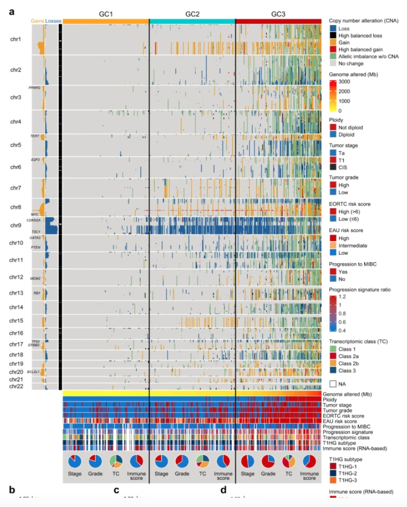

参考的 Fig. 2a：每个肿瘤是全基因组 CNV 热图的一列，基因按染色体位置排序为行，获得（红）与缺失（蓝）堆叠成连贯条带——臂级事件呈现为宽条纹、焦点事件呈现为窄条纹 \[\1\]。GISTIC `thresholded.by_genes` 输出在基因分辨率上模拟并植入臂级与焦点事件；染色体排序矩阵加逐染色体注释条复现参考的版式：

## Example

{fig-alt="全基因组 CNV 热图 DEMO" fig-align="center" width="60%"}

## Setup

-   系统要求：跨平台（Linux/MacOS/Windows）

-   编程语言：R

-   依赖包：`ComplexHeatmap`; `circlize`; `ggplot2`

```{r packages setup, message=FALSE, warning=FALSE, output=FALSE}
suppressPackageStartupMessages({
  library(ComplexHeatmap); library(circlize); library(ggplot2)
})
```

```{r}
sessioninfo::session_info("attached")
```

## 数据准备

分布在 22 条染色体上的 1200 个基因（记录基因位置以便排序）、120 个分入三个基因组类别的肿瘤。植入事件：GC1 类中 chr3 广泛**获得**、GC2 类中 chr9 广泛**缺失**、所有类别中 chr8 的 5 基因簇焦点扩增，以及各处的稀疏背景噪声：

```{r load data}
suppressPackageStartupMessages({
  library(ComplexHeatmap); library(circlize); library(ggplot2)})
set.seed(51307)
n_gene <- 1200; n_sam <- 120
## assign genes to chromosomes proportional to real lengths
chr_len <- c(249, 243, 198, 190, 182, 171, 159, 145, 138, 134, 135, 133,
             114, 107, 102, 90, 83, 80, 59, 64, 47, 46)
chr_of <- sample(rep(paste0("chr", 1:22), round(n_gene * chr_len / sum(chr_len))),
                 n_gene)
## position within each chromosome (0-1), so genes can be ordered along the genome
pos_of <- numeric(n_gene)
for (ch in unique(chr_of)) {
  idx <- which(chr_of == ch)
  pos_of[idx] <- seq_along(idx) / length(idx)
}
genes <- sprintf("G%04d", 1:n_gene)
samples <- sprintf("T%03d", 1:n_sam)
cls <- rep(c("GC1", "GC2", "GC3"), length.out = n_sam)

## GISTIC-style discrete calls: -2 loss, -1 shallow loss, 0 neutral, 1 gain, 2 amp
cnv <- matrix(0L, n_gene, n_sam, dimnames = list(genes, samples))
noise <- matrix(sample(c(-1, 0, 1), n_gene * n_sam, TRUE,
                       prob = c(0.05, 0.9, 0.05)), n_gene, n_sam)
cnv <- cnv + noise

## planted broad events
chr3 <- chr_of == "chr3"; chr9 <- chr_of == "chr9"
cnv[chr3, cls == "GC1"] <- sample(c(1L, 2L), sum(chr3) * sum(cls == "GC1"), TRUE,
                                  prob = c(0.7, 0.3))
cnv[chr9, cls == "GC2"] <- sample(c(-1L, -2L), sum(chr9) * sum(cls == "GC2"), TRUE,
                                  prob = c(0.6, 0.4))
## focal amp on chr8
focal <- which(chr_of == "chr8")[1:5]
cnv[focal, ] <- 2L

ord_g <- order(factor(chr_of, levels = paste0("chr", 1:22)), pos_of)
cnv_ord <- cnv[ord_g, ]
chr_ord <- chr_of[ord_g]
```

## Visualization

### 基因组排序的 CNV 热图

参考的矩阵：行按染色体顺序（不聚类）、列按类别分组并以间隙线分隔、染色体注释条——臂级事件读作不间断的水平条纹：

```{r}
#| label: fig-1.1CnvHeatmap
#| fig-cap: "全基因组 CNV 热图（1200 基因按染色体序 × 120 个肿瘤）：红 = 获得、蓝 = 缺失；植入的 GC1 中 chr3 获得与 GC2 中 chr9 缺失读作宽条纹、chr8 焦点扩增读作所有类别共享的窄热点。"
#| out.width: "95%"
#| fig-width: 9.5
#| fig-height: 6

col_fun <- colorRamp2(c(-2, -1, 0, 1, 2),
                      c("#08306B", "#6BAED6", "white", "#FB6A4A", "#67000D"))
chr_pal <- setNames(rep(c("grey90", "grey60"), 11), paste0("chr", 1:22))

ord_s <- order(factor(cls, levels = c("GC1", "GC2", "GC3")))
ha <- HeatmapAnnotation(Class = cls[ord_s],
                        col = list(Class = c(GC1 = "#E41A1C", GC2 = "#377EB8",
                                             GC3 = "#4DAF4A")),
                        show_annotation_name = TRUE)
ht <- Heatmap(cnv_ord[, ord_s], name = "CNV",
              col = col_fun,
              cluster_rows = FALSE, cluster_columns = FALSE,
              show_row_names = FALSE, show_column_names = FALSE,
              top_annotation = ha,
              row_split = factor(chr_ord, levels = paste0("chr", 1:22)),
              row_title_rot = 0, row_title_gp = grid::gpar(fontsize = 5),
              row_gap = unit(0.25, "mm"),
              border = FALSE,
              heatmap_legend_param = list(at = c(-2, 0, 2),
                                          labels = c("deep loss", "neutral", "amp")))
ht
```

### 逐类 CNV 负荷

热图展示*哪里*；汇总面板展示*多少*：逐类的获得/缺失调用占比，即条纹背后的负荷：

```{r}
#| label: fig-2.1CnvBurden
#| fig-cap: "逐类 CNV 负荷：基因-样本调用中为获得（左）与缺失（右）的占比；GC1 的获得负荷最高、GC2 的缺失负荷最高，量化两次植入的臂级事件。"
#| out.width: "80%"
#| fig-width: 7.5
#| fig-height: 4.8

burden <- do.call(rbind, lapply(levels(factor(cls)), function(k) {
  sub <- cnv[, cls == k]
  data.frame(class = k,
             gain = mean(sub > 0) * 100,
             loss = mean(sub < 0) * 100)
}))
bdf <- data.frame(class = rep(burden$class, 2),
                  type = rep(c("Gain", "Loss"), each = nrow(burden)),
                  pct = c(burden$gain, burden$loss))
bdf$type <- factor(bdf$type, levels = c("Gain", "Loss"))
ggplot2::ggplot(bdf, ggplot2::aes(class, pct, fill = class)) +
  ggplot2::geom_col(width = 0.6) +
  ggplot2::facet_wrap(~ type) +
  ggplot2::scale_fill_manual(values = c(GC1 = "#E41A1C", GC2 = "#377EB8",
                                        GC3 = "#4DAF4A"), guide = "none") +
  ggplot2::labs(x = NULL, y = "% of gene-sample calls") +
  ggplot2::theme_bw(base_size = 11) +
  ggplot2::theme(panel.grid.minor = ggplot2::element_blank(),
                 strip.background = ggplot2::element_blank())
```


## 应用场景

::: {{#fig-CnvHeatmapApplications1}}
{fig-alt="全基因组 CNV 热图" fig-align="center" width="60%"}

全基因组 CNV 热图
:::

基因组排序的 CNV 热图适用于任何拷贝数队列：bulk 肿瘤景观、亚型间 CNV 比较、或单细胞 CNV 推断（inferCNV）——凡臂级与焦点事件需同时可见处。

## 参考文献

\[1\] Xiaofan Lu, et al. FigureYa: A Standardized Visualization Framework for Enhancing Biomedical Data Interpretation and Research Efficiency. iMetaMed. 2025. doi:10.1002/imm3.70005
