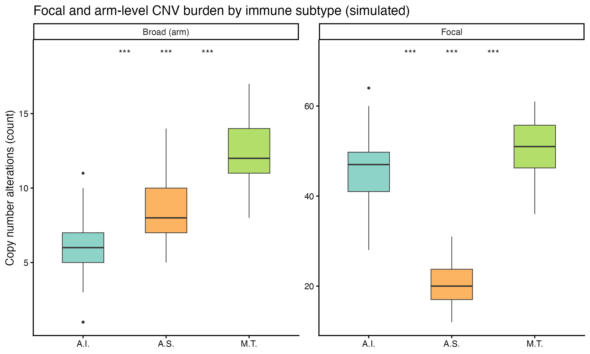

Copy-number **burden** — how many focal and arm-level alterations a tumour carries — separates immune subtypes in ways TMB does not, being tied to immune-escape mechanisms \[1\]. The reference counts, per sample, the altered features in GISTIC's `focal_data_by_genes.txt` and `broad_data_by_genes.txt` and compares subtypes with pairwise significance symbols (ns / \* / \*\*\*). This tutorial reproduces the burden computation and the faceted boxplots from a simulated GISTIC-style matrix:

## Example

{fig-alt="Focal and Arm-Level CNV Burden DEMO" fig-align="center" width="60%"}

## Setup

-   System Requirements: Cross-platform (Linux/MacOS/Windows)

-   Programming language: R

-   Dependent packages: `ggplot2`; `dplyr`

```{r packages setup, message=FALSE, warning=FALSE, output=FALSE}
suppressPackageStartupMessages({
  library(ggplot2)
  library(dplyr)
})
```

```{r}
sessioninfo::session_info("attached")
```

## Data Preparation

150 samples across three immune subtypes (A.I. / A.S. / M.T.) with simulated GISTIC value matrices — 300 focal features and 23 arms, values in {-2, -1, 0, 1, 2}. Planted effects: A.I. carries more focal amplifications, M.T. more deletions, A.S. more arm-level changes. Real data: burden = `colSums(focalload != 0)` on the GISTIC output, samples matched to `pdat.txt`:

```{r load data}
suppressPackageStartupMessages({library(ggplot2); library(dplyr)})
set.seed(18801)
n <- 150
subtypes <- c("A.I.", "A.S.", "M.T.")
pdat <- data.frame(sample = sprintf("S%03d", 1:n),
                   Subtype = factor(rep(subtypes, each = n / 3), levels = subtypes))
## per-sample altered-feature count from a GISTIC-style value vector
burden_of <- function(n_feat, amp_p, del_p) {
  v <- sample(c(-2, -1, 0, 1, 2), n_feat,
              TRUE, prob = c(del_p, del_p * 2, 1 - 4 * del_p, amp_p * 2, amp_p))
  sum(v != 0)
}
## planted subtype effects: A.I. high focal amp, M.T. high focal/broad del
focal <- sapply(seq_len(n), function(i) {
  st <- pdat$Subtype[i]
  burden_of(300, if (st == "A.I.") 0.045 else 0.012, if (st == "M.T.") 0.045 else 0.012)
})
broad <- sapply(seq_len(n), function(i) {
  st <- pdat$Subtype[i]
  burden_of(23, if (st == "A.S.") 0.11 else 0.045, if (st == "M.T.") 0.13 else 0.05)
})
load_df <- rbind(
  data.frame(sample = pdat$sample, Subtype = pdat$Subtype,
             burden = focal, level = "Focal"),
  data.frame(sample = pdat$sample, Subtype = pdat$Subtype,
             burden = broad, level = "Broad (arm)"))
```

## Visualization

### 1. Faceted Burden Boxplots with Pairwise Symbols

Focal and arm-level burden side by side, with BH-adjusted pairwise Wilcoxon symbols above each pair — the planted focal-amplification (A.I.), focal-deletion (M.T.) and arm-level (A.S.) effects all read off the facets:

```{r}
#| label: fig-1.1CnvLoad
#| fig-cap: "Focal (300 features) and arm-level (23 arms) CNV burden of 150 simulated samples across three immune subtypes: boxplots with BH-adjusted pairwise Wilcoxon symbols (ns / * / ** / ***)."
#| out.width: "90%"
#| warning: false
#| message: false
#| fig-width: 7.5
#| fig-height: 4.5

pairs <- combn(subtypes, 2, simplify = FALSE)
sym <- function(p) ifelse(p > 0.05, "ns", ifelse(p <= 0.001, "***", ifelse(p <= 0.01, "**", ifelse(p <= 0.05, "*", "ns"))))
ann <- do.call(rbind, lapply(c("Focal", "Broad (arm)"), function(lv) {
  d <- load_df[load_df$level == lv, ]
  raw <- do.call(rbind, lapply(pairs, function(pr) {
    p <- wilcox.test(burden ~ Subtype, data = d[d$Subtype %in% pr, ])$p.value
    data.frame(level = lv, g1 = pr[1], g2 = pr[2], p = p)
  }))
  raw$p <- p.adjust(raw$p, method = "BH")   # BH across the 3 pairwise tests
  raw$sym <- sym(raw$p)
  raw
}))
ymax <- tapply(load_df$burden, load_df$level, max)
pos_map <- setNames(c(1, 2, 3), c("A.I.", "A.S.", "M.T."))
ggplot(load_df, aes(Subtype, burden, fill = Subtype)) +
  geom_boxplot(outlier.size = 0.6, linewidth = 0.3, width = 0.5) +
  geom_text(data = ann %>% mutate(x = (pos_map[g1] + pos_map[g2]) / 2,
                                  y = ymax[level] * 1.12),
            aes(x, y, label = sym), inherit.aes = FALSE, size = 3.4) +
  facet_wrap(~level, scales = "free_y") +
  scale_fill_manual(values = c("A.I." = "#8DD3C7", "A.S." = "#FDB462", "M.T." = "#B3DE69"), guide = "none") +
  labs(x = NULL, y = "Copy number alterations (count)",
       title = "Focal and arm-level CNV burden by immune subtype (simulated)") +
  theme_classic(base_size = 10)
```

::: callout-tip
**Practice tips**

-   The GISTIC value matrix already holds per-gene/-arm calls (-2…2): the burden is just `colSums(mat != 0)` per sample — do **not** sum the values themselves, gains and losses would cancel.
-   Separate focal from arm-level: they track different mechanisms (local oncogene activation vs whole-chromosome missegregation), and pooling them averages the story away.
-   With three subgroups there are three pairwise tests per panel — adjust (BH here) and use a symbol scheme that includes **ns**, so readers see which comparisons were tested and found flat.
:::

## Applications

::: {#fig-CnvLoadApplications1}
{fig-alt="CNV burden by subtype" fig-align="center" width="60%"}

CNV burden by subtype
:::

Burden-by-subgroup boxplots generalise to any alteration class: TMB by stage, HRD scores by BRCA status, or indel burden by viral aetiology.

## Reference

\[1\] Xiaofan Lu, et al. FigureYa: A Standardized Visualization Framework for Enhancing Biomedical Data Interpretation and Research Efficiency. iMetaMed. 2025. doi:10.1002/imm3.70005

\[2\] Thorsson V, Gibbs DL, Brown SD, et al. The immune landscape of cancer (source of the immune-subtype burden comparison). Immunity. 2018;48(4):812-830. doi:10.1016/j.immuni.2018.03.023