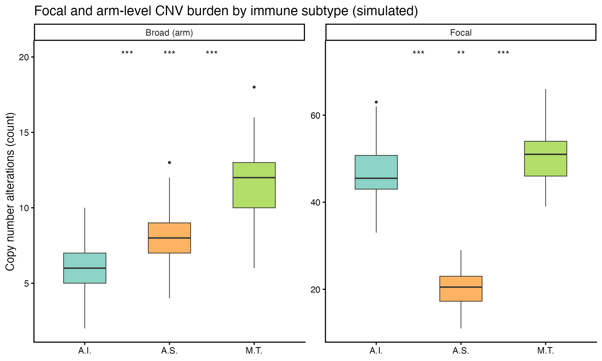

拷贝数**负荷**——肿瘤携带多少局灶与臂级改变——以 TMB 之外的方式区分免疫亚型，与免疫逃逸机制关联 \[1\]。参考文档按样本统计 GISTIC 的 `focal_data_by_genes.txt` 与 `broad_data_by_genes.txt` 中的改变特征数，并用两两显著性符号（ns / * / ***）比较亚型。本教程从模拟 GISTIC 矩阵复现负荷计算与分面箱线图：

## Example

{fig-alt="局灶与臂级 CNV 负荷 DEMO" fig-align="center" width="60%"}

## Setup

-   系统要求：跨平台（Linux/MacOS/Windows）

-   编程语言：R

-   依赖包：`ggplot2`; `dplyr`

```{r packages setup, message=FALSE, warning=FALSE, output=FALSE}
suppressPackageStartupMessages({
  library(ggplot2)
  library(dplyr)
})
```

```{r}
sessioninfo::session_info("attached")
```

## 数据准备

三个免疫亚型（A.I. / A.S. / M.T.）的 150 个样本、模拟 GISTIC 值矩阵——300 个局灶特征与 23 条臂、值取 {-2, -1, 0, 1, 2}。植入效应：A.I. 局灶扩增更多、M.T. 缺失更多、A.S. 臂级更多。真实数据：负荷 = `colSums(focalload != 0)`，样本对 `pdat.txt`：

```{r load data}
suppressPackageStartupMessages({library(ggplot2); library(dplyr)})
set.seed(18801)
n <- 150
subtypes <- c("A.I.", "A.S.", "M.T.")
pdat <- data.frame(sample = sprintf("S%03d", 1:n),
                   Subtype = factor(rep(subtypes, each = n / 3), levels = subtypes))
## per-sample altered-feature count from a GISTIC-style value vector
burden_of <- function(n_feat, amp_p, del_p) {
  v <- sample(c(-2, -1, 0, 1, 2), n_feat,
              TRUE, prob = c(del_p, del_p * 2, 1 - 4 * del_p, amp_p * 2, amp_p))
  sum(v != 0)
}
## planted subtype effects: A.I. high focal amp, M.T. high focal/broad del
focal <- sapply(seq_len(n), function(i) {
  st <- pdat$Subtype[i]
  burden_of(300, if (st == "A.I.") 0.045 else 0.012, if (st == "M.T.") 0.045 else 0.012)
})
broad <- sapply(seq_len(n), function(i) {
  st <- pdat$Subtype[i]
  burden_of(23, if (st == "A.S.") 0.11 else 0.045, if (st == "M.T.") 0.13 else 0.05)
})
load_df <- rbind(
  data.frame(sample = pdat$sample, Subtype = pdat$Subtype,
             burden = focal, level = "Focal"),
  data.frame(sample = pdat$sample, Subtype = pdat$Subtype,
             burden = broad, level = "Broad (arm)"))
```

## Visualization

### 分面负荷箱线图与两两符号

局灶与臂级负荷并排，每对上方是 BH 校正的成对 Wilcoxon 符号——植入的局灶扩增（A.I.）、局灶缺失（M.T.）与臂级（A.S.）效应在两个分面上都可直接读出：

```{r}
#| label: fig-1.1CnvLoad
#| fig-cap: "150 个模拟样本在三个免疫亚型的局灶（300 特征）与臂级（23 臂）CNV 负荷：箱线图配 BH 校正的成对 Wilcoxon 符号（ns / * / ** / ***）。"
#| out.width: "90%"
#| warning: false
#| message: false
#| fig-width: 7.5
#| fig-height: 4.5

pairs <- combn(subtypes, 2, simplify = FALSE)
sym <- function(p) ifelse(p > 0.05, "ns", ifelse(p <= 0.001, "***", ifelse(p <= 0.01, "**", ifelse(p <= 0.05, "*", "ns"))))
ann <- do.call(rbind, lapply(c("Focal", "Broad (arm)"), function(lv) {
  d <- load_df[load_df$level == lv, ]
  raw <- do.call(rbind, lapply(pairs, function(pr) {
    p <- wilcox.test(burden ~ Subtype, data = d[d$Subtype %in% pr, ])$p.value
    data.frame(level = lv, g1 = pr[1], g2 = pr[2], p = p)
  }))
  raw$p <- p.adjust(raw$p, method = "BH")   # BH across the 3 pairwise tests
  raw$sym <- sym(raw$p)
  raw
}))
ymax <- tapply(load_df$burden, load_df$level, max)
pos_map <- setNames(c(1, 2, 3), c("A.I.", "A.S.", "M.T."))
ggplot(load_df, aes(Subtype, burden, fill = Subtype)) +
  geom_boxplot(outlier.size = 0.6, linewidth = 0.3, width = 0.5) +
  geom_text(data = ann %>% mutate(x = (pos_map[g1] + pos_map[g2]) / 2,
                                  y = ymax[level] * 1.12),
            aes(x, y, label = sym), inherit.aes = FALSE, size = 3.4) +
  facet_wrap(~level, scales = "free_y") +
  scale_fill_manual(values = c("A.I." = "#8DD3C7", "A.S." = "#FDB462", "M.T." = "#B3DE69"), guide = "none") +
  labs(x = NULL, y = "Copy number alterations (count)",
       title = "Focal and arm-level CNV burden by immune subtype (simulated)") +
  theme_classic(base_size = 10)
```


::: callout-tip
**实践提示**

-   GISTIC 值矩阵已含逐基因/逐臂的调用（-2…2）：负荷就是每样本的 `colSums(mat != 0)`——**不要**直接对值求和，获得与丢失会互相抵消。
-   局灶与臂级分开：它们对应不同机制（局部癌基因激活 vs 整染色体错误分离），合并会把故事平均掉。
-   三亚组时每面板有三对两两检验——做校正（此处 BH）并使用含 **ns** 的符号方案，让读者看到哪些比较做过且不显著。
:::

## 应用场景

::: {#fig-CnvLoadApplications1}
{fig-alt="按亚型的 CNV 负荷" fig-align="center" width="60%"}

按亚型的 CNV 负荷
:::

负荷-亚组箱线图可推广到任何改变类别：按分期的 TMB、按 BRCA 状态的 HRD 评分、或按病毒病因的 indel 负荷。

## 参考文献

\[1\] Xiaofan Lu, et al. FigureYa: A Standardized Visualization Framework for Enhancing Biomedical Data Interpretation and Research Efficiency. iMetaMed. 2025. doi:10.1002/imm3.70005

\[2\] Thorsson V, Gibbs DL, Brown SD, et al. The immune landscape of cancer (source of the immune-subtype burden comparison). Immunity. 2018;48(4):812-830. doi:10.1016/j.immuni.2018.03.023