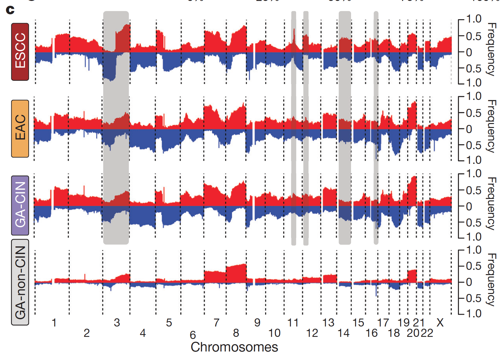

GISTIC condenses a cohort's segmented copy-number data into per-bin **amplitude × frequency** scores, and its genome-wide profile is the standard readout of where a cancer type amplifies and deletes \[1\]. The reference re-draws those profiles **per molecular subtype** (GISTIC's own plots only cover the whole cohort) so subtype-specific drivers stand out \[1\]. GISTIC 2.0 and the Firehose segment files are not reproducible inside a static page; the pipeline — segmentation, per-subtype frequency/amplitude summary, GISTIC-style scoring and the profile figures — runs in-page on simulated data with planted subtype peaks:

## Example

{fig-alt="Subtype-wise CNV Frequency Profiles DEMO" fig-align="center" width="70%"}

## Setup

-   System Requirements: Cross-platform (Linux/MacOS/Windows)

-   Programming language: R

-   Dependent packages: `ggplot2`; `ComplexHeatmap`

```{r packages setup, message=FALSE, warning=FALSE, output=FALSE}
suppressPackageStartupMessages({
  library(ggplot2); library(ComplexHeatmap)
})
```

```{r}
sessioninfo::session_info("attached")
```

## Data Preparation

120 tumours in two subtypes, each with segmented copy number over 60 genome bins (arm-level, 1-22p/q). Planted events — subtype A amplifies 7q and 20q, subtype B deletes 16q and 18q; both share a low-level 8q gain. GISTIC-style scoring: per bin, `score = amplitude × frequency - background`, where amplitude is the mean |log2 ratio| of the events and frequency the fraction of samples altered in the same direction:

```{r load data}
suppressPackageStartupMessages({library(ggplot2); library(ComplexHeatmap)})
set.seed(52334)
n_sam <- 120
bins <- c(t(outer(1:22, c("p", "q"), function(a, b) paste0(a, b))))
n_bin <- length(bins)
subtype <- factor(rep(c("Subtype A", "Subtype B"), each = n_sam / 2))

## segment log2 ratios: noise + planted events
seg <- matrix(rnorm(n_bin * n_sam, 0, 0.12), n_bin, n_sam,
              dimnames = list(bins, sprintf("T%03d", seq_len(n_sam))))
plant <- function(bins_to_hit, direction, strength, mask) {
  ix <- which(subtype == mask)
  seg[bins_to_hit, ix] <<- seg[bins_to_hit, ix] + direction * strength
}
plant(c("7q", "20q"), +1, 0.45, "Subtype A")
plant(c("16q", "18q"), -1, 0.40, "Subtype B")
seg["8q", ] <- seg["8q", ] + 0.22   # low-level shared gain: everyone

## per-subtype GISTIC-style score per bin
gistic <- do.call(rbind, lapply(levels(subtype), function(st) {
  m <- seg[, subtype == st, drop = FALSE]
  amp <- m >= 0.25; del <- m <= -0.25
  f_amp <- rowMeans(amp); f_del <- rowMeans(del)
  a_amp <- rowMeans(abs(m) * amp); a_del <- rowMeans(abs(m) * del)
  ## background amplitude ~ mean |log2| of unaltered bins
  bg <- mean(abs(m)[!amp & !del])
  score_amp <- pmax(f_amp * (a_amp - bg), 0)
  score_del <- pmax(f_del * (a_del - bg), 0)
  data.frame(bin = bins, subtype = st,
             freq_amp = f_amp, freq_del = f_del,
             gistic = score_amp - score_del)
}))
gistic$subtype <- factor(gistic$subtype, levels = levels(subtype))
gistic$bin <- factor(gistic$bin, levels = bins)
```

## Visualization

### 1. Per-Subtype Amplification / Deletion Frequency Profiles

The reference's core figure: for each subtype, the fraction of samples amplified (red, upward) or deleted (blue, downward) per bin across the genome — subtype A shows the 7q/20q amplification peaks, subtype B the 16q/18q deletions:

```{r}
#| label: fig-1.1CnvFreq
#| fig-cap: "Copy-number alteration frequency per arm-level bin, one panel per subtype: amplification fraction (red, upward) and deletion fraction (blue, downward) across chromosomes 1-22; Subtype A peaks at 7q/20q amplification, Subtype B at 16q/18q deletion, and both share the low-level 8q gain."
#| out.width: "100%"
#| fig-width: 11
#| fig-height: 5.6

freq_long <- rbind(
  data.frame(bin = gistic$bin, subtype = gistic$subtype,
             freq = gistic$freq_amp, dir = "Amplification"),
  data.frame(bin = gistic$bin, subtype = gistic$subtype,
             freq = -gistic$freq_del, dir = "Deletion"))
ggplot(freq_long, aes(bin, freq, fill = dir)) +
  geom_col(width = 0.78) +
  geom_hline(yintercept = 0, colour = "grey30", linewidth = 0.4) +
  scale_fill_manual(values = c(Amplification = "#B2182B", Deletion = "#2166AC"), name = NULL) +
  scale_y_continuous(labels = function(f) sprintf("%.0f%%", f * 100)) +
  labs(x = NULL, y = "Samples altered", title = NULL) +
  facet_wrap(~subtype, nrow = 2) +
  theme_bw(base_size = 10.5) +
  theme(axis.text.x = element_text(angle = 90, size = 5.6, vjust = 0.5),
        panel.grid.minor.y = element_blank(),
        legend.position = "top")
```

### 2. GISTIC-Style Scores with Arm-Level Peaks

The reference's GISTIC figure equivalent: the amplitude × frequency score as a per-subtype genome track — the planted peaks are the only bins crossing the significance-style dashed line:

```{r}
#| label: fig-2.1CnvGistic
#| fig-cap: "GISTIC-style scores (amplitude x frequency, background-corrected) per bin for the two subtypes: dashed line marks the 0.10 score level; Subtype A's 7q/20q peaks cross it, Subtype B's 16q/18q deletions mirror it on the negative side, and the shared 8q gain stays below — the subtype-specific drivers the per-subtype re-drawing exposes."
#| out.width: "100%"
#| fig-width: 11
#| fig-height: 4.6

ggplot(gistic, aes(bin, gistic, colour = subtype, group = subtype)) +
  geom_hline(yintercept = 0.10, linetype = "dashed", colour = "grey45") +
  geom_hline(yintercept = 0, colour = "grey75", linewidth = 0.3) +
  geom_line(linewidth = 0.6) +
  geom_point(size = 1.3) +
  annotate("text", x = 18, y = 0.105, label = "score = 0.10", hjust = 0,
           size = 2.8, colour = "grey45", vjust = -0.4) +
  scale_colour_manual(values = c(`Subtype A` = "#B2182B", `Subtype B` = "#2166AC"), name = NULL) +
  labs(x = NULL, y = "GISTIC-style score") +
  theme_bw(base_size = 10.5) +
  theme(axis.text.x = element_text(angle = 90, size = 5.6, vjust = 0.5),
        panel.grid.minor = element_blank(),
        legend.position = "top")
```

::: callout-tip
**Practice tips**
-   Compute the score **per subtype on its own samples** — pooling first and colouring by subtype afterwards smooths exactly the differences this figure exists to show.
-   GISTIC's score is **amplitude × frequency minus background**: a bin with many shallow events can score below one with a few deep events — report both components if readers will re-rank.
-   Keep arm-level bins for cohort-scale overviews; run focal-level GISTIC on the segment file for the peak-gene list.
-   The two directions (amp/del) belong on opposite sides of zero in the frequency plot — stacking them on one positive axis hides deletions.
-   Mark the score threshold honestly: GISTIC's q-value cutoff comes from permutation; the dashed 0.10 line here is an illustrative level, not a significance claim.
:::

## Application

::: {#fig-CnvApplications1}
{fig-alt="Subtype-wise CNV Frequency Profiles" fig-align="center" width="70%"}

Subtype-wise CNV frequency profiles with GISTIC scores
:::

Per-subtype CNV profiles apply to any segmented cohort: TCGA subtype comparisons, therapy-resistant vs sensitive pairs, or multi-region primary/metastasis contrasts.

## Reference

\[1\] Xiaofan Lu, et al. FigureYa: A Standardized Visualization Framework for Enhancing Biomedical Data Interpretation and Research Efficiency. iMetaMed. 2025. doi:10.1002/imm3.70005
