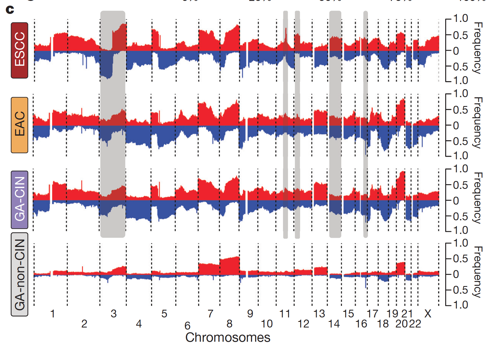

GISTIC 把队列的分段拷贝数数据浓缩成逐 bin 的**幅度 × 频率**分数，其全基因组谱是展示癌种在哪里扩增、哪里缺失的标准读数 \[1\]。参考流程把这些谱**按分子亚型分别重画**（GISTIC 自带图只有全体样本）让亚型特异的驱动事件凸显 \[1\]。GISTIC 2.0 与 Firehose segment 文件无法在静态页面内复现；分段、逐亚型频率/幅度汇总、GISTIC 风格打分与谱图形的完整管线在模拟数据上运行（植入亚型峰）：

## Example

{fig-alt="亚型特异的 CNV 频率谱 DEMO" fig-align="center" width="70%"}

## Setup

-   系统要求：跨平台（Linux/MacOS/Windows）

-   编程语言：R

-   依赖包：`ggplot2`; `ComplexHeatmap`

```{r packages setup, message=FALSE, warning=FALSE, output=FALSE}
suppressPackageStartupMessages({
  library(ggplot2); library(ComplexHeatmap)
})
```

```{r}
sessioninfo::session_info("attached")
```

## 数据准备

120 个肿瘤、两个亚型、60 个基因组 bin（臂级、1-22p/q）的分段拷贝数。植入事件——亚型 A 扩增 7q 与 20q、亚型 B 缺失 16q 与 18q；两者共享低水平 8q 获得。GISTIC 风格打分：每 bin `score = 幅度 × 频率 - 背景校正`，幅度为同向事件平均 |log2|、频率为事件样本比例：

```{r load data}
suppressPackageStartupMessages({library(ggplot2); library(ComplexHeatmap)})
set.seed(52334)
n_sam <- 120
bins <- c(t(outer(1:22, c("p", "q"), function(a, b) paste0(a, b))))
n_bin <- length(bins)
subtype <- factor(rep(c("Subtype A", "Subtype B"), each = n_sam / 2))

## segment log2 ratios: noise + planted events
seg <- matrix(rnorm(n_bin * n_sam, 0, 0.12), n_bin, n_sam,
              dimnames = list(bins, sprintf("T%03d", seq_len(n_sam))))
plant <- function(bins_to_hit, direction, strength, mask) {
  ix <- which(subtype == mask)
  seg[bins_to_hit, ix] <<- seg[bins_to_hit, ix] + direction * strength
}
plant(c("7q", "20q"), +1, 0.45, "Subtype A")
plant(c("16q", "18q"), -1, 0.40, "Subtype B")
seg["8q", ] <- seg["8q", ] + 0.22   # low-level shared gain: everyone

## per-subtype GISTIC-style score per bin
gistic <- do.call(rbind, lapply(levels(subtype), function(st) {
  m <- seg[, subtype == st, drop = FALSE]
  amp <- m >= 0.25; del <- m <= -0.25
  f_amp <- rowMeans(amp); f_del <- rowMeans(del)
  a_amp <- rowMeans(abs(m) * amp); a_del <- rowMeans(abs(m) * del)
  ## background amplitude ~ mean |log2| of unaltered bins
  bg <- mean(abs(m)[!amp & !del])
  score_amp <- pmax(f_amp * (a_amp - bg), 0)
  score_del <- pmax(f_del * (a_del - bg), 0)
  data.frame(bin = bins, subtype = st,
             freq_amp = f_amp, freq_del = f_del,
             gistic = score_amp - score_del)
}))
gistic$subtype <- factor(gistic$subtype, levels = levels(subtype))
gistic$bin <- factor(gistic$bin, levels = bins)
```

## Visualization

### 1. 逐亚型的扩增/缺失频率谱

参考的核心图：每个亚型的逐 bin 扩增比例（红、向上）与缺失比例（蓝、向下）——亚型 A 的 7q/20q 扩增峰与亚型 B 的 16q/18q 缺失峰：

```{r}
#| label: fig-1.1CnvFreq
#| fig-cap: "臂级 bin 的拷贝数改变频率、每亚型一面板：扩增比例（红、向上）与缺失比例（蓝、向下）跨 1-22 号染色体；亚型 A 峰在 7q/20q 扩增、亚型 B 峰在 16q/18q 缺失，两者共享低水平 8q 获得。"
#| out.width: "100%"
#| fig-width: 11
#| fig-height: 5.6

freq_long <- rbind(
  data.frame(bin = gistic$bin, subtype = gistic$subtype,
             freq = gistic$freq_amp, dir = "Amplification"),
  data.frame(bin = gistic$bin, subtype = gistic$subtype,
             freq = -gistic$freq_del, dir = "Deletion"))
ggplot(freq_long, aes(bin, freq, fill = dir)) +
  geom_col(width = 0.78) +
  geom_hline(yintercept = 0, colour = "grey30", linewidth = 0.4) +
  scale_fill_manual(values = c(Amplification = "#B2182B", Deletion = "#2166AC"), name = NULL) +
  scale_y_continuous(labels = function(f) sprintf("%.0f%%", f * 100)) +
  labs(x = NULL, y = "Samples altered", title = NULL) +
  facet_wrap(~subtype, nrow = 2) +
  theme_bw(base_size = 10.5) +
  theme(axis.text.x = element_text(angle = 90, size = 5.6, vjust = 0.5),
        panel.grid.minor.y = element_blank(),
        legend.position = "top")
```

### 2. GISTIC 风格分数与臂级峰

参考 GISTIC 图的等价物：每亚型一条基因组轨道的幅度 × 频率分数——植入峰是仅有的越过虚线的 bin：

```{r}
#| label: fig-2.1CnvGistic
#| fig-cap: "每亚型逐 bin 的 GISTIC 风格分数（幅度 x 频率、背景校正）：虚线标出 0.10 分数水平；亚型 A 的 7q/20q 峰越过虚线、亚型 B 的 16q/18q 缺失在负侧对应，共享的 8q 获得留在其下——按亚型重画才能暴露的亚型特异驱动。"
#| out.width: "100%"
#| fig-width: 11
#| fig-height: 4.6

ggplot(gistic, aes(bin, gistic, colour = subtype, group = subtype)) +
  geom_hline(yintercept = 0.10, linetype = "dashed", colour = "grey45") +
  geom_hline(yintercept = 0, colour = "grey75", linewidth = 0.3) +
  geom_line(linewidth = 0.6) +
  geom_point(size = 1.3) +
  annotate("text", x = 18, y = 0.105, label = "score = 0.10", hjust = 0,
           size = 2.8, colour = "grey45", vjust = -0.4) +
  scale_colour_manual(values = c(`Subtype A` = "#B2182B", `Subtype B` = "#2166AC"), name = NULL) +
  labs(x = NULL, y = "GISTIC-style score") +
  theme_bw(base_size = 10.5) +
  theme(axis.text.x = element_text(angle = 90, size = 5.6, vjust = 0.5),
        panel.grid.minor = element_blank(),
        legend.position = "top")
```

::: callout-tip
**实践要点**
-   分数**在各自亚型样本内计算**——先合并再按亚型着色会把本图要展示的差异平滑掉。
-   GISTIC 的分数是**幅度 × 频率减背景**：许多浅事件的 bin 可能低于少数深事件的 bin——读者要重排时同时报告两个成分。
-   队列尺度概览用臂级 bin；peak 基因列表在 segment 文件上跑 focal 级 GISTIC。
-   两个方向（扩增/缺失）在频率图里应分居零点两侧——叠在同一正轴上会隐藏缺失。
-   分数阈值要诚实标注：GISTIC 的 q 值截断来自置换；此处 0.10 虚线是示意水平，不是显著性声明。
:::

## 应用场景

::: {#fig-CnvApplications1}
{fig-alt="亚型特异的 CNV 频率谱" fig-align="center" width="70%"}

亚型特异的 CNV 频率谱与 GISTIC 分数
:::

逐亚型 CNV 谱适用于任何分段队列：TCGA 亚型比较、耐药 vs 敏感配对、或原发/转移多区域对比。

## 参考文献

\[1\] Xiaofan Lu, et al. FigureYa: A Standardized Visualization Framework for Enhancing Biomedical Data Interpretation and Research Efficiency. iMetaMed. 2025. doi:10.1002/imm3.70005
