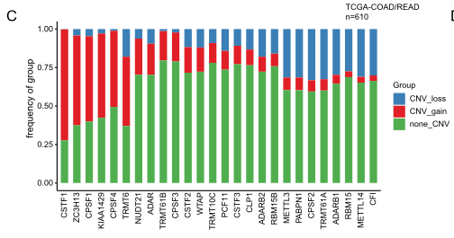

The reference asks a simple question of a cohort: for each candidate gene, how often is it **gained (red), lost (blue) or copy-neutral (green)**? — GISTIC-style per-gene CNV classes over TCGA-COAD/READ, drawn as stacked frequency bars with each bar's height = alteration frequency \[1\]. TCGAbiolinks/GISTIC downloads are replaced by a simulated per-gene class table with planted recurrent gains; the frequency aggregation and the stacked rendering (percentage-stacked columns ordered by alteration frequency) run on plain ggplot2:

## Example

{fig-alt="Gene-Level CNV Gain/Loss Frequencies DEMO" fig-align="center" width="60%"}

## Setup

-   System Requirements: Cross-platform (Linux/MacOS/Windows)

-   Programming language: R

-   Dependent packages: `ggplot2`

```{r packages setup, message=FALSE, warning=FALSE, output=FALSE}
suppressPackageStartupMessages({
  library(ggplot2)
})
```

```{r}
sessioninfo::session_info("attached")
```

## Data Preparation

24 "writer"-style candidate genes × 380 tumours, each gene-patient cell carrying a CNV class (`gain`/`loss`/`non_CNV`, the GISTIC discrete calls). Planted recurrent events: six genes gain in 25-45% of tumours, four genes lost in 15-30%, the rest mostly neutral — the frequency ordering the figure exists to expose:

```{r load data}
suppressPackageStartupMessages({library(ggplot2)})
set.seed(43260)
writers <- sprintf("W%02d", 1:24)
n_tum <- 380
gain_p <- c(0.42, 0.36, 0.31, 0.27, 0.25, 0.25,
            rep(0.06, 10), rep(0.03, 8))
loss_p <- c(rep(0.03, 10), 0.30, 0.24, 0.21, 0.15, rep(0.04, 10))
cnv <- do.call(rbind, lapply(seq_along(writers), function(i) {
  cls <- sample(c("gain", "loss", "non_CNV"), n_tum, TRUE,
                prob = c(gain_p[i], loss_p[i], 1 - gain_p[i] - loss_p[i]))
  data.frame(gene = writers[i], sample = seq_len(n_tum), class = cls)
}))
freq <- as.data.frame(prop.table(table(cnv$gene, cnv$class), margin = 1) * 100)
names(freq) <- c("gene", "class", "pct")
freq$alter <- freq$pct * (freq$class != "non_CNV")
alter_freq <- aggregate(alter ~ gene, freq, sum)
freq$gene <- factor(freq$gene,
                    levels = alter_freq$gene[order(-alter_freq$alter)])
```

## Visualization

### 1. Stacked Gain/Loss/Neutral Frequencies

The reference's stacked bars: one column per gene, gain (red) on top of loss (blue) with neutral (green) filling the rest, ordered by total alteration frequency so the recurrent events lead:

```{r}
#| label: fig-1.1CnvProfile
#| fig-cap: "Per-gene CNV class frequencies across 380 simulated tumours: gain (red) stacked over loss (blue) with copy-neutral (green) completing each column; genes ordered by total alteration frequency, the recurrent-gain writers leading."
#| out.width: "85%"
#| fig-width: 8
#| fig-height: 5.6

ggplot(freq, aes(gene, pct, fill = class)) +
  geom_col(width = 0.72, colour = "grey35", linewidth = 0.2) +
  scale_fill_manual(values = c(gain = "#B2182B", loss = "#2166AC",
                               non_CNV = "#5AAE61"),
                    breaks = c("gain", "loss", "non_CNV"),
                    labels = c("CNV gain", "CNV loss", "non-CNV")) +
  labs(x = NULL, y = "frequency (%)", fill = NULL) +
  theme_bw(base_size = 11) +
  theme(axis.text.x = element_text(angle = 45, hjust = 1, size = 8),
        panel.grid.minor = element_blank())
```

### 2. Gain-Biased Genes Highlighted

The reading aid the reference implies but does not draw: alteration frequency against the gain/loss balance, one point per gene — genes above the diagonal are gain-dominated (candidate oncogene-type drivers), below are loss-dominated:

```{r}
#| label: fig-2.1CnvProfileBalance
#| fig-cap: "Gain vs loss frequency per gene: the six planted recurrent-gain genes sit far above the balance diagonal, the four recurrent-loss genes far below; neutral-heavy genes cluster at the origin. Labels on the extremes."
#| out.width: "75%"
#| fig-width: 6.5
#| fig-height: 6

gm <- aggregate(pct ~ gene + class, freq, sum)
gm_wide <- reshape(gm, idvar = "gene", timevar = "class", direction = "wide")
names(gm_wide) <- sub("pct.", "", names(gm_wide))
ggplot(gm_wide, aes(gain, loss)) +
  geom_abline(slope = 1, intercept = 0, linetype = 2, colour = "grey55") +
  geom_point(aes(colour = alter_freq$alter[
    match(gm_wide$gene, alter_freq$gene)]), size = 3.2) +
  ggrepel::geom_text_repel(aes(label = gene),
                           data = subset(gm_wide, gain > 15 | loss > 15),
                           size = 2.8, seed = 1, max.overlaps = 20) +
  scale_colour_viridis_c(name = "alteration\nfreq (%)", option = "magma",
                         begin = 0.75, end = 0) +
  labs(x = "gain frequency (%)", y = "loss frequency (%)",
       colour = "alteration\nfreq (%)") +
  theme_bw(base_size = 11) +
  theme(panel.grid = element_blank())
```

::: callout-tip
**Practice tips**

-   Order gene columns by **total** alteration frequency (gain + loss), not by gain alone — a gene with a mixed profile is as interesting as a pure-gain one.
-   Copy-neutral must be drawn, not dropped: its share is the denominator that makes the stacked columns comparable across genes.
-   The GISTIC-style classes are discrete calls; keep them categorical in the plot — averaging a CNA log-ratio over a gene set would hide exactly the bimodality this figure exposes.
-   With hundreds of candidates, cap the figure at the top-N altered genes and give the rest a supplementary table; 24 columns is the readability ceiling for 45°-rotated labels.
-   A high gain frequency in a candidate *writer* gene justifies the next analysis (expression correlation with CNV, the reference's downstream step) — the figure is the triage, not the verdict.
:::

## Application

::: {#fig-CnvProfileApplications1}
{fig-alt="Gene-Level CNV Gain/Loss Frequencies" fig-align="center" width="60%"}

Gene-level CNV gain/loss frequencies
:::

The stacked-class-frequency grammar fits any per-gene categorical alteration: mutation class (missense/truncating), methylation promoter state, or structural-variant type — wherever a gene set needs a cohort-level alteration triage.

## Reference

\[1\] Xiaofan Lu, et al. FigureYa: A Standardized Visualization Framework for Enhancing Biomedical Data Interpretation and Research Efficiency. iMetaMed. 2025. doi:10.1002/imm3.70005
