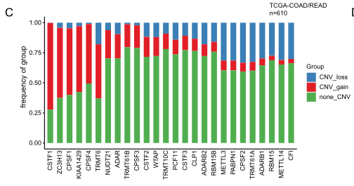

参考文档向队列问一个简单问题：对每个候选基因，它**获得（红）、缺失（蓝）还是拷贝中性（绿）**的频率是多少？——GISTIC 式逐基因 CNV 类别跨 TCGA-COAD/READ、画成堆叠频率条、每条柱高 = 改变频率 \[1\]。TCGA-biolinks/GISTIC 下载替换为带植入复发事件的模拟逐基因类别表；频率聚合与堆叠渲染（百分比堆叠列、按改变频率排序）用朴素 ggplot2 运行：

## Example

{fig-alt="基因级 CNV 获得/缺失频率 DEMO" fig-align="center" width="60%"}

## Setup

-   系统要求：跨平台（Linux/MacOS/Windows）

-   编程语言：R

-   依赖包：`ggplot2`

```{r packages setup, message=FALSE, warning=FALSE, output=FALSE}
suppressPackageStartupMessages({
  library(ggplot2)
})
```

```{r}
sessioninfo::session_info("attached")
```

## 数据准备

24 个"writer"式候选基因 × 380 个肿瘤，每 基因×患者 单元携带 CNV 类别（`gain`/`loss`/`non_CNV`，GISTIC 离散调用）。植入复发事件：六个基因在 25-45% 肿瘤中获得、四个基因在 15-30% 缺失、其余大多中性——图要暴露的频率排序：

```{r load data}
suppressPackageStartupMessages({library(ggplot2)})
set.seed(43260)
writers <- sprintf("W%02d", 1:24)
n_tum <- 380
gain_p <- c(0.42, 0.36, 0.31, 0.27, 0.25, 0.25,
            rep(0.06, 10), rep(0.03, 8))
loss_p <- c(rep(0.03, 10), 0.30, 0.24, 0.21, 0.15, rep(0.04, 10))
cnv <- do.call(rbind, lapply(seq_along(writers), function(i) {
  cls <- sample(c("gain", "loss", "non_CNV"), n_tum, TRUE,
                prob = c(gain_p[i], loss_p[i], 1 - gain_p[i] - loss_p[i]))
  data.frame(gene = writers[i], sample = seq_len(n_tum), class = cls)
}))
freq <- as.data.frame(prop.table(table(cnv$gene, cnv$class), margin = 1) * 100)
names(freq) <- c("gene", "class", "pct")
freq$alter <- freq$pct * (freq$class != "non_CNV")
alter_freq <- aggregate(alter ~ gene, freq, sum)
freq$gene <- factor(freq$gene,
                    levels = alter_freq$gene[order(-alter_freq$alter)])
```

## Visualization

### 堆叠 Gain/Loss/Neutral 频率

参考的堆叠条：每基因一列、gain（红）叠 loss（蓝）、neutral（绿）补齐、按总改变频率排序让复发事件领跑：

```{r}
#| label: fig-1.1CnvProfile
#| fig-cap: "380 个模拟肿瘤中逐基因 CNV 类别频率：gain（红）叠 loss（蓝）加拷贝中性（绿）补齐每列；基因按总改变频率排序、复发获得型 writer 领跑。"
#| out.width: "85%"
#| fig-width: 8
#| fig-height: 5.6

ggplot(freq, aes(gene, pct, fill = class)) +
  geom_col(width = 0.72, colour = "grey35", linewidth = 0.2) +
  scale_fill_manual(values = c(gain = "#B2182B", loss = "#2166AC",
                               non_CNV = "#5AAE61"),
                    breaks = c("gain", "loss", "non_CNV"),
                    labels = c("CNV gain", "CNV loss", "non-CNV")) +
  labs(x = NULL, y = "frequency (%)", fill = NULL) +
  theme_bw(base_size = 11) +
  theme(axis.text.x = element_text(angle = 45, hjust = 1, size = 8),
        panel.grid.minor = element_blank())
```

### 高亮 gain 偏向基因

参考隐含但未画的阅读辅助：改变频率 vs 获得/缺失平衡、每基因一点——对角线上方的基因 gain 主导（候选癌基因型驱动）、下方 loss 主导：

```{r}
#| label: fig-2.1CnvProfileBalance
#| fig-cap: "逐基因的 gain vs loss 频率与平衡对角线：六个植入的复发获得基因远在对角线上方、四个复发缺失基因远在下方；中性为主的基因聚在原点。极端基因带标签。"
#| out.width: "75%"
#| fig-width: 6.5
#| fig-height: 6

gm <- aggregate(pct ~ gene + class, freq, sum)
gm_wide <- reshape(gm, idvar = "gene", timevar = "class", direction = "wide")
names(gm_wide) <- sub("pct.", "", names(gm_wide))
ggplot(gm_wide, aes(gain, loss)) +
  geom_abline(slope = 1, intercept = 0, linetype = 2, colour = "grey55") +
  geom_point(aes(colour = alter_freq$alter[
    match(gm_wide$gene, alter_freq$gene)]), size = 3.2) +
  ggrepel::geom_text_repel(aes(label = gene),
                           data = subset(gm_wide, gain > 15 | loss > 15),
                           size = 2.8, seed = 1, max.overlaps = 20) +
  scale_colour_viridis_c(name = "alteration\nfreq (%)", option = "magma",
                         begin = 0.75, end = 0) +
  labs(x = "gain frequency (%)", y = "loss frequency (%)",
       colour = "alteration\nfreq (%)") +
  theme_bw(base_size = 11) +
  theme(panel.grid = element_blank())
```


## 应用场景

::: {{#fig-CnvProfileApplications1}}
{fig-alt="基因级 CNV 获得/缺失频率" fig-align="center" width="60%"}

基因级 CNV 获得/缺失频率
:::

堆叠类别频率语法适用于任何逐基因类别改变：突变类别（错义/截断）、启动子甲基化状态、或结构变异类型——凡基因集合需要队列层面改变分诊处。

## 参考文献

\[1\] Xiaofan Lu, et al. FigureYa: A Standardized Visualization Framework for Enhancing Biomedical Data Interpretation and Research Efficiency. iMetaMed. 2025. doi:10.1002/imm3.70005
