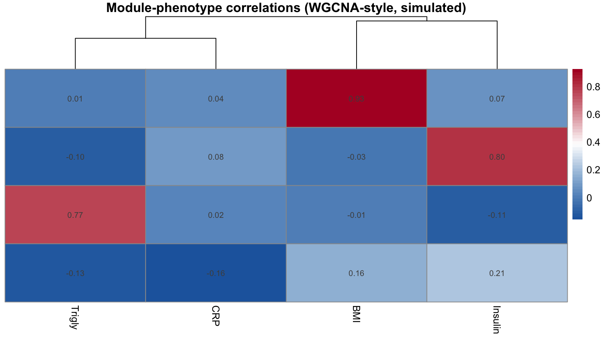

When many features (metabolites, genes, proteins) are measured across the same samples, features that rise and fall together form **co-abundance modules**. The FigureYa103 workflow builds a weighted co-abundance network with WGCNA, cuts it into modules, and asks which modules track which phenotypes — the answer lands in a module × phenotype correlation heatmap with hierarchical clustering on both sides \[1\].

## Example

{fig-alt="CoAbundanceNetwork DEMO" fig-align="center" width="60%"}

## Setup

-   System Requirements: Cross-platform (Linux/MacOS/Windows)

-   Programming language: R

-   Dependent packages: `WGCNA`; `pheatmap`; `ggplot2`

```{r packages setup, message=FALSE, warning=FALSE, output=FALSE}
# Install packages
if (!requireNamespace("WGCNA", quietly = TRUE)) {
  install.packages("WGCNA", repos = "https://cloud.r-project.org")
}
if (!requireNamespace("pheatmap", quietly = TRUE)) {
  install.packages("pheatmap")
}
if (!requireNamespace("ggplot2", quietly = TRUE)) {
  install.packages("ggplot2")
}

# Load packages
suppressPackageStartupMessages({
  library(WGCNA)
  library(pheatmap)
  library(ggplot2)
})
options(stringsAsFactors = FALSE)
allowWGCNAThreads()
```

```{r}
sessioninfo::session_info("attached")
```

## Data Preparation

Two matrices whose rows correspond one-to-one: a features × samples abundance matrix (here 120 simulated serum metabolites across 90 individuals) and a samples × phenotype matrix (four quantitative traits). The module structure is planted so that modules M1/M2/M3 each track one phenotype and M4 tracks none — the figure must recover exactly that pattern.

```{r load data}
set.seed(10301)
n_sm <- 90; n_feat <- 120
mods <- list(M1 = 1:30, M2 = 31:60, M3 = 61:90, M4 = 91:120)
eig <- matrix(rnorm(n_sm * 4, 0, 1), n_sm, 4,
              dimnames = list(paste0("S", 1:n_sm), names(mods)))
feats <- c()
for (k in seq_along(mods)) {
  feats <- cbind(feats, sapply(mods[[k]], function(j) eig[, k] * 0.8 + rnorm(n_sm, 0, 0.45)))
}
colnames(feats) <- paste0("F", sprintf("%03d", 1:n_feat))
anno <- data.frame(
  row.names = paste0("S", 1:n_sm),
  BMI = scale(eig[, 1] * 0.9 + rnorm(n_sm, 0, 0.4))[, 1],
  Insulin = scale(eig[, 2] * 0.8 + rnorm(n_sm, 0, 0.5))[, 1],
  Trigly = scale(eig[, 3] * 0.7 + rnorm(n_sm, 0, 0.6))[, 1],
  CRP = scale(rnorm(n_sm, 0, 1))[, 1])
```

## Visualization

### 1. Soft-Threshold Selection

WGCNA turns correlations into a weighted network with a soft power β chosen so the network is approximately scale-free. `pickSoftThreshold()` scans candidate powers; the reference picks the lowest power whose scale-free fit index flattens near 0.9 with acceptable mean connectivity:

```{r}
#| label: fig-1.1SoftThreshold
#| fig-cap: "Scale-free fit index (left) and mean connectivity (right) across candidate soft powers: the flagged power is the lowest one whose fit flattens near 0.9."
#| out.width: "90%"
#| warning: false
#| message: false
#| fig-width: 8
#| fig-height: 4

sft <- pickSoftThreshold(feats, powerVector = 1:14, verbose = 0)
par(mfrow = c(1, 2))
plot(sft$fitIndices[, 1], -sign(sft$fitIndices[, 3]) * sft$fitIndices[, 2],
     xlab = "Soft threshold power", ylab = "Scale-free fit index",
     type = "n", main = "Scale-free topology")
text(sft$fitIndices[, 1], -sign(sft$fitIndices[, 3]) * sft$fitIndices[, 2],
     labels = 1:14, col = "red")
abline(h = 0.9, col = "grey55", lty = 2)
plot(sft$fitIndices[, 1], sft$fitIndices[, 5],
     xlab = "Soft threshold power", ylab = "Mean connectivity",
     type = "n", main = "Mean connectivity")
text(sft$fitIndices[, 1], sft$fitIndices[, 5], labels = 1:14, col = "red")
```

The chosen power (here the flagged minimum) is used verbatim in the network step.

### 2. Module Detection and Module-Phenotype Heatmap

With the soft power fixed, `blockwiseModules()` builds the network and cuts modules with the dynamic hybrid tree algorithm (`deepSplit = 4`, as in the reference). Module **eigengenes** (first principal component per module) are correlated with the phenotype matrix, and the resulting module × phenotype heatmap is clustered on both axes with significance-ready numbers in the cells:

```{r}
#| label: fig-2.1ModuleHeatmap
#| fig-cap: "Module eigengene vs phenotype correlations (WGCNA-style, simulated): rows = modules from the dynamic hybrid cut, columns = quantitative traits; numbers give Pearson r, the dendrograms cluster both margins."
#| out.width: "95%"
#| warning: false
#| message: false
#| fig-width: 9
#| fig-height: 5

## pickSoftThreshold may return NA when no power reaches the 0.9 criterion —
## fall back to a fixed power (6 is the WGCNA default for signed networks)
chosen_power <- ifelse(is.na(sft$powerEstimate), 6, sft$powerEstimate)
cat("chosen soft power:", chosen_power, "\n")
net <- blockwiseModules(feats, power = chosen_power,   # rows = samples, cols = features
                        TOMType = "unsigned", networkType = "signed",
                        minModuleSize = 20, deepSplit = 4,
                        reassignThreshold = 0, numericLabels = TRUE,
                        verbose = 0)
moduleColors <- labels2colors(net$colors)
names(moduleColors) <- colnames(feats)

## module eigengenes: samples in rows, features in cols, colors per column
MEs <- orderMEs(moduleEigengenes(feats, moduleColors)$eigengenes)
cor_mod <- cor(MEs, anno, use = "pairwise.complete.obs")

pheatmap(cor_mod, cluster_rows = TRUE, cluster_cols = TRUE,
         color = colorRampPalette(c("#2166AC", "white", "#B2182B"))(50),
         display_numbers = matrix(sprintf("%.2f", cor_mod), nrow(cor_mod)),
         fontsize_number = 8, fontsize = 10,
         main = "Module-phenotype correlations (WGCNA-style, simulated)")
```

The heatmap recovers the planted structure: the module driven by BMI co-varies with BMI, and the no-effect module shows correlations indistinguishable from zero — the figure is the test.

::: callout-tip
**Practice tips**

-   `pickSoftThreshold()` needs enough samples (rule of thumb ≥ 15 per candidate module); with fewer samples the fit index never reaches 0.9 and the flagged power is unreliable — fall back to the highest power with acceptable mean connectivity.
-   `deepSplit = 4` is the most aggressive dynamic cut; lower it (0–3) when modules split into fragments smaller than the biology.
-   Module-phenotype correlations share samples across rows — a single Bonferroni correction over modules × traits is the honest significance statement if numbers go into a paper.
:::

## Applications

::: {#fig-CoAbundanceApplications1}
{fig-alt="CoAbundanceNetwork Application" fig-align="center" width="60%"}

Module-phenotype correlation heatmap
:::

The same heatmap layout applies to serum metabolite clusters vs clinical chemistry (the reference), gene co-expression modules vs tumour stage, or protein co-abundance vs drug response.

## Reference

\[1\] Xiaofan Lu, et al. FigureYa: A Standardized Visualization Framework for Enhancing Biomedical Data Interpretation and Research Efficiency. iMetaMed. 2025. doi:10.1002/imm3.70005

\[2\] Langfelder P, Horvath S. WGCNA: an R package for weighted correlation network analysis. BMC Bioinformatics. 2008;9:559. doi:10.1186/1471-2105-9-559
