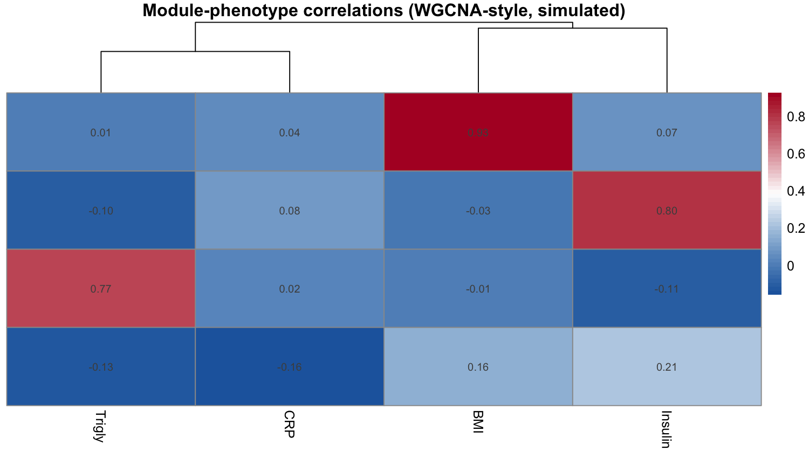

当许多特征（代谢物、基因、蛋白质）在同一批样本上测量时，共变动的特征会形成**共丰度模块**。FigureYa103 流程用 WGCNA 构建加权共丰度网络、切割成模块，并问哪些模块跟踪哪些表型——答案落在模块 × 表型相关热图中，两侧带层次聚类 \[1\]。

## Example

{fig-alt="CoAbundanceNetwork DEMO" fig-align="center" width="60%"}

## Setup

-   系统要求：跨平台（Linux/MacOS/Windows）

-   编程语言：R

-   依赖包：`WGCNA`；`pheatmap`；`ggplot2`

```{r packages setup, message=FALSE, warning=FALSE, output=FALSE}
if (!requireNamespace("WGCNA", quietly = TRUE)) {
  install.packages("WGCNA", repos = "https://cloud.r-project.org")
}
if (!requireNamespace("pheatmap", quietly = TRUE)) {
  install.packages("pheatmap")
}
if (!requireNamespace("ggplot2", quietly = TRUE)) {
  install.packages("ggplot2")
}
suppressPackageStartupMessages({
  library(WGCNA)
  library(pheatmap)
  library(ggplot2)
})
options(stringsAsFactors = FALSE)
allowWGCNAThreads()
```

```{r}
sessioninfo::session_info("attached")
```

## 数据准备

两个行一一对应的矩阵：特征 × 样本丰度矩阵（此处 120 个模拟血清代谢物 × 90 个个体）和样本 × 表型矩阵（四个数量性状）。模块结构已植入——模块 M1/M2/M3 各跟踪一个表型，M4 无关联——图必须精确恢复该模式。

```{r load data}
set.seed(10301)
n_sm <- 90; n_feat <- 120
mods <- list(M1 = 1:30, M2 = 31:60, M3 = 61:90, M4 = 91:120)
eig <- matrix(rnorm(n_sm * 4, 0, 1), n_sm, 4,
              dimnames = list(paste0("S", 1:n_sm), names(mods)))
feats <- c()
for (k in seq_along(mods)) {
  feats <- cbind(feats, sapply(mods[[k]], function(j) eig[, k] * 0.8 + rnorm(n_sm, 0, 0.45)))
}
colnames(feats) <- paste0("F", sprintf("%03d", 1:n_feat))
anno <- data.frame(
  row.names = paste0("S", 1:n_sm),
  BMI = scale(eig[, 1] * 0.9 + rnorm(n_sm, 0, 0.4))[, 1],
  Insulin = scale(eig[, 2] * 0.8 + rnorm(n_sm, 0, 0.5))[, 1],
  Trigly = scale(eig[, 3] * 0.7 + rnorm(n_sm, 0, 0.6))[, 1],
  CRP = scale(rnorm(n_sm, 0, 1))[, 1])
```

## Visualization

### 1. 软阈值选择

WGCNA 用软幂 β 将相关系数转为加权网络，β 的选取使网络近似无标度。`pickSoftThreshold()` 扫描候选幂值；参考文档选择 scale-free 拟合指数在 0.9 附近趋平且平均连接度可接受的最低幂值：

```{r}
#| label: fig-1.1SoftThreshold
#| fig-cap: "候选软幂值的 scale-free 拟合指数（左）与平均连接度（右）：标记的幂值为拟合趋平于 0.9 的最低值。"
#| out.width: "90%"
#| warning: false
#| message: false
#| fig-width: 8
#| fig-height: 4

sft <- pickSoftThreshold(feats, powerVector = 1:14, verbose = 0)
par(mfrow = c(1, 2))
plot(sft$fitIndices[, 1], -sign(sft$fitIndices[, 3]) * sft$fitIndices[, 2],
     xlab = "Soft threshold power", ylab = "Scale-free fit index",
     type = "n", main = "Scale-free topology")
text(sft$fitIndices[, 1], -sign(sft$fitIndices[, 3]) * sft$fitIndices[, 2],
     labels = 1:14, col = "red")
abline(h = 0.9, col = "grey55", lty = 2)
plot(sft$fitIndices[, 1], sft$fitIndices[, 5],
     xlab = "Soft threshold power", ylab = "Mean connectivity",
     type = "n", main = "Mean connectivity")
text(sft$fitIndices[, 1], sft$fitIndices[, 5], labels = 1:14, col = "red")
```

### 2. 模块检测与模块-表型热图

以选定的软幂值，`blockwiseModules()` 构建网络并用动态混合切割算法（`deepSplit = 4`，与参考一致）切割模块。模块**特征基因**（每模块第一主成分）与表型矩阵做相关，得到的模块 × 表型热图两侧聚类、格子内标注相关值：

```{r}
#| label: fig-2.1ModuleHeatmap
#| fig-cap: "模块特征基因 vs 表型相关（WGCNA 风格，模拟）：行 = 动态混合切割所得模块，列 = 数量性状；数值为 Pearson r，两侧树状图聚类。"
#| out.width: "95%"
#| warning: false
#| message: false
#| fig-width: 9
#| fig-height: 5

chosen_power <- ifelse(is.na(sft$powerEstimate), 6, sft$powerEstimate)
cat("chosen soft power:", chosen_power, "\n")
net <- blockwiseModules(feats, power = chosen_power,   # rows = samples, cols = features
                        TOMType = "unsigned", networkType = "signed",
                        minModuleSize = 20, deepSplit = 4,
                        reassignThreshold = 0, numericLabels = TRUE,
                        verbose = 0)
moduleColors <- labels2colors(net$colors)
names(moduleColors) <- colnames(feats)

## 模块特征基因：样本在行、特征在列、colors 按列
MEs <- orderMEs(moduleEigengenes(feats, moduleColors)$eigengenes)
cor_mod <- cor(MEs, anno, use = "pairwise.complete.obs")

pheatmap(cor_mod, cluster_rows = TRUE, cluster_cols = TRUE,
         color = colorRampPalette(c("#2166AC", "white", "#B2182B"))(50),
         display_numbers = matrix(sprintf("%.2f", cor_mod), nrow(cor_mod)),
         fontsize_number = 8, fontsize = 10,
         main = "Module-phenotype correlations (WGCNA-style, simulated)")
```

热图恢复了植入的结构：BMI 驱动的模块与 BMI 共变，无效应模块的相关性与零无异——图即检验。

::: callout-tip
**实践要点**

-   `pickSoftThreshold()` 需要足够样本（经验法则每个候选模块 ≥ 15）；样本太少时拟合指数达不到 0.9，标记的幂值不可靠——退而选择平均连接度可接受的最高幂值。
-   `deepSplit = 4` 是最激进的动态切割；模块碎裂成小于生物学规模的片段时降低（0–3）。
-   模块-表型相关在行间共享样本——若数值进论文，对模块 × 性状做一次 Bonferroni 校正是诚实的显著性声明。
:::

## Applications

::: {#fig-CoAbundanceApplications1}
{fig-alt="CoAbundanceNetwork Application" fig-align="center" width="60%"}

模块-表型相关热图
:::

同一热图版式适用于血清代谢物簇 vs 临床生化（参考文档）、基因共表达模块 vs 肿瘤分期、或蛋白质共丰度 vs 药物响应。

## Reference

\[1\] Xiaofan Lu, et al. FigureYa: A Standardized Visualization Framework for Enhancing Biomedical Data Interpretation and Research Efficiency. iMetaMed. 2025. doi:10.1002/imm3.70005

\[2\] Langfelder P, Horvath S. WGCNA: an R package for weighted correlation network analysis. BMC Bioinformatics. 2008;9:559. doi:10.1186/1471-2105-9-559