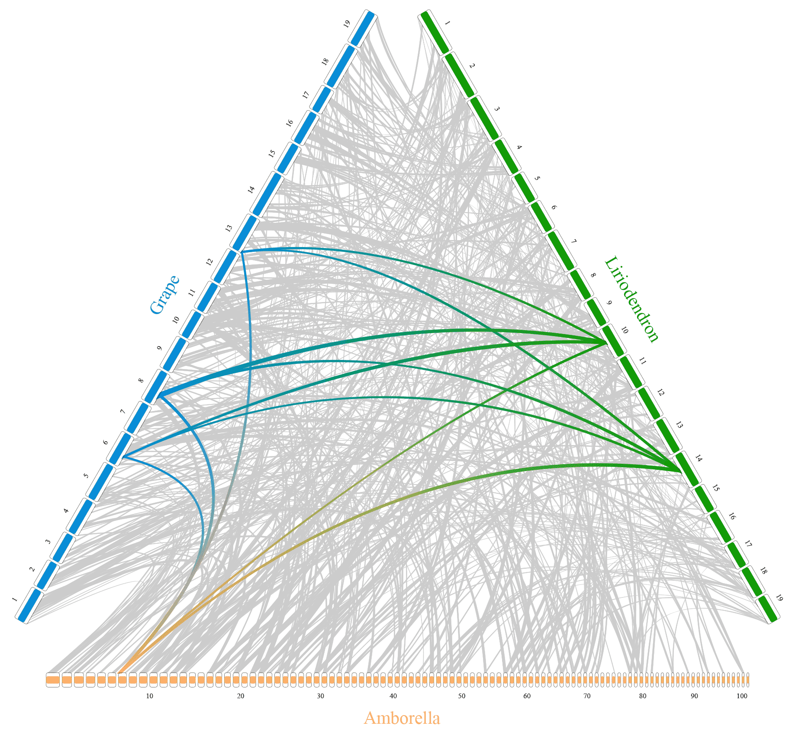
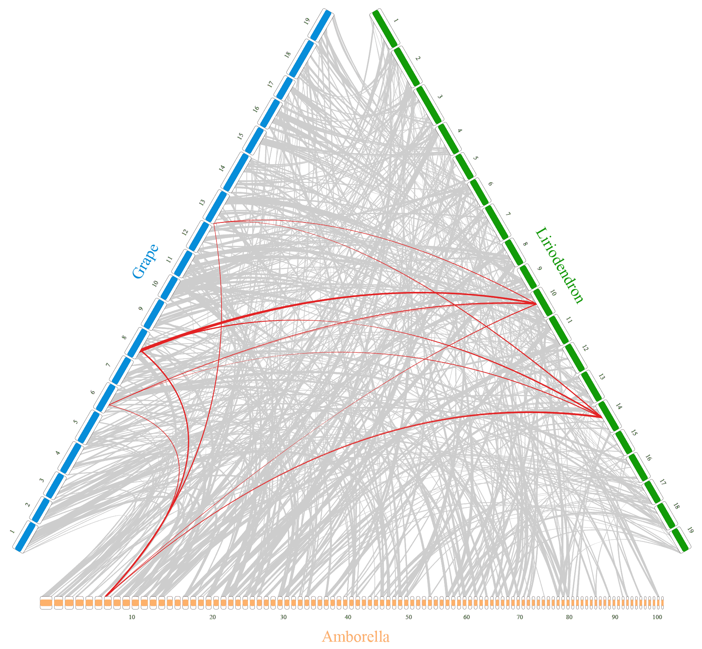
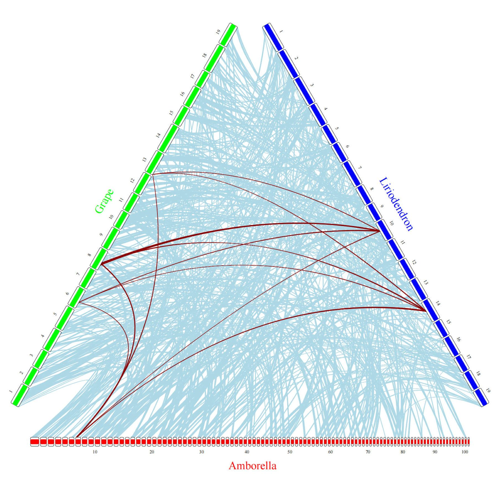
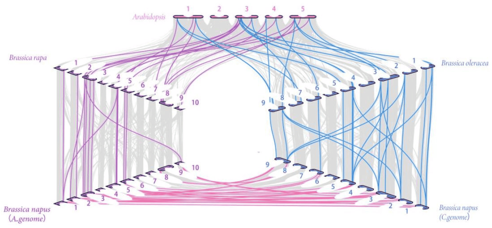

Collinearity plot is often used to compare genome sequences of different species, identify conserved homologous gene blocks and their arrangement order, and reveal changes in chromosome structure during evolution. This plot is widely used in the study of genome evolution, functional gene localization, and species relationship analysis.

## Example

{fig-alt="Collinearity Plot DEMO" fig-align="center" width="60%"}

This plot is a colinearity diagram of the ternary genome, where `Amborella`, `Grape`, and `Liriodendron` represent three different species, the long bars represent genomes, the numbers are chromosome numbers, and the lines represent the comparison between the genomes of different species. The highlighted lines represent the comparison of the genomic regions of interest.

## Setup

-   System Requirements: Cross-platform (Linux/MacOS/Windows)

-   Programming language: R

-   Dependent packages: `RIdeogram`, `ggplot2`, `gggenes`

```{r packages setup, message=FALSE, warning=FALSE, output=FALSE}
# Install packages
if (!requireNamespace("RIdeogram", quietly = TRUE)) {
  install.packages("RIdeogram")
}
if (!requireNamespace("ggplot2", quietly = TRUE)) {
  install.packages("ggplot2")
}
if (!requireNamespace("gggenes", quietly = TRUE)) {
  install.packages("gggenes")
}

# Load packages
library(RIdeogram)
library(ggplot2)
library(gggenes)
```

```{r}
sessioninfo::session_info("attached")
```

## Data Preparation

We import the sample data provided in the RIdeogram package. `karyotype_ternary_comparison` contains different species and genome information, and `synteny_ternary_comparison` contains genome comparison information between different species.

```{r load data}
data(karyotype_ternary_comparison, package="RIdeogram")
data(synteny_ternary_comparison, package="RIdeogram")
```

```{r}
# View karyotype_ternary_comparison data structure
head(karyotype_ternary_comparison)
```

```{r}
# View synteny_ternary_comparison data structure
head(synteny_ternary_comparison)
```

## Visualization

### 1. Basic Collinearity Plot

You can use the `ideogram` function provided in the RIdeogram package to draw a collinearity plot.

```{r}
#| label: fig-1BasicCollinearity
#| fig-cap: "Basic Collinearity Plot"
#| out.width: "95%"
#| warning: false
#| eval: false

# Basic Collinearity Plot
ideogram(karyotype = karyotype_ternary_comparison, synteny = synteny_ternary_comparison)
convertSVG("chromosome.svg", device = "png")
```

::: {#fig-1BasicCollinearity}
{fig-alt="Basic Collinearity Plot" fig-align="center" width="95%"}

Basic Collinearity Plot
:::

::: callout-tip
**Key Parameters: **

- **karyotype**: A table containing information about different species and their genomes. The data structure is shown in `karyotype_ternary_comparison`.
- **overlaid**: A table containing genome comparison information between different species. The data structure is shown in `synteny_ternary_comparison`.
:::

### 2. Change Colors

If you want to change the colors of the plot, just modify the color column in the `karyotype` and `overlaid` tables. As shown below, we modify the `color` and `fill` columns in the `karyotype_ternary_comparison` table, and the `fill` column in the `synteny_ternary_comparison`.

```{r}
#| label: fig-2changecolor
#| fig-cap: "Change Colors"
#| out.width: "95%"
#| warning: false
#| eval: false

# Change the colors of three species
change_color1 <- c("fcb06b"="ff0000", "078dd8"="00ff00", "139b08"="0000ff")
karyotype_ternary_comparison$color <- as.character(change_color1[karyotype_ternary_comparison$color])
karyotype_ternary_comparison$fill <- as.character(change_color1[karyotype_ternary_comparison$fill])

# Change the line color
change_color2 <- c("cccccc"="add8e6", "e41a1c"="8b0000")
synteny_ternary_comparison$fill <- as.character(change_color2[synteny_ternary_comparison$fill])

# Plot
ideogram(karyotype = karyotype_ternary_comparison, synteny = synteny_ternary_comparison)
```

::: {#fig-2changecolor}
{fig-alt="Change Colors" fig-align="center" width="95%"}

Change Colors
:::

## Implementations deliberately not used here

This page draws its figures with the project's base stack on purpose. Of the tools that the issue-435 inventory maps onto Omics/CollinearityPlot, 8 were marked **skipped** and are used only as layout references, not as dependencies: 5 that have gone more than five years without an operational commit (cutoff 2021-11-07) and 3 whose dependency closure is too heavy to justify for one static figure. Keeping an abandoned tool would mean pinning code that no longer builds; installing a heavy one would pull a whole analysis framework into a documentation build. The figure conventions were read off those tools, then re-implemented here so each panel can be inspected line by line.

| Tool | Last commit | Status | Why it is skipped |
| --- | --- | --- | --- |
| GENESPACE | 2025-01-24 | heavy dependency | framework-scale dependency closure is too heavy for one static figure |
| plotsr | 2026-07-27 | heavy dependency | framework-scale dependency closure is too heavy for one static figure |
| SyMap | — | heavy dependency | framework-scale dependency closure is too heavy for one static figure |
| local-rearrangements | 2017-11-15 | stale | >5 years without maintenance |
| Minidot | 2016-08-30 | stale | >5 years without maintenance |
| Mummer-idotplot | 2020-02-29 | stale | >5 years without maintenance |
| oxford-plots | 2019-08-11 | stale | >5 years without maintenance |
| pafr | 2021-04-30 | stale | >5 years without maintenance |

## Application

::: {#fig-CollinearityApplications}
{fig-alt="CollinearityApp1" fig-align="center" width="60%"}

Applications of Collinearity Plot
:::

This figure shows the homology of R2R3-MYB genes in B. napus and three ancestral plant species. The figure shows the colinearity between Arabidopsis (A. thaliana), Brassica rapa (B. rapa), Brassica oleracea (B. oleracea), Brassica napus (B. napus).\[1\]

### 3. Alignment Dot Plot with Orientation Classes

MUMmer, paf2dot and dotPlotly reduce a whole-genome alignment to segments in query–target space. The main diagonal is colinearity; an anti-diagonal segment is an inversion; repeated segments that leave the diagonal are duplications or repeats. Colour must encode the orientation class, not the alignment score, or the reader cannot separate an inversion from a repeat.

```{r}
#| label: fig-3AlignmentDotPlot
#| fig-cap: "Whole-genome alignment dot plot: 46 collinear blocks along the diagonal (blue), seven inverted blocks (red), and one query block aligned to four target loci (purple)"
#| out.width: "88%"
#| warning: false
#| message: false
#| fig-width: 7.2
#| fig-height: 6.4
#| fig-dpi: 300
set.seed(43529)
gmax <- 12

## 46 collinear anchors along the main diagonal.
n <- 46
q0 <- runif(n, 0.15, 10.7)
q1 <- pmin(q0 + runif(n, 0.25, 1.15), 11.95)
fwd <- data.frame(q0 = q0, q1 = q1,
                  t0 = pmax(q0 + rnorm(n, 0, 0.035), 0.02),
                  t1 = pmin(q1 + rnorm(n, 0, 0.035), 11.98),
                  class = "Forward")

## Inverted blocks: the target is traversed right-to-left, so the slope is negative.
inv_q0 <- c(1.30, 2.75, 4.15, 5.55, 7.05, 8.55, 9.95)
inv_len <- c(0.60, 0.45, 0.75, 0.50, 0.65, 0.40, 0.70)
inv <- data.frame(q0 = inv_q0, q1 = inv_q0 + inv_len,
                  t0 = inv_q0 + 1.35 + runif(7, 0, 0.12),
                  t1 = inv_q0 + 1.35 - inv_len, class = "Inverted")

## One duplicated 0.8 Mb query block aligned to four target loci.
rep_loci <- c(3.20, 6.00, 8.80, 10.35)
reps <- data.frame(q0 = 2.00, q1 = 2.80, t0 = rep_loci,
                   t1 = rep_loci + 0.80, class = "Repeat")

aln <- rbind(fwd, inv, reps)
aln$class <- factor(aln$class, levels = c("Forward", "Inverted", "Repeat"))

ggplot(aln) +
  geom_segment(aes(x = q0, xend = q1, y = t0, yend = t1, colour = class),
               linewidth = 0.55, lineend = "round", alpha = 0.8) +
  geom_abline(slope = 1, intercept = 0, linetype = "22",
              colour = "grey35", linewidth = 0.35) +
  annotate("text", x = 9.05, y = 9.35, label = "collinear diagonal",
           angle = 45, size = 2.5, colour = "grey35", hjust = 0) +
  scale_colour_manual(values = c(Forward = "#2f6db3", Inverted = "#c94c3b",
                                 Repeat = "#7b52ab"), name = NULL) +
  scale_x_continuous(breaks = seq(0, 12, 3), limits = c(0, 12),
                     expand = c(0, 0)) +
  scale_y_continuous(breaks = seq(0, 12, 3), limits = c(0, 12),
                     expand = c(0, 0)) +
  coord_equal() +
  labs(x = "Query assembly (Mb)", y = "Reference assembly (Mb)") +
  theme_minimal(base_size = 9) +
  theme(panel.grid.minor = element_blank(),
        panel.grid.major = element_line(colour = "grey91", linewidth = 0.25),
        panel.border = element_rect(colour = "grey55", fill = NA,
                                    linewidth = 0.5),
        legend.position = "top", legend.justification = "left",
        legend.key.size = unit(0.55, "lines"),
        legend.text = element_text(size = 7.5),
        axis.text = element_text(size = 7.5, colour = "grey25"),
        axis.title = element_text(size = 8.3),
        plot.margin = margin(4, 8, 4, 4))
```

### 4. Gene-Level Synteny Ribbon

gggenomes and pauvre keep gene arrows and join orthologs with ribbons, which is the right view when block boundaries fall inside genes. Here H2 carries two rearrangements relative to H1: the g03–g04 block is translocated after g08, and the g07–g08 block is inverted. Ribbons are grey when order and orientation are conserved, orange and crossing when the target block is reversed, and purple when the block changes position.

```{r}
#| label: fig-4GeneSyntenyRibbons
#| fig-cap: "Gene-level synteny between two haplotypes: grey ribbons are collinear, orange ribbons cross because g07-g08 is inverted in H2, and purple ribbons mark the translocated g03-g04 block"
#| out.width: "100%"
#| warning: false
#| message: false
#| fig-width: 8.8
#| fig-height: 4.2
#| fig-dpi: 300
set.seed(43530)
ids <- sprintf("g%02d", 1:10)
family <- rep(c("F1", "F2", "F3", "F4", "F5"), each = 2)
glen <- c(0.95, 0.80, 1.05, 0.90, 1.10, 0.85, 0.75, 1.00, 0.95, 0.90)
gap <- 0.12

h1_order <- 1:10
h2_order <- c(1, 2, 5, 6, 8, 7, 3, 4, 9, 10)

layout <- function(order, strand) {
  len <- glen[order]
  x0 <- cumsum(c(0, len[-length(len)] + gap))
  data.frame(id = ids[order], family = family[order], len = len,
             x0 = x0, x1 = x0 + len, mid = x0 + len / 2,
             strand = strand[match(ids[order], ids)],
             stringsAsFactors = FALSE)
}
h1 <- layout(h1_order, rep("+", length(ids))); h1$y <- 2.15
h2 <- layout(h2_order, ifelse(ids %in% c("g07", "g08"), "-", "+")); h2$y <- 0.85

genes <- rbind(h1[, c("id", "family", "x0", "x1", "strand", "y")],
               h2[, c("id", "family", "x0", "x1", "strand", "y")])

rib_class <- setNames(c("collinear", "collinear", "translocated", "translocated",
                        "collinear", "collinear", "inverted", "inverted",
                        "collinear", "collinear"), ids)
rib_col <- c(collinear = "#9e9e9e", inverted = "#d95f02",
             translocated = "#7570b3")
fam_col <- c(F1 = "#7fb3d5", F2 = "#8fc98f", F3 = "#e9c46a",
             F4 = "#cf8d95", F5 = "#a99acb")

y_top <- 1.92; y_bot <- 1.08
ribs <- do.call(rbind, lapply(ids, function(g) {
  a <- h1[h1$id == g, ]; b <- h2[h2$id == g, ]
  bx <- c(b$x0, b$x1)
  if (b$strand == "-") bx <- rev(bx)
  data.frame(grp = g, class = rib_class[[g]],
             x = c(a$x0, a$x1, bx[2], bx[1]),
             y = c(y_top, y_top, y_bot, y_bot))
}))
ribs$class <- factor(ribs$class, levels = names(rib_col))

ggplot() +
  geom_polygon(data = ribs, aes(x, y, group = grp, fill = class),
               colour = NA) +
  geom_gene_arrow(data = genes, aes(xmin = x0, xmax = x1, y = y,
                                    forward = strand == "+", fill = family),
                  arrowhead_height = unit(4, "mm"),
                  arrowhead_width = unit(1.6, "mm"),
                  colour = "grey35", linewidth = 0.25) +
  geom_text(data = h1, aes(mid, y + 0.30, label = id), size = 2.3) +
  geom_text(data = h2, aes(mid, y - 0.30, label = id), size = 2.3) +
  annotate("text", x = -0.35, y = 2.15, label = "H1", fontface = "bold",
           size = 3.1, hjust = 1) +
  annotate("text", x = -0.35, y = 0.85, label = "H2", fontface = "bold",
           size = 3.1, hjust = 1) +
  scale_fill_manual(values = c(collinear = alpha("#9e9e9e", 0.34),
                               inverted = alpha("#d95f02", 0.55),
                               translocated = alpha("#7570b3", 0.46),
                               fam_col),
                    breaks = names(rib_col),
                    labels = c("collinear", "inverted", "translocated"),
                    name = NULL) +
  scale_x_continuous(breaks = seq(0, 10, 2), expand = c(0, 0)) +
  scale_y_continuous(expand = c(0, 0)) +
  coord_cartesian(xlim = c(-0.55, 11.2), ylim = c(0.35, 2.65), clip = "off") +
  labs(x = "Position along assembly (Mb)", y = NULL) +
  theme_minimal(base_size = 9) +
  theme(panel.grid.major.y = element_blank(),
        panel.grid.minor = element_blank(),
        panel.grid.major.x = element_blank(),
        axis.text.y = element_blank(),
        axis.text = element_text(size = 7.5, colour = "grey25"),
        axis.title = element_text(size = 8.3),
        legend.position = "top", legend.justification = "left",
        legend.key.size = unit(0.6, "lines"),
        legend.text = element_text(size = 7.5),
        plot.margin = margin(4, 8, 4, 22))
```

### 5. Windowed Identity Heatmap

StainedGlass rasterises the query × target matrix instead of drawing one line per alignment and colours each window by alignment identity. Tandem repeats become off-diagonal stripes, while low-identity background alignments recede. The cost is resolution: the window size (100 kb here) sets the smallest event the figure can show.

```{r}
#| label: fig-5IdentityHeatmap
#| fig-cap: "Windowed identity heatmap (100 kb windows): the dark diagonal is the collinear alignment, two off-diagonal blocks are direct repeats, and the short anti-diagonal stripe is an inverted repeat"
#| out.width: "76%"
#| warning: false
#| message: false
#| fig-width: 6.6
#| fig-height: 5.6
#| fig-dpi: 300
set.seed(43531)
n <- 80
w <- 0.1

mat <- matrix(rnorm(n * n, 0.66, 0.035), n, n)
for (k in -2:2) {
  idx <- which(abs(row(mat) - col(mat)) == abs(k))
  mat[idx] <- 0.94 + rnorm(length(idx), 0, 0.012)
}
## Two direct repeats and one inverted repeat off the diagonal.
mat[12:20, 46:54] <- matrix(rnorm(9 * 9, 0.88, 0.02), 9, 9)
mat[52:60, 16:24] <- matrix(rnorm(9 * 9, 0.86, 0.02), 9, 9)
anti <- 62:70
for (i in seq_along(anti)) {
  mat[anti[i], 12:20][length(anti) - i + 1] <- 0.91 + rnorm(1, 0, 0.012)
}

df <- expand.grid(q = seq_len(n), t = seq_len(n))
df$id <- as.vector(mat)
df$x <- (df$q - 0.5) * w
df$y <- (df$t - 0.5) * w

ggplot(df, aes(x, y, fill = id)) +
  geom_tile() +
  scale_fill_gradientn(colours = c("#f7f7f7", "#c6dbef", "#6baed6",
                                   "#2171b5", "#08306b"),
                       limits = c(0.6, 1), oob = scales::squish,
                       breaks = c(0.65, 0.75, 0.85, 0.95),
                       name = "window identity") +
  scale_x_continuous(breaks = seq(0, 8, 2), limits = c(0, 8),
                     expand = c(0, 0)) +
  scale_y_continuous(breaks = seq(0, 8, 2), limits = c(0, 8),
                     expand = c(0, 0)) +
  coord_equal() +
  labs(x = "Query genome (Mb)", y = "Target genome (Mb)") +
  theme_minimal(base_size = 9) +
  theme(panel.grid = element_blank(),
        panel.border = element_rect(colour = "grey55", fill = NA,
                                    linewidth = 0.5),
        axis.text = element_text(size = 7.5, colour = "grey25"),
        axis.title = element_text(size = 8.3),
        legend.position = "right",
        legend.key.height = unit(1.6, "lines"),
        legend.key.width = unit(0.55, "lines"),
        legend.title = element_text(size = 8),
        legend.text = element_text(size = 7.2),
        plot.margin = margin(4, 6, 4, 4))
```

At whole-chromosome scale the same ordered-block model is drawn as multi-genome ribbons or rings; see [Multi-Genome Comparison](MultiGenomeComparisonPlot.qmd) for that layout.

## Reference

\[1\] Luo D, Mei D, Wei W, Liu J. Identification and Phylogenetic Analysis of the R2R3-MYB Subfamily in Brassica napus. Plants (Basel). 2023;12(4):886. Published 2023 Feb 16. doi:10.3390/plants12040886

\[2\] Kurtz S, Phillippy A, Delcher AL, et al. Versatile and open software for comparing large genomes. *Genome Biology*. 2004;5(2):R12. doi:10.1186/gb-2004-5-2-r12

\[3\] Hackl T, et al. gggenomes: a grammar of graphics for comparative genomics. https://github.com/thackl/gggenomes

\[4\] Vollger MR, Kerpedjiev P, Phillippy AM, Eichler EE. StainedGlass: interactive visualization of massive tandem repeat structures with identity heatmaps. *Bioinformatics*. 2022;38(7):2049-2051. doi:10.1093/bioinformatics/btac018


\[1\] Luo D, Mei D, Wei W, Liu J. Identification and Phylogenetic Analysis of the R2R3-MYB Subfamily in Brassica napus. Plants (Basel). 2023;12(4):886. Published 2023 Feb 16. doi:10.3390/plants12040886


