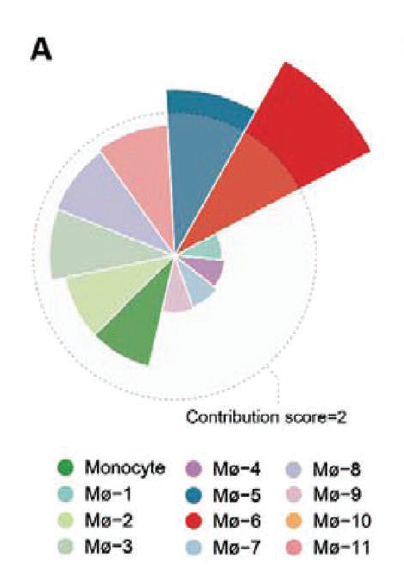

The reference ranks macrophage subsets by their **disease contribution score** — derived from differential abundance and gene-expression perturbation between disease and control groups — and renders it as a circular barplot whose radius is proportional to the score \[1\]. Here the pipeline (per-cluster differential abundance → effect-size ranking → circular barplot) is reproduced on simulated single-cell data using ggplot2 `coord_polar`:

## Example

{fig-alt="Cell-Subset Disease Contribution Score DEMO" fig-align="center" width="70%"}

## Setup

-   System Requirements: Cross-platform (Linux/MacOS/Windows)

-   Programming language: R

-   Dependent packages: `ggplot2`

```{r packages setup, message=FALSE, warning=FALSE, output=FALSE}
suppressPackageStartupMessages({
  library(ggplot2)
})
```

```{r}
sessioninfo::session_info("attached")
```

## Data Preparation

8 macrophage subsets scored across disease and control single-cell cohorts. The contribution score combines two signals: **differential abundance** (log fold-change of the subset's cell fraction between disease and control) and **differential expression magnitude** (mean absolute log2FC of the subset's marker genes). Both are simulated with planted rankings — macrophage_early has the highest contribution:

```{r load data}
suppressPackageStartupMessages({library(ggplot2)})
set.seed(52319)
subsets <- sprintf("Mac_%02d", 1:8)
n_dis <- 25; n_ctl <- 25
## differential abundance: disease vs control cell fractions
frac_dis <- c(0.22, 0.18, 0.12, 0.10, 0.08, 0.06, 0.04, 0.03)
frac_ctl <- c(0.08, 0.20, 0.14, 0.15, 0.12, 0.12, 0.10, 0.09)
da_lfc <- log2(frac_dis / frac_ctl)

## differential expression magnitude per subset (mean |log2FC| of markers)
de_mag <- c(1.8, 1.5, 0.6, 0.4, 0.3, 0.25, 0.2, 0.15)

## combined contribution score, normalised to [0, 1]
raw <- abs(da_lfc) * 0.4 + de_mag * 0.6
contrib <- raw / max(raw)
names(contrib) <- subsets

## sort names and values with the SAME index vector so each subset keeps
## its own score (factor() alone would keep values in original order and
## mispair them with the sorted scores)
ord <- order(-contrib)
contrib_df <- data.frame(
  subset = factor(subsets[ord], levels = subsets[ord]),
  score = as.numeric(contrib[ord])
)
```

## Visualization

### 1. Circular Contribution Barplot

The reference's Fig. 6A: circular barplot where bar length encodes the contribution score, coloured by rank:

```{r}
#| label: fig-1.1ContribBar
#| fig-cap: "Disease contribution scores for 8 macrophage subsets as a circular barplot: bar length encodes the normalised score (differential abundance x expression magnitude), coloured by rank; Mac_01 has the highest contribution."
#| out.width: "80%"
#| fig-width: 6
#| fig-height: 6

ggplot(contrib_df, aes(subset, score, fill = score)) +
  geom_col(width = 0.72) +
  ## value labels at a fixed radius outside the ring: uniform dark-on-white
  ## contrast, independent of each wedge's fill darkness
  geom_text(aes(label = sprintf("%.2f", score)),
            position = position_stack(vjust = 1.08), size = 3.1, colour = "grey15") +
  scale_fill_viridis_c(option = "magma", begin = 0.75, end = 0.15,
                       guide = "none") +
  scale_y_continuous(expand = expansion(mult = c(0, 0.14))) +
  coord_polar(start = 0, clip = "off") +
  labs(x = NULL, y = NULL) +
  theme_minimal(base_size = 11) +
  theme(axis.text.y = element_blank(),
        axis.ticks = element_blank(),
        panel.grid = element_blank())
```

### 2. Component Breakdown: Abundance vs Expression

To show that the combined score is a weighted sum of two independent signals, the differential abundance and expression magnitude are plotted as a paired scatter:

```{r}
#| label: fig-2.1ContribComponents
#| fig-cap: "Differential abundance (log2 fold-change of cell fraction) vs differential expression magnitude for each subset: Mac_01 is high on both axes; Mac_02's rank is driven by expression while its abundance barely changes; Mac_06-Mac_08 shift strongly in abundance (down) but have low expression magnitude, placing them mid-rank."
#| out.width: "70%"
#| fig-width: 6.5
#| fig-height: 5

comp_df <- data.frame(subset = subsets, da_lfc = da_lfc, de_mag = de_mag)
ggplot(comp_df, aes(da_lfc, de_mag)) +
  geom_point(size = 4, colour = "#2166AC") +
  geom_text(aes(label = subset), vjust = -0.9, size = 3, colour = "grey25") +
  geom_hline(yintercept = 0.5, linetype = "dashed", colour = "grey50") +
  geom_vline(xintercept = 0, linetype = "dashed", colour = "grey50") +
  labs(x = "Differential abundance (log2 FC of cell fraction)",
       y = "Differential expression magnitude (mean |log2FC|)") +
  theme_bw(base_size = 11) +
  theme(panel.grid.minor = element_blank())
```

::: callout-tip
**Practice tips**
-   The contribution score is a **weighted sum of two independent signals** — report both components so readers can tell whether a subset is driven by abundance or by expression.
-   Normalise the combined score to [0, 1] so the circular barplot's radius is interpretable without a numeric axis.
-   Order subsets by descending score; an alphabetical or cluster-index order scrambles the ranking that the figure exists to show.
-   Differential abundance should be computed from per-sample cell fractions (not pooled counts) to avoid pseudoreplication.
-   State the weighting (0.4 abundance + 0.6 expression here) explicitly; a different weighting changes the ranking.
:::

## Application

::: {#fig-ContribScoreApplications1}
{fig-alt="Cell-Subset Disease Contribution Score" fig-align="center" width="70%"}

Cell-subset disease contribution score
:::

The contribution ranking applies to any disease-vs-control single-cell comparison: macrophage subsets in myocardial infarction, T-cell states in immunotherapy response, or stromal populations in fibrosis.

## Reference

\[1\] Xiaofan Lu, et al. FigureYa: A Standardized Visualization Framework for Enhancing Biomedical Data Interpretation and Research Efficiency. iMetaMed. 2025. doi:10.1002/imm3.70005
