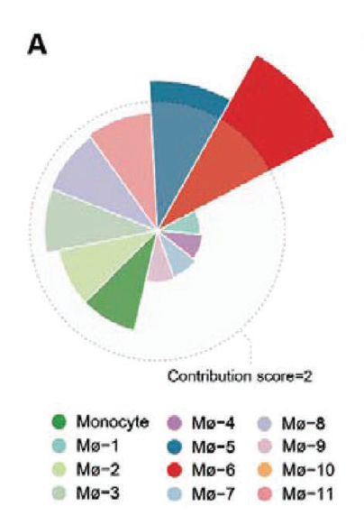

参考流程按**疾病贡献评分**对巨噬细胞亚群排序——评分由疾病组与对照组之间的丰度差异与基因表达扰动共同决定——并绘制半径正比于评分的环形条形图 \[1\]。这里在模拟单细胞数据上复现完整流程（逐群差异丰度 → 效应量排序 → 环形条形图），使用 ggplot2 `coord_polar`：

## Example

{fig-alt="细胞亚群疾病贡献评分 DEMO" fig-align="center" width="70%"}

## Setup

-   系统要求：跨平台（Linux/MacOS/Windows）

-   编程语言：R

-   依赖包：`ggplot2`

```{r packages setup, message=FALSE, warning=FALSE, output=FALSE}
suppressPackageStartupMessages({
  library(ggplot2)
})
```

```{r}
sessioninfo::session_info("attached")
```

## 数据准备

8 个巨噬细胞亚群在疾病与对照组单细胞队列中评分。贡献评分综合两个信号：**差异丰度**（亚群细胞比例在疾病 vs 对照间的 log 倍数变化）与**差异表达幅度**（亚群标志基因的平均 |log2FC|）。两者均植入排序结构——Mac_01 贡献最高：

```{r load data}
suppressPackageStartupMessages({library(ggplot2)})
set.seed(52319)
subsets <- sprintf("Mac_%02d", 1:8)
n_dis <- 25; n_ctl <- 25
## differential abundance: disease vs control cell fractions
frac_dis <- c(0.22, 0.18, 0.12, 0.10, 0.08, 0.06, 0.04, 0.03)
frac_ctl <- c(0.08, 0.20, 0.14, 0.15, 0.12, 0.12, 0.10, 0.09)
da_lfc <- log2(frac_dis / frac_ctl)

## differential expression magnitude per subset (mean |log2FC| of markers)
de_mag <- c(1.8, 1.5, 0.6, 0.4, 0.3, 0.25, 0.2, 0.15)

## combined contribution score, normalised to [0, 1]
raw <- abs(da_lfc) * 0.4 + de_mag * 0.6
contrib <- raw / max(raw)
names(contrib) <- subsets

## sort names and values with the SAME index vector so each subset keeps
## its own score (factor() alone would keep values in original order and
## mispair them with the sorted scores)
ord <- order(-contrib)
contrib_df <- data.frame(
  subset = factor(subsets[ord], levels = subsets[ord]),
  score = as.numeric(contrib[ord])
)
```

## Visualization

### 1. 环形贡献条形图

参考图 Fig. 6A：环形条形图，条长编码贡献评分，按排名着色：

```{r}
#| label: fig-1.1ContribBar
#| fig-cap: "8 个巨噬细胞亚群的疾病贡献评分环形条形图：条长编码归一化评分（差异丰度 x 表达幅度），按排名着色；Mac_01 贡献最高。"
#| out.width: "80%"
#| fig-width: 6
#| fig-height: 6

ggplot(contrib_df, aes(subset, score, fill = score)) +
  geom_col(width = 0.72) +
  ## value labels at a fixed radius outside the ring: uniform dark-on-white
  ## contrast, independent of each wedge's fill darkness
  geom_text(aes(label = sprintf("%.2f", score)),
            position = position_stack(vjust = 1.08), size = 3.1, colour = "grey15") +
  scale_fill_viridis_c(option = "magma", begin = 0.75, end = 0.15,
                       guide = "none") +
  scale_y_continuous(expand = expansion(mult = c(0, 0.14))) +
  coord_polar(start = 0, clip = "off") +
  labs(x = NULL, y = NULL) +
  theme_minimal(base_size = 11) +
  theme(axis.text.y = element_blank(),
        axis.ticks = element_blank(),
        panel.grid = element_blank())
```

### 2. 成分拆解：丰度 vs 表达

为了展示综合评分是两个独立信号的乘积，将差异丰度与表达幅度绘制为成对散点：

```{r}
#| label: fig-2.1ContribComponents
#| fig-cap: "各亚群的差异丰度（细胞比例 log2 倍数变化）与差异表达幅度：Mac_01 在两个轴上都高；Mac_02 的排名由表达驱动而其丰度几乎不变；Mac_06-Mac_08 丰度变化剧烈（下调）但表达幅度低，排名居中。"
#| out.width: "70%"
#| fig-width: 6.5
#| fig-height: 5

comp_df <- data.frame(subset = subsets, da_lfc = da_lfc, de_mag = de_mag)
ggplot(comp_df, aes(da_lfc, de_mag)) +
  geom_point(size = 4, colour = "#2166AC") +
  geom_text(aes(label = subset), vjust = -0.9, size = 3, colour = "grey25") +
  geom_hline(yintercept = 0.5, linetype = "dashed", colour = "grey50") +
  geom_vline(xintercept = 0, linetype = "dashed", colour = "grey50") +
  labs(x = "Differential abundance (log2 FC of cell fraction)",
       y = "Differential expression magnitude (mean |log2FC|)") +
  theme_bw(base_size = 11) +
  theme(panel.grid.minor = element_blank())
```

::: callout-tip
**实践要点**
-   贡献评分是**两个独立信号的加权和**——应同时报告两个成分，让读者能判断某亚群是由丰度还是由表达驱动。
-   将综合评分归一化到 [0, 1]，环形条形图的半径无需数值轴即可解读。
-   按评分降序排列亚群；按字母或群编号排序会打乱图所要表达的排名。
-   差异丰度应基于逐样本细胞比例（而非合并计数）计算，以避免伪重复。
-   明确写出权重（此处为 0.4 丰度 + 0.6 表达）；权重不同排名也会不同。
:::

## 应用场景

::: {#fig-ContribScoreApplications1}
{fig-alt="细胞亚群疾病贡献评分" fig-align="center" width="70%"}

细胞亚群疾病贡献评分
:::

贡献排名适用于任何疾病 vs 对照的单细胞比较：心肌梗死的巨噬细胞亚群、免疫治疗应答的 T 细胞状态、或纤维化中的基质细胞群。

## 参考文献

\[1\] Xiaofan Lu, et al. FigureYa: A Standardized Visualization Framework for Enhancing Biomedical Data Interpretation and Research Efficiency. iMetaMed. 2025. doi:10.1002/imm3.70005
