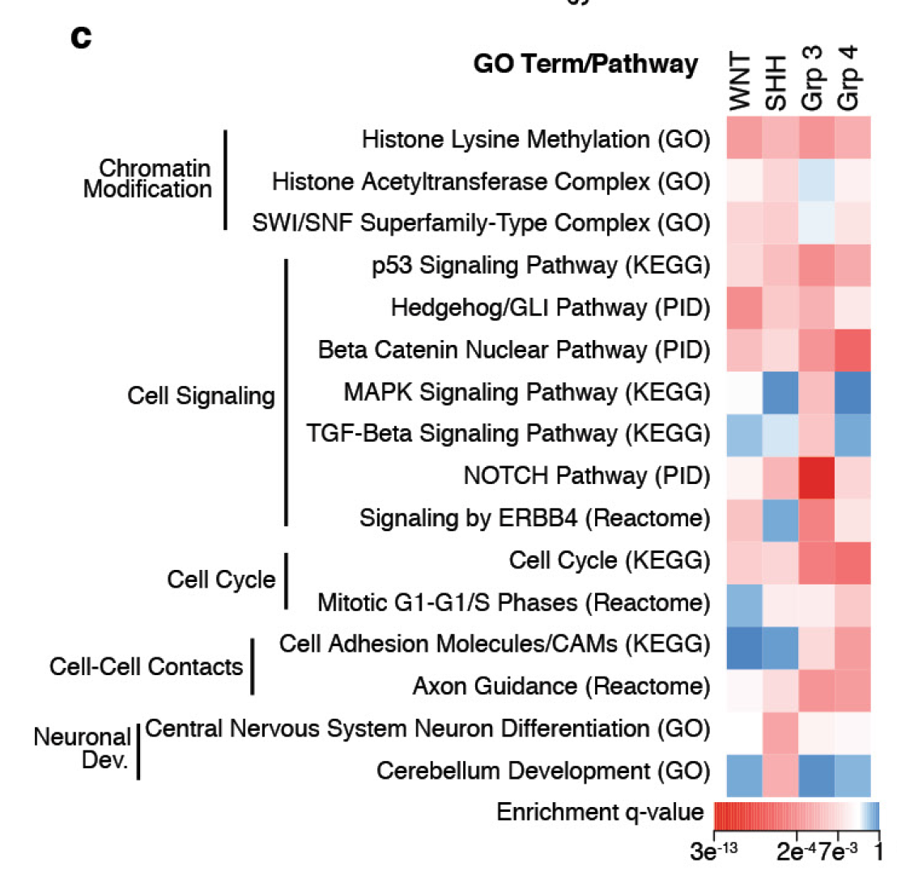

DAVID's kappa statistic quantifies how much two annotation terms **overlap in their gene members beyond chance**: a gene × term binary matrix is built from the annotation table, and Cohen's kappa is computed for every term pair from the 2×2 contingency (both / only-term1 / only-term2 / neither) over all N genes \[1\]. Clustering the kappa matrix groups redundant GO terms so a single representative can be picked per cluster \[1\]. The DAVID web tool is not needed — the kappa computation and the clustered heatmap run in-page on a simulated annotation table:

## Example

{fig-alt="DAVID Kappa Matrix of Annotation Overlap DEMO" fig-align="center" width="70%"}

## Setup

-   System Requirements: Cross-platform (Linux/MacOS/Windows)

-   Programming language: R

-   Dependent packages: `pheatmap`; `ggplot2`

```{r packages setup, message=FALSE, warning=FALSE, output=FALSE}
suppressPackageStartupMessages({
  library(pheatmap)
})
```

```{r}
sessioninfo::session_info("attached")
```

## Data Preparation

An annotation table (term, gene) with 8 GO-style terms over 120 genes. Planted redundancy — two term pairs are near-duplicates (same gene set with small perturbations), one pair overlaps weakly, the rest are independent:

```{r load data}
suppressPackageStartupMessages({library(pheatmap); library(ggplot2)})
set.seed(52339)
genes <- sprintf("GENE%03d", seq_len(120))
terms <- c("mitotic cell cycle", "cell cycle phase transition",
           "chromosome segregation", "DNA replication",
           "innate immune response", "cytokine signalling",
           "oxidation-reduction", "lipid metabolic process")

sets <- list(
  `mitotic cell cycle` = sample(genes, 30),
  `cell cycle phase transition` = NULL,
  `chromosome segregation` = sample(genes, 25),
  `DNA replication` = sample(genes, 22),
  `innate immune response` = sample(genes, 28),
  `cytokine signalling` = NULL,
  `oxidation-reduction` = sample(genes, 32),
  `lipid metabolic process` = sample(genes, 20))
sets[[2]] <- c(sample(sets[[1]], 26), sample(genes, 4))    # near-duplicate of term 1
sets[[6]] <- c(sample(sets[[5]], 24), sample(genes, 5))    # near-duplicate of term 5
sets[[8]] <- c(sample(sets[[7]], 3), sample(genes, 17))    # weakly overlapping

D <- do.call(rbind, lapply(seq_along(terms), function(k) {
  data.frame(term = terms[k], gene = sets[[k]], stringsAsFactors = FALSE)
}))
D <- D[order(D$gene), ]
```

## Computation and Visualization

### 1. Kappa Matrix Between Annotation Terms

The DAVID kappa for every term pair, drawn as a clustered heatmap — the two near-duplicate pairs light up at kappa ≈ 0.85 while independent terms sit near 0:

```{r}
#| label: fig-1.1KappaHeatmap
#| fig-cap: "Cohen's kappa between annotation terms over the N = 89 annotated genes (clustered heatmap, values printed): the two planted near-duplicate pairs (mitotic cell cycle / cell cycle phase transition, innate immune response / cytokine signalling) reach kappa 0.77-0.82, while unrelated pairs stay below 0.2 — the redundancy DAVID's kappa is designed to expose."
#| out.width: "95%"
#| fig-width: 8.5
#| fig-height: 6.5

## gene x term binary matrix
M <- length(terms)
N <- length(unique(D$gene))
u_genes <- unique(D$gene)
G <- matrix(0, M, N, dimnames = list(terms, u_genes))
for (k in seq_len(M)) G[k, ] <- as.numeric(u_genes %in% sets[[k]])

## Cohen's kappa per term pair (2x2: both / only-i / only-j / neither)
kappa_pair <- function(gi, gj) {
  a <- sum(gi == 1 & gj == 1)
  b <- sum(gi == 1 & gj == 0)
  c <- sum(gi == 0 & gj == 1)
  d <- sum(gi == 0 & gj == 0)
  po <- (a + d) / N
  pe <- ((a + b) * (a + c) + (c + d) * (b + d)) / N^2
  (po - pe) / (1 - pe)
}
K <- matrix(0, M, M, dimnames = list(terms, terms))
for (i in seq_len(M)) for (j in seq_len(M)) {
  if (i != j) K[i, j] <- round(kappa_pair(G[i, ], G[j, ]), 2)
}

pheatmap(K,
         color = colorRampPalette(c("#2166AC", "white", "#B2182B"))(64),
         cluster_rows = TRUE, cluster_cols = TRUE,
         display_numbers = TRUE, number_format = "%.2f",
         number_color = "grey15",
         fontsize = 8.5, fontsize_number = 7.5,
         border_color = "white",
         legend = TRUE,
         main = "Kappa statistic between annotation terms")
```

### 2. Term Sizes and Overlap Counts

The companion bar plot: how many genes each term annotates, with the pairwise overlap counts of the nearest neighbour annotated on top — context for the kappa values:

```{r}
#| label: fig-2.1KappaSizes
#| fig-cap: "Gene counts per annotation term (bars) with the kappa of each term's nearest neighbour printed above: near-duplicate pairs carry kappa 0.77-0.82 while the lipid/oxidation-reduction pair's weak overlap shows as kappa ≈ 0.2 — pick one representative per high-kappa cluster before enrichment reporting."
#| out.width: "85%"
#| fig-width: 8.5
#| fig-height: 4.8

size_df <- data.frame(term = factor(terms, levels = terms[order(-sapply(sets, length))]),
                      n = sapply(sets, length))
nn_kappa <- sapply(seq_len(M), function(i) {
  k <- K[i, ][-i]
  max(k)
})
size_df$nn <- nn_kappa[match(as.character(size_df$term), terms)]

ggplot(size_df, aes(term, n)) +
  geom_col(fill = "#4472C4", width = 0.65) +
  geom_text(aes(label = sprintf("kappa(nn) = %.2f", nn)),
            angle = 90, hjust = -0.08, size = 2.7, colour = "grey25") +
  scale_y_continuous(expand = expansion(mult = c(0, 0.34))) +
  labs(x = NULL, y = "Genes annotated") +
  theme_bw(base_size = 11) +
  theme(axis.text.x = element_text(angle = 30, hjust = 1, size = 8.5),
        panel.grid.minor = element_blank())
```

::: callout-tip
**Practice tips**
-   Kappa corrects for **chance overlap** — two large terms sharing many genes by accident still score low, which is exactly why DAVID uses it instead of raw overlap counts.
-   Interpretation bands (Fleiss): kappa < 0.4 independent, 0.4-0.75 moderate, > 0.75 near-duplicate — collapse terms above 0.75 into one representative before reporting enrichment.
-   Build the gene × term matrix from the **union of genes** across all terms (the "neither" cell needs the true background N); computing kappa per-term-pair on subsets inflates it.
-   Sort the heatmap by clustering, not alphabetically — the redundant clusters should visually co-locate, which is the figure's point.
-   The same pipeline works for any annotation source (GO, KEGG, MSigDB sets) — only the (term, gene) table changes.
:::

## Application

::: {#fig-DavidKappaApplications1}
{fig-alt="DAVID Kappa Matrix of Annotation Overlap" fig-align="center" width="70%"}

DAVID kappa matrix of annotation overlap
:::

Kappa matrices apply to any enrichment result: GO/KEGG term de-redundancy, MSigDB set selection, or ChIP motif-category overlap before reporting.

## Reference

\[1\] Xiaofan Lu, et al. FigureYa: A Standardized Visualization Framework for Enhancing Biomedical Data Interpretation and Research Efficiency. iMetaMed. 2025. doi:10.1002/imm3.70005
