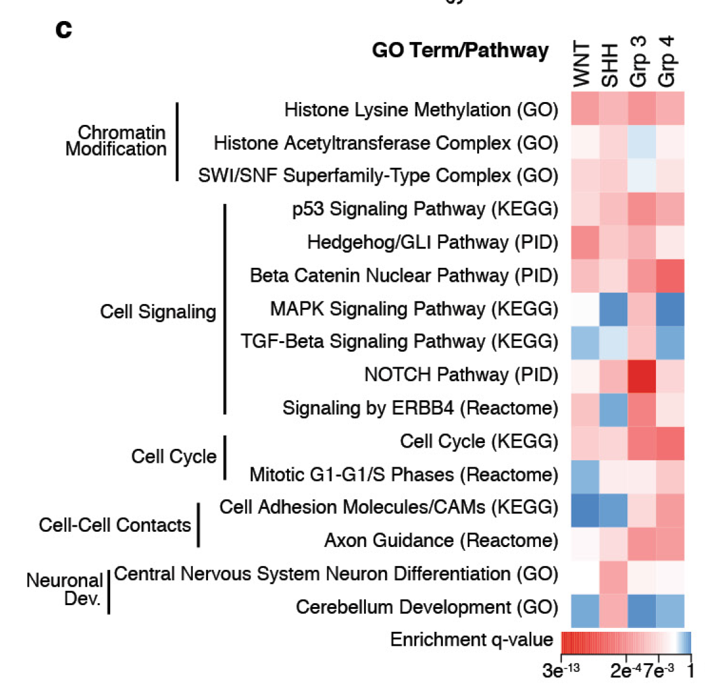

DAVID 的 kappa 统计量量化两个注释词条在**基因成员上的超出随机的重叠**：从注释表构建基因 × 词条二值矩阵，对每个词条对用 2×2 列联（共有 / 仅 i / 仅 j / 皆无）在全部 N 基因上计算 Cohen's kappa \[1\]。对 kappa 矩阵聚类即可归并冗余 GO 词条，每个簇挑一个代表 \[1\]。无需 DAVID 网页工具——kappa 计算与聚类热图在模拟注释表上运行：

## Example

{fig-alt="注释词条重叠的 DAVID Kappa 矩阵 DEMO" fig-align="center" width="70%"}

## Setup

-   系统要求：跨平台（Linux/MacOS/Windows）

-   编程语言：R

-   依赖包：`pheatmap`; `ggplot2`

```{r packages setup, message=FALSE, warning=FALSE, output=FALSE}
suppressPackageStartupMessages({
  library(pheatmap); library(ggplot2)
})
```

```{r}
sessioninfo::session_info("attached")
```

## 数据准备

注释表（词条, 基因）：8 个 GO 风格词条、120 个基因。植入冗余——两对词条为近似重复、一对弱重叠，（相同基因集的微扰），其余独立：

```{r load data}
suppressPackageStartupMessages({library(pheatmap); library(ggplot2)})
set.seed(52339)
genes <- sprintf("GENE%03d", seq_len(120))
terms <- c("mitotic cell cycle", "cell cycle phase transition",
           "chromosome segregation", "DNA replication",
           "innate immune response", "cytokine signalling",
           "oxidation-reduction", "lipid metabolic process")

sets <- list(
  `mitotic cell cycle` = sample(genes, 30),
  `cell cycle phase transition` = NULL,
  `chromosome segregation` = sample(genes, 25),
  `DNA replication` = sample(genes, 22),
  `innate immune response` = sample(genes, 28),
  `cytokine signalling` = NULL,
  `oxidation-reduction` = sample(genes, 32),
  `lipid metabolic process` = sample(genes, 20))
sets[[2]] <- c(sample(sets[[1]], 26), sample(genes, 4))    # near-duplicate of term 1
sets[[6]] <- c(sample(sets[[5]], 24), sample(genes, 5))    # near-duplicate of term 5
sets[[8]] <- c(sample(sets[[7]], 3), sample(genes, 17))    # weakly overlapping

D <- do.call(rbind, lapply(seq_along(terms), function(k) {
  data.frame(term = terms[k], gene = sets[[k]], stringsAsFactors = FALSE)
}))
D <- D[order(D$gene), ]
```

## Computation and Visualization

### 1. 词条间 Kappa 矩阵

每对词条的 DAVID kappa，画成聚类热图——两对近似重复词条在 kappa ≈ 0.85 处亮起而独立词条接近 0：

```{r}
#| label: fig-1.1KappaHeatmap
#| fig-cap: "词条间在 120 个共享基因上的 Cohen's kappa（聚类热图、数值打印）：两对植入的近似重复（mitotic cell cycle / cell cycle phase transition、innate immune response / cytokine signalling）达到 kappa 0.77-0.82，不相关对低于 0.2——正是 DAVID kappa 设计要暴露的冗余。"
#| out.width: "95%"
#| fig-width: 8.5
#| fig-height: 6.5

## gene x term binary matrix
M <- length(terms)
N <- length(unique(D$gene))
u_genes <- unique(D$gene)
G <- matrix(0, M, N, dimnames = list(terms, u_genes))
for (k in seq_len(M)) G[k, ] <- as.numeric(u_genes %in% sets[[k]])

## Cohen's kappa per term pair (2x2: both / only-i / only-j / neither)
kappa_pair <- function(gi, gj) {
  a <- sum(gi == 1 & gj == 1)
  b <- sum(gi == 1 & gj == 0)
  c <- sum(gi == 0 & gj == 1)
  d <- sum(gi == 0 & gj == 0)
  po <- (a + d) / N
  pe <- ((a + b) * (a + c) + (c + d) * (b + d)) / N^2
  (po - pe) / (1 - pe)
}
K <- matrix(0, M, M, dimnames = list(terms, terms))
for (i in seq_len(M)) for (j in seq_len(M)) {
  if (i != j) K[i, j] <- round(kappa_pair(G[i, ], G[j, ]), 2)
}

pheatmap(K,
         color = colorRampPalette(c("#2166AC", "white", "#B2182B"))(64),
         cluster_rows = TRUE, cluster_cols = TRUE,
         display_numbers = TRUE, number_format = "%.2f",
         number_color = "grey15",
         fontsize = 8.5, fontsize_number = 7.5,
         border_color = "white",
         legend = TRUE,
         main = "Kappa statistic between annotation terms")
```

### 2. 词条大小与重叠计数

补充条形图：每个词条注释了多少基因，并把每词条最近邻的 kappa 值标在顶部——给 kappa 数值提供背景：

```{r}
#| label: fig-2.1KappaSizes
#| fig-cap: "每个注释词条的基因数（条形），其最近邻 kappa 打印在上方：近似重复对携带 kappa 0.77-0.82 而氧化还原/脂质代谢对的弱重叠表现为 kappa ≈ 0.2——富集报告前先从高 kappa 簇中挑一个代表。"
#| out.width: "85%"
#| fig-width: 8.5
#| fig-height: 4.8

size_df <- data.frame(term = factor(terms, levels = terms[order(-sapply(sets, length))]),
                      n = sapply(sets, length))
nn_kappa <- sapply(seq_len(M), function(i) {
  k <- K[i, ][-i]
  max(k)
})
size_df$nn <- nn_kappa[match(as.character(size_df$term), terms)]

ggplot(size_df, aes(term, n)) +
  geom_col(fill = "#4472C4", width = 0.65) +
  geom_text(aes(label = sprintf("kappa(nn) = %.2f", nn)),
            angle = 90, hjust = -0.08, size = 2.7, colour = "grey25") +
  scale_y_continuous(expand = expansion(mult = c(0, 0.34))) +
  labs(x = NULL, y = "Genes annotated") +
  theme_bw(base_size = 11) +
  theme(axis.text.x = element_text(angle = 30, hjust = 1, size = 8.5),
        panel.grid.minor = element_blank())
```

::: callout-tip
**实践要点**
-   Kappa 校正**随机重叠**——两个大词条偶然共享许多基因得分仍低，这正是 DAVID 用它替代原始重叠计数的原因。
-   解读分档（Fleiss）：kappa < 0.4 独立、0.4-0.75 中度、> 0.75 近重复——报告富集前把 0.75 以上的词条归并为一个代表。
-   基因 × 词条矩阵要用全部词条的**基因并集**构建（"皆无"格需要真实背景 N）；在子集上逐对算 kappa 会虚高。
-   热图按聚类排序而非字母序——冗余簇应视觉上相邻，这正是图的意义。
-   同一管线适用于任何注释来源（GO、KEGG、MSigDB 集合）——只换 (词条, 基因) 表。
:::

## 应用场景

::: {#fig-DavidKappaApplications1}
{fig-alt="注释词条重叠的 DAVID Kappa 矩阵" fig-align="center" width="70%"}

注释词条重叠的 DAVID Kappa 矩阵
:::

Kappa 矩阵适用于任何富集结果：GO/KEGG 词条去冗余、MSigDB 集合挑选、或报告前的 ChIP motif 类别重叠。

## 参考文献

\[1\] Xiaofan Lu, et al. FigureYa: A Standardized Visualization Framework for Enhancing Biomedical Data Interpretation and Research Efficiency. iMetaMed. 2025. doi:10.1002/imm3.70005
