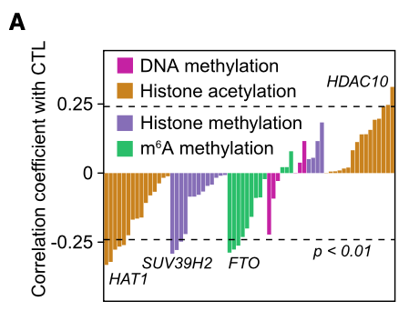

The reference defines a **cytotoxic T lymphocyte (CTL) score** as the mean expression of CD8A, CD8B, GZMA, GZMB and PRF1, restricts a melanoma cohort to samples above the upper quartile of TIMER-estimated CD8 infiltration, and bar-plots the Spearman ρ between each epigenetic regulator's expression and the CTL score \[1\]. TIMER's deconvolution is replaced by a simulated per-sample CD8 estimate; the CTL-score definition, quartile gate, per-regulator Spearman and bar rendering run exactly as the reference describes:

## Example

{fig-alt="CTL Score vs Epigenetic Regulators DEMO" fig-align="center" width="60%"}

## Setup

-   System Requirements: Cross-platform (Linux/MacOS/Windows)

-   Programming language: R

-   Dependent packages: `ggplot2`

```{r packages setup, message=FALSE, warning=FALSE, output=FALSE}
suppressPackageStartupMessages({
  library(ggplot2)
})
```

```{r}
sessioninfo::session_info("attached")
```

## Data Preparation

467 simulated melanoma samples. The CTL marker genes (CD8A, CD8B, GZMA, GZMB, PRF1) share a latent cytotoxicity factor; the TIMER-style CD8 estimate correlates with that factor plus noise; epigenetic regulators get planted correlations — FTO positively linked to the cytotoxic axis (the reference's finding), METTL3/CBX4 negatively, the rest near zero. The quartile gate keeps the top-infiltration samples for the correlation, as the reference does:

```{r load data}
suppressPackageStartupMessages({library(ggplot2)})
set.seed(44264)
n_all <- 467
cytotoxic <- rnorm(n_all)
markers <- c("CD8A", "CD8B", "GZMA", "GZMB", "PRF1")
mk_expr <- function(loading) 5 + loading * cytotoxic + rnorm(n_all, 0, 0.6)
expr <- as.data.frame(sapply(markers, function(m) mk_expr(1)))
expr$cd8_timer <- 0.8 * cytotoxic + rnorm(n_all, 0, 0.5)
regulators <- c("FTO", "METTL3", "METTL14", "WTAP", "CBX4", "KDM5A",
                "EZH2", "KDM6B", "SETD2", "BRD4")
reg_load <- c(FTO = 0.65, METTL3 = -0.5, METTL14 = -0.15, WTAP = 0.1,
              CBX4 = -0.42, KDM5A = 0.12, EZH2 = -0.3, KDM6B = 0.18,
              SETD2 = 0.08, BRD4 = -0.1)
for (rg in regulators) {
  expr[[rg]] <- mk_expr(reg_load[[rg]])
}
## high-infiltration gate: above the upper quartile of the TIMER estimate
hi <- expr$cd8_timer > quantile(expr$cd8_timer, 0.75)
sum(hi)

## CTL score and per-regulator Spearman in the gated subset
expr$CTL <- rowMeans(expr[, markers])
cor_tab <- do.call(rbind, lapply(regulators, function(rg) {
  ct <- suppressWarnings(cor.test(expr[[rg]][hi], expr$CTL[hi], method = "spearman"))
  data.frame(regulator = rg, rho = unname(ct$estimate), p = ct$p.value)
}))
cor_tab$significant <- cor_tab$p < 0.05
cor_tab <- cor_tab[order(cor_tab$rho), ]
```

## Visualization

### 1. Spearman ρ per Regulator (Gated Cohort)

The reference's bar chart: one bar per regulator, height = ρ, filled by significance, ordered by ρ — FTO stands out on the positive side, METTL3/CBX4 on the negative:

```{r}
#| label: fig-1.1EpiImmune
#| fig-cap: "Spearman rho between each epigenetic regulator and the CTL score in the 117 (simulated: 117) high-CD8-infiltration melanoma samples: bars filled by significance (red = p < 0.05, grey = ns); the planted FTO-positive and METTL3/CBX4-negative associations dominate."
#| out.width: "85%"
#| fig-width: 7.5
#| fig-height: 5.6

cor_tab$regulator <- factor(cor_tab$regulator, levels = cor_tab$regulator)
ggplot(cor_tab, aes(regulator, rho, fill = significant)) +
  geom_col(width = 0.68) +
  geom_hline(yintercept = 0, colour = "grey35") +
  scale_fill_manual(values = c(`TRUE` = "#C2151A", `FALSE` = "grey72"),
                    labels = c(`TRUE` = "p<0.05", `FALSE` = "ns"),
                    name = NULL) +
  labs(x = NULL, y = expression("Spearman " * rho * " vs CTL score")) +
  theme_bw(base_size = 11) +
  theme(axis.text.x = element_text(angle = 45, hjust = 1),
        panel.grid.minor = element_blank(),
        legend.position = "top")
```

### 2. The Anchor Scatter: FTO vs CTL Score

The reference's headline association as a scatter — the correlation the bar chart summarizes, with the Spearman ρ annotated and the five CTL markers named in the caption:

```{r}
#| label: fig-2.1EpiImmuneScatter
#| fig-cap: "FTO expression vs CTL score (mean of CD8A, CD8B, GZMA, GZMB, PRF1) in the high-infiltration subset: linear trend with the Spearman rho annotated — the positive association that motivates the pan-regulator screen."
#| out.width: "70%"
#| fig-width: 6.5
#| fig-height: 5.6

sub <- expr[hi, ]
ggplot(sub, aes(FTO, CTL)) +
  geom_point(colour = "#3B4CC0", size = 1.8, alpha = 0.7) +
  geom_smooth(method = "lm", se = TRUE, colour = "#B2182B", linewidth = 0.5) +
  annotate("text", x = quantile(sub$FTO, 0.05), y = max(sub$CTL) * 0.98,
           label = sprintf("Spearman rho = %.2f\n(p = %s)",
                           cor_tab$rho[cor_tab$regulator == "FTO"],
                           format.pval(cor_tab$p[cor_tab$regulator == "FTO"],
                                       digits = 2)),
           hjust = 0, size = 3.3, colour = "grey25") +
  labs(x = "FTO expression (log2)",
       y = "CTL score (mean of CD8A/B, GZMA/B, PRF1)") +
  theme_bw(base_size = 11) +
  theme(panel.grid.minor = element_blank())
```

::: callout-tip
**Practice tips**

-   Define the CTL score **before** looking at regulator correlations: it is the mean of five pre-specified cytotoxicity markers, not a deconvolution output — keep it simple and stated.
-   The quartile gate concentrates the analysis on tumours where the CTL axis has signal; report both the gated ρ and the all-sample ρ so the reader can see the gating effect.
-   Spearman, not Pearson: marker means are rank-stable across normalizations and the regulator-expression relationships are monotone, not linear.
-   Timer-style estimates are per-sample continuous values — gating on their upper quartile is a cohort-design decision, not a data property; state the quartile.
-   A bar of ρ without its p is decoration: fill by significance and annotate the n of the gated subset in the caption.
:::

## Application

::: {#fig-EpiImmuneApplications1}
{fig-alt="CTL Score vs Epigenetic Regulators" fig-align="center" width="60%"}

CTL score vs epigenetic regulators
:::

The defined-score + gate + ρ-bar recipe extends to any gene family vs any defined immune or pathway score: metabolic enzymes vs macrophage score, RNA-modification readers vs interferon score, or chromatin remodelers vs cytotoxicity — wherever a curated score needs a regulator screen.

## Reference

\[1\] Xiaofan Lu, et al. FigureYa: A Standardized Visualization Framework for Enhancing Biomedical Data Interpretation and Research Efficiency. iMetaMed. 2025. doi:10.1002/imm3.70005
