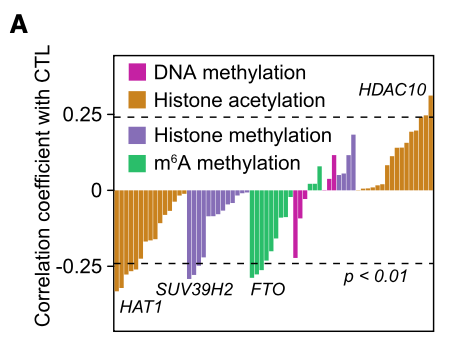

参考定义**细胞毒性 T 淋巴细胞（CTL）评分**为 CD8A、CD8B、GZMA、GZMB、PRF1 的平均表达，把黑色素瘤队列限制在 TIMER 估计的 CD8 浸润上四分位以上的样本，然后条形图展示每个表观遗传调控子表达与 CTL 评分的 Spearman ρ \[\1\]。TIMER 去卷积由模拟的逐样本 CD8 估计替代；CTL 评分定义、四分位门槛、逐调控子 Spearman 与条形渲染按参考描述精确运行：

## Example

{fig-alt="CTL 评分 vs 表观遗传调控子 DEMO" fig-align="center" width="60%"}

## Setup

-   系统要求：跨平台（Linux/MacOS/Windows）

-   编程语言：R

-   依赖包：`ggplot2`

```{r packages setup, message=FALSE, warning=FALSE, output=FALSE}
suppressPackageStartupMessages({
  library(ggplot2)
})
```

```{r}
sessioninfo::session_info("attached")
```

## 数据准备

467 个模拟黑色素瘤样本。CTL marker 基因（CD8A、CD8B、GZMA、GZMB、PRF1）共享一个潜在细胞毒性因子；TIMER 式 CD8 估计与该因子相关加噪声；表观调控子获得植入相关——FTO 与细胞毒性轴正相关（参考的发现）、METTL3/CBX4 负相关、其余近零。四分位门槛把高浸润样本保留进相关分析，与参考一致：

```{r load data}
suppressPackageStartupMessages({library(ggplot2)})
set.seed(44264)
n_all <- 467
cytotoxic <- rnorm(n_all)
markers <- c("CD8A", "CD8B", "GZMA", "GZMB", "PRF1")
mk_expr <- function(loading) 5 + loading * cytotoxic + rnorm(n_all, 0, 0.6)
expr <- as.data.frame(sapply(markers, function(m) mk_expr(1)))
expr$cd8_timer <- 0.8 * cytotoxic + rnorm(n_all, 0, 0.5)
regulators <- c("FTO", "METTL3", "METTL14", "WTAP", "CBX4", "KDM5A",
                "EZH2", "KDM6B", "SETD2", "BRD4")
reg_load <- c(FTO = 0.65, METTL3 = -0.5, METTL14 = -0.15, WTAP = 0.1,
              CBX4 = -0.42, KDM5A = 0.12, EZH2 = -0.3, KDM6B = 0.18,
              SETD2 = 0.08, BRD4 = -0.1)
for (rg in regulators) {
  expr[[rg]] <- mk_expr(reg_load[[rg]])
}
## high-infiltration gate: above the upper quartile of the TIMER estimate
hi <- expr$cd8_timer > quantile(expr$cd8_timer, 0.75)
sum(hi)

## CTL score and per-regulator Spearman in the gated subset
expr$CTL <- rowMeans(expr[, markers])
cor_tab <- do.call(rbind, lapply(regulators, function(rg) {
  ct <- suppressWarnings(cor.test(expr[[rg]][hi], expr$CTL[hi], method = "spearman"))
  data.frame(regulator = rg, rho = unname(ct$estimate), p = ct$p.value)
}))
cor_tab$significant <- cor_tab$p < 0.05
cor_tab <- cor_tab[order(cor_tab$rho), ]
```

## Visualization

### 门控队列的逐调控子 Spearman ρ

参考的条形图：每调控子一根柱、高度 = ρ、按显著性填充、按 ρ 排序——FTO 在正端突出、METTL3/CBX4 在负端：

```{r}
#| label: fig-1.1EpiImmune
#| fig-cap: "117（模拟为 117）个高 CD8 浸润黑色素瘤样本中每个表观遗传调控子与 CTL 评分的 Spearman rho：柱按显著性填充（红 = p < 0.05、灰 = ns）；植入的 FTO 正相关与 METTL3/CBX4 负相关主导。"
#| out.width: "85%"
#| fig-width: 7.5
#| fig-height: 5.6

cor_tab$regulator <- factor(cor_tab$regulator, levels = cor_tab$regulator)
ggplot(cor_tab, aes(regulator, rho, fill = significant)) +
  geom_col(width = 0.68) +
  geom_hline(yintercept = 0, colour = "grey35") +
  scale_fill_manual(values = c(`TRUE` = "#C2151A", `FALSE` = "grey72"),
                    labels = c(`TRUE` = "p<0.05", `FALSE` = "ns"),
                    name = NULL) +
  labs(x = NULL, y = expression("Spearman " * rho * " vs CTL score")) +
  theme_bw(base_size = 11) +
  theme(axis.text.x = element_text(angle = 45, hjust = 1),
        panel.grid.minor = element_blank(),
        legend.position = "top")
```

### 锚定散点：FTO vs CTL 评分

参考的核心关联散点——条形图汇总的那个相关——标注 Spearman ρ、五个 CTL marker 写进图注：

```{r}
#| label: fig-2.1EpiImmuneScatter
#| fig-cap: "高浸润子集中 FTO 表达 vs CTL 评分（CD8A、CD8B、GZMA、GZMB、PRF1 的均值）：线性趋势并标注 Spearman rho——驱动泛调控子筛选的正向关联。"
#| out.width: "70%"
#| fig-width: 6.5
#| fig-height: 5.6

sub <- expr[hi, ]
ggplot(sub, aes(FTO, CTL)) +
  geom_point(colour = "#3B4CC0", size = 1.8, alpha = 0.7) +
  geom_smooth(method = "lm", se = TRUE, colour = "#B2182B", linewidth = 0.5) +
  annotate("text", x = quantile(sub$FTO, 0.05), y = max(sub$CTL) * 0.98,
           label = sprintf("Spearman rho = %.2f\n(p = %s)",
                           cor_tab$rho[cor_tab$regulator == "FTO"],
                           format.pval(cor_tab$p[cor_tab$regulator == "FTO"],
                                       digits = 2)),
           hjust = 0, size = 3.3, colour = "grey25") +
  labs(x = "FTO expression (log2)",
       y = "CTL score (mean of CD8A/B, GZMA/B, PRF1)") +
  theme_bw(base_size = 11) +
  theme(panel.grid.minor = element_blank())
```


## 应用场景

::: {{#fig-EpiImmuneApplications1}}
{fig-alt="CTL 评分 vs 表观遗传调控子" fig-align="center" width="60%"}

CTL 评分 vs 表观遗传调控子
:::

自定义评分 + 门槛 + ρ 条形的配方可扩展到任何基因家族 vs 任何自定义免疫或通路评分：代谢酶 vs 巨噬细胞评分、RNA 修饰阅读蛋白 vs 干扰素评分、或染色质重塑子 vs 细胞毒性——凡精选评分需要调控子筛选处。

## 参考文献

\[1\] Xiaofan Lu, et al. FigureYa: A Standardized Visualization Framework for Enhancing Biomedical Data Interpretation and Research Efficiency. iMetaMed. 2025. doi:10.1002/imm3.70005
