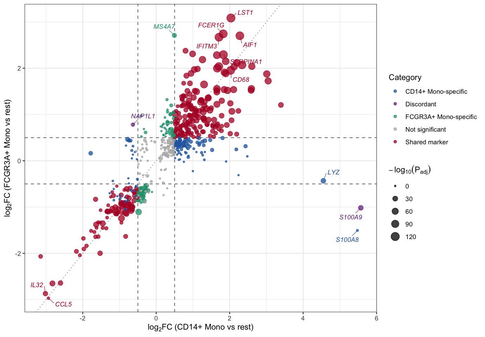

FC-FC 散点图（也称变异火山图）用于比较同一批特征在两个差异分析对比中的变化倍数：每个点代表一个基因（或蛋白、代谢物等），X 轴是它在对比 A 中的 log2 变化倍数，Y 轴是它在对比 B 中的 log2 变化倍数。与火山图（单一对比 × 显著性）不同，FC-FC 散点图把两个对比并排展示，便于识别**在两个对比中一致变化**（两轴同号）、**仅在一个对比中变化**（对比特异性）以及**方向相反（不一致）**的特征——这正是比较两个数据集、两个细胞群体、两个治疗臂或发现与验证队列时的典型问题。本教程复现《顶刊图社》系列（第018期）介绍的图表类型，见文末参考文献。

## 示例

{fig-alt="FcFcPlot DEMO" fig-align="center" width="70%"}

这个 FC-FC 散点图比较了两个单核细胞亚群的标记基因统计量：X 轴是每个基因在 CD14+ Mono 类群（相对其余全部细胞）中的平均 log2 变化倍数，Y 轴是它在 FCGR3A+ Mono 类群中的平均 log2 变化倍数。散点按显著性类别着色：在两个亚群中均显著共享的标记基因（红色）、亚群特异性标记基因（蓝/绿色）以及方向相反的不一致标记基因（紫色）；点的大小编码统计显著性。经典单核细胞标志物 `S100A8`/`S100A9` 位于 CD14+ 轴的最右端（`S100A9` 因在 FCGR3A+ 中的变化倍数显著为负，被归为*不一致*），`MS4A7` 向上偏离（FCGR3A+ Mono 特异），而沿对角线分布的一大群基因（`LST1`、`FCER1G`、`AIF1`、`CD68` 等）是共享的单核细胞标记基因。

## 环境配置

-   系统要求：跨平台（Linux/MacOS/Windows）

-   编程语言：R

-   依赖包：`scRNAtoolVis`；`tidyverse`；`ggrepel`

```{r packages setup, message=FALSE, warning=FALSE, output=FALSE}
# Installing necessary packages
if (!requireNamespace("scRNAtoolVis", quietly = TRUE)) {
  remotes::install_github("junjunlab/scRNAtoolVis")
}
if (!requireNamespace("tidyverse", quietly = TRUE)) {
  install.packages("tidyverse")
}
if (!requireNamespace("ggrepel", quietly = TRUE)) {
  install.packages("ggrepel")
}

# Load packages
library(scRNAtoolVis)
library(tidyverse)
library(ggrepel)
```

## 数据准备

示例使用 [scRNAtoolVis](https://github.com/junjunlab/scRNAtoolVis) 包内置的 `pbmc.markers` 数据集（PBMC 单细胞标记基因表：9 个细胞类群、5,921 行标记统计量）。每一行报告一个基因在某个类群中相对其余全部细胞的差异表达统计量（`avg_log2FC`、`p_val_adj`、`pct.1`、`pct.2` 等）。我们把两个单核细胞亚群——CD14+ Mono 与 FCGR3A+ Mono——的标记统计量按基因逐行连接，从而得到同一批特征的两个「对比」。

```{r load data, message=FALSE}
# Load the PBMC marker gene table
data("pbmc.markers")

# Marker statistics of the two monocyte subsets
cd14 <- pbmc.markers |>
  filter(cluster == "CD14+ Mono") |>
  select(gene, avg_log2FC, p_val_adj)

fcgr3a <- pbmc.markers |>
  filter(cluster == "FCGR3A+ Mono") |>
  select(gene, avg_log2FC, p_val_adj)

# Join by gene: 546 genes are markers in both subsets
fc_fc <- inner_join(cd14, fcgr3a, by = "gene", suffix = c("_cd14", "_fcgr3a"))

# Classify each gene and compute the plotting score
fc_cut <- 0.5
p_cut <- 0.05
fc_fc <- fc_fc |>
  mutate(
    sig_cd14 = p_val_adj_cd14 < p_cut & abs(avg_log2FC_cd14) >= fc_cut,
    sig_fcgr3a = p_val_adj_fcgr3a < p_cut & abs(avg_log2FC_fcgr3a) >= fc_cut,
    category = case_when(
      sig_cd14 & sig_fcgr3a & sign(avg_log2FC_cd14) == sign(avg_log2FC_fcgr3a) ~ "Shared marker",
      sig_cd14 & sig_fcgr3a ~ "Discordant",
      sig_cd14 ~ "CD14+ Mono-specific",
      sig_fcgr3a ~ "FCGR3A+ Mono-specific",
      TRUE ~ "Not significant"
    ),
    neglog10p = -log10(pmax(p_val_adj_cd14, p_val_adj_fcgr3a))
  )

# View data
head(fc_fc)
```

**注意：** 在你自己的数据中，输入就是两张差异分析结果表（例如 DESeq2、limma 或 edgeR 的差异结果），每张表至少包含特征名称和 log2 变化倍数两列；作图前按特征名称将两张表连接即可。

## 可视化

### 1. 基础绘图

基础版本把每个基因画成一个散点，用虚线标出变化倍数阈值、用点线画出参考对角线。位于对角线上的点在两个对比中变化幅度相同。

```{r}
#| label: fig-1.1BasicFcFc
#| fig-cap: "基础 FC-FC 散点图"
#| out.width: "95%"
#| warning: false
#| message: false
#| fig-width: 7.5
#| fig-height: 6

ggplot(fc_fc, aes(avg_log2FC_cd14, avg_log2FC_fcgr3a)) +
  geom_hline(yintercept = c(-fc_cut, fc_cut), linetype = "dashed", color = "grey50") +
  geom_vline(xintercept = c(-fc_cut, fc_cut), linetype = "dashed", color = "grey50") +
  geom_abline(slope = 1, intercept = 0, linetype = "dotted", color = "grey60") +
  geom_point(color = "#2166AC", size = 1.8, alpha = 0.7) +
  labs(x = expression(log[2]*FC~"(CD14+ Mono vs rest)"),
       y = expression(log[2]*FC~"(FCGR3A+ Mono vs rest)")) +
  theme_bw()
```

### 2. 按类别着色

按基因在哪个（些）对比中显著着色，散点图就变成了一张可读的决策图：共享标记、亚群特异标记与不一致标记各得一种颜色。

```{r}
#| label: fig-1.2CategoryFcFc
#| fig-cap: "按显著性类别着色"
#| out.width: "95%"
#| warning: false
#| message: false
#| fig-width: 8.2
#| fig-height: 6

category_colors <- c(
  "Shared marker" = "#B2182B",
  "Discordant" = "#7B3294",
  "CD14+ Mono-specific" = "#2166AC",
  "FCGR3A+ Mono-specific" = "#1B9E77",
  "Not significant" = "grey70"
)

ggplot(fc_fc, aes(avg_log2FC_cd14, avg_log2FC_fcgr3a)) +
  geom_hline(yintercept = c(-fc_cut, fc_cut), linetype = "dashed", color = "grey50") +
  geom_vline(xintercept = c(-fc_cut, fc_cut), linetype = "dashed", color = "grey50") +
  geom_point(aes(color = category), size = 2, alpha = 0.75) +
  scale_color_manual(values = category_colors) +
  labs(x = expression(log[2]*FC~"(CD14+ Mono vs rest)"),
       y = expression(log[2]*FC~"(FCGR3A+ Mono vs rest)"),
       color = "Category") +
  theme_bw()
```

::: callout-tip
**关键参数：**

- `fc_cut`：变化倍数阈值。取 `fc_cut = 0.5` 时，基因在某一轴的 |log2FC| ≥ 0.5 才算变化；可根据你的数据尺度调整。
- `p_cut`：判定显著性所用的校正 P 值阈值（此处为 0.05），用于在划分类别时把真实标记与噪声分开。
:::

### 3. 点大小与基因标注

用点大小编码统计显著性，并标注最值得关注的基因——两轴的极值基因、联合证据最强的共享标记，以及不一致基因——图形就完整了。

```{r}
#| label: fig-1.3LabelFcFc
#| fig-cap: "点大小编码显著性并标注基因的 FC-FC 散点图"
#| out.width: "95%"
#| warning: false
#| message: false
#| fig-width: 9.2
#| fig-height: 6.4

# Curated label set: discordant genes, extremes on both axes and top shared markers
label_genes <- bind_rows(
  fc_fc |> filter(category == "Discordant") |>
    slice_max(abs(avg_log2FC_cd14 - avg_log2FC_fcgr3a), n = 3),
  fc_fc |> slice_max(abs(avg_log2FC_cd14), n = 3),
  fc_fc |> slice_max(abs(avg_log2FC_fcgr3a), n = 3),
  fc_fc |> filter(gene == "MS4A7"),
  fc_fc |> filter(category == "Shared marker") |>
    slice_max(neglog10p + pmin(abs(avg_log2FC_cd14), abs(avg_log2FC_fcgr3a)), n = 6)
) |>
  distinct(gene, .keep_all = TRUE)

ggplot(fc_fc, aes(avg_log2FC_cd14, avg_log2FC_fcgr3a)) +
  geom_hline(yintercept = c(-fc_cut, fc_cut), linetype = "dashed", color = "grey50") +
  geom_vline(xintercept = c(-fc_cut, fc_cut), linetype = "dashed", color = "grey50") +
  geom_abline(slope = 1, intercept = 0, linetype = "dotted", color = "grey60") +
  geom_point(aes(color = category, size = neglog10p), alpha = 0.75) +
  scale_color_manual(values = category_colors) +
  scale_size_continuous(range = c(0.8, 5), name = expression(-log[10](P[adj]))) +
  geom_text_repel(data = label_genes, aes(label = gene, color = category),
                  size = 3.1, fontface = "italic", max.overlaps = 40,
                  box.padding = 0.55, segment.size = 0.25,
                  show.legend = FALSE, seed = 1) +
  labs(x = expression(log[2]*FC~"(CD14+ Mono vs rest)"),
       y = expression(log[2]*FC~"(FCGR3A+ Mono vs rest)"),
       color = "Category") +
  theme_bw()
```

图 3 标注了不一致基因 `S100A9` 与 `NAP1L1`、CD14+ 轴最右端的 `S100A8` 与 `LYZ`、FCGR3A+ Mono 特异的 `MS4A7`，以及沿对角线分布的共享标记基因区块（`LST1`、`FCER1G`、`IFITM3`、`CD68`、`AIF1` 等）；`CCL5` 与 `IL32` 位于两个亚群一致下调的角落。在两个数据集比较的场景中，同样的布局会突出在两个队列中一致变化的基因与队列特异命中。

## 应用场景

当需要逐特征地比较两个差异对比时，FC-FC 散点图被广泛使用：

-   同一实验中的两个细胞群体、组织或条件（如上方示例）。
-   发现队列与验证队列，或同一疾病的两个独立数据集——一致命中的基因位于对角线附近。
-   针对同一对照的两个治疗臂——象限分析可以把共享的响应程序与治疗臂特异性效应区分开。
-   跨组学比较，例如转录组与蛋白组变化倍数的对照。

要用到自己的数据上，分别对两个对比做差异分析，按特征名称连接两张结果表，然后复用上方代码即可；只需修改文件名与列名。

## 参考文献

\[1\] 顶刊图社 | 第018期：FC-FC散点图（变异火山图）. 微信公众号文章. <http://mp.weixin.qq.com/s?__biz=MzU5NjE2ODU0OQ==&mid=2247483956&idx=1&sn=627480882a5c4423980fdefeea18e225>

\[2\] Zhang J. scRNAtoolVis: Making single-cell RNA-seq visualization easier and better. <https://github.com/junjunlab/scRNAtoolVis>（`pbmc.markers` 数据集来源）。
