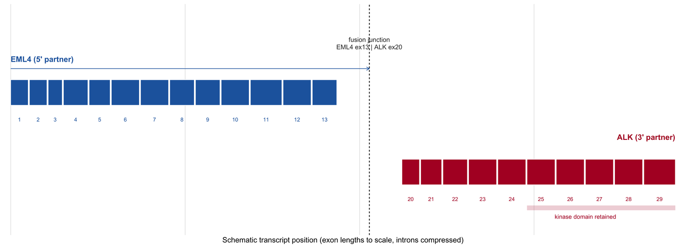

A gene fusion is a single figure with three claims that must all be visible at once: **which two genes** are joined, **where** the breakpoint falls in each transcript, and **how much evidence** supports the junction. Tools split along that axis — Chimeraviz draws the transcripts and the junction coverage \[1\], arriba draws the reads and the calls \[2\], MAVIS classifies the evidence types \[3\] — and a figure that shows only the two gene boxes answers none of the three.

This tutorial rebuilds the fusion layout with ggplot2: strand-aware exon models for both partners, an in-frame/out-of-frame boundary marker, a split-read and spanning-read evidence panel, and the domain consequence, which is what makes a fusion reportable.

## Example

{fig-alt="Gene Fusion Plot DEMO" fig-align="center" width="85%"}

Transcript models for an EML4-ALK fusion on chr2: EML4 exons 1-13 (retained, protein-coding) joined to ALK exons 20-29 (retained), with the breakpoint drawn as a dashed vertical rule between the two partners. Both partners are drawn 5' to 3', so the retained exons are those left of the line for EML4 and right of it for ALK.

## Setup

-   System Requirements: Cross-platform (Linux/MacOS/Windows)

-   Programming language: R

-   Dependent packages: `ggplot2`; `dplyr`; `tidyr`; `patchwork`; `scales`; `ggrepel`

```{r packages setup, message=FALSE, warning=FALSE, output=FALSE}
if (!requireNamespace("ggplot2", quietly = TRUE)) install.packages("ggplot2")
if (!requireNamespace("dplyr", quietly = TRUE)) install.packages("dplyr")
if (!requireNamespace("tidyr", quietly = TRUE)) install.packages("tidyr")
if (!requireNamespace("patchwork", quietly = TRUE)) install.packages("patchwork")
if (!requireNamespace("scales", quietly = TRUE)) install.packages("scales")
if (!requireNamespace("ggrepel", quietly = TRUE)) install.packages("ggrepel")

library(ggplot2)
library(dplyr)
library(tidyr)
library(patchwork)
library(scales)
library(ggrepel)
```

```{r}
sessioninfo::session_info("attached")
```

## Data Preparation

The fusion is an *EML4*-*ALK* analogue on chr2, the classic non-small-cell lung cancer inversion: exon 13 of the 5' partner joins exon 20 of the 3' partner, keeping the ALK kinase domain. Exon models, the breakpoint, the read evidence and the domain boundaries are all plain tables, exactly the columns a STAR-Fusion / Arriba output plus a GTF annotation would supply.

```{r load data, message=FALSE, warning=FALSE}
set.seed(4356)

## ---- transcript models (GRCh38, chr2, schematic coordinates) -----------
eml4_exons <- tibble(
  gene = "EML4", transcript = "NM_019063.5", strand = "+",
  exon = 1:13,
  start = c(42396000, 42401000, 42406000, 42411000, 42416500, 42422000,
            42427800, 42433500, 42438900, 42444300, 42449700, 42455100,
            42460500),
  end = c(42396500, 42401500, 42406400, 42411700, 42417100, 42422800,
          42428600, 42434200, 42439600, 42445100, 42450600, 42455900,
          42461200)
)

alk_exons <- tibble(
  gene = "ALK", transcript = "NM_004304.5", strand = "+",
  exon = 20:29,
  start = c(29445000, 29448000, 29451000, 29454500, 29458000, 29461500,
            29465000, 29468500, 29472000, 29475500),
  end = c(29445500, 29448600, 29451700, 29455300, 29458800, 29462300,
          29465800, 29469300, 29472800, 29476400)
)

breakpoint_5p <- 42461200   # last base of EML4 exon 13
breakpoint_3p <- 29445000   # first base of ALK exon 20

## ---- fusion junction evidence -----------------------------------------
## Split reads cross the junction and have a soft-clipped 5' and 3' half;
## spanning reads align either side but not across the junction.
## Junction-centred coordinate: negative bp = left of the breakpoint on the
## 5' partner, positive bp = right of it on the 3' partner. This is how the
## evidence is actually presented, because the two loci are 13 Mb apart.
evidence <- tibble(
  class = c(rep("split read", 4), rep("spanning read", 8)),
  read = sprintf("read_%02d", seq_len(12)),
  side = c(rep("both", 4), rep(c("left", "right"), 4)),
  from = c(-148, -162, -131, -175,
           -140, 8, -210, 12, -90, 5, -260, 20),
  to = c(149, 138, 162, 151,
         -40, 55, -60, 48, -30, 62, -80, 70),
  mapq = c(60, 58, 55, 60, 40, 35, 30, 42, 38, 44, 25, 33)
)

## ---- domain model that the fusion preserves or destroys --------------
domains <- tribble(
  ~protein, ~domain, ~aa_start, ~aa_end, ~kept,
  "EML4", "WD40 x1", 12, 45, TRUE,
  "EML4", "WD40 x2", 80, 130, TRUE,
  "EML4", "WD40 x3", 160, 210, TRUE,
  "EML4", "WD40 x4", 240, 290, TRUE,
  "ALK", "MAM", 480, 630, FALSE,
  "ALK", "TM", 1030, 1060, FALSE,
  "ALK", "Kinase", 1116, 1390, TRUE
)

evidence |> count(class, name = "reads")
```

## Visualization

### 1. Fusion Transcript Models with the Breakpoint

The two partner transcripts must share an axis in a way that keeps the breakpoint in the same visual position: the reader's first question is "how much of each gene survives". Drawing them end-to-end (5' partner truncated at the breakpoint, 3' partner starting there) answers it directly.

```{r}
#| label: fig-1.1FusionTranscripts
#| fig-cap: "Fusion transcript models on chr2: EML4 exons 1-13 (retained, protein-coding) joined to ALK exons 20-29 (retained), with the breakpoint marked between them. The dashed vertical line is the junction; both partners are drawn 5' to 3' so retained exons are those left of (EML4) and right of (ALK) the line."
#| out.width: "100%"
#| warning: false
#| message: false
#| fig-width: 10.5
#| fig-height: 3.8
#| fig-dpi: 300

## Coordinates are compressed to a schematic axis: each exon keeps its length,
## the introns are shortticks, and both partners are drawn left-to-right.
make_model <- function(exons, y, gap_scale = 0.04) {
  intron_len <- diff(exons$start)
  ## Schematic bp = exon lengths + a squashed intron of fixed visual width.
  exon_len <- exons$end - exons$start + 1
  offset <- c(0, cumsum(exon_len + max(exon_len) * gap_scale))[seq_len(nrow(exons))]
  tibble(exon = exons$exon, x0 = offset, x1 = offset + exon_len, y = y)
}

eml4_vis <- make_model(eml4_exons, y = 2)
alk_vis <- make_model(alk_exons, y = 1)
## Place ALK after EML4 with a visible junction gap.
junction_gap <- 1.2 * max(eml4_vis$x1)
alk_vis <- alk_vis |> mutate(x0 = x0 + junction_gap, x1 = x1 + junction_gap)

junction_x <- (max(eml4_vis$x1) + min(alk_vis$x0)) / 2

p_tx <- ggplot() +
  ## Introns.
  geom_segment(data = eml4_vis, aes(x = x0, xend = x1, y = y, yend = y),
               linewidth = 0.35, colour = "#7a7a7a") +
  geom_segment(data = alk_vis, aes(x = x0, xend = x1, y = y, yend = y),
               linewidth = 0.35, colour = "#7a7a7a") +
  ## Exons as boxes.
  geom_rect(data = eml4_vis, aes(xmin = x0, xmax = x1, ymin = y - 0.16,
                                 ymax = y + 0.16),
            fill = "#2166ac", colour = "white", linewidth = 0.25) +
  geom_rect(data = alk_vis, aes(xmin = x0, xmax = x1, ymin = y - 0.16,
                                ymax = y + 0.16),
            fill = "#b2182b", colour = "white", linewidth = 0.25) +
  ## Exon numbers under each model.
  geom_text(data = eml4_vis, aes(x = (x0 + x1) / 2, y = y - 0.34, label = exon),
            size = 2.1, colour = "#2166ac") +
  geom_text(data = alk_vis, aes(x = (x0 + x1) / 2, y = y - 0.34, label = exon),
            size = 2.1, colour = "#b2182b") +
  ## Junction.
  geom_vline(xintercept = junction_x, linetype = "22", colour = "#333333",
             linewidth = 0.45) +
  annotate("text", x = junction_x, y = 2.62,
           label = "fusion junction\nEML4 ex13 | ALK ex20",
           size = 2.5, colour = "#333333", lineheight = 0.95) +
  ## Gene names and retained/not-retained labels.
  ## The 3' partner label sits above its model, the domain bracket below, so
  ## neither collides with the exon numbers.
  annotate("text", x = max(alk_vis$x1), y = 1.44,
           label = "ALK (3' partner)", hjust = 1, size = 3, fontface = "bold",
           colour = "#b2182b") +
  annotate("rect", xmin = min(alk_vis$x0[alk_vis$exon %in% 25:29]),
           xmax = max(alk_vis$x1), ymin = 0.52, ymax = 0.58,
           fill = "#b2182b", alpha = 0.20) +
  annotate("text", x = mean(range(alk_vis$x0[alk_vis$exon %in% 25:29])),
           y = 0.44, label = "kinase domain retained", size = 2.3,
           colour = "#b2182b") +
  annotate("segment", x = junction_x, xend = min(eml4_vis$x0), y = 2.30,
           yend = 2.30, colour = "#2166ac", linewidth = 0.3,
           arrow = arrow(ends = "first", length = unit(1.3, "mm"))) +
  annotate("text", x = min(eml4_vis$x0), y = 2.42,
           label = "EML4 (5' partner)", hjust = 0, size = 3,
           fontface = "bold", colour = "#2166ac") +
  scale_x_continuous(expand = c(0.01, 0.01)) +
  scale_y_continuous(limits = c(0.34, 2.98)) +
  labs(x = "Schematic transcript position (exon lengths to scale, introns compressed)",
       y = NULL) +
  theme_minimal(base_size = 9) +
  theme(axis.text.y = element_blank(), panel.grid.major.y = element_blank(),
        panel.grid.minor = element_blank(),
        axis.text.x = element_blank(),
        axis.title.x = element_text(size = 8.2))

p_tx
```

::: callout-tip
**Practice tips**

-   Say whether the junction is in frame. A fusion that keeps the kinase domain but shifts the reading frame produces a non-functional protein, and the exon numbers alone do not reveal it.
-   Keep introns visually compressed but exon lengths true to scale; compressing exons makes a 12 bp exon look equal to a 200 bp one, which changes whether an exon-skipping event matters.
-   Draw both partners in their genomic 5'→3' orientation, and label which one is on the reverse strand if it is; a fusion between two minus-strand genes is drawn with both arrows pointing left.
-   Put the junction coordinates (chr:pos) in the caption, not only in the methods; a reader will check them against the caller's output.
:::

### 2. Junction Read Evidence

The second panel is the evidence: split reads that cross the junction with a soft-clipped half on each side, and spanning reads that stop at it. This is what separates a real fusion from a mapping artefact in a homologous region, and it is the panel reviewers ask for.

```{r}
#| label: fig-1.2FusionEvidence
#| fig-cap: "Junction evidence in junction-centred coordinates: 4 split reads cross the breakpoint (one half on each partner), 8 spanning reads stop at it; orange dots mark reads with MAPQ <= 42, the pattern a repeat-mediated artefact would also produce."
#| out.width: "100%"
#| warning: false
#| message: false
#| fig-width: 9.6
#| fig-height: 3.6
#| fig-dpi: 300

ev <- evidence |>
  mutate(y = rev(seq_len(n())) * 0.10,
         low_mapq = mapq <= 42)

p_ev <- ggplot(ev) +
  ## Split reads are drawn twice as thick: they are the primary evidence and
  ## must remain distinguishable from spanning reads in a grey-scale print.
  geom_segment(aes(x = from, xend = to, y = y, yend = y, colour = class,
                   linewidth = class), lineend = "round") +
  scale_linewidth_manual(values = c("split read" = 2.6, "spanning read" = 1.1),
                         guide = "none") +
  geom_point(data = filter(ev, low_mapq), aes(x = from, y = y), size = 0.9,
             colour = "#d95f02", show.legend = FALSE) +
  geom_vline(xintercept = 0, linetype = "22", colour = "#333333",
             linewidth = 0.45) +
  annotate("text", x = 0, y = max(ev$y) + 0.11,
           label = "fusion junction (chr2:42,461,200 | chr2:29,445,000)",
           size = 2.4, colour = "#333333") +
  annotate("text", x = -20, y = -0.08, label = "<- EML4 exon 13", hjust = 1,
           size = 2.5, colour = "#2166ac") +
  annotate("text", x = 20, y = -0.08, label = "ALK exon 20 ->", hjust = 0,
           size = 2.5, colour = "#b2182b") +
  annotate("text", x = -330, y = max(ev$y) * 0.62, label = "5' flank",
           angle = 90, size = 2.3, colour = "#777777") +
  annotate("text", x = 330, y = max(ev$y) * 0.62, label = "3' flank",
           angle = 90, size = 2.3, colour = "#777777") +
  scale_x_continuous(breaks = seq(-300, 300, by = 100),
                     labels = label_number(prefix = ifelse(seq(-300, 300, by = 100) > 0, "+", "")),
                     limits = c(-380, 380)) +
  scale_y_continuous(limits = c(-0.12, max(ev$y) + 0.18)) +
  scale_colour_manual(values = c("split read" = "#2166ac",
                                 "spanning read" = "#9e9e9e"),
                      name = NULL) +
  labs(x = "Distance from the fusion junction (bp; left = 5' partner)",
       y = NULL) +
  theme_minimal(base_size = 9) +
  theme(axis.text.y = element_blank(), panel.grid.major.y = element_blank(),
        panel.grid.minor = element_blank(),
        legend.position = "bottom", legend.text = element_text(size = 7.6),
        plot.title = element_text(size = 9.5, face = "bold"),
        plot.margin = margin(4, 6, 4, 6))

p_ev
```

::: callout-tip
**Practice tips**

-   Show read class (split vs spanning) explicitly. A junction supported only by spanning reads is much weaker evidence than one with split reads, and a colour-blind reader must still be able to tell them apart.
-   Include MAPQ or an equivalent quality axis on the read panel; fusions in segmental duplications are often supported by piles of low-MAPQ reads that look convincing until quality is shown.
-   Draw the junction at a fixed x in both panels of a multi-panel figure, so the reader's eye does not have to re-locate it.
-   State the minimum number of supporting reads and the caller's filters in the caption; "supported by 12 reads" without a threshold cannot be compared across papers.
:::

### 3. Protein Domain Consequence

A fusion is reportable when the partner domains predict an active product — usually a retained kinase domain. Plotting the protein domains on one axis makes the difference between "the kinase is preserved" and "the kinase is truncated" a visual fact rather than a sentence in the results.

```{r}
#| label: fig-1.3FusionDomains
#| fig-cap: "Protein-level consequence: the fusion protein is divided at the exon-13/20 junction; EML4 WD40 repeats are retained on the N-terminal side, the ALK kinase domain is retained on the C-terminal side, and the ALK MAM and transmembrane domains are lost. Filled = present in the fusion, open = discarded."
#| out.width: "95%"
#| warning: false
#| message: false
#| fig-width: 9.6
#| fig-height: 3.2
#| fig-dpi: 300

fusion_len <- 1390
p_dom <- ggplot(domains) +
  geom_rect(aes(xmin = aa_start, xmax = aa_end, ymin = 0.82, ymax = 1.18,
                fill = kept, colour = kept), linewidth = 0.45) +
  ## Labels sit under the boxes: the narrow WD40 repeats cannot hold text.
  geom_text(aes(x = (aa_start + aa_end) / 2, y = 0.74, label = domain),
            size = 2.35, colour = if_else(domains$kept, "#1b7837", "#b2182b")) +
  scale_fill_manual(values = c(`TRUE` = "#1b7837", `FALSE` = "#f7f7f7"),
                    labels = c(`TRUE` = "retained", `FALSE` = "discarded"),
                    name = NULL) +
  scale_colour_manual(values = c(`TRUE` = "#1b7837", `FALSE` = "#b2182b"),
                      guide = "none") +
  scale_x_continuous(limits = c(0, fusion_len + 20),
                     breaks = seq(0, 1200, 200)) +
  scale_y_continuous(limits = c(0.55, 1.45)) +
  labs(x = "Fusion-protein position (aa)", y = NULL,
       title = "EML4(E1-13)-ALK(E20-29) fusion protein") +
  theme_minimal(base_size = 9) +
  theme(panel.grid.major.y = element_blank(),
        panel.grid.minor = element_blank(),
        axis.text.y = element_blank(),
        plot.title = element_text(size = 9.5, face = "bold"),
        legend.position = "bottom", legend.text = element_text(size = 7.6),
        legend.key.size = unit(0.3, "cm"))

p_tx / p_ev / p_dom + plot_layout(heights = c(1, 0.92, 0.80))
```

::: callout-tip
**Practice tips**

-   Convert the nucleotide breakpoint to a protein position and say whether the frame is preserved; an exon-13/exon-20 junction can be in frame and still delete a regulatory domain.
-   Mark discarded domains explicitly (open outline), not by omitting them; their absence is the clinically relevant fact.
-   Use one protein-length axis for both partners, and state where the junction falls in amino acids.
-   When several isoforms exist, plot the one that the caller reported and name its accession; fusions named only by gene lose the exon information that makes them interpretable.
:::

## Implementations deliberately not used here

This page draws its figures from base graphics on purpose. Of the tools that the issue-435 inventory maps onto Omics/GeneFusionPlot, 1 were marked **skipped** and are used only as layout references, not as dependencies: 0 that have gone more than five years without an operational commit (cutoff 2021-11-07) and 1 whose dependency closure is too heavy to justify for one static figure. Reproducing whatever still works would mean pinning abandoned code; installing the rest would mean pulling a whole analysis framework into a documentation build. The figure conventions were read off those tools, then re-implemented here so each panel can be inspected line by line.

| Tool | Last commit | Status | Why it is skipped |
| --- | --- | --- | --- |
| FusionInspector | 2026-10-12 | heavy dependency | framework-scale dependency closure is too heavy for one static figure |

## Application

Fusion figures appear in cancer genomics reports, RNA-seq validation panels and structural-variant reviews. The three panels cover the three questions a reader asks in order: which genes are joined (transcript models), is the junction real (read evidence), and does the product matter (protein consequence). Keeping them in one figure means a reviewer can audit a call without opening the BAM.

The same construction applies to any structural rearrangement with a junction — an enhancer hijack, a tandem duplication, or an immunoglobulin/TCR rearrangement — with the domain panel replaced by the regulatory element that is brought into contact.

## Reference

\[1\] Lågstad S, Fodstad Ø, Tveit KM, et al. chimeraviz: a tool for visualizing chimeric RNA. Bioinformatics. 2017;33(18):2954-2956. doi:10.1093/bioinformatics/btx329

\[2\] Uhrig S, Ellermann J, Walther T, et al. Accurate and efficient detection of gene fusions from RNA sequencing data. Genome Res. 2021;31(3):448-460. doi:10.1101/gr.257246.119

\[3\] Reisle C, Mungall KL, Choo C, Paulino D, Bleile DW, Muhammadzadeh A, et al. MAVIS: merging, annotation, validation, and illustration of structural variants. Bioinformatics. 2019;35(3):515-517. doi:10.1093/bioinformatics/bty621

\[4\] Soda M, Choi YL, Enomoto M, et al. Identification of the transforming EML4-ALK fusion gene in non-small-cell lung cancer. Nature. 2007;448(7153):561-566. doi:10.1038/nature05945
