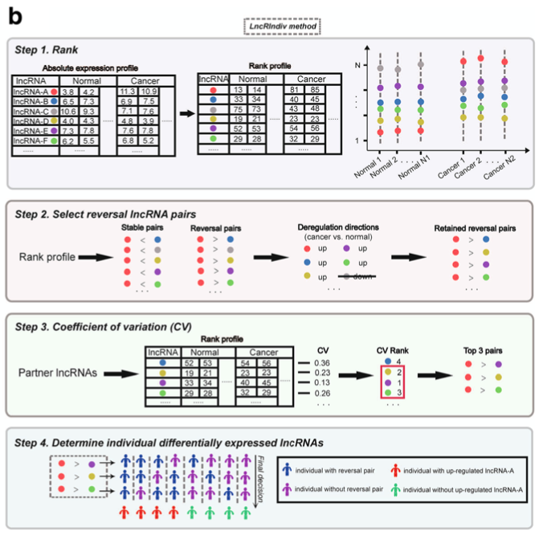

`LncRIndiv` 在**单个病人**层面判定失调 lncRNA——不是按组——利用的事实是基因对*秩次序*在正常组织内稳定、在癌组织中被打乱 \[1\]。管线：(1) 保留正常样本中秩方向一致率 ≥95% 的 lncRNA 对，(2) 用 2×2 Fisher 检验每个对在肿瘤中的反转，(3) 每个查询 lncRNA 保留 CV 最小（表达最稳）的前 3 个 partner，(4) 当某 lncRNA 秩超过**半数以上**稳定 partner 时判为失调。输出是二值的 病人 × lncRNA 热图 \[1\]。参考依赖 `matlab::ones()` 与 `EnvStats::cv()`；两者在 base R 中都是一行替代，整条管线免依赖运行、外加 pheatmap：

## Example

{fig-alt="LncRIndiv 基因对失调判定 DEMO" fig-align="center" width="60%"}

## Setup

-   系统要求：跨平台（Linux/MacOS/Windows）

-   编程语言：R

-   依赖包：`pheatmap`

```{r packages setup, message=FALSE, warning=FALSE, output=FALSE}
suppressPackageStartupMessages({
  library(pheatmap)
})
```

```{r}
sessioninfo::session_info("attached")
```

## 数据准备

80 个模拟 lncRNA × 50 样本（25 肿瘤 `T`、25 正常 `N`），带植入结构：多数对在正常样本保持固定秩次序，少数"驱动" lncRNA 在肿瘤中上调使其稳定对反转。参考的 GSE27262 式输入由该模拟替代：

```{r load data}
suppressPackageStartupMessages({library(pheatmap)})
set.seed(39233)
n_lnc <- 80; n_tum <- 25; n_nor <- 25
lncs <- sprintf("LNC%02d", 1:n_lnc)
sams <- c(paste0("T", 1:n_tum), paste0("N", 1:n_nor))
Sinfo <- data.frame(sample = sams,
                    Title = paste0(".../", sams, ifelse(grepl("^T", sams), "T", "N")))
Expr <- matrix(rnorm(n_lnc * (n_tum + n_nor), 5, 1), n_lnc, n_tum + n_nor,
               dimnames = list(lncs, sams))
## planted stable pairs: LNC01 < LNC02 < ... < LNC40 in normals
rank_shift <- matrix(0, n_lnc, n_tum + n_nor, dimnames = list(lncs, sams))
for (j in seq_len(40)) rank_shift[j, ] <- j * 0.08
Expr <- Expr + rank_shift
## tumour-only up-shift of drivers 1-6 -> their stable pairs reverse in tumours
drivers <- lncs[1:6]
Expr[1:6, 1:n_tum] <- Expr[1:6, 1:n_tum] + 3.2
## rank profile per sample
expr.rank <- apply(Expr, 2, rank)
tumsam <- Sinfo$sample[grepl("T$", Sinfo$Title)]
norsam <- Sinfo$sample[grepl("N$", Sinfo$Title)]
```

## Visualization

### 正常样本稳定对与肿瘤反转

步骤 1-2 合成一图：保留对在正常样本中的秩一致率（0.95 截断），以及方向表（正常 vs 肿瘤 × a<b vs a>b）的 2×2 Fisher 检验——方向显著反转且两基因失调方向一致的对照文保留：

```{r}
#| label: fig-1.1GenePairReversal
#| fig-cap: "LncRIndiv 筛查：保留对的正常秩一致率 ≥95%；反转图按 Fisher FDR 标记肿瘤反转对——植入上调的驱动 lncRNA 主导显著端。"
#| out.width: "100%"
#| fig-width: 10.5
#| fig-height: 4.4

## step 1: pairs with >=95% consistent rank direction in normals
pairs <- NULL
for (i in 1:(n_lnc - 1)) {
  for (j in (i + 1):n_lnc) {
    ratio <- mean(expr.rank[i, norsam] < expr.rank[j, norsam])
    if (ratio >= 0.95) pairs <- rbind(pairs, data.frame(V1 = lncs[i], V2 = lncs[j], cons = ratio))
    if (ratio <= 0.05) pairs <- rbind(pairs, data.frame(V1 = lncs[j], V2 = lncs[i], cons = 1 - ratio))
  }
}
## step 2: Fisher test of the direction table per pair
pairs$FDR <- NA; pairs$dirct <- NA
for (i in seq_len(nrow(pairs))) {
  a <- pairs$V1[i]; b <- pairs$V2[i]
  tum.d <- expr.rank[a, tumsam] - expr.rank[b, tumsam]
  nor.d <- expr.rank[a, norsam] - expr.rank[b, norsam]
  avg1 <- mean(expr.rank[a, tumsam]) - mean(expr.rank[a, norsam])
  avg2 <- mean(expr.rank[b, tumsam]) - mean(expr.rank[b, norsam])
  tmp <- matrix(c(sum(nor.d < 0), sum(nor.d > 0), sum(tum.d < 0), sum(tum.d > 0)),
                2, 2, byrow = TRUE,
                dimnames = list(c("Normal", "Tumour"), c("a<b", "a>b")))
  pairs$FDR[i] <- p.adjust(fisher.test(tmp)$p.value, method = "BH")
  pairs$dirct[i] <- ifelse(avg1 * avg2 > 0, "same", "different")
}
outSel <- pairs[pairs$FDR < 0.1 & pairs$dirct == "same", ]

par(mfrow = c(1, 2), mar = c(4, 4, 2.5, 1), las = 1)
hist(pairs$cons, breaks = seq(0.8, 1, 0.02), col = "#9DC3E6",
     xlab = "rank consistency in normals", main = "Step 1: stable pairs")
abline(v = 0.95, lwd = 2, lty = 2)
hts <- hist(pairs$cons, plot = FALSE)$counts
text(0.945, max(hts) * 0.9, "0.95 cutoff", adj = 1, cex = 0.8)
isdrv <- (outSel$V1 %in% drivers)
xr <- max(-log10(outSel$FDR))
plot(-log10(outSel$FDR), seq_len(nrow(outSel)), type = "n",
     xlab = "-log10(FDR) of reversal Fisher test", ylab = "",
     yaxt = "n", xlim = c(0, xr * 1.15), ylim = c(0, nrow(outSel) * 1.12),
     main = "Step 2: tumour-reversed pairs")
points(-log10(outSel$FDR)[isdrv], seq_len(sum(isdrv)), pch = 19, col = "#B2182B")
points(-log10(outSel$FDR)[!isdrv], seq_len(nrow(outSel))[!isdrv], pch = 17, col = "#4472C4")
legend("topright", inset = c(0.01, 0.01), c("planted driver", "background"),
       pch = c(19, 17), col = c("#B2182B", "#4472C4"), bty = "n", cex = 0.85)
```

### 逐病人失调判定

步骤 3-4：每个查询 lncRNA 按全样本秩 CV 保留前 3 个 partner，当 lncRNA 秩超过 ≥ 半数 partner 时判为失调——二值热图即参考的交付物：

```{r}
#| label: fig-2.1GenePairDysTab
#| fig-cap: "LncRIndiv 失调矩阵：行 = 查询 lncRNA、列 = 肿瘤样本；黄色 = 判为上调（秩超过 ≥ 半数稳定 partner）、黑色 = 未判。六个植入驱动在几乎所有肿瘤样本中被判出。"
#| out.width: "95%"
#| fig-width: 9
#| fig-height: 5.4

## step 3: top-3 lowest-CV partners per query lncRNA
n.top <- 3
queries <- unique(outSel$V1)
keep <- do.call(rbind, lapply(queries, function(a) {
  ps <- outSel[outSel$V1 == a, ]
  cv <- sapply(ps$V2, function(b) sd(expr.rank[b, ]) / mean(expr.rank[b, ]))
  ps <- ps[order(cv), , drop = FALSE]
  ps[seq_len(min(n.top, nrow(ps))), c("V1", "V2")]
}))
colnames(keep) <- c("lncRNA.A", "partner")

## step 4: majority-vote call per patient
dysTab <- matrix(0, length(queries), length(tumsam),
                 dimnames = list(queries, tumsam))
for (s in tumsam) {
  for (a in queries) {
    ps <- keep$partner[keep$lncRNA.A == a]
    pos <- sum(expr.rank[a, s] > expr.rank[ps, s])
    dysTab[a, s] <- as.integer(pos >= ceiling(0.5 * length(ps)))
  }
}
pheatmap(dysTab, border_color = NA,
         cluster_rows = TRUE, cluster_cols = TRUE,
         color = c("black", "yellow"),
         show_rownames = TRUE, show_colnames = TRUE,
         fontsize_row = 7, fontsize_col = 6,
         legend_breaks = c(0, 0.5, 1),
         legend_labels = c("DN.Reg.", "", "UP.Reg."),
         main = "LncRIndiv dysregulation calls in tumour samples")
```


## 应用场景

::: {{#fig-GenePairApplications1}}
{fig-alt="LncRIndiv 基因对失调" fig-align="center" width="60%"}

LncRIndiv 基因对失调
:::

秩对技巧适用于任何样本内可比的量：miRNA 与 mRNA 异构体切换、单病人通路激活、或纯度校正的标记——凡需要无组建模的单样本差异判定处。

## 参考文献

\[1\] Xiaofan Lu, et al. FigureYa: A Standardized Visualization Framework for Enhancing Biomedical Data Interpretation and Research Efficiency. iMetaMed. 2025. doi:10.1002/imm3.70005
