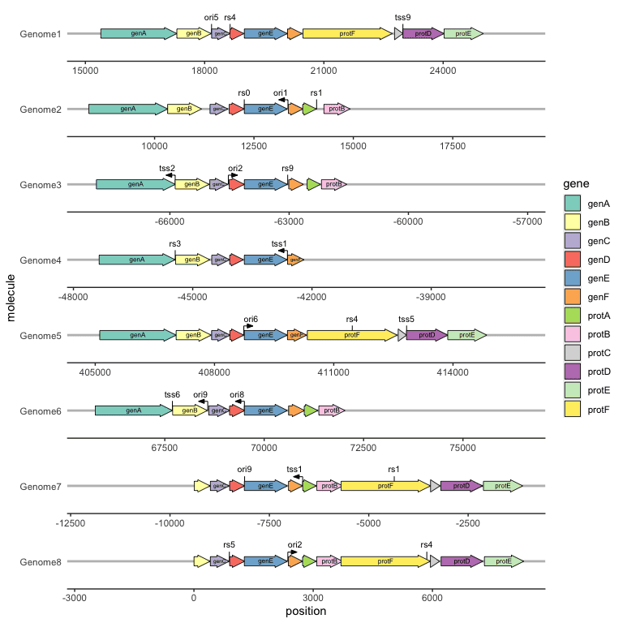
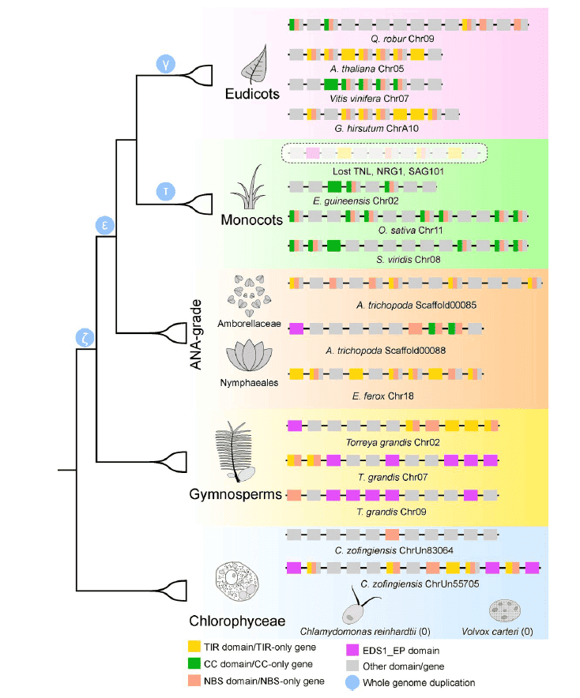

In biology, especially in molecular biology research, analyzing the expression and regulation patterns of genes has always been a research focus. In this process, it is inevitable that there will be a need to draw the structure of a gene or the upstream and downstream relationships. Therefore, this tutorial will summarize some common gene structure drawing methods based on the R package gggenes.

## Example

{fig-alt="GeneStructurePlot DEMO" fig-align="center" width="60%"}

## Setup

-   System Requirements: Cross-platform (Linux/MacOS/Windows)

-   Programming language: R

-   Dependent packages: `tidyverse`; `gggenes`; `ggtree`

```{r packages setup, message=FALSE, warning=FALSE, output=FALSE}
# Installing necessary packages
if (!requireNamespace("tidyverse", quietly = TRUE)) {
  install.packages("tidyverse")
}
if (!requireNamespace("gggenes", quietly = TRUE)) {
  install.packages("gggenes")
}
if (!requireNamespace("ggtree", quietly = TRUE)) {
  install.packages("ggtree")
}

# Load packages
library(tidyverse)
library(gggenes)
library(ggtree)
```

```{r}
sessioninfo::session_info("attached")
```

## Data Preparation

The data uses the `example_genes` dataset, `example_subgenes` dataset, and `example_features` dataset that come with gggenes, which record the location information of genes, the location information of gene substructures, and the location information of marker points on genes, respectively.

`example_genes` is a data frame, which contains a column recording chromosome or chain information as the vertical coordinate, a column recording gene or sequence ID as the mapping index of the dye, two columns recording the start and end positions of the gene, and a column recording the gene direction. Each row is a gene. The following table is an example of the data of `example_genes`:

```{r load data1, message=FALSE}
head(example_genes)
```

`example_subgenes` needs to contain all the columns of `example_genes`, and needs to contain an additional column to record the gene substructure ID, two columns to record the start and end positions of the gene substructure, and each row is a gene substructure. The following table is an example of the data of `example_subgenes`:

```{r load data2, message=FALSE}
head(example_subgenes)
```

`example_features` needs to contain a column for recording chromosome or chain information, a column for recording marker name, a column for recording marker type, a column for recording marker position, and a column for recording marker direction. Each line is a marker. The following table is an example of `example_features` data:

```{r load data3, message=FALSE}
head(example_features)
```

## Visualization

### 1. Gene structure plot basics

As an extension of ggplot2, gggenes consists of a main function geom_gene_arrow and several secondary functions. First, the basic usage of gggenes is introduced:

#### 1.1 Plotting the relative positions of a series of genes

```{r}
#| label: fig-1.1BasicPlot
#| fig-cap: "Plotting the relative positions of a series of genes"
#| out.width: "95%"
#| warning: false
#| message: false
#| fig-width: 6
#| fig-height: 6

# Plotting the relative positions of a series of genes
ggplot(example_genes, aes(xmin = start, xmax = end, y = molecule)) +
    geom_gene_arrow() +
    facet_wrap(~ molecule, scales = "free", ncol = 1)  # gggenes is usually used with the facet_wrap function for faceting. It should be noted that if the drawing interface is too small, an error message will be displayed: "Viewport has zero dimension(s)". Just enlarge the drawing window or set a larger interface.
```

#### 1.2 Plot a set of genes

If you are interested in the structure of the gene itself rather than its location, you can use the gene ID as the vertical axis:

```{r}
#| label: fig-1.2GeneGroup
#| fig-cap: "Plot a set of genes"
#| out.width: "95%"
#| warning: false
#| message: false
#| fig-width: 6
#| fig-height: 6

# Plot a set of genes
df <- subset(example_genes, molecule == "Genome4")
df$end <- df$end-df$start
df$start <- 1
ggplot(df, aes(xmin = start, xmax = end, y = gene)) +
    geom_gene_arrow()
```

#### 1.3 Plot gene substructure

Sometimes we may focus on more detailed structures of genes, such as CDS positions or special motif positions, etc. In this case, we need another extended function `geom_subgene_arrow` provided by gggenes to complete it. It should be noted that although example_subgenes can also be used as the input of `geom_gene_arrow`, since each row in the data will create an outline image of a gene, it is not recommended to do so when a gene contains multiple substructures. The recommended method is to separate the gene information and substructure information into two data frames. The usage is as follows:

```{r}
#| label: fig-1.3SubStructure
#| fig-cap: "Plot gene substructure"
#| out.width: "95%"
#| warning: false
#| message: false
#| fig-width: 6
#| fig-height: 6

# Plot gene substructure
ggplot(example_genes, aes(xmin = start, xmax = end, y = molecule)) +
    facet_wrap(~ molecule, scales = "free", ncol = 1) +
    geom_gene_arrow(fill = "white") +
    geom_subgene_arrow(data = example_subgenes,
                       aes(fill = gene, xsubmin = from, xsubmax = to),
                       color="black", alpha=.7)
```

#### 1.4 Plot gene markers

Sometimes we may focus on a particular point on a gene or sequence, such as a restriction site or a promoter site. Unlike genes or their substructures, markers are often one or a limited number of bases. In this case, it is not suitable to use the arrow drawing method. The `geom_feature` and `geom_feature_label` extension functions can complete this labeling task well:

```{r}
#| label: fig-1.4GeneLabel
#| fig-cap: "Plot gene markers"
#| out.width: "95%"
#| warning: false
#| message: false
#| fig-width: 6
#| fig-height: 6

# Plot gene markers
ggplot(example_genes, aes(xmin = start, xmax = end, y = molecule)) +
    facet_wrap(~ molecule, scales = "free", ncol = 1) +
    geom_gene_arrow(fill = "white")+
    geom_feature(
        data = example_features,
        aes(x = position, y = molecule, forward = forward)
    ) +
    geom_feature_label(
        data = example_features,
        aes(x = position, y = molecule, label = name, forward = forward),
        feature_height = unit(4, "mm"), # When the marker point cannot be displayed normally, you can set this parameter to adjust the marker label height.
        label_height = unit(3, "mm") # When the size of the marker label is not appropriate, you can set this parameter to adjust the size of the marker label.
    ) +
    theme_genes() # This topic will be mentioned below
```

#### 1.5 With evolutionary trees and plots

We may be interested in the genetic differences between different species or varieties in a certain chromosome region. At this time, we can combine the evolutionary tree with the gene structure diagram. In addition to using the puzzle method, the R package ggtree also provides an interface for combining the two:
First, we need to obtain a tree structure. Here, we directly use the gggenes data set to construct a tree. When actually using it, just read a tree file.
Generate an evolutionary tree based on the gene structure. It is not necessary to generate it for actual use:

```{r ggtree}
get_genes <- function(data, genome) {
    filter(data, molecule == genome) %>% pull(gene)
}

g <- unique(example_genes[,1])
n <- length(g)
d <- matrix(nrow = n, ncol = n)
rownames(d) <- colnames(d) <- g
genes <- lapply(g, get_genes, data = example_genes)

for (i in 1:n) {
    for (j in 1:i) {
        jaccard_sim <- length(intersect(genes[[i]], genes[[j]])) / 
            length(union(genes[[i]], genes[[j]]))
        d[j, i] <- d[i, j] <- 1 - jaccard_sim
    }
}
tree <- ape::bionj(d) 
```

When drawing, use the `ggtree` function, specify the gene structure data in `geom_facet`, and specify `geom = geom_motif` `panel = 'Alignment'`. The `on` parameter is used to specify the gene name to be aligned (it must be common to all species. If not, I don't know how to set it for the time being). The coordinate mapping parameters are `xmin` and `xmax`. It should be noted that the chromosome ID used as the vertical axis above (here can be the name of different species) must be in the first column of the data frame. `ggtree` will determine the vertical axis position of the gene structure by comparing the branch labels of the tree and the first column of the gene structure.
The drawing code is as follows:

```{r}
#| label: fig-1.5ggtree
#| fig-cap: "With evolutionary trees and plots"
#| out.width: "95%"
#| warning: false
#| message: false
#| fig-width: 6
#| fig-height: 6

# With evolutionary trees and plots
ggtree(tree, branch.length='none') + 
    geom_tiplab() + xlim_tree(5.5) + 
    geom_facet(data = example_genes,
               geom = geom_motif,
               mapping = aes(xmin = start, xmax = end, fill = gene), 
               panel = 'Alignment',on = 'genE', 
               label = 'gene', align = 'left') +
    scale_fill_brewer(palette = "Set3") +  #修改配色的方法下面会提到
    scale_x_continuous(expand=c(0,0)) +
    theme(strip.text=element_blank())
```

### 2. Beautification

#### 2.1 theme_genes

In gggenes, there is an image theme called `theme_genes` that is very suitable for drawing gene structure:

```{r}
#| label: fig-2.1theme_genes
#| fig-cap: "theme_genes"
#| out.width: "95%"
#| warning: false
#| message: false
#| fig-width: 6
#| fig-height: 6

# theme_genes
ggplot(example_genes, aes(xmin = start, xmax = end, y = molecule)) +
    geom_gene_arrow() +
    facet_wrap(~ molecule, scales = "free", ncol = 1) +
    theme_genes() 
```

#### 2.2 Modify Color

Add colors to different genes (the same goes for substructures, so I won’t go into details):

```{r}
#| label: fig-2.2.1Color1
#| fig-cap: "Modify Color"
#| out.width: "95%"
#| warning: false
#| message: false
#| fig-width: 6
#| fig-height: 6

# Modify Color
ggplot(example_genes, aes(xmin = start, xmax = end, y = molecule, fill=gene)) +
    geom_gene_arrow() +
    facet_wrap(~ molecule, scales = "free", ncol = 1) +
    theme_genes()
```

To change the color scheme, you can use the palette or set it manually:

```{r}
#| label: fig-2.2.2Color
#| fig-cap: "Modify Color"
#| out.width: "95%"
#| warning: false
#| message: false
#| fig-width: 6
#| fig-height: 6

# Modify Color
ggplot(example_genes, aes(xmin = start, xmax = end, y = molecule, fill = gene)) +
    geom_gene_arrow() +
    facet_wrap(~ molecule, scales = "free", ncol = 1) +
    scale_fill_brewer(palette = "Set3") +
    theme_genes()
```

Custom color scheme:

```{r}
#| label: fig-2.2.3Color
#| fig-cap: "Modify Color"
#| out.width: "95%"
#| warning: false
#| message: false
#| fig-width: 6
#| fig-height: 6

# Modify Color
ggplot(example_genes, aes(xmin = start, xmax = end, y = molecule, fill = gene)) +
    geom_gene_arrow() +
    facet_wrap(~ molecule, scales = "free", ncol = 1) +
    scale_fill_manual(values=c("genA"="#266CAF",
                               "genB"="#BF3237",
                               "genC"="#54AC78",
                               "genD"="#FBD75F")) +
    theme_genes()
```

#### 2.3 Add gene labels

To add gene labels, you need to use the `geom_gene_label` extension function, which only requires an additional label mapping to be defined.

```{r}
#| label: fig-2.3Label
#| fig-cap: "Add gene labels"
#| out.width: "95%"
#| warning: false
#| message: false
#| fig-width: 6
#| fig-height: 6

# Add gene labels
ggplot(example_genes, aes(xmin = start, xmax = end, y = molecule, fill = gene)) +
    geom_gene_arrow() +
    geom_gene_label(aes(label = gene),align = "left") +
    facet_wrap(~ molecule, scales = "free", ncol = 1) +
    scale_fill_brewer(palette = "Set3") +
    theme_genes()
```

#### 2.4 Modify gene arrow shape

To modify the arrowhead properties, you need to use two parameters in `geom_gene_arrow`: `arrowhead_height` and `arrowhead_width`, which define the height and width of the arrowhead respectively.

```{r}
#| label: fig-2.4arrow
#| fig-cap: "Modify gene arrow shape"
#| out.width: "95%"
#| warning: false
#| message: false
#| fig-width: 6
#| fig-height: 6

# Modify gene arrow shape
ggplot(example_genes, aes(xmin = start, xmax = end, y = molecule, fill = gene)) +
    geom_gene_arrow(arrowhead_height = unit(3, "mm"), arrowhead_width = unit(1, "mm")) +
    facet_wrap(~ molecule, scales = "free", ncol = 1) +
    scale_fill_brewer(palette = "Set3") +
    theme_genes()
```

#### 2.5 Modify the direction of genes

To modify the gene direction, you generally need to set the `forward` mapping. The content of the mapping column must be a value that can be converted into a Boolean value, such as: 0/1, T/F, TRUE/FALSE, "True"/"False", etc. You can use the `as.logical` function to judge for yourself.
If there is no setting, the gene arrow points to the direction of `xmax` by default. When the `forward` mapping is set, the gene with a Boolean value of TRUE points to the direction of `xmax`, and the gene with a Boolean value of FALSE points to the direction of `xmin`. Therefore, if `xmin` and `xmax` in your data are directional, you can also not perform `forward` mapping.

```{r}
#| label: fig-2.5forward
#| fig-cap: "Modify the direction of genes"
#| out.width: "95%"
#| warning: false
#| message: false
#| fig-width: 6
#| fig-height: 6

# Modify the direction of genes
ggplot(example_genes, aes(xmin = start, xmax = end, y = molecule, fill = gene, forward = orientation)) +
    geom_gene_arrow() +
    facet_wrap(~ molecule, scales = "free", ncol = 1) +
    scale_fill_brewer(palette = "Set3") +
    theme_genes()
```

### 3. ChIP/ATAC Signal Tracks + Gene Structure (ggplot2)

Transcription-regulation figures overlay **sequencing signal tracks** (ChIP-seq, ATAC-seq, DNA methylation) on a gene-body schematic \[4\]. The ggplot2 + cowplot recipe: one `geom_area()`/`geom_line()` layer per track, one `geom_rect()` layer for exons, stacked with `plot_grid()`.

```{r}
#| label: fig-3.1SignalTracks
#| fig-cap: "Simulated ATAC-seq and ChIP-seq signal tracks around a gene body; the bottom panel shows the exon structure."
#| out.width: "95%"
#| warning: false
#| message: false
#| fig-width: 8
#| fig-height: 4.5

set.seed(2001)
n_bin <- 200
pos <- seq_len(n_bin)
exons <- data.frame(start = c(30, 80, 140), end = c(60, 120, 175))

mk_track <- function(base, peaks, noise_sd = 0.08) {
  sig <- rep(base, n_bin)
  for (pk in peaks) sig[pk[1]:pk[2]] <- sig[pk[1]:pk[2]] + pk[3]
  sig + rnorm(n_bin, sd = noise_sd)
}
track_df <- rbind(
  data.frame(track = "ATAC-seq", pos = pos, signal = mk_track(0.3, list(c(35, 55, 1.8), c(90, 110, 1.2), c(145, 170, 2.0)))),
  data.frame(track = "ChIP-seq", pos = pos, signal = mk_track(0.5, list(c(40, 58, 2.5), c(145, 168, 1.5)))))

p_tracks <- ggplot(track_df, aes(pos, signal, fill = track)) +
  geom_area(alpha = 0.5, position = "identity", colour = NA) +
  facet_wrap(~track, ncol = 1, scales = "free_y", strip.position = "left") +
  scale_fill_manual(values = c("ATAC-seq" = "#445EAD", "ChIP-seq" = "#B2182B")) +
  labs(x = NULL, y = "Signal") +
  theme_classic(base_size = 10) +
  theme(legend.position = "none", strip.placement = "outside",
        strip.background = element_blank(), strip.text.y.left = element_text(angle = 0))

p_gene <- ggplot(exons, aes(xmin = start, xmax = end, ymin = 0.4, ymax = 0.6)) +
  geom_rect(fill = "#445EAD", colour = "#2874C5") +
  annotate("segment", x = exons$end[-nrow(exons)], xend = exons$start[-1],
           y = 0.5, yend = 0.5, colour = "#2874C5", linewidth = 0.5) +
  scale_x_continuous(limits = c(1, n_bin), expand = c(0, 0)) +
  scale_y_continuous(limits = c(0, 1)) +
  labs(x = "Genomic position (bp)", y = NULL) +
  theme_classic(base_size = 10) +
  theme(axis.line.y = element_blank(), axis.ticks.y = element_blank(),
        axis.text.y = element_blank())

cowplot::plot_grid(p_tracks, p_gene, ncol = 2, align = "h", axis = "tb",
                   rel_widths = c(1, 0.75))
```

::: callout-tip
**Practice tips**

-   Simulate the tracks with `base + peak_envelope + noise` where the peak envelope is a Gaussian or step function at known positions — this mirrors real bigWig data structure.
-   `facet_wrap(..., strip.position = "left")` puts track names on the left as a pseudo-y-axis label.
-   The exon `geom_rect()` uses genomic coordinates that match the track x-axis; keep the same `limits` in both layers.
:::

### 4. Transcript-Centric Coordinates and Multi-Species Gene Context

Two layouts are missing from the genomic-coordinate track above, and both are standard in Gviz, plotgardener, ggtranscript and wiggleplotr \[5,6\]. The first is **transcript-centric coordinates**: every exon is concatenated along the transcript, so coverage from an isoform-specific assay lands on the same axis as the model it supports. In genomic coordinates the same reads are forced onto one axis while the isoforms skip different exons, and an isoform-specific peak is read as a difference in the gene rather than a difference in the transcript. The second is the **gene-neighbourhood view**, where the x axis is gene order rather than base pairs, which is what makes an inversion visible as an arrow direction and an absent gene visible as a gap.

Both panels below reuse the same `gggenes` arrow grammar as the rest of the tutorial, so the encodings stay comparable across sections.

#### 4.1 Coverage in Transcript Coordinates, Not Genomic Coordinates

```{r}
#| label: fig-4-1TranscriptCentric
#| fig-cap: "Coverage of one gene in three isoforms, each in its own transcript coordinate (exons concatenated with a 30 bp gap). T1 includes all eight exons, T2 skips exons 3 and 6, and T3 skips exons 2 and 5; the coverage ribbon is scaled within each row. The same exon has a different x coordinate in every row, which is the point: in genomic coordinates the three profiles would be superimposed on exons they do not share."
#| out.width: "95%"
#| warning: false
#| message: false
#| fig-width: 9
#| fig-height: 3.8
#| fig-dpi: 300

set.seed(43522)

## One gene with eight exons and three isoforms. Transcript coordinates are the
## exons concatenated with a fixed 30 bp gap; the same exon therefore has a
## different coordinate in every isoform.
exons <- data.frame(
  exon = 1:8,
  gstart = c(100, 500, 800, 1100, 1500, 1900, 2300, 2700),
  gend   = c(300, 620, 900, 1250, 1600, 2000, 2450, 2900)
)
tx <- list(T1 = 1:8, T2 = c(1, 2, 4, 5, 7, 8), T3 = c(1, 3, 4, 6, 7, 8))
gap <- 30

tx_tab <- do.call(rbind, lapply(names(tx), function(t) {
  ids <- tx[[t]]
  e <- exons[match(ids, exons$exon), ]
  e$x0 <- cumsum(c(0, (e$gend - e$gstart + gap)[-nrow(e)]))
  e$x1 <- e$x0 + (e$gend - e$gstart)
  e$tx <- t
  e
}))
tx_tab$y <- as.numeric(factor(tx_tab$tx, levels = names(tx)))

## Coverage in each transcript's own coordinates. In genomic coordinates the
## same reads would be forced onto one axis and the isoform-specific peaks
## would overlap.
cov_tab <- do.call(rbind, lapply(names(tx), function(t) {
  e <- tx_tab |> filter(tx == t)
  p <- seq(0, max(e$x1), by = 5)
  inside <- sapply(p, function(x) any(x >= e$x0 & x <= e$x1))
  peak_at <- mean(e$x0[e$exon %in% c(1, 4)])
  sig <- ifelse(inside, 0.35, 0.05) +
    0.9 * exp(-((p - peak_at)^2) / (2 * 180^2)) +
    rnorm(length(p), 0, 0.03)
  data.frame(tx = t, pos = p, cov = pmax(sig, 0), y = unique(e$y))
}))
cov_tab <- cov_tab |> group_by(tx) |> mutate(cov = cov / max(cov) * 0.62) |> ungroup()

## Gene neighbourhood in five species: g2 is inverted in sp3, g4 in sp4, g5 is
## absent in sp3 and g6 is absent in sp5.
sp <- c("sp1", "sp2", "sp3", "sp4", "sp5")
nb <- data.frame(
  species = rep(sp, each = 6),
  order = rep(1:6, 5),
  gene = c("g1","g2","g3","g4","g5","g6",
           "g1","g2","g3","g4","g5","g6",
           "g1","g3","g2","g4","g6","-",
           "g1","g2","g3","g4","g5","g6",
           "g1","g2","g3","g4","g5","-"),
  forward = c(rep(TRUE, 6), rep(TRUE, 6),
              TRUE, TRUE, FALSE, TRUE, TRUE, TRUE,
              TRUE, TRUE, TRUE, FALSE, TRUE, TRUE,
              rep(TRUE, 5), FALSE)
) |>
  filter(gene != "-") |>
  mutate(x0 = (order - 1) * 1000, x1 = x0 + 820)

ggplot() +
  ## Coverage as a ribbon from the row baseline, so each isoform keeps its own
  ## y band instead of overlapping the next one.
  geom_ribbon(data = cov_tab, aes(x = pos, ymin = y, ymax = y + cov, group = tx),
              fill = "#9ecae1", alpha = 0.75, colour = NA) +
  geom_rect(data = tx_tab, aes(xmin = x0, xmax = x1, ymin = y - 0.10, ymax = y + 0.10),
            fill = "#2c7bb6", colour = "white", linewidth = 0.2) +
  geom_text(data = tx_tab, aes((x0 + x1) / 2, y, label = exon),
            size = 1.7, colour = "white") +
  scale_y_continuous(breaks = 1:3, labels = names(tx),
                     limits = c(0.6, 3.75), expand = c(0, 0)) +
  scale_x_continuous(expand = c(0.01, 0.01)) +
  labs(x = "transcript coordinate (bp, exons concatenated)", y = NULL) +
  theme_minimal(base_size = 8) +
  theme(panel.grid.minor = element_blank(),
        axis.text.y = element_text(size = 7))
```

#### 4.2 Gene Neighbourhood: Order and Orientation as the Axis

```{r}
#| label: fig-4-2GeneNeighborhood
#| fig-cap: "Gene neighbourhood of six orthologues across five species: x is gene order (1 kb per slot), arrow direction is strand, and colour is orthologue group. sp3 has lost g5 and carries g2 inverted between g3 and g4; sp4 carries g4 inverted; sp5 has lost g6. On a base-pair axis these three events would require three separate zoomed panels to see."
#| out.width: "95%"
#| warning: false
#| message: false
#| fig-width: 9
#| fig-height: 2.8
#| fig-dpi: 300

ggplot(nb, aes(xmin = x0, xmax = x1, y = species, fill = gene, forward = forward)) +
  gggenes::geom_gene_arrow(arrowhead_height = unit(3, "mm"),
                           arrowhead_width = unit(1, "mm")) +
  geom_text(aes((x0 + x1) / 2, species, label = gene), size = 2.1, colour = "#222222") +
  scale_fill_brewer(palette = "Set2", guide = "none") +
  scale_y_discrete(limits = rev(sp)) +
  labs(x = "gene neighbourhood coordinate (bp)", y = NULL) +
  gggenes::theme_genes() +
  theme(text = element_text(size = 8))
```


::: callout-tip
**Practice tips**

-   Use one coordinate system per panel and say which one. A coverage track and a gene model drawn in different coordinates will look aligned and be wrong; that is the most common defect in this figure family.
-   Concatenate exons with a fixed gap when you draw transcript coordinates. The gap is not biology; it is a visual separator, and it must be stated in the caption.
-   Keep the exon numbers on the boxes. They are the only thing that lets a reader map a transcript coordinate back to a genomic exon.
-   Draw gene neighbourhoods with an arrow per gene, not a rectangle. Orientation is half the information, and a rectangle silently discards it.
-   State the slot width in a neighbourhood plot (here 1 kb per gene order unit). Without it the x axis looks like base pairs and the figure is read as a physical map.
-   Do not mix a presence/absence claim with a length claim in one panel. A missing gene is a gap in the order axis; a shorter gene is a shorter arrow. They are different observations.
:::

## Implementations deliberately not used here

This page draws its figures with the project's base stack on purpose. Of the tools that the issue-435 inventory maps onto Omics/GeneStructurePlot, 4 were marked **skipped** and are used only as layout references, not as dependencies: 1 that have gone more than five years without an operational commit (cutoff 2021-11-07) and 3 whose dependency closure is too heavy to justify for one static figure. Keeping an abandoned tool would mean pinning code that no longer builds; installing a heavy one would pull a whole analysis framework into a documentation build. The figure conventions were read off those tools, then re-implemented here so each panel can be inspected line by line.

| Tool | Last commit | Status | Why it is skipped |
| --- | --- | --- | --- |
| ArchR | — | heavy dependency | framework-scale dependency closure is too heavy for one static figure |
| signac | 2026-09-11 | heavy dependency | framework-scale dependency closure is too heavy for one static figure |
| trackViewer | — | heavy dependency | framework-scale dependency closure is too heavy for one static figure |
| Millefy | 2019-12-23 | stale | >5 years without maintenance |

## Application

::: {#fig-GeneStructurePlotApplications}
{fig-alt="GeneStructurePlotApp1" fig-align="center" width="60%"}

Applications of Gene Structure Plot
:::

The figure shows the loss and differentiation model of NLR genes in plants during evolution. \[1\]。

## Reference

\[1\] Guo BC, Zhang YR, Liu ZG, Li XC, Yu Z, Ping BY, Sun YQ, van den Burg H, Ma FW, Zhao T. Deciphering Plant NLR Genomic Evolution: Synteny-Informed Classification Unveils Insights into TNL Gene Loss. Mol Biol Evol. 2025 Feb 3;42(2):msaf015. doi: 10.1093/molbev/msaf015. PMID: 39835721; PMCID: PMC11789945.


\[4\] Xiaofan Lu, et al. FigureYa: A Standardized Visualization Framework for Enhancing Biomedical Data Interpretation and Research Efficiency. iMetaMed. 2025. doi:10.1002/imm3.70005

\[5\] Hahne F, Ivanek R. Visualizing Genomic Data Using Gviz and Bioconductor. Methods Mol Biol. 2016;1418:335-351. doi:10.1007/978-1-4939-3578-9_16

\[6\] Härle D, et al. ggtranscript: an R package for the visualization and interpretation of transcript isoforms using ggplot2. Bioinformatics. 2022;38(15):3844-3846. doi:10.1093/bioinformatics/btac409

\[7\] Kramer NE, Davis ES, Wenger CD, et al. Plotgardener: cultivating precise multi-panel figures for genomic data. Bioinformatics. 2022;38(13):3402-3404. doi:10.1093/bioinformatics/btac057
