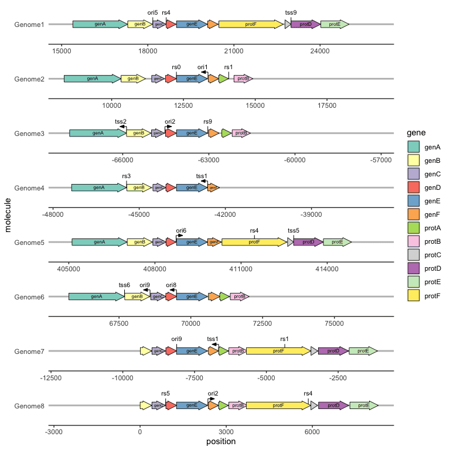
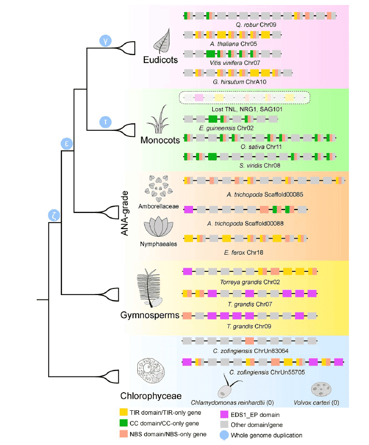

在生物学，尤其是分子生物学研究中解析基因的表达调控模式一直以来都是研究的重点内容，而在此过程中难免会有绘制一个基因的结构或者上下游关系的需求，因此本教程将基于R包gggenes对常见的一些基因结构画法进行总结。

## 示例

{fig-alt="GeneStructurePlot DEMO" fig-align="center" width="60%"}

## 环境配置

-   系统要求： 跨平台（Linux/MacOS/Windows）

-   编程语言：R

-   依赖包：`tidyverse`; `gggenes`; `ggtree`

```{r packages setup, message=FALSE, warning=FALSE, output=FALSE}
# 安装包
if (!requireNamespace("tidyverse", quietly = TRUE)) {
  install.packages("tidyverse")
}
if (!requireNamespace("gggenes", quietly = TRUE)) {
  install.packages("gggenes")
}
if (!requireNamespace("ggtree", quietly = TRUE)) {
  install.packages("ggtree")
}

# 加载包
library(tidyverse)
library(gggenes)
library(ggtree)
```

```{r}
sessioninfo::session_info("attached")
```

## 数据准备

数据使用gggenes中自带的`example_genes`数据集、`example_subgenes`数据集以及`example_features`数据集，分别记录了基因的位置信息、基因子结构的位置信息、基因上标记点的位置信息。

`example_genes`为一个数据框（dataframe），包含一个记录染色体或链信息的列作为纵坐标，一个记录基因或序列ID的列作为染色的映射索引，两个记录基因起始和终止位置的列，一个记录基因方向的列，每一行为一个基因，下表为`example_genes`的数据示例：

```{r load data1, message=FALSE}
head(example_genes)
```

`example_subgenes`需要包含`example_genes`的所有列，并且需要额外包含一个记录基因子结构ID的列，两个记录基因子结构起始和终止位置的列，每一行为一个基因子结构，下表为`example_subgenes`的数据示例：

```{r load data2, message=FALSE}
head(example_subgenes)
```

`example_features`需要包含一个记录染色体或链信息的列，一个记录标记点名称的列，一个记录标记点类型的列，一个记录标记点位置的列，一个记录标记点方向的列，每一行为一个标记，下表为`example_features`的数据示例：

```{r load data3, message=FALSE}
head(example_features)
```

## 可视化

### 1. 基因结构图基础

gggenes作为ggplot2的扩展，其功能由一个主要函数geom_gene_arrow以及若干次要函数完成，首先介绍gggenes的基础用法：

#### 1.1 绘制一连串的基因相对位置

```{r}
#| label: fig-1.1BasicPlot
#| fig-cap: "绘制一连串的基因相对位置"
#| out.width: "95%"
#| warning: false
#| message: false
#| fig-width: 6
#| fig-height: 6

# 绘制一连串的基因相对位置
ggplot(example_genes, aes(xmin = start, xmax = end, y = molecule)) +
    geom_gene_arrow() +
    facet_wrap(~ molecule, scales = "free", ncol = 1)  # gggenes通常配合facet_wrap函数进行分面使用。需要注意的是，画图界面过小的话会提示报错：“Viewport has zero dimension(s)”，只需将画图窗口拉大或者设置更大的界面即可。
```

#### 1.2 绘制一组基因

如果关注的是基因本身的结构而不是基因的位置可以将基因ID作为纵轴：

```{r}
#| label: fig-1.2GeneGroup
#| fig-cap: "绘制一组基因"
#| out.width: "95%"
#| warning: false
#| message: false
#| fig-width: 6
#| fig-height: 6

# 绘制一组基因
df <- subset(example_genes, molecule == "Genome4")
df$end <- df$end-df$start
df$start <- 1
ggplot(df, aes(xmin = start, xmax = end, y = gene)) +
    geom_gene_arrow()
```

#### 1.3 绘制基因子结构

有时我们会关注于基因上更精细的结构，比如CDS位置或者特殊的motif位置等，此时则需要gggenes中提供的另一个扩展函数`geom_subgene_arrow`来完成，需要注意的是虽然example_subgenes也可以作为`geom_gene_arrow`的输入但是由于数据中的每一行都会创建一个基因的轮廓图像，因此在一个基因含有多个子结构的时候不建议这么做，建议的使用方法还是将基因信息以及子结构信息单独分为俩个数据框处理。使用方法如下：

```{r}
#| label: fig-1.3SubStructure
#| fig-cap: "绘制基因子结构"
#| out.width: "95%"
#| warning: false
#| message: false
#| fig-width: 6
#| fig-height: 6

# 绘制基因子结构
ggplot(example_genes, aes(xmin = start, xmax = end, y = molecule)) +
    facet_wrap(~ molecule, scales = "free", ncol = 1) +
    geom_gene_arrow(fill = "white") +
    geom_subgene_arrow(data = example_subgenes,
                       aes(fill = gene, xsubmin = from, xsubmax = to),
                       color="black", alpha=.7)
```

#### 1.4 绘制基因标记点

有时我们会关注基因或序列上的某个特殊点位，例如酶切位点或者启动子位点等，与基因或者其子结构不同的是标记常常为一个或有限的几个碱基，此时不适合使用箭头的画图方法，而`geom_feature`和`geom_feature_label`拓展函数则可以很好的完成这种标记任务：

```{r}
#| label: fig-1.4GeneLabel
#| fig-cap: "绘制基因标记点"
#| out.width: "95%"
#| warning: false
#| message: false
#| fig-width: 6
#| fig-height: 6

# 绘制基因标记点
ggplot(example_genes, aes(xmin = start, xmax = end, y = molecule)) +
    facet_wrap(~ molecule, scales = "free", ncol = 1) +
    geom_gene_arrow(fill = "white")+
    geom_feature(
        data = example_features,
        aes(x = position, y = molecule, forward = forward)
    ) +
    geom_feature_label(
        data = example_features,
        aes(x = position, y = molecule, label = name, forward = forward),
        feature_height = unit(4, "mm"), #当标记点无法正常显示时，可以设置该参数调整标记的标签高度
        label_height = unit(3, "mm") #当标记点标签大小不合适时，可以设置该参数调整标记的标签大小
    ) +
    theme_genes() #这个主题下面会提到
```

#### 1.5 与进化树和作图

我们可能会关注不同物种或品种在某个染色体区域的基因差异，此时我们可以将进化树与基因结构图联用，除了使用拼图的方法以外，R包ggtree也提供了一个接口用于二者联用：
首先我们需要获取一个树结构，这里直接用gggenes的数据集构造一个tree，实际使用时读取一个树文件即可。
根据基因结构生成一个进化树，实际使用不需要生成：

```{r ggtree}
get_genes <- function(data, genome) {
    filter(data, molecule == genome) %>% pull(gene)
}

g <- unique(example_genes[,1])
n <- length(g)
d <- matrix(nrow = n, ncol = n)
rownames(d) <- colnames(d) <- g
genes <- lapply(g, get_genes, data = example_genes)

for (i in 1:n) {
    for (j in 1:i) {
        jaccard_sim <- length(intersect(genes[[i]], genes[[j]])) / 
            length(union(genes[[i]], genes[[j]]))
        d[j, i] <- d[i, j] <- 1 - jaccard_sim
    }
}
tree <- ape::bionj(d) 
```

画图时使用`ggtree`函数，并在`geom_facet`中指定基因结构数据，并指定`geom = geom_motif` `panel = 'Alignment'`，`on` 参数用于指定需要对齐的基因名称（必须是所有物种共有的，如果没有的话暂时不知道怎么设置）。坐标映射参数为`xmin`和`xmax`。需要注意的是在上方被作为纵轴的染色体ID（这里可以是不同物种的名称）必须位于数据框的第一列，`ggtree`会通过比较树的枝标签以及基因结构的第一列来决定基因结构的纵轴位置。
画图代码如下：

```{r}
#| label: fig-1.5ggtree
#| fig-cap: "与进化树和作图"
#| out.width: "95%"
#| warning: false
#| message: false
#| fig-width: 6
#| fig-height: 6

# 与进化树和作图
ggtree(tree, branch.length='none') + 
    geom_tiplab() + xlim_tree(5.5) + 
    geom_facet(data = example_genes,
               geom = geom_motif,
               mapping = aes(xmin = start, xmax = end, fill = gene), 
               panel = 'Alignment',on = 'genE', 
               label = 'gene', align = 'left') +
    scale_fill_brewer(palette = "Set3") +  #修改配色的方法下面会提到
    scale_x_continuous(expand=c(0,0)) +
    theme(strip.text=element_blank())
```

### 2. 图像美化

#### 2.1 theme_genes 主题

在gggenes中，有一个名为`theme_genes`的图像主题，非常适合用于绘制基因结构：

```{r}
#| label: fig-2.1theme_genes
#| fig-cap: "theme_genes主题"
#| out.width: "95%"
#| warning: false
#| message: false
#| fig-width: 6
#| fig-height: 6

# theme_genes主题
ggplot(example_genes, aes(xmin = start, xmax = end, y = molecule)) +
    geom_gene_arrow() +
    facet_wrap(~ molecule, scales = "free", ncol = 1) +
    theme_genes() 
```

#### 2.2 修改颜色

对不同的基因添加颜色(子结构同理，不再赘述)：

```{r}
#| label: fig-2.2.1Color1
#| fig-cap: "修改颜色"
#| out.width: "95%"
#| warning: false
#| message: false
#| fig-width: 6
#| fig-height: 6

# 修改颜色
ggplot(example_genes, aes(xmin = start, xmax = end, y = molecule, fill=gene)) +
    geom_gene_arrow() +
    facet_wrap(~ molecule, scales = "free", ncol = 1) +
    theme_genes()
```

更换配色方案可以使用调色板或者手动设置：

```{r}
#| label: fig-2.2.2Color
#| fig-cap: "修改颜色"
#| out.width: "95%"
#| warning: false
#| message: false
#| fig-width: 6
#| fig-height: 6

# 修改颜色
ggplot(example_genes, aes(xmin = start, xmax = end, y = molecule, fill = gene)) +
    geom_gene_arrow() +
    facet_wrap(~ molecule, scales = "free", ncol = 1) +
    scale_fill_brewer(palette = "Set3") +
    theme_genes()
```

自定义配色：

```{r}
#| label: fig-2.2.3Color
#| fig-cap: "修改颜色"
#| out.width: "95%"
#| warning: false
#| message: false
#| fig-width: 6
#| fig-height: 6

# 修改颜色
ggplot(example_genes, aes(xmin = start, xmax = end, y = molecule, fill = gene)) +
    geom_gene_arrow() +
    facet_wrap(~ molecule, scales = "free", ncol = 1) +
    scale_fill_manual(values=c("genA"="#266CAF",
                               "genB"="#BF3237",
                               "genC"="#54AC78",
                               "genD"="#FBD75F")) +
    theme_genes()
```

#### 2.3 为基因添加标签

添加基因标签需要使用`geom_gene_label`扩展函数，该函数只需要额外定义一个label映射即可

```{r}
#| label: fig-2.3Label
#| fig-cap: "为基因添加标签"
#| out.width: "95%"
#| warning: false
#| message: false
#| fig-width: 6
#| fig-height: 6

# 为基因添加标签
ggplot(example_genes, aes(xmin = start, xmax = end, y = molecule, fill = gene)) +
    geom_gene_arrow() +
    geom_gene_label(aes(label = gene),align = "left") +
    facet_wrap(~ molecule, scales = "free", ncol = 1) +
    scale_fill_brewer(palette = "Set3") +
    theme_genes()
```

#### 2.4 修改基因箭头形状

想要修改箭头性状需要用到`geom_gene_arrow`中的两个参数：`arrowhead_height` `arrowhead_width`，分别定义箭头的高度与宽度

```{r}
#| label: fig-2.4arrow
#| fig-cap: "修改基因箭头形状"
#| out.width: "95%"
#| warning: false
#| message: false
#| fig-width: 6
#| fig-height: 6

# 修改基因箭头形状
ggplot(example_genes, aes(xmin = start, xmax = end, y = molecule, fill = gene)) +
    geom_gene_arrow(arrowhead_height = unit(3, "mm"), arrowhead_width = unit(1, "mm")) +
    facet_wrap(~ molecule, scales = "free", ncol = 1) +
    scale_fill_brewer(palette = "Set3") +
    theme_genes()
```

#### 2.5 修改基因的方向

修改基因方向一般需要设置`forward`映射，映射列的内容必须是可以转化为布尔值的值，例如：0/1，T/F，TRUE/FALSE，”True“/"False"等，可以使用`as.logical`函数自行判断。
在没有设置的情况下，基因的箭头默认指向`xmax`的方向，当设置`forward`的映射后，布尔值为TRUE的基因指向`xmax`的方向，布尔值为FALSE的基因指向`xmin`的方向。因此如果在你的数据中`xmin`和`xmax`本身就带有方向性，也可以不进行`forward`映射。

```{r}
#| label: fig-2.5forward
#| fig-cap: "修改基因的方向"
#| out.width: "95%"
#| warning: false
#| message: false
#| fig-width: 6
#| fig-height: 6

# 修改基因的方向
ggplot(example_genes, aes(xmin = start, xmax = end, y = molecule, fill = gene, forward = orientation)) +
    geom_gene_arrow() +
    facet_wrap(~ molecule, scales = "free", ncol = 1) +
    scale_fill_brewer(palette = "Set3") +
    theme_genes()
```

### 3. ChIP/ATAC 信号轨道 + 基因结构（ggplot2）

转录调控文章常将**测序信号轨道**（ChIP-seq、ATAC-seq、DNA 甲基化）叠在基因结构示意图上 \[2\]。ggplot2 + cowplot 配方：每个轨道一层 `geom_area()`/`geom_line()`，基因外显子一层 `geom_rect()`，用 `plot_grid()` 堆叠。

```{r}
#| label: fig-3.1SignalTracks
#| fig-cap: "模拟 ATAC-seq 和 ChIP-seq 信号轨道与基因结构；右侧面板展示外显子结构。"
#| out.width: "95%"
#| warning: false
#| message: false
#| fig-width: 8
#| fig-height: 4.5

set.seed(2001)
n_bin <- 200
pos <- seq_len(n_bin)
exons <- data.frame(start = c(30, 80, 140), end = c(60, 120, 175))

mk_track <- function(base, peaks, noise_sd = 0.08) {
  sig <- rep(base, n_bin)
  for (pk in peaks) sig[pk[1]:pk[2]] <- sig[pk[1]:pk[2]] + pk[3]
  sig + rnorm(n_bin, sd = noise_sd)
}
track_df <- rbind(
  data.frame(track = "ATAC-seq", pos = pos, signal = mk_track(0.3, list(c(35, 55, 1.8), c(90, 110, 1.2), c(145, 170, 2.0)))),
  data.frame(track = "ChIP-seq", pos = pos, signal = mk_track(0.5, list(c(40, 58, 2.5), c(145, 168, 1.5)))))

p_tracks <- ggplot(track_df, aes(pos, signal, fill = track)) +
  geom_area(alpha = 0.5, position = "identity", colour = NA) +
  facet_wrap(~track, ncol = 1, scales = "free_y", strip.position = "left") +
  scale_fill_manual(values = c("ATAC-seq" = "#445EAD", "ChIP-seq" = "#B2182B")) +
  labs(x = NULL, y = "Signal") +
  theme_classic(base_size = 10) +
  theme(legend.position = "none", strip.placement = "outside",
        strip.background = element_blank(), strip.text.y.left = element_text(angle = 0))

p_gene <- ggplot(exons, aes(xmin = start, xmax = end, ymin = 0.4, ymax = 0.6)) +
  geom_rect(fill = "#445EAD", colour = "#2874C5") +
  annotate("segment", x = exons$end[-nrow(exons)], xend = exons$start[-1],
           y = 0.5, yend = 0.5, colour = "#2874C5", linewidth = 0.5) +
  scale_x_continuous(limits = c(1, n_bin), expand = c(0, 0)) +
  scale_y_continuous(limits = c(0, 1)) +
  labs(x = "Genomic position (bp)", y = NULL) +
  theme_classic(base_size = 10) +
  theme(axis.line.y = element_blank(), axis.ticks.y = element_blank(),
        axis.text.y = element_blank())

cowplot::plot_grid(p_tracks, p_gene, ncol = 2, align = "h", axis = "tb",
                   rel_widths = c(1, 0.75))
```

::: callout-tip
**实践要点**

-   用 `base + peak_envelope + noise` 模拟轨道，峰值包络是在已知位置的高斯或阶跃函数——这模拟了真实 bigWig 数据结构。
-   `facet_wrap(..., strip.position = "left")` 将轨道名放在左侧作为伪 y 轴标签。
-   外显子 `geom_rect()` 使用与轨道 x 轴匹配的基因组坐标；两层保持相同的 `limits`。
:::

### 4. 转录本坐标与多物种基因邻域

上面的基因组坐标轨道还缺两种版式，而它们在 Gviz、plotgardener、ggtranscript 与 wiggleplotr 中都是标准做法 \[5,6\]。第一种是**转录本坐标**：把所有外显子按转录本顺序拼接，于是异构体特异的测序覆盖会落在它所支持的那个模型自己的轴上。若用基因组坐标，同一批读段会被压到同一条轴上，而各异构体跳过的外显子不同，异构体特异的峰会直接被读成基因层面的差异，而不是转录本层面的差异。第二种是**基因邻域视图**：x 轴是基因顺序而不是碱基位置，这正是让倒位表现为箭头方向、让缺失表现为空档的原因。

下面两幅图沿用本教程其余部分的 `gggenes` 箭头语法，使编码在各节之间保持可比。

#### 4.1 转录本坐标下的覆盖度，而非基因组坐标

```{r}
#| label: fig-4-1TranscriptCentric
#| fig-cap: "同一基因三个异构体的覆盖度，每个异构体使用自己的转录本坐标（外显子拼接，间隔固定 30 bp）。T1 包含全部 8 个外显子，T2 跳过外显子 3 和 6，T3 跳过外显子 2 和 5；覆盖度带在每一行内部各自缩放。同一个外显子在每一行里的 x 坐标都不同，这正是要点：在基因组坐标下，三条曲线会被叠加到它们并不共享的外显子上。"
#| out.width: "95%"
#| warning: false
#| message: false
#| fig-width: 9
#| fig-height: 3.8
#| fig-dpi: 300

set.seed(43522)

## One gene with eight exons and three isoforms. Transcript coordinates are the
## exons concatenated with a fixed 30 bp gap; the same exon therefore has a
## different coordinate in every isoform.
exons <- data.frame(
  exon = 1:8,
  gstart = c(100, 500, 800, 1100, 1500, 1900, 2300, 2700),
  gend   = c(300, 620, 900, 1250, 1600, 2000, 2450, 2900)
)
tx <- list(T1 = 1:8, T2 = c(1, 2, 4, 5, 7, 8), T3 = c(1, 3, 4, 6, 7, 8))
gap <- 30

tx_tab <- do.call(rbind, lapply(names(tx), function(t) {
  ids <- tx[[t]]
  e <- exons[match(ids, exons$exon), ]
  e$x0 <- cumsum(c(0, (e$gend - e$gstart + gap)[-nrow(e)]))
  e$x1 <- e$x0 + (e$gend - e$gstart)
  e$tx <- t
  e
}))
tx_tab$y <- as.numeric(factor(tx_tab$tx, levels = names(tx)))

## Coverage in each transcript's own coordinates. In genomic coordinates the
## same reads would be forced onto one axis and the isoform-specific peaks
## would overlap.
cov_tab <- do.call(rbind, lapply(names(tx), function(t) {
  e <- tx_tab |> filter(tx == t)
  p <- seq(0, max(e$x1), by = 5)
  inside <- sapply(p, function(x) any(x >= e$x0 & x <= e$x1))
  peak_at <- mean(e$x0[e$exon %in% c(1, 4)])
  sig <- ifelse(inside, 0.35, 0.05) +
    0.9 * exp(-((p - peak_at)^2) / (2 * 180^2)) +
    rnorm(length(p), 0, 0.03)
  data.frame(tx = t, pos = p, cov = pmax(sig, 0), y = unique(e$y))
}))
cov_tab <- cov_tab |> group_by(tx) |> mutate(cov = cov / max(cov) * 0.62) |> ungroup()

## Gene neighbourhood in five species: g2 is inverted in sp3, g4 in sp4, g5 is
## absent in sp3 and g6 is absent in sp5.
sp <- c("sp1", "sp2", "sp3", "sp4", "sp5")
nb <- data.frame(
  species = rep(sp, each = 6),
  order = rep(1:6, 5),
  gene = c("g1","g2","g3","g4","g5","g6",
           "g1","g2","g3","g4","g5","g6",
           "g1","g3","g2","g4","g6","-",
           "g1","g2","g3","g4","g5","g6",
           "g1","g2","g3","g4","g5","-"),
  forward = c(rep(TRUE, 6), rep(TRUE, 6),
              TRUE, TRUE, FALSE, TRUE, TRUE, TRUE,
              TRUE, TRUE, TRUE, FALSE, TRUE, TRUE,
              rep(TRUE, 5), FALSE)
) |>
  filter(gene != "-") |>
  mutate(x0 = (order - 1) * 1000, x1 = x0 + 820)

ggplot() +
  ## Coverage as a ribbon from the row baseline, so each isoform keeps its own
  ## y band instead of overlapping the next one.
  geom_ribbon(data = cov_tab, aes(x = pos, ymin = y, ymax = y + cov, group = tx),
              fill = "#9ecae1", alpha = 0.75, colour = NA) +
  geom_rect(data = tx_tab, aes(xmin = x0, xmax = x1, ymin = y - 0.10, ymax = y + 0.10),
            fill = "#2c7bb6", colour = "white", linewidth = 0.2) +
  geom_text(data = tx_tab, aes((x0 + x1) / 2, y, label = exon),
            size = 1.7, colour = "white") +
  scale_y_continuous(breaks = 1:3, labels = names(tx),
                     limits = c(0.6, 3.75), expand = c(0, 0)) +
  scale_x_continuous(expand = c(0.01, 0.01)) +
  labs(x = "transcript coordinate (bp, exons concatenated)", y = NULL) +
  theme_minimal(base_size = 8) +
  theme(panel.grid.minor = element_blank(),
        axis.text.y = element_text(size = 7))
```

#### 4.2 基因邻域：把顺序与方向当作坐标轴

```{r}
#| label: fig-4-2GeneNeighborhood
#| fig-cap: "模拟的六个直系同源基因在五个物种中的邻域：x 轴是基因顺序（每个位置 1 kb），箭头方向是链方向，颜色是直系同源组。sp3 丢失 g5，并在 g3 与 g4 之间携带倒位的 g2；sp4 携带倒位的 g4；sp5 丢失 g6。在碱基坐标轴上，这三个事件需要三个分别放大的面板才看得见。"
#| out.width: "95%"
#| warning: false
#| message: false
#| fig-width: 9
#| fig-height: 2.8
#| fig-dpi: 300

ggplot(nb, aes(xmin = x0, xmax = x1, y = species, fill = gene, forward = forward)) +
  gggenes::geom_gene_arrow(arrowhead_height = unit(3, "mm"),
                           arrowhead_width = unit(1, "mm")) +
  geom_text(aes((x0 + x1) / 2, species, label = gene), size = 2.1, colour = "#222222") +
  scale_fill_brewer(palette = "Set2", guide = "none") +
  scale_y_discrete(limits = rev(sp)) +
  labs(x = "gene neighbourhood coordinate (bp)", y = NULL) +
  gggenes::theme_genes() +
  theme(text = element_text(size = 8))
```


::: callout-tip
**实践要点**

-   每个面板只用一个坐标系统，并写明是哪一个。把覆盖度轨道与基因模型画在不同坐标里，看起来是对齐的，实际是错的——这是这一类图最常见的缺陷。
-   画转录本坐标时，用固定间隔拼接外显子。这个间隔不是生物学长度，只是视觉分隔，必须写进图注。
-   在外显子方块上保留外显子编号。它是读者把转录本坐标映射回基因组外显子的唯一线索。
-   基因邻域用每个基因一个箭头来画，不要用矩形。方向占据了一半信息，而矩形会把它悄悄丢掉。
-   在邻域图里写明每个顺序单位对应的宽度（这里是 1 kb）。没有它，x 轴看起来像碱基坐标，图会被读成物理图谱。
-   不要把“有无”的主张与“长度”的主张混在一个面板里。缺失的基因是顺序轴上的空档，变短的基因是更短的箭头，这是两种不同的观察。
:::


## 关于本页跳过的实现

本页的图由 base graphics 直接绘制，而不安装这些被跳过的工具。在 issue-435 清单中归到 Omics/GeneStructurePlot.qmd 的工具里，5 条被标记为**跳过**，仅作为版式参考、不作为依赖：1 条超过 5 年无运维更新（截止日 2021-11-07）、4 条依赖闭包过重，不值得为一张静态图引入。沿用这些工具，等于锁定已废弃的代码；安装另一批，则要把整套分析框架拖进文档构建。本页先把这些工具的图形约定读懂，再自行重画，以便逐行核验每个面板。

| 工具 | 最近提交 | 状态 | 跳过原因 |
| --- | --- | --- | --- |
| ArchR | — | 依赖过重 | 框架级依赖闭包过重，不值得为一张静态图引入 |
| Gviz | — | 依赖过重 | 框架级依赖闭包过重，不值得为一张静态图引入 |
| signac | 2026-09-11 | 依赖过重 | 框架级依赖闭包过重，不值得为一张静态图引入 |
| trackViewer | — | 依赖过重 | 框架级依赖闭包过重，不值得为一张静态图引入 |
| Millefy | 2019-12-23 | 陈旧 | 超过 5 年无运维更新 |

## 应用场景

::: {#fig-GeneStructurePlotApplications}
{fig-alt="GeneStructurePlotApp1" fig-align="center" width="60%"}

基因结构图应用
:::

图中展示了植物在进化过程中，NLR基因的丢失分化模型 \[1\]。

## 参考文献

\[1\] Guo BC, Zhang YR, Liu ZG, Li XC, Yu Z, Ping BY, Sun YQ, van den Burg H, Ma FW, Zhao T. Deciphering Plant NLR Genomic Evolution: Synteny-Informed Classification Unveils Insights into TNL Gene Loss. Mol Biol Evol. 2025 Feb 3;42(2):msaf015. doi: 10.1093/molbev/msaf015. PMID: 39835721; PMCID: PMC11789945.


\[4\] Lu X, Li K, Li Z, et al. FigureYa: a standardized visualization framework for enhancing biomedical data interpretation and research efficiency. iMetaMed. 2025;1(1). doi:10.1002/imm3.70005

\[2\] Xiaofan Lu, et al. FigureYa: A Standardized Visualization Framework for Enhancing Biomedical Data Interpretation and Research Efficiency. iMetaMed. 2025. doi:10.1002/imm3.70005
\[5\] Hahne F, Ivanek R. Visualizing Genomic Data Using Gviz and Bioconductor. Methods Mol Biol. 2016;1418:335-351. doi:10.1007/978-1-4939-3578-9_16

\[6\] Gustavsson EK, Zhang D, Reynolds RH, Garcia-Ruiz S, Ryten M. ggtranscript: an R package for the visualization and interpretation of transcript isoforms using ggplot2. Bioinformatics. 2022;38(15):3844-3846. doi:10.1093/bioinformatics/btac409

\[7\] Kramer NE, Davis ES, Wenger CD, et al. Plotgardener: cultivating precise multi-panel figures in R. Bioinformatics. 2022;38(7):2042-2045. doi:10.1093/bioinformatics/btac057
