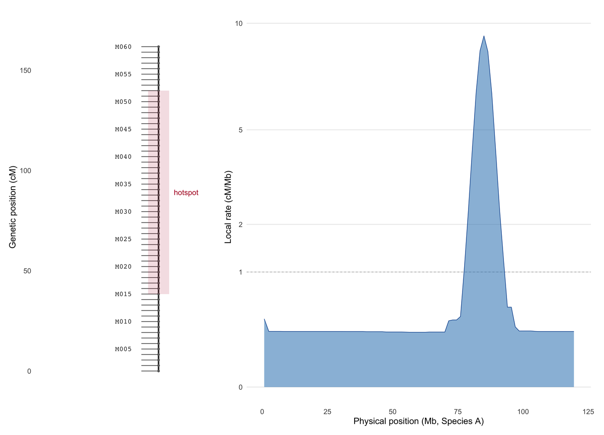

A genetic map is not a physical map. Its axis is **centimorgans (cM)**, where 1 cM is 1% recombination, and the local slope d(cM)/d(Mb) is the recombination rate. Mapping populations, linkage analysis and comparative genomics all plot on this axis, and the classic failure mode is to draw a cM map on a bp axis — which silently reorders markers wherever the recombination rate is not uniform.

This tutorial builds the CMap / chromPlot layout \[1,2\] from transparent inputs: a linkage group with markers in genetic order, the recombination rate profile derived *from* the map by finite differences, and a comparison panel aligning two species' maps by name.

## Example

{fig-alt="Genetic Map Plot DEMO" fig-align="center" width="85%"}

A linkage-group map: markers placed on a centimorgan axis (left) beside the local recombination rate derived from the same map by finite differences (right, square-root scale). The hotspot cluster at 80-90 Mb carries about 63% of the genetic length inside 8% of the physical span, so the cM axis stretches there and the rate panel peaks.

## Setup

-   System Requirements: Cross-platform (Linux/MacOS/Windows)

-   Programming language: R

-   Dependent packages: `ggplot2`; `dplyr`; `tidyr`; `patchwork`; `scales`

```{r packages setup, message=FALSE, warning=FALSE, output=FALSE}
if (!requireNamespace("ggplot2", quietly = TRUE)) install.packages("ggplot2")
if (!requireNamespace("dplyr", quietly = TRUE)) install.packages("dplyr")
if (!requireNamespace("tidyr", quietly = TRUE)) install.packages("tidyr")
if (!requireNamespace("patchwork", quietly = TRUE)) install.packages("patchwork")
if (!requireNamespace("scales", quietly = TRUE)) install.packages("scales")

library(ggplot2)
library(dplyr)
library(tidyr)
library(patchwork)
library(scales)
```

```{r}
sessioninfo::session_info("attached")
```

## Data Preparation

Two linkage groups from a simulated F2 mapping population are built with 60 markers each. The genetic position of every marker is sampled from a non-uniform recombination landscape (a hotspot cluster in the middle of the chromosome, cold regions near the centromere), and the physical position is then obtained by inverting the recombination rate — so the two axes genuinely disagree, as they do in real genomes. Marker order is the genetic order, which is what a linkage map defines.

```{r load data, message=FALSE, warning=FALSE}
set.seed(4354)

build_map <- function(n_chr, n_mar, hotspot_centre, hotspot_width) {
  span_mb <- 120
  ## Recombination rate r(x) in cM/Mb: baseline 1, a Gaussian hotspot cluster,
  ## and a cold centromere.
  dx <- seq(0, span_mb, length.out = 4001)
  r_rate <- 0.35 + 120 * dnorm(dx, hotspot_centre, hotspot_width) -
    0.25 * dnorm(dx, 60, 10)
  r_rate <- pmax(r_rate, 0.04)
  cum_cm <- cumsum(r_rate) * (span_mb / (length(dx) - 1))
  ## Physical positions of n_mar markers equally spaced in cM.
  cm_of <- seq(0, max(cum_cm), length.out = n_mar)
  pos_mb <- approx(cum_cm, dx, xout = cm_of, rule = 2)$y
  tibble(chr = n_chr, marker = seq_len(n_mar), cM = cm_of, Mb = pos_mb,
         marker_name = sprintf("M%03d", seq_len(n_mar)))
}

maps <- bind_rows(
  build_map(n_chr = 1, n_mar = 60, hotspot_centre = 85, hotspot_width = 3.5) |>
    mutate(species = "Species A"),
  build_map(n_chr = 1, n_mar = 60, hotspot_centre = 40, hotspot_width = 7) |>
    mutate(species = "Species B")
)

## Local recombination rate from the map itself: d(cM)/d(Mb) between adjacent
## markers — the only quantity a linkage map can actually estimate.
## The rate is evaluated on a fine physical grid (bins of ~1.5 Mb): two
## adjacent markers can be a few kb apart inside a hotspot and 10 Mb apart in a
## cold region, so a marker-to-marker ratio would be dominated by noise.
rate_grid <- function(dx, cum_cm, width = 1.5) {
  brk <- seq(0, max(dx) + width, by = width)
  bin <- cut(dx, breaks = brk, include.lowest = TRUE)
  idx <- split(seq_along(dx), bin)
  keep <- vapply(idx, function(ii) {
    !is.na(ii[1]) && length(ii) > 1
  }, logical(1))
  data.frame(
    Mb_mid = vapply(idx[keep], function(ii) mean(dx[ii]), numeric(1)),
    rate = vapply(idx[keep], function(ii) diff(range(cum_cm[ii])) / width, numeric(1))
  )
}

rate <- bind_rows(lapply(c("Species A", "Species B"), function(sp) {
  sub <- filter(maps, species == sp)
  ## cum_cm as a function of physical position, from the map itself.
  grid <- seq(0, max(sub$Mb), by = 0.5)
  cm <- approx(sub$Mb, sub$cM, xout = grid, rule = 2)$y
  rate_grid(grid, cm) |> mutate(species = sp)
}))

rate |>
  group_by(species) |>
  summarise(mean_rate = mean(rate), max_rate = max(rate), .groups = "drop")
```

## Visualization

### 1. Genetic Map with Recombination Rate Profile

The map itself is a vertical rule with tick marks — the traditional CMap/chromPlot display — and the rate profile beside it makes the invisible arithmetic visible: 5 cM covers more than 20 Mb in the cold region and about 0.5 Mb at the hotspot.

```{r}
#| label: fig-1.1GeneticMapRate
#| fig-cap: "Linkage-group map for Species A: markers placed on a centimorgan axis (left) beside the local recombination rate derived from the same map by finite differences (right, square-root scale). The hotspot cluster at 80-90 Mb carries about 63% of the genetic length inside 8% of the physical span."
#| out.width: "95%"
#| warning: false
#| message: false
#| fig-width: 8.6
#| fig-height: 6.2
#| fig-dpi: 300

a <- filter(maps, species == "Species A")
a_rate <- filter(rate, species == "Species A")
## Genetic positions covered by the hotspot cluster (80-90 Mb), computed from
## the map itself so the bracket always matches the data.
hotspot_cM <- range(a$cM[a$Mb >= 80 & a$Mb <= 90])

## Marker labels every 5th marker, and the dense hotspot cluster labelled
## by bracket rather than by text (there is no room in a real map either).
lab <- a |> filter(marker %% 5 == 0)

p_map <- ggplot(a) +
  geom_segment(aes(x = 0, xend = 0, y = 0, yend = max(cM)), linewidth = 0.7,
               colour = "#333333") +
  geom_segment(aes(x = -0.9, xend = 0, y = cM, yend = cM), linewidth = 0.35,
               colour = "#666666") +
  geom_point(aes(x = 0, y = cM), size = 0.7, colour = "#666666") +
  geom_text(data = lab, aes(x = -1.4, y = cM, label = marker_name), hjust = 1,
            size = 2.5, family = "mono", colour = "#333333") +
  annotate("rect", xmin = -0.55, xmax = 0.55, ymin = hotspot_cM[1],
           ymax = hotspot_cM[2], fill = "#b2182b", alpha = 0.14) +
  annotate("text", x = 0.8, y = mean(hotspot_cM), label = "hotspot", hjust = 0,
           size = 2.7, colour = "#b2182b") +
  scale_x_continuous(limits = c(-6, 3)) +
  scale_y_continuous(limits = c(-8, max(a$cM) * 1.06),
                     breaks = seq(0, 300, 50)) +
  labs(x = NULL, y = "Genetic position (cM)") +
  theme_minimal(base_size = 9) +
  theme(panel.grid = element_blank(), axis.text.x = element_blank(),
        axis.title.y = element_text(size = 9),
        plot.margin = margin(4, 0, 4, 4))

p_rate <- ggplot(a_rate) +
  geom_hline(yintercept = 1, colour = "#bdbdbd", linewidth = 0.35,
             linetype = "22") +
  geom_area(aes(x = Mb_mid, y = rate), fill = "#3182bd", alpha = 0.55,
            linewidth = 0.25, colour = "#08519c") +

  scale_y_continuous(limits = c(0, max(a_rate$rate) * 1.05), trans = "sqrt",
                     breaks = c(0, 1, 2, 5, 10, 20)) +
  scale_x_continuous(limits = c(0, 120)) +
  labs(x = "Physical position (Mb, Species A)", y = "Local rate (cM/Mb)") +
  theme_minimal(base_size = 9) +
  theme(panel.grid.minor = element_blank(),
        panel.grid.major.x = element_blank(),
        axis.title = element_text(size = 9),
        plot.margin = margin(4, 8, 4, 0))

p_map + p_rate + plot_layout(widths = c(0.55, 1))
```

::: callout-tip
**Practice tips**

-   Label the axis unit. A cM axis and a bp axis look identical; the only thing that prevents the classic misreading is an explicit "cM" in the axis title.
-   Compute the rate from the map, never from a separate table, unless you say otherwise. `d(cM)/d(Mb)` between adjacent markers is the quantity a linkage map supports.
-   A square-root or log y axis is often necessary for rate profiles (hotspots are 5–50× the baseline); declare the transform, because it changes how "spiky" the landscape looks.
-   Bracket dense marker clusters instead of labelling them; a hotspot with 30 markers in 2 Mb cannot carry 30 readable labels at print size.
:::

### 2. Comparative Genetic Maps Aligned by Marker Name

The CMap contribution is comparative: two species' maps drawn side by side and connected by orthologous markers. The connection must be drawn marker-to-marker, not chromosome-to-chromosome, and gaps where a marker is absent are information, not noise.

```{r}
#| label: fig-1.2ComparativeMaps
#| fig-cap: "Comparative genetic maps: Species A and Species B linkage groups on their own centimorgan axes, with 24 orthologous markers connected; the linking lines fan out where the two recombination landscapes differ, showing that conservation of marker order does not imply conservation of genetic distance."
#| out.width: "90%"
#| warning: false
#| message: false
#| fig-width: 7.4
#| fig-height: 6.6
#| fig-dpi: 300

## 24 orthologues, paired by rank; the pair names are shared so the links
## connect markers, not chromosomes.
ortho <- tibble(
  a_marker = seq(3, 58, length.out = 24) |> round(),
  b_marker = seq(3, 58, length.out = 24) |> round()
) |>
  left_join(filter(maps, species == "Species A") |> select(a_marker = marker, cM_a = cM),
            by = "a_marker") |>
  left_join(filter(maps, species == "Species B") |> select(b_marker = marker, cM_b = cM),
            by = "b_marker")

map_panel <- function(dat, x0, label) {
  list(
    annotate("segment", x = x0, xend = x0, y = 0, yend = max(dat$cM),
             linewidth = 0.7, colour = "#333333"),
    annotate("point", x = x0, y = dat$cM, size = 0.55, colour = "#666666"),
    annotate("text", x = x0, y = -14, label = label, size = 3.1,
             fontface = "bold", colour = "#222222")
  )
}

p_cmp <- ggplot() +
  geom_segment(data = ortho, aes(x = 0.05, xend = 0.95, y = cM_a, yend = cM_b),
               colour = "#4393c3", linewidth = 0.32, alpha = 0.55) +
  map_panel(filter(maps, species == "Species A"), 0, "Species A") +
  map_panel(filter(maps, species == "Species B"), 1, "Species B") +
  scale_x_continuous(limits = c(-0.12, 1.12)) +
  scale_y_continuous(limits = c(-max(maps$cM) * 0.05, max(maps$cM) * 1.06),
                     breaks = seq(0, 300, 50)) +
  labs(x = NULL, y = "Genetic position (cM)") +
  theme_minimal(base_size = 9.5) +
  theme(panel.grid.minor = element_blank(),
        panel.grid.major.x = element_blank(),
        axis.text.x = element_blank(),
        axis.title.y = element_text(size = 9))

p_cmp
```

::: callout-tip
**Practice tips**

-   Align comparative maps on the *shared* axis type: genetic-to-genetic or physical-to-physical. Mixing cM with bp produces crossing lines that look like rearrangements but are pure unit artefacts.
-   Connect by orthologue identity, not by rank, unless you say "rank pairing"; rank pairing hides duplications and missing markers.
-   Keep the two maps on independent y scales only if you print both axes; otherwise use one shared scale and accept that one species' chromosome will be shorter.
-   A conserved marker order with a wildly different spacing is a real and important result: it separates "same genes in the same order" from "same recombination landscape".
:::

## Application

Genetic maps are the input to QTL mapping, linkage-based genome assembly, and the comparison of recombination landscapes across species or sexes. Drawing the map on its own cM axis — with the rate profile derived from it — makes two claims auditable at once: that marker order came from linkage, and that the recombination rate is a property of the population, not of the plot's aspect ratio.

The same construction serves diversity-panel maps (cM along a chromosome, rate below), sex-specific maps (the two panels share markers and differ in spacing), and comparative crop maps where a translocation appears as a block of crossing linker lines.

## Reference

\[1\] Youens-Clark K, Buckler E, Casstevens T, et al. CMap: comparative map viewer for Web browsers. Bioinformatics. 2009;25(22):3040-3042. doi:10.1093/bioinformatics/btp458

\[2\] Gama-Castro S, et al. chromPlot: global visualization of genomic data in R. Bioinformatics. 2016;32(15):2366-2368. doi:10.1093/bioinformatics/btw137

\[3\] Stapley J, Feulner PGD, Johnston SE, et al. Variation in recombination frequency and distribution across eukaryotes: patterns and processes. Philos Trans R Soc Lond B Biol Sci. 2017;372(1736):20160455. doi:10.1098/rstb.2016.0455
