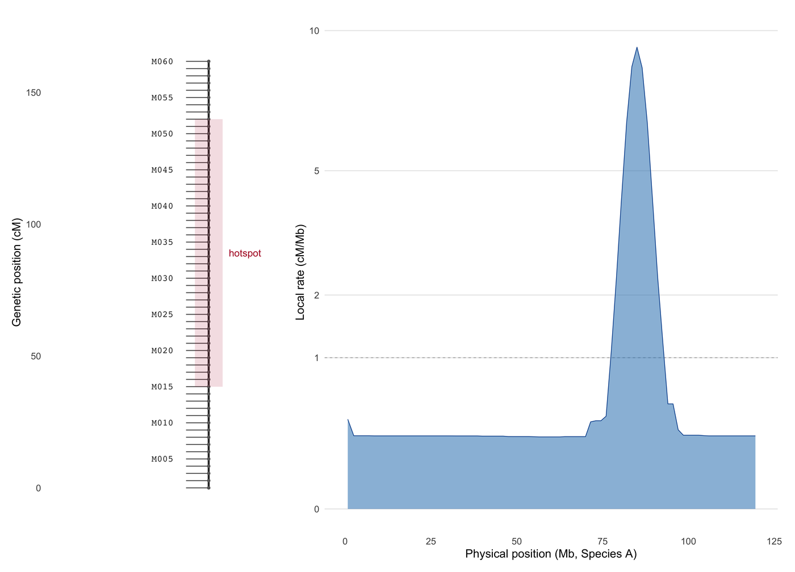

遗传图谱不是物理图谱。它的轴是**厘摩（cM）**，1 cM 代表 1% 重组率，而局部斜率 d(cM)/d(Mb) 就是重组率。作图群体、连锁分析与比较基因组学都在这个轴上作图；最经典的错误是把 cM 图谱画在 bp 轴上——只要重组率不均匀，标记的顺序就会在无声中被重排。

本教程用透明输入构建 CMap / chromPlot 版式 \[1,2\]：按遗传顺序排列标记的连锁群、*由图谱本身*经有限差分得到的重组率剖面，以及按名称对齐两个物种图谱的比较面板。

## 示例

{fig-alt="遗传图谱 DEMO" fig-align="center" width="85%"}

连锁群图谱：标记按厘摩（cM）轴排布（左），右侧是由同一张图通过有限差分得到的局部重组率（平方根刻度）。80-90 Mb 的热点簇在 8% 的物理跨度内容纳了约 63% 的遗传长度，因此 cM 轴在此处被拉伸，重组率面板也在此处冲高。

## Setup

-   系统要求：跨平台（Linux/MacOS/Windows）

-   编程语言：R

-   依赖包：`ggplot2`；`dplyr`；`tidyr`；`patchwork`；`scales`

```{r packages setup, message=FALSE, warning=FALSE, output=FALSE}
if (!requireNamespace("ggplot2", quietly = TRUE)) install.packages("ggplot2")
if (!requireNamespace("dplyr", quietly = TRUE)) install.packages("dplyr")
if (!requireNamespace("tidyr", quietly = TRUE)) install.packages("tidyr")
if (!requireNamespace("patchwork", quietly = TRUE)) install.packages("patchwork")
if (!requireNamespace("scales", quietly = TRUE)) install.packages("scales")

library(ggplot2)
library(dplyr)
library(tidyr)
library(patchwork)
library(scales)
```

```{r}
sessioninfo::session_info("attached")
```

## 数据准备

用模拟 F2 作图群体构建两个各含 60 个标记的连锁群。每个标记的遗传位置取自一个非均匀的重组景观（染色体中部的热点簇、着丝粒附近的冷区），物理位置再通过反演重组率得到——因此两个轴确实不一致，与真实基因组一致。标记顺序即遗传顺序，这正是连锁图谱所定义的内容。

```{r load data, message=FALSE, warning=FALSE}
set.seed(4354)

build_map <- function(n_chr, n_mar, hotspot_centre, hotspot_width) {
  span_mb <- 120
  ## Recombination rate r(x) in cM/Mb: baseline 1, a Gaussian hotspot cluster,
  ## and a cold centromere.
  dx <- seq(0, span_mb, length.out = 4001)
  r_rate <- 0.35 + 120 * dnorm(dx, hotspot_centre, hotspot_width) -
    0.25 * dnorm(dx, 60, 10)
  r_rate <- pmax(r_rate, 0.04)
  cum_cm <- cumsum(r_rate) * (span_mb / (length(dx) - 1))
  ## Physical positions of n_mar markers equally spaced in cM.
  cm_of <- seq(0, max(cum_cm), length.out = n_mar)
  pos_mb <- approx(cum_cm, dx, xout = cm_of, rule = 2)$y
  tibble(chr = n_chr, marker = seq_len(n_mar), cM = cm_of, Mb = pos_mb,
         marker_name = sprintf("M%03d", seq_len(n_mar)))
}

maps <- bind_rows(
  build_map(n_chr = 1, n_mar = 60, hotspot_centre = 85, hotspot_width = 3.5) |>
    mutate(species = "Species A"),
  build_map(n_chr = 1, n_mar = 60, hotspot_centre = 40, hotspot_width = 7) |>
    mutate(species = "Species B")
)

## Local recombination rate from the map itself: d(cM)/d(Mb) between adjacent
## markers — the only quantity a linkage map can actually estimate.
## The rate is evaluated on a fine physical grid (bins of ~1.5 Mb): two
## adjacent markers can be a few kb apart inside a hotspot and 10 Mb apart in a
## cold region, so a marker-to-marker ratio would be dominated by noise.
rate_grid <- function(dx, cum_cm, width = 1.5) {
  brk <- seq(0, max(dx) + width, by = width)
  bin <- cut(dx, breaks = brk, include.lowest = TRUE)
  idx <- split(seq_along(dx), bin)
  keep <- vapply(idx, function(ii) {
    !is.na(ii[1]) && length(ii) > 1
  }, logical(1))
  data.frame(
    Mb_mid = vapply(idx[keep], function(ii) mean(dx[ii]), numeric(1)),
    rate = vapply(idx[keep], function(ii) diff(range(cum_cm[ii])) / width, numeric(1))
  )
}

rate <- bind_rows(lapply(c("Species A", "Species B"), function(sp) {
  sub <- filter(maps, species == sp)
  ## cum_cm as a function of physical position, from the map itself.
  grid <- seq(0, max(sub$Mb), by = 0.5)
  cm <- approx(sub$Mb, sub$cM, xout = grid, rule = 2)$y
  rate_grid(grid, cm) |> mutate(species = sp)
}))

rate |>
  group_by(species) |>
  summarise(mean_rate = mean(rate), max_rate = max(rate), .groups = "drop")
```

## 可视化

### 1. 遗传图谱与重组率剖面

图谱本身是一条带刻度的竖线——CMap/chromPlot 的传统画法——旁边的重组率剖面把看不见的算术显式化：5 cM 在冷区覆盖超过 20 Mb，在热点区只覆盖约 0.5 Mb。

```{r}
#| label: fig-1.1GeneticMapRate
#| fig-cap: "物种 A 的连锁群图谱：标记置于厘摩轴上（左），旁边是由同一图谱经有限差分得到的局部重组率（右，平方根刻度）。80-90 Mb 的热点簇在 8% 的物理跨度内承载了约 63% 的遗传长度。"
#| out.width: "95%"
#| warning: false
#| message: false
#| fig-width: 8.6
#| fig-height: 6.2
#| fig-dpi: 300

a <- filter(maps, species == "Species A")
a_rate <- filter(rate, species == "Species A")
## Genetic positions covered by the hotspot cluster (80-90 Mb), computed from
## the map itself so the bracket always matches the data.
hotspot_cM <- range(a$cM[a$Mb >= 80 & a$Mb <= 90])

## Marker labels every 5th marker, and the dense hotspot cluster labelled
## by bracket rather than by text (there is no room in a real map either).
lab <- a |> filter(marker %% 5 == 0)

p_map <- ggplot(a) +
  geom_segment(aes(x = 0, xend = 0, y = 0, yend = max(cM)), linewidth = 0.7,
               colour = "#333333") +
  geom_segment(aes(x = -0.9, xend = 0, y = cM, yend = cM), linewidth = 0.35,
               colour = "#666666") +
  geom_point(aes(x = 0, y = cM), size = 0.7, colour = "#666666") +
  geom_text(data = lab, aes(x = -1.4, y = cM, label = marker_name), hjust = 1,
            size = 2.5, family = "mono", colour = "#333333") +
  annotate("rect", xmin = -0.55, xmax = 0.55, ymin = hotspot_cM[1],
           ymax = hotspot_cM[2], fill = "#b2182b", alpha = 0.14) +
  annotate("text", x = 0.8, y = mean(hotspot_cM), label = "hotspot", hjust = 0,
           size = 2.7, colour = "#b2182b") +
  scale_x_continuous(limits = c(-6, 3)) +
  scale_y_continuous(limits = c(-8, max(a$cM) * 1.06),
                     breaks = seq(0, 300, 50)) +
  labs(x = NULL, y = "Genetic position (cM)") +
  theme_minimal(base_size = 9) +
  theme(panel.grid = element_blank(), axis.text.x = element_blank(),
        axis.title.y = element_text(size = 9),
        plot.margin = margin(4, 0, 4, 4))

p_rate <- ggplot(a_rate) +
  geom_hline(yintercept = 1, colour = "#bdbdbd", linewidth = 0.35,
             linetype = "22") +
  geom_area(aes(x = Mb_mid, y = rate), fill = "#3182bd", alpha = 0.55,
            linewidth = 0.25, colour = "#08519c") +

  scale_y_continuous(limits = c(0, max(a_rate$rate) * 1.05), trans = "sqrt",
                     breaks = c(0, 1, 2, 5, 10, 20)) +
  scale_x_continuous(limits = c(0, 120)) +
  labs(x = "Physical position (Mb, Species A)", y = "Local rate (cM/Mb)") +
  theme_minimal(base_size = 9) +
  theme(panel.grid.minor = element_blank(),
        panel.grid.major.x = element_blank(),
        axis.title = element_text(size = 9),
        plot.margin = margin(4, 8, 4, 0))

p_map + p_rate + plot_layout(widths = c(0.55, 1))
```

::: callout-tip
**Practice tips**

-   必须标注轴单位。cM 轴与 bp 轴看起来完全一样，唯一能避免经典误读的，就是轴标题里明确写出 "cM"。
-   重组率应由图谱本身计算，而非另取一张表（除非明确说明）。相邻标记之间的 `d(cM)/d(Mb)` 才是连锁图谱能支撑的量。
-   重组率剖面常需平方根或对数 y 轴（热点可达基线的 5–50 倍）；必须声明变换，因为它会改变景观看起来"多尖"。
-   密集标记簇用括号标注而非逐一点标签；2 Mb 内 30 个标记的热点在印刷尺寸下无法承载 30 个可读标签。
:::

### 2. 按标记名对齐的比较遗传图谱

CMap 的贡献在于比较：两个物种的图谱并排绘制，并由直系同源标记相连。连线必须是标记到标记，而不是染色体到染色体；标记缺失处的空档是信息，不是噪声。

```{r}
#| label: fig-1.2ComparativeMaps
#| fig-cap: "比较遗传图谱：物种 A 与物种 B 的连锁群各用自己的厘摩轴，24 个直系同源标记相连；两套重组景观不同处连线呈扇形展开，说明标记顺序保守并不意味着遗传距离保守。"
#| out.width: "90%"
#| warning: false
#| message: false
#| fig-width: 7.4
#| fig-height: 6.6
#| fig-dpi: 300

## 24 orthologues, paired by rank; the pair names are shared so the links
## connect markers, not chromosomes.
ortho <- tibble(
  a_marker = seq(3, 58, length.out = 24) |> round(),
  b_marker = seq(3, 58, length.out = 24) |> round()
) |>
  left_join(filter(maps, species == "Species A") |> select(a_marker = marker, cM_a = cM),
            by = "a_marker") |>
  left_join(filter(maps, species == "Species B") |> select(b_marker = marker, cM_b = cM),
            by = "b_marker")

map_panel <- function(dat, x0, label) {
  list(
    annotate("segment", x = x0, xend = x0, y = 0, yend = max(dat$cM),
             linewidth = 0.7, colour = "#333333"),
    annotate("point", x = x0, y = dat$cM, size = 0.55, colour = "#666666"),
    annotate("text", x = x0, y = -14, label = label, size = 3.1,
             fontface = "bold", colour = "#222222")
  )
}

p_cmp <- ggplot() +
  geom_segment(data = ortho, aes(x = 0.05, xend = 0.95, y = cM_a, yend = cM_b),
               colour = "#4393c3", linewidth = 0.32, alpha = 0.55) +
  map_panel(filter(maps, species == "Species A"), 0, "Species A") +
  map_panel(filter(maps, species == "Species B"), 1, "Species B") +
  scale_x_continuous(limits = c(-0.12, 1.12)) +
  scale_y_continuous(limits = c(-max(maps$cM) * 0.05, max(maps$cM) * 1.06),
                     breaks = seq(0, 300, 50)) +
  labs(x = NULL, y = "Genetic position (cM)") +
  theme_minimal(base_size = 9.5) +
  theme(panel.grid.minor = element_blank(),
        panel.grid.major.x = element_blank(),
        axis.text.x = element_blank(),
        axis.title.y = element_text(size = 9))

p_cmp
```

::: callout-tip
**Practice tips**

-   比较图谱必须在*相同的*轴类型上对齐：遗传对遗传，或物理对物理。把 cM 与 bp 混用会产生看起来像重排、实则为单位假象的交叉线。
-   按直系同源身份连线，而非按名次，除非明确写"按名次配对"；按名次配对标会掩盖重复与缺失标记。
-   只有在两个轴都标出的情况下才让两张图使用独立 y 比例；否则请使用同一比例，并接受其中一个物种的染色体看起来更短。
-   标记顺序保守但间距差异极大，是真实且重要的结果：它区分了"同样基因、同样顺序"与"同样重组景观"。
:::

## 应用

遗传图谱是 QTL 定位、基于连锁的基因组组装，以及跨物种/跨性别重组景观比较的输入。把图谱画在它自己的 cM 轴上、并附带由它导出的重组率剖面，同时让两个主张可审计：标记顺序来自连锁证据；重组率是群体的属性，而不是图形的长宽比。

同一构造也适用于多样性面板图谱（沿染色体的 cM、下方画重组率）、性别特异图谱（两个面板共享标记而间距不同），以及比较作物图谱——其中易位会表现为一组交叉连线。

## 参考文献

\[1\] Youens-Clark K, Buckler E, Casstevens T, et al. CMap: comparative map viewer for Web browsers. Bioinformatics. 2009;25(22):3040-3042. doi:10.1093/bioinformatics/btp458

\[2\] Gama-Castro S, et al. chromPlot: global visualization of genomic data in R. Bioinformatics. 2016;32(15):2366-2368. doi:10.1093/bioinformatics/btw137

\[3\] Stapley J, Feulner PGD, Johnston SE, et al. Variation in recombination frequency and distribution across eukaryotes: patterns and processes. Philos Trans R Soc Lond B Biol Sci. 2017;372(1736):20160455. doi:10.1098/rstb.2016.0455
