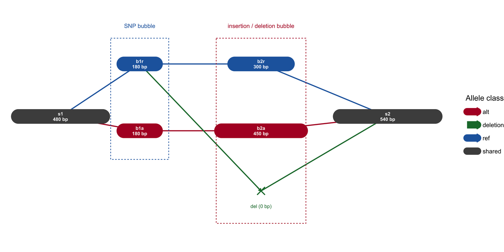

A genome graph replaces the linear reference with a network: sequence segments are nodes, overlaps and adjacencies are edges, and each haplotype or assembly is a walk through that network. The figure family matters because a linear coordinate cannot represent an insertion, a duplication, or a pangenome bubble without losing one of the alleles. This tutorial draws the three canonical views used by assembly and pangenome tools — a **Bandage-style assembly graph**, a **sequence-tube-map bubble**, and an **odgi-style 1D path layout** — from one small hand-built graph so the encodings can be checked by eye.

## Example

{fig-alt="Genome Graph Plot DEMO" fig-align="center" width="85%"}

An assembly graph of a 1.5 kb reference path with two variant bubbles: node width encodes segment length, shared segments are grey, and the reference and alternate alleles of each bubble are blue and red. The SNP bubble splits into a 180 bp reference and a 180 bp alternate path; the insertion/deletion bubble into a 300 bp reference, a 450 bp insertion and a zero-length deletion marker. A linear reference cannot show both paths at once, which is why a graph is used.

## Setup

-   System Requirements: Cross-platform (Linux/MacOS/Windows)

-   Programming language: R

-   Dependent packages: `ggplot2`; `dplyr`; `tidyr`; `igraph`; `ggraph`; `patchwork`

```{r packages setup, message=FALSE, warning=FALSE, output=FALSE}
if (!requireNamespace("ggplot2", quietly = TRUE)) install.packages("ggplot2")
if (!requireNamespace("dplyr", quietly = TRUE)) install.packages("dplyr")
if (!requireNamespace("tidyr", quietly = TRUE)) install.packages("tidyr")
if (!requireNamespace("igraph", quietly = TRUE)) install.packages("igraph")
if (!requireNamespace("ggraph", quietly = TRUE)) install.packages("ggraph")
if (!requireNamespace("patchwork", quietly = TRUE)) install.packages("patchwork")

library(ggplot2)
library(dplyr)
library(tidyr)
library(igraph)
library(ggraph)
library(patchwork)
```

```{r}
sessioninfo::session_info("attached")
```

## Data Preparation

Real GFA files are large, but every layout rule is visible in a seven-node graph. We model a graph sampled from three haplotypes — a shared left flank, a **SNP bubble**, a **150 bp insertion**, and a **deletion allele** at the same second site, followed by a shared right flank — and derive its lengths rather than restating them: the reference path is 480 + 180 + 300 + 540 = 1,500 bp, the longest haplotype path is 480 + 180 + 450 + 540 = 1,650 bp, and the sum over all nodes is 2,130 bp. Segment length is carried as a column because node width must encode it — a graph drawn with uniform nodes hides which allele is actually long.

```{r load data, message=FALSE, warning=FALSE}
set.seed(4353)

## segments: GFA `S` lines (name, length, GC content for colouring)
segments <- tibble(
  seg    = c("s1", "b1r", "b1a", "b2r", "b2a", "del", "s2"),
  length = c(480,  180,   180,   300,   450,   0,   540),
  gc     = c(0.44, 0.39,  0.61,  0.45,  0.47,  NA,  0.43),
  allele = c("shared", "SNP_ref", "SNP_alt", "INS_ref", "INS_alt",
             "deletion", "shared")
)

## links: GFA `L` lines (from, to, orientation), with an overlap length
links <- tibble(
  from = c("s1", "s1", "b1r", "b1a", "b2r", "b2a", "b1r", "del"),
  to   = c("b1r", "b1a", "b2r", "b2a", "s2", "s2", "del", "s2"),
  ovlp = c(60, 60, 60, 60, 70, 70, 0, 0),
  kind = c("ref", "alt", "ref", "alt", "ref", "alt", "deletion", "deletion")
)

## walks: each haplotype as an ordered segment path
paths <- tribble(
  ~haplotype, ~step, ~seg,
  "H1 (reference)", 1, "s1", "H1 (reference)", 2, "b1r",
  "H1 (reference)", 3, "b2r", "H1 (reference)", 4, "s2",
  "H2 (SNP + ins)", 1, "s1", "H2 (SNP + ins)", 2, "b1a",
  "H2 (SNP + ins)", 3, "b2a", "H2 (SNP + ins)", 4, "s2",
  "H3 (deletion)",  1, "s1", "H3 (deletion)",  2, "b1r",
  "H3 (deletion)",  3, "del", "H3 (deletion)",  4, "s2"
)

segments |>
  left_join(paths |> count(seg, name = "n_paths"), by = "seg") |>
  replace_na(list(n_paths = 0))
```

## Visualization

### 1. Assembly Graph with Segment Length as Node Width

The Bandage convention: one node per segment, node width proportional to segment length, and edges wherever two segments can follow one another. Two variant sites are drawn explicitly — a SNP bubble (180 bp reference versus 180 bp alternate) and an insertion/deletion bubble (300 bp reference, 450 bp insertion, zero-length deletion) — so the reader can trace each haplotype without reading the GFA.

```{r}
#| label: fig-1.1AssemblyGraph
#| fig-cap: "Simulated assembly graph of a 1.5 kb reference path with two variant sites: node width encodes segment length, shared segments are grey, reference alleles are blue, alternate alleles are red, and the zero-length deletion is marked explicitly."
#| out.width: "96%"
#| warning: false
#| message: false
#| fig-width: 9.2
#| fig-height: 4.6
#| fig-dpi: 300

nodes <- segments |>
  left_join(
    tribble(
      ~seg, ~x, ~y,
      "s1", 1.0, 0.00,
      "b1r", 2.5, 0.55,
      "b1a", 2.5, -0.15,
      "b2r", 4.8, 0.55,
      "b2a", 4.8, -0.15,
      "del", 4.8, -0.78,
      "s2", 7.2, 0.00
    ),
    by = "seg"
  ) |>
  mutate(
    cls = case_when(
      endsWith(allele, "_ref") ~ "ref",
      endsWith(allele, "_alt") ~ "alt",
      allele == "deletion" ~ "deletion",
      TRUE ~ "shared"
    ),
    w = pmax(0.40, length / 300)
  )

edges <- links |>
  left_join(nodes |> select(seg, x, y), by = c("from" = "seg")) |>
  left_join(nodes |> select(seg, xend = x, yend = y),
            by = c("to" = "seg"))

box <- nodes |> filter(length > 0)
deleted <- nodes |> filter(length == 0)

ggplot() +
  geom_curve(data = edges,
             aes(x, y, xend = xend, yend = yend, colour = kind),
             curvature = 0, linewidth = 0.7,
             arrow = arrow(length = unit(1.3, "mm"), type = "open")) +
  geom_segment(data = box |> mutate(x0 = x - w / 2, x1 = x + w / 2),
               aes(x = x0, y = y, xend = x1, yend = y, colour = cls),
               linewidth = 9, lineend = "round") +
  geom_point(data = deleted, aes(x, y), shape = 4, size = 3.8,
             stroke = 1.0, colour = "#1B7837") +
  geom_text(data = deleted, aes(x, y - 0.16, label = "del (0 bp)"),
            size = 2.3, colour = "#1B7837") +
  geom_text(data = box,
            aes(x, y, label = paste0(seg, "\n", length, " bp")),
            colour = "white", size = 2.2, lineheight = 0.95,
            fontface = "bold") +
  annotate("rect", xmin = 1.95, xmax = 3.05, ymin = -0.45, ymax = 0.82,
           fill = NA, colour = "#2166AC", linetype = "22", linewidth = 0.4) +
  annotate("text", x = 2.50, y = 0.95, label = "SNP bubble",
           size = 2.7, colour = "#2166AC") +
  annotate("rect", xmin = 3.95, xmax = 5.65, ymin = -1.12, ymax = 0.82,
           fill = NA, colour = "#B2182B", linetype = "22", linewidth = 0.4) +
  annotate("text", x = 4.80, y = 0.95, label = "insertion / deletion bubble",
           size = 2.7, colour = "#B2182B") +
  scale_colour_manual(values = c(shared = "#4D4D4D", ref = "#2166AC",
                                 alt = "#B2182B", deletion = "#1B7837"),
                      name = "Allele class") +
  guides(colour = guide_legend(override.aes = list(linewidth = 4.5))) +
  coord_cartesian(xlim = c(0.25, 8.20), ylim = c(-1.30, 1.10), clip = "off") +
  theme_void(base_size = 10) +
  theme(legend.position = "right")
```

### 2. Sequence-Tube-Map Bubble

The sequence tube map draws each haplotype as a coloured pipe. At a variant site the pipes physically separate into allele-specific lanes and re-join afterwards, so an insertion is a *detour*, not a note in the margin. Here the three haplotype pipes travel in parallel lanes and branch across the 0.48-0.96 kb variant window. The x axis is **alignment position on the reference**, so the three pipes share the same flanking coordinates; the 150 bp insertion (H2) is compressed into the same slot and the 300 bp reference stretch missing from H3 is drawn as a break in its pipe. Neither detour is to scale, and the figure says so.

```{r}
#| label: fig-1.2TubeMap
#| fig-cap: "Sequence-tube-map view on the reference alignment axis (0-1.50 kb): the three haplotype pipes diverge inside the 0.48-0.96 kb variant window. H2 carries the SNP plus a 150 bp insertion (drawn compressed, so its detour height is not a length claim); H3 carries the zero-length deletion allele, so its pipe is broken across the 0.30 kb of reference it lacks. All three pipes start and end at the same alignment coordinates."
#| out.width: "96%"
#| warning: false
#| message: false
#| fig-width: 9.2
#| fig-height: 4.4
#| fig-dpi: 300

## Alignment coordinates, in kb, on the reference: s1 [0, 0.48],
## b1/b2 [0.48, 0.96], s2 [0.96, 1.50]. Every pipe therefore starts at 0 and
## ends at 1.50, and the variant window is the same interval for all three.
tube <- tribble(
  ~haplotype, ~x, ~y,
  "H1 (reference)", 0.00, 0.40, "H1 (reference)", 1.50, 0.40,
  "H2 (SNP + ins)", 0.00, 0.00, "H2 (SNP + ins)", 0.48, 0.00,
  "H2 (SNP + ins)", 0.68, 0.95, "H2 (SNP + ins)", 0.90, 0.95,
  "H2 (SNP + ins)", 0.96, 0.00, "H2 (SNP + ins)", 1.50, 0.00,
  "H3 (deletion)",  0.00, -0.40, "H3 (deletion)",  0.66, -0.40,
  "H3 (deletion)",  0.96, -0.40, "H3 (deletion)",  1.50, -0.40
)

## The deletion is a gap in H3: reference [0.66, 0.96] is absent from that
## haplotype, so the pipe is broken there rather than bent into a lobe.
del_gap <- tibble(x = 0.66, xend = 0.96, y = -0.40, yend = -0.40)

tube_cols <- c("H1 (reference)" = "#4D4D4D",
               "H2 (SNP + ins)" = "#2166AC",
               "H3 (deletion)"  = "#1B7837")

ggplot(tube, aes(x, y, colour = haplotype)) +
  geom_path(aes(group = haplotype), linewidth = 8, lineend = "round",
            linejoin = "round", alpha = 0.9) +
  ## Break H3 where the 300 bp reference stretch is deleted.
  geom_segment(data = del_gap, aes(x = x, xend = xend, y = y, yend = yend),
               inherit.aes = FALSE, colour = "white", linewidth = 9) +
  geom_point(data = tube |> filter(x %in% c(0.48, 0.96)),
             aes(x, y), size = 0.9, colour = "white", alpha = 0.8) +
  annotate("rect", xmin = 0.48, xmax = 0.96, ymin = -1.12, ymax = 1.12,
           fill = NA, colour = "#8C510A", linetype = "22", linewidth = 0.4) +
  annotate("text", x = 0.72, y = 1.34, size = 2.7, colour = "#8C510A",
           label = "variant window (alignment 0.48-0.96 kb; not to scale)") +
  annotate("text", x = 1.03, y = 0.95, size = 2.6, hjust = 0,
           colour = "#2166AC",
           label = "SNP + 150 bp insertion\n(shown compressed)") +
  annotate("text", x = 0.72, y = -1.02, size = 2.6, colour = "#1B7837",
           label = "deletion allele (0 bp): pipe breaks") +
  scale_colour_manual(values = tube_cols, name = "Haplotype pipe") +
  guides(colour = guide_legend(override.aes = list(linewidth = 4.5))) +
  scale_x_continuous(breaks = c(0, 0.48, 0.96, 1.50),
                     labels = c("0", "0.48", "0.96", "1.50")) +
  coord_cartesian(xlim = c(0, 1.62), ylim = c(-1.18, 1.42)) +
  labs(x = "reference alignment position (kb)", y = NULL) +
  theme_classic(base_size = 10.5) +
  theme(axis.line.y = element_blank(), axis.text.y = element_blank(),
        axis.ticks.y = element_blank(), legend.position = "right")
```

### 3. 1D Path Layout

Force-directed layouts of large pangenome graphs become hairballs. The odgi convention instead orders nodes by their position along a chosen reference path and stacks paths as rows — loss of topology, gain in legibility and comparability across hundreds of haplotypes.

```{r}
#| label: fig-1.3PathLayout
#| fig-cap: "Path-guided 1D layout: each row is one haplotype and each node one segment, with each row scaled to its own path length -- shared segments therefore do NOT align across rows (the tube map in figure 2 is the reference-aligned view); allele boxes are coloured by variant class."
#| out.width: "95%"
#| warning: false
#| message: false
#| fig-width: 9.2
#| fig-height: 3.4
#| fig-dpi: 300

allele_cols <- c(shared = "#4D4D4D", SNP_ref = "#2166AC",
                 SNP_alt = "#B2182B", INS_ref = "#4393C3",
                 INS_alt = "#D6604D", deletion = "#1B7837")

path_df <- paths |>
  left_join(segments, by = "seg") |>
  group_by(haplotype) |>
  mutate(
    ref_pos = cumsum(lag(replace_na(length, 0), default = 0))
  ) |>
  ungroup() |>
  mutate(
    row = as.integer(factor(haplotype, levels = c("H1 (reference)",
                                                  "H2 (SNP + ins)",
                                                  "H3 (deletion)"))),
    node_y = -row * 1.0
  )

ggplot(path_df) +
  geom_rect(data = filter(path_df, length > 0),
            aes(xmin = ref_pos, xmax = ref_pos + length,
                ymin = node_y - 0.34, ymax = node_y + 0.34,
                fill = allele), colour = "white", linewidth = 0.7) +
  geom_text(data = filter(path_df, length > 0),
            aes(ref_pos + length / 2, node_y, label = seg),
            colour = "white", size = 2.4, show.legend = FALSE) +
  geom_point(data = filter(path_df, length == 0),
             aes(ref_pos, node_y), shape = 4, size = 2.8, stroke = 0.9,
             colour = "#1B7837") +
  geom_text(data = filter(path_df, length == 0),
            aes(ref_pos, node_y + 0.42, label = "del 0 bp"),
            size = 2.2, colour = "#1B7837") +
  scale_fill_manual(values = allele_cols, name = "Allele class") +
  scale_colour_identity() +
  scale_y_continuous(breaks = c(-1, -2, -3),
                     labels = c("H1 (reference)", "H2 (SNP + ins)",
                                "H3 (deletion)")) +
  scale_x_continuous(expand = c(0.01, 0)) +
  labs(x = "Position along each haplotype's own path (bp)", y = NULL,
       title = "Path-guided 1D layout",
       subtitle = "Each row scales to its own path length, so shared segments do NOT align across rows (figure 2 shows the reference-aligned view)") +
  theme_classic(base_size = 10.5) +
  theme(plot.title = element_text(face = "bold", size = 10.5),
        plot.subtitle = element_text(colour = "#4D4D4D", size = 8.8),
        axis.line.y = element_blank(), axis.ticks.y = element_blank())
```

::: callout-tip
**Practice tips**

-   Node width must encode segment length. Uniform nodes turn a long insertion and a single-base SNP into the same visual object, which is the most common way an assembly graph misleads.
-   Give the zero-length deletion node an explicit marker (a dot or a gap) instead of omitting it; a deletion is an edge between two flanks, and hiding it makes the two haplotypes look identical.
-   In a tube map, separate the pipes before drawing them, not after. Overlapping pipes over a variant site are unreadable, and they imply identity that the graph denies.
-   For anything beyond a toy graph, prefer the 1D path layout. Force-directed layouts are for presentation, not for comparing dozens of haplotypes.
-   Bandage, BandageJS, gfaestus, gfalook, sequenceTubeMap, odgi, and ggbandage/ggtubemap are the reference implementations; several are GUI, GPU, or GitHub-only builds that would add a heavy toolchain for a single static figure, so this page reproduces their layout rules in ggplot2 instead.
:::

## Implementations deliberately not used here

This page draws its figures with ggplot2 rather than installing the skipped tools. Of the tools that the issue-435 inventory maps onto Omics/GenomeGraphPlot.qmd, 3 are marked **skipped** here and used only as layout references, not as dependencies: 1 that has gone more than five years without an operational commit (cutoff 2021-11-07), and 2 that only run as interactive viewers. Reproducing whatever still works would mean pinning abandoned code; installing the rest would mean pulling a whole analysis framework into a documentation build. The figure conventions were read off those tools, then re-implemented here so each panel can be inspected line by line.

| Tool | Last commit | Status | Why it is skipped |
| --- | --- | --- | --- |
| Bandage | — | non-static | cannot be reproduced as a static figure |
| BandageJS | — | non-static | cannot be reproduced as a static figure |
| IGGE | 2021-04-11 | stale | >5 years without maintenance |

## Application

Graph layouts are now standard in three settings: **de novo assembly** (navigating unitigs and bubbles before scaffolding), **pangenome analysis** (showing that an alternate allele is a path, not a variant call against a reference), and **structural-variant interpretation** (a breakpoint becomes an edge). For publication, a small subgraph hand-drawn from a GFA is usually more informative than a screenshot of the whole graph, and it lets the caption state the overlap and length thresholds that were applied.

## Reference

\[1\] Wick RR, Schultz MB, Zobel J, Holt KE. Bandage: interactive visualization of de novo genome assemblies. Bioinformatics. 2015;31(20):3350-3352. doi:10.1093/bioinformatics/btv383

\[2\] Beyer W, Novak AM, Hickey G, et al. Sequence tube maps: making graph genomes intuitive to commuters. Bioinformatics. 2019;35(24):5318-5320. doi:10.1093/bioinformatics/btz597

\[3\] Guarracino A, Heumos S, Nahnsen S, Prins P, Garrison E. ODGI: understanding pangenome graphs. Bioinformatics. 2022;38(13):3319-3326. doi:10.1093/bioinformatics/btac308

\[4\] Eggertsson HP, Jonsson H, Kristmundsdottir S, et al. Graphtyper enables population-scale genotyping using pangenome graphs. Nat Genet. 2017;49(11):1654-1660. doi:10.1038/ng.3964
