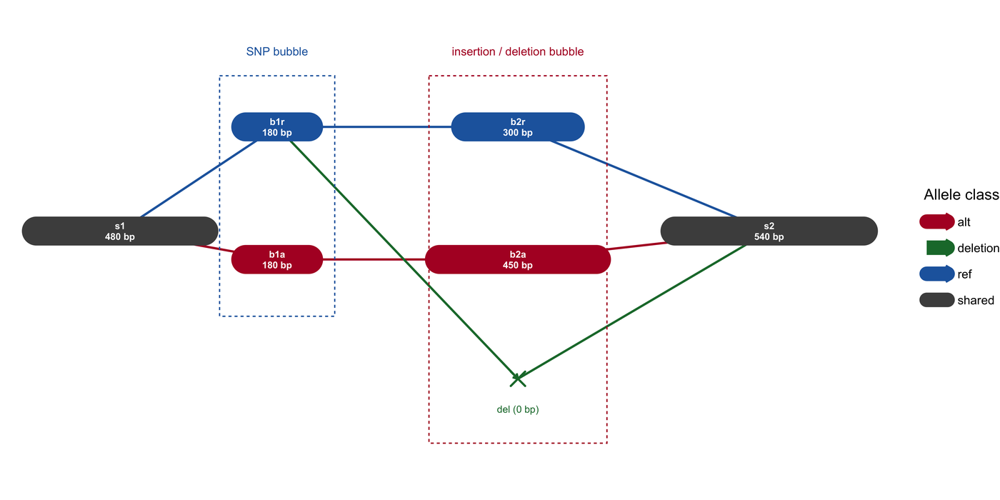

基因组图用网络取代线性参考：序列片段是节点，重叠与相邻关系是边，每个单倍型或组装体都是网络中的一条游走路径。这一图形族之所以重要，在于线性坐标无法在不丢失某个等位的情况下表示插入、重复或泛基因组 bubble。本教程从一份手工构建的小图出发，绘制组装与泛基因组工具的三种规范视图——**Bandage 风格组装图**、**sequence tube map bubble** 与 **odgi 风格一维路径排布**——使各种编码规则可以用肉眼核验。

## 示例

{fig-alt="基因组组装图 DEMO" fig-align="center" width="85%"}

1.5 kb 参考路径、含两个变异位点的组装图：节点宽度编码片段长度，共有片段为灰色，参考等位为蓝色、备选等位为红色，长度为零的缺失节点则显式标出。SNP bubble 分出 180 bp 参考路径与 180 bp 备选路径；插入/缺失 bubble 分出 300 bp 参考、450 bp 插入与零长度缺失标记。线性参考无法同时表达两条路径，这正是需要图结构的原因。

## Setup

-   系统要求：跨平台（Linux/MacOS/Windows）

-   编程语言：R

-   依赖包： `ggplot2`; `dplyr`; `tidyr`; `igraph`; `ggraph`; `patchwork`

```{r packages setup, message=FALSE, warning=FALSE, output=FALSE}
if (!requireNamespace("ggplot2", quietly = TRUE)) install.packages("ggplot2")
if (!requireNamespace("dplyr", quietly = TRUE)) install.packages("dplyr")
if (!requireNamespace("tidyr", quietly = TRUE)) install.packages("tidyr")
if (!requireNamespace("igraph", quietly = TRUE)) install.packages("igraph")
if (!requireNamespace("ggraph", quietly = TRUE)) install.packages("ggraph")
if (!requireNamespace("patchwork", quietly = TRUE)) install.packages("patchwork")

library(ggplot2)
library(dplyr)
library(tidyr)
library(igraph)
library(ggraph)
library(patchwork)
```

```{r}
sessioninfo::session_info("attached")
```

## 数据准备

真实 GFA 文件很大，但所有版式规则在七个节点的图上都能看清。我们建模的图取自三条单倍型——共享左翼、**SNP bubble**、**150 bp 插入**、同一第二位点的**缺失等位**以及共享右翼——长度全部由数据推导而非另写一遍：参考路径 480 + 180 + 300 + 540 = 1,500 bp，最长单倍型路径 480 + 180 + 450 + 540 = 1,650 bp，全部节点长度之和为 2,130 bp。片段长度作为独立列保存，因为节点宽度必须编码它——用等宽节点画图会掩盖哪个等位其实更长。

```{r load data, message=FALSE, warning=FALSE}
set.seed(4353)

## segments: GFA `S` lines (name, length, GC content for colouring)
segments <- tibble(
  seg    = c("s1", "b1r", "b1a", "b2r", "b2a", "del", "s2"),
  length = c(480,  180,   180,   300,   450,   0,   540),
  gc     = c(0.44, 0.39,  0.61,  0.45,  0.47,  NA,  0.43),
  allele = c("shared", "SNP_ref", "SNP_alt", "INS_ref", "INS_alt",
             "deletion", "shared")
)

## links: GFA `L` lines (from, to, orientation), with an overlap length
links <- tibble(
  from = c("s1", "s1", "b1r", "b1a", "b2r", "b2a", "b1r", "del"),
  to   = c("b1r", "b1a", "b2r", "b2a", "s2", "s2", "del", "s2"),
  ovlp = c(60, 60, 60, 60, 70, 70, 0, 0),
  kind = c("ref", "alt", "ref", "alt", "ref", "alt", "deletion", "deletion")
)

## walks: each haplotype as an ordered segment path
paths <- tribble(
  ~haplotype, ~step, ~seg,
  "H1 (reference)", 1, "s1", "H1 (reference)", 2, "b1r",
  "H1 (reference)", 3, "b2r", "H1 (reference)", 4, "s2",
  "H2 (SNP + ins)", 1, "s1", "H2 (SNP + ins)", 2, "b1a",
  "H2 (SNP + ins)", 3, "b2a", "H2 (SNP + ins)", 4, "s2",
  "H3 (deletion)",  1, "s1", "H3 (deletion)",  2, "b1r",
  "H3 (deletion)",  3, "del", "H3 (deletion)",  4, "s2"
)

segments |>
  left_join(paths |> count(seg, name = "n_paths"), by = "seg") |>
  replace_na(list(n_paths = 0))
```

## 可视化

### 1. 以片段长度为节点宽度的组装图

Bandage 约定：每个片段一个节点，节点宽度与片段长度成正比，凡两片段可以相接即连一条边。这里显式画出两个变异位点——SNP bubble（参考 180 bp、备择 180 bp）与插入/缺失 bubble（参考 300 bp、插入 450 bp、零长度缺失）——读者无需读 GFA 即可追踪每条单倍型。

```{r}
#| label: fig-1.1AssemblyGraph
#| fig-cap: "1.5 kb 参考路径、含两个变异位点的组装图：节点宽度编码片段长度，共享片段为灰色，参考等位为蓝色、备选等位为红色，零长度缺失节点显式标出。"
#| out.width: "96%"
#| warning: false
#| message: false
#| fig-width: 9.2
#| fig-height: 4.6
#| fig-dpi: 300

nodes <- segments |>
  left_join(
    tribble(
      ~seg, ~x, ~y,
      "s1", 1.0, 0.00,
      "b1r", 2.5, 0.55,
      "b1a", 2.5, -0.15,
      "b2r", 4.8, 0.55,
      "b2a", 4.8, -0.15,
      "del", 4.8, -0.78,
      "s2", 7.2, 0.00
    ),
    by = "seg"
  ) |>
  mutate(
    cls = case_when(
      endsWith(allele, "_ref") ~ "ref",
      endsWith(allele, "_alt") ~ "alt",
      allele == "deletion" ~ "deletion",
      TRUE ~ "shared"
    ),
    w = pmax(0.40, length / 300)
  )

edges <- links |>
  left_join(nodes |> select(seg, x, y), by = c("from" = "seg")) |>
  left_join(nodes |> select(seg, xend = x, yend = y),
            by = c("to" = "seg"))

box <- nodes |> filter(length > 0)
deleted <- nodes |> filter(length == 0)

ggplot() +
  geom_curve(data = edges,
             aes(x, y, xend = xend, yend = yend, colour = kind),
             curvature = 0, linewidth = 0.7,
             arrow = arrow(length = unit(1.3, "mm"), type = "open")) +
  geom_segment(data = box |> mutate(x0 = x - w / 2, x1 = x + w / 2),
               aes(x = x0, y = y, xend = x1, yend = y, colour = cls),
               linewidth = 9, lineend = "round") +
  geom_point(data = deleted, aes(x, y), shape = 4, size = 3.8,
             stroke = 1.0, colour = "#1B7837") +
  geom_text(data = deleted, aes(x, y - 0.16, label = "del (0 bp)"),
            size = 2.3, colour = "#1B7837") +
  geom_text(data = box,
            aes(x, y, label = paste0(seg, "\n", length, " bp")),
            colour = "white", size = 2.2, lineheight = 0.95,
            fontface = "bold") +
  annotate("rect", xmin = 1.95, xmax = 3.05, ymin = -0.45, ymax = 0.82,
           fill = NA, colour = "#2166AC", linetype = "22", linewidth = 0.4) +
  annotate("text", x = 2.50, y = 0.95, label = "SNP bubble",
           size = 2.7, colour = "#2166AC") +
  annotate("rect", xmin = 4.18, xmax = 5.42, ymin = -1.12, ymax = 0.82,
           fill = NA, colour = "#B2182B", linetype = "22", linewidth = 0.4) +
  annotate("text", x = 4.80, y = 0.95, label = "insertion / deletion bubble",
           size = 2.7, colour = "#B2182B") +
  scale_colour_manual(values = c(shared = "#4D4D4D", ref = "#2166AC",
                                 alt = "#B2182B", deletion = "#1B7837"),
                      name = "Allele class") +
  coord_cartesian(xlim = c(0.25, 8.20), ylim = c(-1.30, 1.10), clip = "off") +
  theme_void(base_size = 10) +
  theme(legend.position = "right")
```

### 2. Sequence tube map 分支视图

sequence tube map 把每条单倍型画成一根彩色管道。在变异位点，管道物理上分开成为等位专属车道后再汇合，因此插入是一段*绕行*，而不是页边注释。这里三条单倍型管道平行行进，并在 0.48–0.96 kb 的变异窗口处分叉。x 轴是**比对到参考序列的位置**，因此三条管道的两翼坐标完全一致；H2 的 150 bp 插入被压缩进同一段位，H3 缺失的 300 bp 参考区段则画成管道断开。两处绕行都非等比例，图内已注明。

```{r}
#| label: fig-1.2TubeMap
#| fig-cap: "以参考比对坐标为横轴的 sequence tube map 视图（0–1.50 kb）：三条单倍型管道在 0.48–0.96 kb 的变异窗口内分叉。H2 携带 SNP 与 150 bp 插入（画成压缩形式，绕行高度不是长度声明）；H3 携带零长度缺失等位，缺失了 0.30 kb 参考序列，故其管道在此断开。三条管道起止于同一比对坐标。"
#| out.width: "96%"
#| warning: false
#| message: false
#| fig-width: 9.2
#| fig-height: 4.4
#| fig-dpi: 300

## 参考序列上的比对坐标（kb）：s1 [0, 0.48]、b1/b2 [0.48, 0.96]、
## s2 [0.96, 1.50]。因此三条管道都从 0 起、到 1.50 止，变异窗口对三者是
## 同一段区间。
tube <- tribble(
  ~haplotype, ~x, ~y,
  "H1 (reference)", 0.00, 0.40, "H1 (reference)", 1.50, 0.40,
  "H2 (SNP + ins)", 0.00, 0.00, "H2 (SNP + ins)", 0.48, 0.00,
  "H2 (SNP + ins)", 0.68, 0.95, "H2 (SNP + ins)", 0.90, 0.95,
  "H2 (SNP + ins)", 0.96, 0.00, "H2 (SNP + ins)", 1.50, 0.00,
  "H3 (deletion)",  0.00, -0.40, "H3 (deletion)",  0.66, -0.40,
  "H3 (deletion)",  0.96, -0.40, "H3 (deletion)",  1.50, -0.40
)

## 缺失意味着 H3 没有参考序列 [0.66, 0.96] 这一段，所以把管道断开，
## 而不是弯成一个凹槽。
del_gap <- tibble(x = 0.66, xend = 0.96, y = -0.40, yend = -0.40)

tube_cols <- c("H1 (reference)" = "#4D4D4D",
               "H2 (SNP + ins)" = "#2166AC",
               "H3 (deletion)"  = "#1B7837")

ggplot(tube, aes(x, y, colour = haplotype)) +
  geom_path(aes(group = haplotype), linewidth = 8, lineend = "round",
            linejoin = "round", alpha = 0.9) +
  ## 在被缺失的 300 bp 参考区段处断开 H3。
  geom_segment(data = del_gap, aes(x = x, xend = xend, y = y, yend = yend),
               inherit.aes = FALSE, colour = "white", linewidth = 9) +
  geom_point(data = tube |> filter(x %in% c(0.48, 0.96)),
             aes(x, y), size = 0.9, colour = "white", alpha = 0.8) +
  annotate("rect", xmin = 0.48, xmax = 0.96, ymin = -1.12, ymax = 1.12,
           fill = NA, colour = "#8C510A", linetype = "22", linewidth = 0.4) +
  annotate("text", x = 0.72, y = 1.34, size = 2.7, colour = "#8C510A",
           label = "variant window (alignment 0.48-0.96 kb; not to scale)") +
  annotate("text", x = 0.79, y = 1.05, size = 2.6, colour = "#2166AC",
           label = "SNP (G) + 150 bp insertion, shown compressed") +
  annotate("text", x = 0.72, y = -1.02, size = 2.6, colour = "#1B7837",
           label = "deletion allele (0 bp): pipe breaks") +
  scale_colour_manual(values = tube_cols, name = "Haplotype pipe") +
  scale_x_continuous(breaks = c(0, 0.48, 0.96, 1.50),
                     labels = c("0", "0.48", "0.96", "1.50")) +
  coord_cartesian(xlim = c(0, 1.62), ylim = c(-1.18, 1.42)) +
  labs(x = "reference alignment position (kb)", y = NULL) +
  theme_classic(base_size = 10.5) +
  theme(axis.line.y = element_blank(), axis.text.y = element_blank(),
        axis.ticks.y = element_blank(), legend.position = "right")
```

### 3. 一维路径排布

大型泛基因组图的力导向排布会变成"毛线团"。odgi 约定改为按节点在选定参考路径上的位置排序，并把各路径堆叠成行——牺牲拓扑完整性，换来在数百条单倍型之间的可读性与可比性。

```{r}
#| label: fig-1.3PathLayout
#| fig-cap: "路径引导的一维排布：每行一条单倍型，每个节点按参考顺序定位，等位框按变异类别着色。"
#| out.width: "95%"
#| warning: false
#| message: false
#| fig-width: 9.2
#| fig-height: 3.4
#| fig-dpi: 300

allele_cols <- c(shared = "#4D4D4D", SNP_ref = "#2166AC",
                 SNP_alt = "#B2182B", INS_ref = "#4393C3",
                 INS_alt = "#D6604D", deletion = "#1B7837")

path_df <- paths |>
  left_join(segments, by = "seg") |>
  group_by(haplotype) |>
  mutate(
    ref_pos = cumsum(lag(replace_na(length, 0), default = 0))
  ) |>
  ungroup() |>
  mutate(
    row = as.integer(factor(haplotype, levels = c("H1 (reference)",
                                                  "H2 (SNP + ins)",
                                                  "H3 (deletion)"))),
    node_y = -row * 1.0
  )

ggplot(path_df) +
  geom_rect(data = filter(path_df, length > 0),
            aes(xmin = ref_pos, xmax = ref_pos + length,
                ymin = node_y - 0.34, ymax = node_y + 0.34,
                fill = allele), colour = "white", linewidth = 0.7) +
  geom_text(data = filter(path_df, length > 0),
            aes(ref_pos + length / 2, node_y, label = seg,
                colour = ifelse(gc > 0.55, "white", "#1B1B1B")),
            size = 2.4, show.legend = FALSE) +
  geom_point(data = filter(path_df, length == 0),
             aes(ref_pos, node_y), shape = 4, size = 2.8, stroke = 0.9,
             colour = "#1B7837") +
  geom_text(data = filter(path_df, length == 0),
            aes(ref_pos, node_y + 0.23, label = "del 0 bp"),
            size = 2.2, colour = "#1B7837") +
  scale_fill_manual(values = allele_cols, name = "Allele class") +
  scale_colour_identity() +
  scale_y_continuous(breaks = c(-1, -2, -3),
                     labels = c("H1 (reference)", "H2 (SNP + ins)",
                                "H3 (deletion)")) +
  scale_x_continuous(expand = c(0.01, 0)) +
  labs(x = "Reference-ordered position (bp)", y = NULL,
       title = "Path-guided 1D layout",
       subtitle = "Nodes ordered by the H1 path; branch alleles keep their own length") +
  theme_classic(base_size = 10.5) +
  theme(plot.title = element_text(face = "bold", size = 10.5),
        plot.subtitle = element_text(colour = "#4D4D4D", size = 8.8),
        axis.line.y = element_blank(), axis.ticks.y = element_blank())
```

::: callout-tip
**实践要点**

-   节点宽度必须编码片段长度。等宽节点会把长插入与单碱基 SNP 画成同一视觉对象，这是组装图最常见的误导方式。
-   对长度为零的缺失节点给出显式标记（圆点或留空），而不是省略；缺失是两翼之间的一条边，隐藏它会让两条单倍型看起来完全相同。
-   在 tube map 中要先把管道分开再绘制。变异位点处管道重叠不可读，并且暗示了图本身否定的等同关系。
-   超出玩具规模时应优先用一维路径排布。力导向排布适合展示，不适合比较数十条单倍型。
-   Bandage、BandageJS、gfaestus、gfalook、sequenceTubeMap、odgi 与 ggbandage/ggtubemap 是参考实现；其中若干是 GUI、GPU 或仅 GitHub 分发的构建，为一张静态图引入会带来沉重工具链，因此本页用 ggplot2 复现其版式规则。
:::

## 关于本页跳过的实现

本页刻意只用基础图形自行绘制。在 issue-435 清单中归到 Omics/GenomeGraphPlot 的工具里，有 3 条被标记为**跳过**，仅作为版式参考、不作为依赖：其中 3 条超过 5 年无运维更新（截止日 2021-11-07），0 条依赖闭包过重，不值得为一张静态图引入。沿用这些工具，等于锁定已废弃的代码；安装另一批，则要把整套分析框架拖进文档构建。本页先把这些工具的图形约定读懂，再自行重画，以便逐行核验每个面板。

| 工具 | 最近提交 | 状态 | 跳过原因 |
| --- | --- | --- | --- |
| Bandage | — | 非静态 | 无法静态复现 |
| BandageJS | — | 非静态 | 无法静态复现 |
| IGGE | 2021-04-11 | 陈旧 | 超过 5 年无运维更新 |

## 应用

图版式现已是三类场景的标准做法：**从头组装**（在 scaffold 之前浏览 unitig 与 bubble）、**泛基因组分析**（说明备择等位是一条路径，而不仅是对参考的变异调用）与**结构变异解读**（断点就是一条边）。用于发表时，从 GFA 手工截取的小子图通常比整图截图更有信息量，也便于在图注中说明所采用的 overlap 与长度阈值。

## 参考资料

\[1\] Wick RR, Schultz MB, Zobel J, Holt KE. Bandage: interactive visualization of de novo genome assemblies. Bioinformatics. 2015;31(20):3350-3352. doi:10.1093/bioinformatics/btv383

\[2\] Beyer W, Novak AM, Hickey G, et al. Sequence tube maps: making graph genomes intuitive to commuters. Bioinformatics. 2019;35(24):5318-5320. doi:10.1093/bioinformatics/btz597

\[3\] Guarracino A, Heumos S, Nahnsen S, Prins P, Garrison E. ODGI: understanding pangenome graphs. Bioinformatics. 2022;38(13):3319-3326. doi:10.1093/bioinformatics/btac308

\[4\] Eggertsson HP, Jonsson H, Kristmundsdottir S, et al. Graphtyper enables population-scale genotyping using pangenome graphs. Nat Genet. 2017;49(11):1654-1660. doi:10.1038/ng.3964
