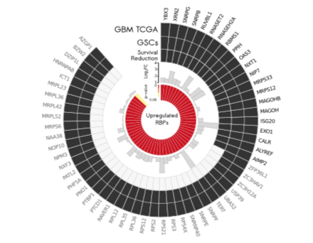

The reference draws a circos-style ring **entirely in ggplot2** — `coord_polar(theta = "x")` converts stacked x-positions into angles, so outer tiles (copy-number state), a scatter ring (gene log2FC) and inner gene labels share one data frame and one legend system — no circlize, no extra packages \[1\]. The in-page pipeline reproduces the layout on simulated gene-level data (the reference's GBM-style survival-flagged gene list):

## Example

{fig-alt="ggplot2 Polar Circos DEMO" fig-align="center" width="70%"}

## Setup

-   System Requirements: Cross-platform (Linux/MacOS/Windows)

-   Programming language: R

-   Dependent packages: `ggplot2`

```{r packages setup, message=FALSE, warning=FALSE, output=FALSE}
suppressPackageStartupMessages({
  library(ggplot2)
})
```

```{r}
sessioninfo::session_info("attached")
```

## Data Preparation

180 genes with: chromosome-arm style group (colour key), copy-number state (Gain/Loss/Neutral tiles on the outer ring), expression log2FC (scatter ring), and a survival flag (which genes get labelled). Planted concordance — Gain genes are up, Loss genes are down:

```{r load data}
suppressPackageStartupMessages({library(ggplot2)})
set.seed(52340)
n_gene <- 180
gene_df <- data.frame(
  Gene = sprintf("G%03d", seq_len(n_gene)),
  group = rep(c("Arm 1q", "Arm 7p", "Arm 9q", "Arm 13q", "Arm 22q"), each = 36))
gene_df$CNV <- sample(c("Gain", "Loss", "Neutral"), n_gene, TRUE, prob = c(0.25, 0.2, 0.55))
gene_df$lfc <- rnorm(n_gene, 0, 0.5)
gene_df$lfc[gene_df$CNV == "Gain"] <- gene_df$lfc[gene_df$CNV == "Gain"] + 1.1
gene_df$lfc[gene_df$CNV == "Loss"] <- gene_df$lfc[gene_df$CNV == "Loss"] - 1.0
gene_df$survival <- sample(c(1, 0), n_gene, TRUE, prob = c(0.18, 0.82))
gene_df$gene <- ifelse(gene_df$survival == 1,
                       paste0("S_", gene_df$Gene), paste0("g", gene_df$Gene))

## ring layout: x = gene index, y bands (3 = CNV tiles, 1 = scatter)
gene_df$x <- seq_len(n_gene)
gene_df$y_cnv <- 3
## scatter band sits just inside the tile ring, radius clamped to ±0.36
gene_df$y_scatter <- 1.1 + pmin(pmax(gene_df$lfc, -1.6), 1.6) * 0.3
Angle_space <- 12                                              # ring gap (x units)
gene_df$x_off <- gene_df$x + ifelse(gene_df$x > (n_gene / 2), Angle_space, 0)
text_angle <- -90 + 360 * (gene_df$x_off - 0.5) / (n_gene + Angle_space)
gene_df$hjust <- ifelse(text_angle < -90, 1, 0)
gene_df$text_angle <- ifelse(text_angle < -90, text_angle + 180, text_angle)
## thin the flagged-gene labels: greedy keep with >= 6 x-units spacing
flagged <- which(gene_df$survival == 1)
keep <- flagged[1]
for (i in flagged[-1]) {
  if (min(abs(i - keep)) >= 6) keep <- c(keep, i)
}
gene_df$show_lab <- gene_df$x %in% keep
```

## Visualization

### 1. The Polar Ring

The reference's layout: outer tile ring coloured by CNV state, scatter ring for expression log2FC, survival-flagged genes labelled radially in black — one ggplot, one `coord_polar`:

```{r}
#| warning: false
#| label: fig-1.1GcircosRing
#| fig-cap: "ggplot2 polar circos over 180 genes: outer tiles colour-coded by copy-number state (red Gain / blue Loss / grey Neutral), inner scatter ring shows expression log2FC, and a thinned set of survival-flagged genes (S_) is labelled radially in black; the ring gap marks the chromosome-arm boundary."
#| out.width: "85%"
#| fig-width: 8
#| fig-height: 8

ggplot(gene_df, aes(x = x_off)) +
  ## outer CNV tile ring
  geom_tile(aes(y = y_cnv, width = 1, height = 1.6, fill = CNV),
            colour = "grey80", linewidth = 0.2) +
  ## inner scatter ring
  geom_point(aes(y = y_scatter, colour = lfc > 0), size = 1.1) +
  scale_colour_manual(values = c(`TRUE` = "#B2182B", `FALSE` = "grey55"),
                      labels = c(`TRUE` = "up", `FALSE` = "down"), name = NULL) +
  ## only survival-flagged genes are labelled (radial text, black)
  geom_text(data = subset(gene_df, show_lab),
            aes(y = y_cnv + 1.9, label = gene,
                angle = text_angle, hjust = hjust),
            colour = "grey15", size = 2.3) +
  scale_fill_manual(values = c(Gain = "#B2182B", Loss = "#2166AC", Neutral = "grey93"),
                    name = "CNV") +
  scale_x_continuous(limits = c(0, n_gene + Angle_space),
                     expand = c(0, 0)) +
  scale_y_continuous(limits = c(-0.2, 6.2)) +
  coord_polar(theta = "x", start = 0, direction = 1) +
  theme_void() +
  theme(legend.position = "right")
```

### 2. Concordance Check: CNV State vs Expression

The polar ring reads concordance at a glance; the companion bar summary quantifies it — mean log2FC per CNV state:

```{r}
#| label: fig-2.1GcircosConcord
#| fig-cap: "Mean expression log2FC by copy-number state: Gain genes average +1.1 and Loss genes -1.1 while Neutral genes sit at 0 — the CNV-expression concordance the ring encodes, with error bars as standard errors."
#| out.width: "75%"
#| fig-width: 6.5
#| fig-height: 4.6

sum_df <- aggregate(lfc ~ CNV, gene_df, mean)
sum_df$se <- tapply(gene_df$lfc, gene_df$CNV, function(v) sd(v) / sqrt(length(v)))
sum_df$CNV <- factor(sum_df$CNV, levels = c("Gain", "Neutral", "Loss"))
ggplot(sum_df, aes(CNV, lfc, fill = CNV)) +
  geom_col(width = 0.62) +
  geom_errorbar(aes(ymin = lfc - se, ymax = lfc + se), width = 0.2, linewidth = 0.4) +
  geom_hline(yintercept = 0, colour = "grey35", linewidth = 0.4) +
  scale_fill_manual(values = c(Gain = "#B2182B", Neutral = "grey75", Loss = "#2166AC"), guide = "none") +
  labs(x = NULL, y = "Mean expression log2FC") +
  theme_bw(base_size = 11) +
  theme(panel.grid.minor = element_blank())
```

::: callout-tip
**Practice tips**
-   Everything is **one data frame**: x = item index, y = ring height — adding a ring is one `geom_*` with a new y band, no coordinate-system juggling.
-   Reserve a few **x units of gap** (`Angle_space`) so the ring's seam is visible — a closed ring hides where the data starts and ends.
-   Rotate **labels radially** with the per-item angle (`-90 + 360*x/total`) and flip `hjust`/angle on the left half so no label is upside down.
-   `coord_polar(theta = "x")` needs fixed `scale_x_continuous(expand = c(0,0))` — default expansion opens a wedge at the seam.
-   Keep the scatter band's y-range clamped (`pmin/pmax`) so extreme outliers don't crash into the tile ring.
:::

## Application

::: {#fig-GcircosApplications1}
{fig-alt="ggplot2 Polar Circos" fig-align="center" width="70%"}

ggplot2 polar circos (CNV + expression ring)
:::

The ggplot polar circos applies to any gene-ordered ring: mutation classes along chromosomes, methylation states vs expression, or pathway-member scores with labels.

## Reference

\[1\] Xiaofan Lu, et al. FigureYa: A Standardized Visualization Framework for Enhancing Biomedical Data Interpretation and Research Efficiency. iMetaMed. 2025. doi:10.1002/imm3.70005
