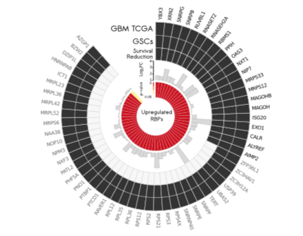

参考用**纯 ggplot2** 画 circos 风格环形图——`coord_polar(theta = "x")` 把堆叠的 x 位置转换为角度，使外层 tile（拷贝数状态）、散点环（基因 log2FC）与基因标签共用一个数据框、一套图例系统——不需要 circlize 或额外包 \[1\]。页内管线在模拟的基因级数据上复现该布局（参考的 GBM 风格生存标记基因列表）：

## Example

{fig-alt="ggplot2 极坐标 Circos DEMO" fig-align="center" width="70%"}

## Setup

-   系统要求：跨平台（Linux/MacOS/Windows）

-   编程语言：R

-   依赖包：`ggplot2`

```{r packages setup, message=FALSE, warning=FALSE, output=FALSE}
suppressPackageStartupMessages({
  library(ggplot2)
})
```

```{r}
sessioninfo::session_info("attached")
```

## 数据准备

180 个基因，带：染色体臂式分组（颜色键）、拷贝数状态（外环 Gain/Loss/Neutral tile）、表达 log2FC（散点环）与生存标记（哪些基因被标注）。植入一致性——Gain 基因上调、Loss 基因下调：

```{r load data}
suppressPackageStartupMessages({library(ggplot2)})
set.seed(52340)
n_gene <- 180
gene_df <- data.frame(
  Gene = sprintf("G%03d", seq_len(n_gene)),
  group = rep(c("Arm 1q", "Arm 7p", "Arm 9q", "Arm 13q", "Arm 22q"), each = 36))
gene_df$CNV <- sample(c("Gain", "Loss", "Neutral"), n_gene, TRUE, prob = c(0.25, 0.2, 0.55))
gene_df$lfc <- rnorm(n_gene, 0, 0.5)
gene_df$lfc[gene_df$CNV == "Gain"] <- gene_df$lfc[gene_df$CNV == "Gain"] + 1.1
gene_df$lfc[gene_df$CNV == "Loss"] <- gene_df$lfc[gene_df$CNV == "Loss"] - 1.0
gene_df$survival <- sample(c(1, 0), n_gene, TRUE, prob = c(0.18, 0.82))
gene_df$gene <- ifelse(gene_df$survival == 1,
                       paste0("S_", gene_df$Gene), paste0("g", gene_df$Gene))

## ring layout: x = gene index, y bands (3 = CNV tiles, 1 = scatter)
gene_df$x <- seq_len(n_gene)
gene_df$y_cnv <- 3
## scatter band sits just inside the tile ring, radius clamped to ±0.36
gene_df$y_scatter <- 1.1 + pmin(pmax(gene_df$lfc, -1.6), 1.6) * 0.3
Angle_space <- 12                                              # ring gap (x units)
gene_df$x_off <- gene_df$x + ifelse(gene_df$x > (n_gene / 2), Angle_space, 0)
text_angle <- -90 + 360 * (gene_df$x_off - 0.5) / (n_gene + Angle_space)
gene_df$hjust <- ifelse(text_angle < -90, 1, 0)
gene_df$text_angle <- ifelse(text_angle < -90, text_angle + 180, text_angle)
## thin the flagged-gene labels: greedy keep with >= 6 x-units spacing
flagged <- which(gene_df$survival == 1)
keep <- flagged[1]
for (i in flagged[-1]) {
  if (min(abs(i - keep)) >= 6) keep <- c(keep, i)
}
gene_df$show_lab <- gene_df$x %in% keep
```

## Visualization

### 1. 极坐标环

参考的布局：外层 tile 环按 CNV 状态着色、散点环展示表达 log2FC、按间隔稀疏标注的生存标记基因（S_）以黑色径向文字呈现——一张 ggplot、一个 `coord_polar`：

```{r}
#| label: fig-1.1GcircosRing
#| fig-cap: "180 个基因的 ggplot2 极坐标 circos：外层 tile 按拷贝数状态着色（红 Gain / 蓝 Loss / 灰 Neutral），内层散点环展示表达 log2FC，按间隔稀疏标注的生存标记基因（S_）以黑色径向文字呈现；环缺口标记染色体臂边界。"
#| out.width: "85%"
#| fig-width: 8
#| fig-height: 8

ggplot(gene_df, aes(x = x_off)) +
  ## outer CNV tile ring
  geom_tile(aes(y = y_cnv, width = 1, height = 1.6, fill = CNV),
            colour = "grey80", linewidth = 0.2) +
  ## inner scatter ring
  geom_point(aes(y = y_scatter, colour = lfc > 0), size = 1.1) +
  scale_colour_manual(values = c(`TRUE` = "#B2182B", `FALSE` = "grey55"),
                      labels = c(`TRUE` = "up", `FALSE` = "down"), name = NULL) +
  ## only survival-flagged genes are labelled (radial text, black)
  geom_text(data = subset(gene_df, show_lab),
            aes(y = y_cnv + 1.9, label = gene,
                angle = text_angle, hjust = hjust),
            colour = "grey15", size = 2.3) +
  scale_fill_manual(values = c(Gain = "#B2182B", Loss = "#2166AC", Neutral = "grey93"),
                    name = "CNV") +
  scale_x_continuous(limits = c(0, n_gene + Angle_space),
                     expand = c(0, 0)) +
  scale_y_continuous(limits = c(-0.2, 6.2)) +
  coord_polar(theta = "x", start = 0, direction = 1) +
  theme_void() +
  theme(legend.position = "right")
```

### 2. 一致性检查：CNV 状态 vs 表达

极坐标环一眼可读一致性；补充条形汇总将其量化——各 CNV 状态的平均 log2FC：

```{r}
#| label: fig-2.1GcircosConcord
#| fig-cap: "各拷贝数状态的平均表达 log2FC：Gain 基因平均 +1.1、Loss 基因 -1.0 而 Neutral 基因在 0——环形图编码的 CNV-表达一致性，误差棒为标准误。"
#| out.width: "75%"
#| fig-width: 6.5
#| fig-height: 4.6

sum_df <- aggregate(lfc ~ CNV, gene_df, mean)
sum_df$se <- tapply(gene_df$lfc, gene_df$CNV, function(v) sd(v) / sqrt(length(v)))
sum_df$CNV <- factor(sum_df$CNV, levels = c("Gain", "Neutral", "Loss"))
ggplot(sum_df, aes(CNV, lfc, fill = CNV)) +
  geom_col(width = 0.62) +
  geom_errorbar(aes(ymin = lfc - se, ymax = lfc + se), width = 0.2, linewidth = 0.4) +
  geom_hline(yintercept = 0, colour = "grey35", linewidth = 0.4) +
  scale_fill_manual(values = c(Gain = "#B2182B", Neutral = "grey75", Loss = "#2166AC"), guide = "none") +
  labs(x = NULL, y = "Mean expression log2FC") +
  theme_bw(base_size = 11) +
  theme(panel.grid.minor = element_blank())
```

::: callout-tip
**实践要点**
-   一切都在**一个数据框**里：x = 条目序号、y = 环高——加一圈就是加一个带新 y 带的 `geom_*`，无需坐标变换。
-   预留几**个 x 单位的缺口**（`Angle_space`）让环的接缝可见——闭合的环看不出数据从哪开始。
-   用逐条目角度（`-90 + 360*x/total`）**径向旋转标签**并在左半区翻转 `hjust`/角度，避免倒置文字。
-   稀疏标注密集的标记基因（贪心间距 ≥ 6 个 x 单位）——180 个全标必然互相叠印。
-   `coord_polar(theta = "x")` 需要 `scale_x_continuous(expand = c(0,0))` 固定——默认外扩会在接缝处张开楔形。
:::

## 应用场景

::: {#fig-GcircosApplications1}
{fig-alt="ggplot2 极坐标 Circos" fig-align="center" width="70%"}

ggplot2 极坐标 Circos（CNV + 表达环）
:::

ggplot 极坐标 circos 适用于任何按基因排序的环：沿染色体的突变类别、甲基化状态 vs 表达、或通路成员分数与标签。

## 参考文献

\[1\] Xiaofan Lu, et al. FigureYa: A Standardized Visualization Framework for Enhancing Biomedical Data Interpretation and Research Efficiency. iMetaMed. 2025. doi:10.1002/imm3.70005
